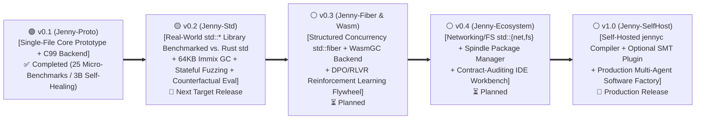

# 🗺️ Spinning Jenny (`Jenny`) Master Roadmap (`v0.1 -> v1.0`)

> **Document Role**: Master version roadmap index tracking **Spinning Jenny (`Jenny`)** from its initial concept prototype (**`v0.1`**) to a self-hosted, industrial-grade AI-native systems programming language (**`v1.0`**).  
> 🌐 **Language**: **English** | **[简体中文 (`ROADMAP_zh.md`)](./ROADMAP_zh.md)**

---

## 1. Global Version Panorama (`v0.1` $\rightarrow$ `v1.0`)

---

## 2. Versioned Roadmap Index (`docs/roadmap/`)

| Version | Codename & Focus | Compiler & Runtime Track (`Compiler Track`) | Standard Library & PL-LLM Track (`Std & PL-LLM Track`) | Status | Detailed Roadmap (`docs/roadmap/`) |
| :--- | :--- | :--- | :--- | :---: | :--- |
| **`v0.1`** | **`Jenny-Proto`** AI-Native Language Core & C99 Transpiler Prototype | • Completed internal Stages 0–4 (`v0.1.0-alpha1` $\rightarrow$ `v0.1.0`) • `.jni`/`.jn` separation, 3-mode parameters, dual-track memory (`*T`/`*in(arena)`/`^T` pooled prototype), 3-track closures, 16B `AnyError`, `@spin` white-box expansion, C99 backend, and `--fuzz`/`--mutate` prototypes | • Built 25 single-file micro-benchmarks (`B01`–`B25`) • Measured overall `TCR = 0.6833`, `TCR_impl = 0.2197`, `ECC_self = 65.31%` • Local `qwen2.5-coder:3b` 18-module skeleton completion: `Pass@1 = 50%` $\rightarrow$ `Heal@2 = 100%` | 🟢 **Completed** *(2026-10-17)* | 📄 **[`docs/roadmap/roadmap_v0.1.md`](./docs/roadmap/roadmap_v0.1.md)** ([中文](./docs/zh/roadmap/roadmap_v0.1.md)) |
| **`v0.2`** | **`Jenny-Std`** Real-World `std` Library Construction Benchmarked Against Rust `std` | • **M0.2.1**: Multi-module package system (`import std::*`), cross-file `.jni` ABI firewall & generic containers • **M0.2.2**: True 64KB block/line Immix mark-region GC + ASan/UBSan gate • **M0.2.3**: Stateful container method-sequence fuzzing (`10,000` random ops) + `--diff` oracle • **M0.2.4**: Unified `jenny` CLI & all-paths `E0108` check | • **P0.2.1**: Build real-world `std::{mem, collections, str, io, codec}` modules (`Vec`, `VecDeque`, `HashMap`, `LruCache`, `BufReader`, `PathBuf`) benchmarked directly against Rust `std` • **P0.2.2**: Same-model (`3b`/`7b`) counterfactual evaluation (Jenny `std` vs. Rust `std` `rustc` vs. Go) + quick-fix ablation • **P0.2.3**: Dual-Agent (Architect `.jni` + Coder `.jn`) `std` synthesis • **P0.2.4**: Native runtime performance benchmarks (`clang -O3` vs. `rustc -O3`) | 🟡 **Next Up** | 📄 **[`docs/roadmap/roadmap_v0.2.md`](./docs/roadmap/roadmap_v0.2.md)** ([中文](./docs/zh/roadmap/roadmap_v0.2.md)) |
| **`v0.3`** | **`Jenny-Fiber & Wasm`** Structured Concurrency, WasmGC & RLVR Flywheel | • Implement `std::fiber` (`fiber::all` / `fiber::race`) cooperative scheduler & `Send`/`Share` concurrency checks • Add WasmGC backend mapping `^T` to WasmGC `structref` | • Compiler-in-the-loop **QLoRA SFT + GRPO / RLVR** training pipeline using verified `std` & benchmark trajectories | ⚪ **Planned** | *(To be created after `v0.2`)* |
| **`v0.4`** | **`Jenny-Ecosystem`** OS Standard Library & Contract Auditing IDE Workbench | • Expand system standard library `std::{fs, net, time, process}` & `spindle` package resolver | • Upgrade `tools/vscode-jenny` into an interactive contract coverage & `--diff` auditing workbench | ⚪ **Planned** | *(To be created after `v0.3`)* |
| **`v1.0`** | **`Jenny-SelfHost`** Self-Hosted Compiler & Production Release | • Rewrite compiler frontend and borrow/effect checker in Jenny itself (`jennyc-self`) atop `std::*` | • Public release of `Jenny v1.0`, full `std` library, and fine-tuned model weights | ⚪ **Long-Term** | *(To be created after `v0.4`)* |
