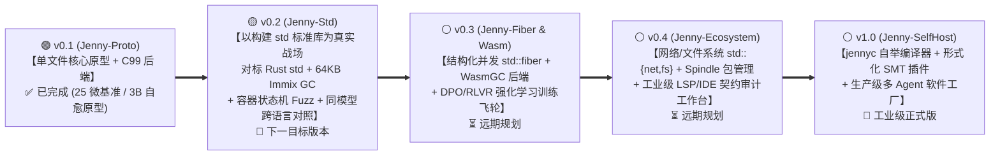

# 🗺️ Spinning Jenny (`Jenny`) 全局版本演进路线图总索引 (`v0.1 -> v1.0`)

> **文档定位**：本文件是 **Spinning Jenny (`Jenny`) 编程语言** 从概念验证原型（**`v0.1`**）迈向自举工业级 AI 原生系统语言（**`v1.0`**）的 **全局版本路线图总索引（Master Version Roadmap Index）**。  
> **版本化管理规范**：各主/次版本的详细里程碑拆解、双轨任务清单与准出验收指标，统一按版本号归档在 **[`docs/roadmap/`](./docs/roadmap/)** 目录下。  
> **双轨协同原则**：每一个版本的演进均由 **“编译器与运行时轨（Compiler & Runtime Track）”** 与 **“大模型实证与训练轨（PL-LLM Track）”** 双轨交织驱动，并严格遵循 [`AGENTS.md`](./AGENTS.md) 规定的 **`plan` (`docs/plan/`) $\rightarrow$ `log` (`docs/log/`) $\rightarrow$ `tests` (`docs/tests/`)** 闭环研发铁律。

---

## 1. 全局版本演进全景图 (`v0.1` $\rightarrow$ `v1.0`)

---

## 2. 分版本路线图导航与状态总表 (`docs/roadmap/`)

| 版本号 | 版本代号与核心定位 | 编译器与运行时轨核心目标 (`Compiler Track`) | 标准库实战与大模型实证轨核心目标 (`Std & PL-LLM Track`) | 当前状态 | 详细路线图文档 (`docs/roadmap/`) |
| :--- | :--- | :--- | :--- | :---: | :--- |
| **`v0.1`** | **`Jenny-Proto`** AI 原生语言核心与 C99 转译器原型 | • 完成 `Stage 0 (alpha1)` ~ `Stage 4 (v0.1.0)` 五步原型闭环 • `.jni`/`.jn` 分离、三态参数、双轨内存 (`*T`/`*in(arena)`/`^T` 池化原型)、三轨闭包、16B `AnyError`、`@spin` 白盒展开、C99 后端与 `--fuzz`/`--mutate` 原型 | • 构建 25 个单文件微基准（`B01`~`B25`） • 实测总体 `TCR = 0.6833`、`TCR_impl = 0.2197`、`ECC_self = 65.31%` • 本地 `qwen2.5-coder:3b` 18 题骨架补全 `Pass@1 = 50%` $\rightarrow$ `Heal@2 = 100%` | 🟢 **已完成** *(2026-10-17)* | 📄 **[`docs/roadmap/roadmap_v0.1.md`](./docs/roadmap/roadmap_v0.1.md)** |
| **`v0.2`** | **`Jenny-Std`** 以建设 `std` 标准库为真实战场，全面对标 Rust `std` | • **M0.2.1**：多模块包系统（`import std::*`）、跨文件 `.jni` 防火墙与容器泛型支持 • **M0.2.2**：真正的 64KB 块/行结构 Immix GC + ASan/UBSan 门禁 • **M0.2.3**：面向 `std` 容器的有状态方法序列 Fuzzing（10,000 步随机操作）+ `--diff` • **M0.2.4**：统一 `jenny` CLI 与全路径 `E0108` 检查 | • **P0.2.1**：告别生造测试题，实战构建 `std::{mem, collections, str, io, codec}` 五大标准库集群（`Vec`, `VecDeque`, `HashMap`, `LruCache`, `BufReader`, `PathBuf` 等） • **P0.2.2**：同模型（`3b`/`7b`）写 Jenny `std` vs Rust `std` (`rustc`) vs Go 对照与快修消融实验 • **P0.2.3**：双 Agent（Architect `.jni` + Coder `.jn`）协同构建 `std` 实测 • **P0.2.4**：Jenny `std` (`clang -O3`) vs Rust `std` (`rustc -O3`) 原生性能基准 | 🟡 **下一目标** *(Next Up)* | 📄 **[`docs/roadmap/roadmap_v0.2.md`](./docs/roadmap/roadmap_v0.2.md)** |
| **`v0.3`** | **`Jenny-Fiber & Wasm`** 结构化并发、WasmGC 后端与 RLVR 飞轮 | • 落地 `std::fiber`（`fiber::all` / `fiber::race`）协作式协程调度器与 `Send`/`Share` 并发安全检查 • 新增 WasmGC 原生后端（将 `^T` 直接映射为 WasmGC `structref`） | • 基于 `jenny` 毫秒级沙箱与 `std` 语料构建 Compiler-in-the-Loop **QLoRA SFT + GRPO / RLVR** 强化学习管线，训练 `Jenny-Coder` | ⚪ **规划中** | *(待 `v0.2` 准出后创建 `roadmap_v0.3.md`)* |
| **`v0.4`** | **`Jenny-Ecosystem`** 网络/文件系统标准库与契约审计 IDE 工作台 | • 扩展系统标准库 `std::{fs, net, time, process}` 与 `spindle` 包依赖解析器 | • 升级 `tools/vscode-jenny` 为支持 `.jni` 契约覆盖率可视化与一键 `--diff` 审计的人机协同工作台 | ⚪ **规划中** | *(待 `v0.3` 准出后创建 `roadmap_v0.4.md`)* |
| **`v1.0`** | **`Jenny-SelfHost`** 编译器自举与工业级正式版 | • 使用 Jenny 语言自身（依托 `v0.2`~`v0.4` 建成的 `std::*`）重写编译器核心前端与检查器（`jennyc-self`），实现自举 | • 开源发布 `Jenny v1.0` 工具链、完整 `std` 标准库与微调模型权重 | ⚪ **远期目标** | *(待 `v0.4` 准出后创建 `roadmap_v1.0.md`)* |

---

## 3. 当前版本状态摘要 (`v0.1` 已完成 $\rightarrow$ 准备启动 `v0.2`)

### 3.1 `v0.1` (`Jenny-Proto`) 已交付成果清单
* **语言规范**：[`docs/design/哲学与总纲.md`](./docs/design/哲学与总纲.md) 与 [`docs/design/specs/00~11`](./docs/design/specs/00_index_and_overview.md) 全套 v2.0 规范。
* **原型编译器**：[`compiler/jenny-nano/jenny_nano.py`](./compiler/jenny-nano/jenny_nano.py) 与 [`compiler/jenny-flow/jenny_flow.py`](./compiler/jenny-flow/jenny_flow.py) + C99 运行时 [`jenny_rt.h`](./compiler/jenny-flow/jenny_rt.h)。
* **25 模块微基准集 (`B01`~`B25`)**：[`benchmarks/`](./benchmarks/) 下共 75 个 `.jni` / `.jn` / `.rs` 源码文件，全部通过 `clang -std=c11 -O3` 原生编译、49 个 `@example` 沙箱、26 项故障回归（13 运行时 + 13 静态）与 `2,480` 次 `--fuzz` 调用。
* **技术论文与同行评审档案**：[`docs/paper/spinning_jenny_paper_zh.md`](./docs/paper/spinning_jenny_paper_zh.md)、[`docs/paper/spinning_jenny_paper_en.md`](./docs/paper/spinning_jenny_paper_en.md)、[`docs/paper/spinning_jenny_paper_review.md`](./docs/paper/spinning_jenny_paper_review.md) 与 [`docs/paper/review_v2.md`](./docs/paper/review_v2.md)。
* **完整归档详情**：请查阅 👉 **[`docs/roadmap/roadmap_v0.1.md`](./docs/roadmap/roadmap_v0.1.md)**。

### 3.2 `v0.2` (`Jenny-Std`) 启动聚焦重点（以 `std` 标准库建设作为真实业务演练场）
* 详见 👉 **[`docs/roadmap/roadmap_v0.2.md`](./docs/roadmap/roadmap_v0.2.md)**：
  1. **地基与容器核**：打通跨文件 `import std::*` (`M0.2.1`) + 64KB 块结构 Immix GC (`M0.2.2`) + 有状态容器 10,000 步随机序列 Fuzzing (`M0.2.3`)，率先落地 **`std::mem` (`ByteBuf`, `Arena`)** 与 **`std::collections` (`Vec`, `VecDeque`, `HashMap`, `LruCache`)**；
  2. **扩展标准库**：构建 **`std::str` (`StrView`, `StringBuf`)**、**`std::io` (`Cursor`, `BufReader`, `BufWriter`, `PathBuf`)** 与 **`std::codec`**，在真实多模块依赖链上验证 `.jni` ABI 防火墙与上下文节省率；
  3. **对标 Rust `std` 全面实证**：在全套 `std` 真实组件上开展 **同模型（`3b`/`7b`）写 Jenny `std` vs 写 Rust `std` (`rustc`) 对照实验、快修消融实验、双 Agent 协同生成实验与 `-O3` 原生性能对标**。
