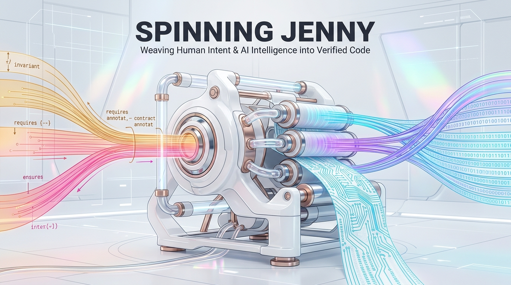
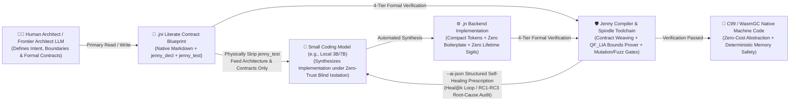
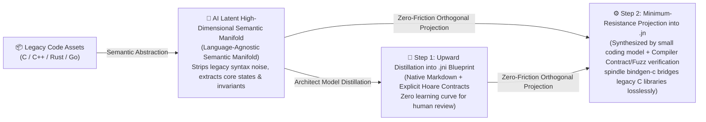
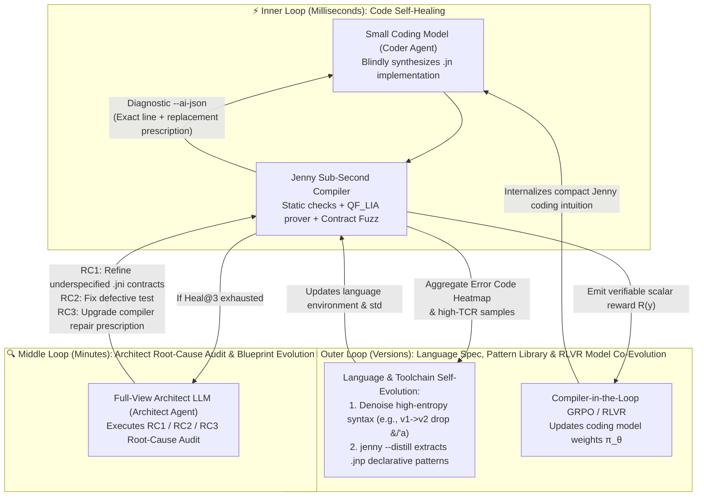
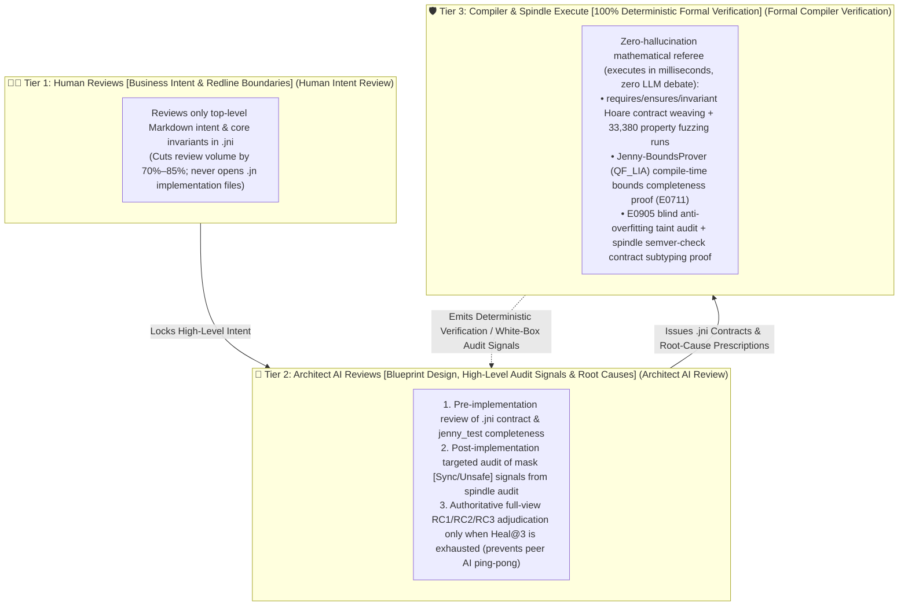
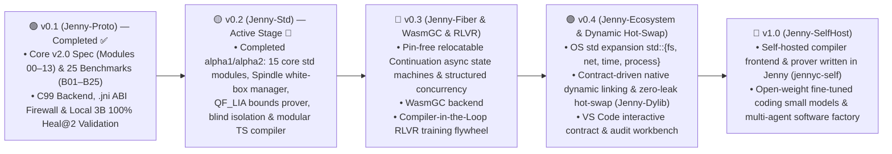

# Escaping the "Dark Forest" of Vibe Coding: Why We Designed the AI-Native Systems Programming Language Spinning Jenny from First Principles

> 🌐 **Language**: **English** | **[简体中文](../zh/articles/introducing_spinning_jenny_zh.md)**



> ***"In 1764, the Spinning Jenny wove the Industrial Revolution. Today, Jenny weaves Human Intent and AI Intelligence into verified computer code."***

---

## I. Introduction: When AI Generates 500 Lines of Code per Second, What Engineering Paradox Are We Trapped In?

Over the past two years, the software engineering community has experienced both the euphoria and the growing pains of what is now called **"Vibe Coding."**

Large Language Models (LLMs) have driven the marginal cost of raw code generation toward zero. Yet any engineer who has attempted to build serious systems software with AI—storage engines, network protocol stacks, high-concurrency runtimes, or financial core ledgers—quickly hits an invisible wall we call the **"Dark Forest Paradox of AI Coding"**:

1. **Traditional Programming Languages Were Designed for Human Keystrokes, Not Autoregressive Token Generation**:
   * **C / C++** grant AI boundless freedom, yet lack compile-time memory and bounds-safety contracts, making it trivially easy for AI to introduce subtle buffer overflows and Use-After-Free vulnerabilities;
   * **Rust** provides formidable safety guarantees, but its symbolic borrow checker (`&T`, `&mut T`, `&'a mut`), explicit lifetime gymnastics (`<'a, 'b: 'a>`), and strict single-owner tree discipline have become the #1 hallucination swamp for LLMs—even frontier models frequently spiral into multi-round compile-error loops when implementing doubly-linked lists, self-referential views, or complex closure captures;
   * **Go** is straightforward, but its repetitive `if err != nil` boilerplate and weak type expressiveness rapidly devour precious Context Window capacity in large-scale codebases.
2. **Human "Audit Blindness" vs. AI "Unchecked Hallucination"**:
   * Natural human language is inherently ambiguous and underspecified. When a human tosses out a vague prompt, the AI fills in edge cases via probabilistic guesswork and pours out thousands of lines of code far beyond the physiological limits of human reading comprehension.
   * When **architectural intent, interface contracts, and low-level implementation details** are tangled inside the same `.rs`, `.cpp`, or `.go` file, humans cannot review it all and dare not trust it; meanwhile, the AI cannot fit the cross-module call graph into its context window and is incentivized to hardcode shortcuts around unit tests (*Reward Hacking*). **Both humans and AI are left groping in the dark.**

What if a programming language were designed from day one not on the assumption that *"a human types every line of implementation code by hand,"* but derived from the **First Principles of Human-AI Collaborative Division of Labor**?

That is why **Spinning Jenny (`Jenny`, with `.jni` blueprints and `.jn` implementations)** was born.



---

## II. First Principles: From the Fundamental Differences Between Human Coding and AI Coding to Zero-Friction Migration

### 2.1 Root-Cause Analysis: Six Fundamental Differences Between Human Coding and AI Coding

Every mainstream programming language of the past 70 years—from C, C++, and Java to Go and Rust—was built on an unquestioned hidden axiom: **code is typed line by line by a biological human brain editing text non-linearly with a keyboard, typing slowly (~40 tokens/min) while relying on implicit common sense.**

When the primary executor of coding shifts to a Transformer-based autoregressive Large Language Model, the underlying physical laws flip completely:

| Core Dimension | 👨‍💻 Human Programmer (Biological Brain + Random-Access Editing) | 🤖 AI Coding Model (Autoregressive Sampling + Attention Window) | 💥 Mismatch Pain Points of Traditional Languages in the AI Era |
| :--- | :--- | :--- | :--- |
| **1. Physical Generation Mechanism**<br>*(Non-Linear Drafting vs. Unidirectional Causality)* | **Non-linear drafting with random cursor jumps**: Humans type slowly (~40 tokens/min), but upon realizing halfway through a function that a variable needs borrowing or a struct needs `<'a>`, they can jump back to line 1 and edit the signature at will. | **Strictly left-to-right unidirectional causal flow**: Generates rapidly (~5,000 tokens/min), but each emitted token cannot "reach back and rewrite earlier tokens." If a downstream call forces an upstream signature change, single-pass generation inevitably hallucinates. | Rust's upward-contagious `<'a>` lifetimes and implicit Moves forcing retroactive `&` annotations directly violate the unidirectional causal attention of autoregressive models. |
| **2. Memory & Context Bottleneck**<br>*(Short-Term Memory vs. Attention Dilution)* | **Tiny local working memory ($7 \pm 2$ chunks), but persistent global intuition**: Cannot memorize thousands of API signatures (relies on IDE autocomplete and syntactic sugar), yet maintains a stable mental model of the system. | **Vast parametric memory, but Effective Attention decays sharply with context length**: When 70% of the Context Window is stuffed with cross-module low-level implementation details and `if err != nil` boilerplate, *Lost-in-the-Middle* attention degradation sets in. | Traditional languages mix interface contracts and low-level implementations in the same `.rs`/`.go` file, polluting cross-module LLM context with massive implementation noise. |
| **3. Intent Comprehension & Edge Cases**<br>*(Implicit Common Sense vs. Probabilistic Completion)* | **Excels at unspoken common sense, dislikes writing formal contracts**: Humans intuitively know *"withdrawal amount cannot be negative, index cannot be out of bounds"* and view `requires` clauses as tedious ceremony. | **Zero common sense for unstated assumptions (pure probabilistic completion), but excels at solving within strict formal constraints**: Without explicit contracts, AI randomly drops edge cases; given first-class formal contracts, coding becomes high-precision mathematical constraint solving. | Traditional languages relegate contracts to non-binding `///` comments or separate `_test` files, causing catastrophic intent loss between human and AI. |
| **4. Behavior Toward Tests**<br>*(Causal Generalization vs. Reward Hacking)* | **Causal reasoning and engineering discipline**: Seeing `assert(f(2) == 4)`, a human understands it is a sample point and will not write `if x == 2 { return 4 }`. | **Pure objective optimization (*Reward Hacking*)**: If concrete test literals are visible during code generation, the model is strongly tempted to hardcode branches matching the test inputs to minimize loss. | Traditional workflows expose business code and unit tests in the same context without compiler-enforced *Zero-Trust Blind Test Isolation* or anti-overfitting taint analysis. |
| **5. Consuming Compiler Diagnostics**<br>*(Pedagogical Prose vs. Machine Prescriptions)* | **Needs human-readable prose explanations**: e.g., `rustc`'s 30-line ASCII art arrows and conversational hints. | **Needs high-SNR, structured JSON prescriptions with deterministic repair actions**: Verbose prose diagnostics pollute the self-healing context window; AI needs exact AST locations and `suggested_replacement`. | Traditional compiler diagnostics are formatted for human eyes rather than closed-loop agent self-healing (`Heal@k`) or verifiable reinforcement learning rewards (RLVR). |
| **6. Ultimate Bottleneck of System Evolution**<br>*(Typing Speed vs. Audit Bandwidth)* | Historically, the bottleneck was **how fast humans could type code**. | Today, the ultimate bottleneck is **the physiological bandwidth of humans reading and auditing AI-generated code** (~200 lines/hour for deep code review vs. 100+ lines/second of AI output). | Traditional languages force humans to review AI-generated low-level implementation code line by line, degenerating into rubber-stamp "Vibe Coding." |

---

### 2.2 The Five First Principles of Human-AI Collaboration and Language Evolution

From these six fundamental cognitive differences between humans and AI, we derive the **Five First Principles** of an AI-native programming language:

* **Principle 1: The Dual-Plane Cognitive Decoupling Law (Humans Guard `.jni` Contracts, AI Weaves `.jn` Implementations)**
  * Because human scarcity lies in **attention and intent definition** while AI scarcity lies in **context purity and constraint determinism**, humans and AI must never be forced to crowd into the same source file.
  * Source code is physically split into two orthogonal planes: the **`.jni` (Intent & Contract Plane)** aligns with human cognitive strengths, using native Markdown to articulate architecture alongside high-density `jenny_decl` (types, signatures, Hoare contracts) and `jenny_test` (acceptance assertions), cutting human review volume by over 70%; the **`.jn` (Backend Implementation Plane)** aligns with small coding models, synthesized automatically under zero-trust blind isolation where `jenny_test` is physically stripped.
* **Principle 2: The Autoregressive-Friendly Law (Eliminating Backward Contagion & Sigil Noise)**
  * Language syntax must flow naturally with left-to-right Transformer attention, never forcing a later line of code to retroactively alter an earlier type signature or lifetime parameter.
  * Jenny sets default parameter semantics to **read-only borrow (`x: T`)** to eliminate accidental Moves; **automatically infers stack-bound views** for slice-containing structs to eliminate `<'a>` contagion; and introduces **`mask [...]` controlled side-effect masking** so locks (`Sync`) or bounds-proven unchecked accesses (`Unsafe`) are safely contained inside concrete implementations without coloring top-level `trait` interfaces.
* **Principle 3: The Proof-over-Prompting Law (First-Class Contracts & Formal Verification)**
  * The longer a natural-language prompt grows, the more an LLM's attention scatters. Instead of begging the AI ten times in a prompt to *"please check array bounds,"* contracts must be first-class language citizens proven mathematically by the compiler.
  * Jenny automatically weaves `requires ... else Error` into function prologues, embeds a `QF_LIA` linear integer arithmetic solver (`Jenny-BoundsProver`) to prove unchecked index safety at compile time, and uses `Spindle` to formally verify Hoare-logic contract subtyping across version upgrades.
* **Principle 4: The Hierarchical Agent & RLVR Flywheel Law**
  * Using a massive, expensive frontier LLM to write every low-level loop is a waste of compute. The optimal division of labor is: **Frontier Architect Model (`Architect Agent`) collaborating with humans on `.jni` $\times$ Local Small Coding Model (`3B/7B Coder Agent`) synthesizing `.jn` in parallel $\times$ Compiler acting as zero-trust referee and RLVR environment via `--ai-json` prescriptions and `RC1`–`RC3` root-cause audits**.
* **Principle 5: The Metric-Driven Self-Recursive Evolution Law (Replacing Committee Intuition with Loss-Function Optimization)**
  * Traditional languages are designed by committee intuition and become frozen once released due to human muscle-memory inertia. In Jenny, syntax rules are no longer sacred dogma—they are tunable parameters minimizing the **Total Human-AI Co-Design Loss Function**.
  * Every syntax rule, diagnostic format, and standard library primitive is governed by **five orthogonal quantitative metrics (`TCR`, `ECC`, `Pass@1 / Heal@k`, `SHR`, `HCS`)** and the compiler's **Error Code Heatmap**: high-entropy syntax friction triggers syntax denoising, while repetitive AST subtrees trigger `jenny --distill` to crystallize new declarative `.jnp` patterns, enabling **self-recursive evolution** of the language itself.

---

### 2.3 Why Can Legacy Languages Migrate to Jenny with Zero Friction? (High-Dimensional Semantic Manifold Projection vs. Human Cognitive Inertia)

Whenever a new programming language is introduced, skeptics ask: *"It took over a decade for C++, Java, or Rust to gain adoption. Given the massive migration cost of software ecosystems, why would teams able to migrate to Jenny rapidly?"*

The answer lies in the **fundamental difference between how humans and AI represent "language"**:

#### 2.3.1 The Historical Bottleneck: Human Muscle Memory and Cognitive Inertia

In the era of hand-typed code, adopting a new language was excruciating because human programmers had to invest thousands of hours building **cognitive inertia and keyboard muscle memory** in their cerebral cortex—often internalizing a specific language's idioms as part of their professional identity. Asking a veteran C++, Java, or Go engineer to switch languages triggers instinctive psychological resistance.

#### 2.3.2 The AI Representation Truth: Code Logic Lives in a Language-Agnostic High-Dimensional "Semantic Manifold"

Large Language Models, by contrast, have **zero emotional attachment, historical baggage, or muscle memory** toward any programming language!

Inside the high-dimensional latent space of a Transformer, algorithmic logic, data invariants, state-machine transitions, and concurrency topologies are represented as a **Language-Agnostic Semantic Manifold**. Concrete programming languages (C++, Rust, Go, Jenny) are merely **Coordinate Bases** onto which this high-dimensional semantic manifold is projected to form a 1D token sequence:

* **Manifold Distortion When Projecting onto Traditional Languages**: When an AI projects a zero-copy parser or graph algorithm onto the Rust coordinate basis, the semantic manifold must twist violently to satisfy `<'a>` lifetime contagion and `Rc<RefCell<T>>` borrow rules—lengthening the projection trajectory and causing local curvature explosions (manifesting as multi-round compile errors and sigil hallucinations).
* **Minimum-Action Trajectory When Projecting onto Jenny**: Jenny's coordinate basis (sigil-free tri-modal parameters `x` / `mut x` / `own x`, orthogonal tri-modal storage `T` / `*T` / `^T`, and first-class Hoare contracts) is aligned directly with the natural topology of the AI's latent semantic manifold. Projecting internal logic onto Jenny follows the **path of least resistance, highest manifold fidelity, and shortest token length (61%–78% reduction)**!
* **Zero-Shot Basis Switching in Just 390 Tokens**: Our empirical evaluation proves that even a **local 3B model (`qwen2.5-coder:3b`)** that has never seen Jenny in pre-training needs only a **390-token Syntax Card** in its context window to establish the projection mapping from its internal semantic manifold to Jenny—achieving **100% self-healing compilation pass rate within 2 rounds (`Heal@2 = 100%`)**.



#### 2.3.3 Upward Asset Migration and Zero-Pain Transition for Human Teams

Because of this mechanism, migrating legacy codebases and human engineering teams to Jenny is not a painful rewrite, but a seamless elevation:

* **For Legacy Codebases (C / C++ / Rust / Go) — "Manifold Elevation $\rightarrow$ `.jni` Contract Distillation $\rightarrow$ `.jn` Native Re-Weaving"**:
  * Traditional transpilers (such as `c2rust`) perform low-dimensional literal syntax translation, spitting out unmaintainable `unsafe *mut c_void` soup;
  * In Jenny, the Architect AI reads the legacy C/Rust/Go module, extracts its latent business manifold and implicit assumptions, **distills them upward into a structured `<module>.jni` literate contract blueprint** (locking implicit assumptions into explicit `invariant` / `requires` / `ensures` clauses), and lets the Coder AI **re-weave a clean `<module>.jn` implementation** verified against 30,000+ contract fuzzing iterations (while `spindle bindgen-c` bridges existing C headers 1:1 with zero glue cost).
* **For Human Developers — "Leave Syntax Burden to AI, Keep Intuition for Humans"**:
  * Humans resist new languages because they dread memorizing arcane syntax rules;
  * Under Jenny's dual-plane division of labor, **humans only read and write `.jni` blueprints**—whose top level is standard Markdown and whose contracts are intuitive mathematical inequalities (`requires amount > 0`) free of sigil gymnastics. Meanwhile, `.jn` implementation details are handled entirely by unbiased AI models. **Even if you don't want to write blueprints by hand, the Architect AI can distill code logic into high-level architectural intent for you, bridging natural language and formal logic effortlessly.**

---

### 2.4 Micro-Case Study of First Principles: `str::format` vs. C++20 Template Metaprogramming and Rust Macros

To see how AI-Native First Principles guide concrete language design choices, consider one of the most universal building blocks in any language: **String Formatting**.

#### 2.4.1 The Original Sin of Traditional Formatting: Pandering to Human Visual Sugar at the Expense of Compilers and AI

Whether in C (`snprintf("Key=%04x Count=%d", k, c)`), C++20 (`std::format("Key={:04x} Count={:L}", k, c)`), or Rust (`format!("Key={:04x} Count={}", k, c)`), traditional languages embed format placeholders inside a template string literal for one reason: **pandering to the human biological eye**, which likes scanning a continuous sentence template.

Yet clinging to this "human visual sugar" while demanding compile-time safety has created a catastrophic engineering tax:

* **The Two-Generation Tragedy of C++ — From Stateful `iostream` Pollution to C++20 `std::format`'s "Cthulhu-Scale Template Explosion"**:
  * First-generation `std::ostringstream` (`oss << "Key=" << std::hex << std::setw(4) << std::setfill('0') << k << std::dec ...`) is not only verbose and hard to read, but `std::hex` is a stateful stream mutator—if an AI forgets `std::dec`, every subsequent integer in the stream is silently corrupted into hexadecimal!
  * In C++20, to preserve the `"Key={:04x}"` visual sugar with compile-time checking, the standard library introduced `std::format` powered by `consteval` and variadic Template Metaprogramming (TMP). The price? Writing a single `#include <format>` expands to **50,000–70,000 lines (over 1.5 MB) of preprocessed C++ template headers**!
  * Every call to `std::format("Key={:04x}", k)` forces the C++ compiler to recursively instantiate a monstrous type hierarchy:

    ```text
    std::basic_format_string<char, std::type_identity_t<int>&>
     └── std::__detail::__format::_Formatting_scanner<std::__detail::__format::_Sink_iter<char>, char>
          └── std::basic_format_context<std::__detail::__format::_Sink_iter<char>, char>
               └── std::basic_format_args<...>::handle (type-erased vtable wrapper)
                    └── std::formatter<int, char>::parse / format ...
    ```

    Not only does this balloon `.cpp` compile times, mangled symbol lengths, and DWARF debug info, **it is fatal to AI self-healing**: if an AI passes a struct without specializing `std::formatter<T>` (which itself requires ~25 lines of arcane template boilerplate), GCC/Clang dumps a **150–300 line nested template instantiation backtrace** that floods and poisons the LLM's context window!
* **Rust `format!`'s Compromise — Compiler Built-in Black Magic and Long-Range Alignment Hallucinations**:
  * To avoid C++-style template bloat, Rust had to hardcode `format_args!` as **privileged compiler magic**—ordinary Rust functions cannot replicate it, breaking self-hosting transparency.
  * Furthermore, for a left-to-right autoregressive LLM, `format!("... {} ... {:04x} ... {}", a, b, c)` forces **long-range positional alignment** between placeholders on the left and arguments dozens of tokens to the right, while stuffing an implicit mini-DSL (`{:>+#010.4x}`) inside string literals that frequently triggers argument misalignment and `{{` escaping bugs.

#### 2.4.2 Jenny's First-Principles Choice: Abandoning Visual Sugar to Drive Token Cost and Runtime Cost to the Physical Floor

Standing on Jenny's dual-plane separation (`.jni` for humans, `.jn` for AI), we asked a fundamental question:
> *Since low-level string formatting calls live inside backend `.jn` implementation files (generated by AI coding models and executed by CPUs, while humans review `.jni` contracts), why pay a 70,000-line template tax or compiler-magic tax just to pander to human visual habits?*

In Jenny's [`std::str::fmt`](../../library/std/str/fmt.jni), formatting calls in `.jn` are designed for **causal locality and direct hardware execution**:

```jenny
// Inside backend .jn implementation (synthesized by AI, zero visual-sugar tax):
val s = str::format("Key=", (48879, FmtSpec.HexLower, 4), " Count=", (1234567, FmtSpec.GroupedInt))
```

This deliberately "non-sugar-coated" design hits the physical optimum across four dimensions simultaneously:

* **Unidirectional Causal Locality — Zero Long-Range Alignment, Zero Escaping, Zero Mini-DSL**:
  * Each text literal and its formatted value tuple `(48879, FmtSpec.HexLower, 4)` are **bound locally side by side**, matching left-to-right Transformer attention;
  * String literals are pure byte slices (writing `"{}"` outputs `"{}"` literally, with zero `{{` or `%%` escaping);
  * Format specifiers are first-class strongly-typed enums (`FmtSpec.HexLower`) checked against the union constraint `pub type Formattable = FmtInto | ToStr | (FmtSpecInto, FmtSpec, ...i64)`—making invalid format strings impossible.
* **Zero Compiler Black Magic — 100% White-Box Self-Hosted in 14 Lines and 3 Branches**:
  * By eliminating format-string parsing altogether, Jenny's formatter requires zero compiler macro magic and zero 70,000-line template headers—it is implemented in **14 lines of pure Jenny code with 3 `@spin if` branches** in the standard library (cutting implementation tokens by **66.64%** vs. Rust).
* **Sub-Millisecond Compile-Time Unrolling & High-SNR Diagnostics**:
  * `@spin for arg in args` unrolls the variadic tuple at compile time into sequential `fb.put_str(...)` and `fmt_spec_into(...)` calls with zero deep template recursion. Passing an unformattable type emits **1 concise structured diagnostic (`E0309`)** that an AI can heal in a single round.
* **Zero Runtime Overhead**:
  * Compiles down to sequential writes into a 512B stack-allocated Arena buffer and returns a 24B Small-String-Optimized `String` ($\le 22\text{B}$ stays inline in registers/stack)—**0 format-string parsing, 0 vtable dispatch, and 0 heap allocation**!

| Dimension | **C (`snprintf`)** | **C++20 (`std::format` TMP)** | **Rust (`format!` Built-in Macro)** | **Jenny (`str::format` Procedural `@spin`)** |
| :--- | :--- | :--- | :--- | :--- |
| **Design Premise** | Human visual sugar (`%04x`) | Human visual sugar + Template Metaprogramming | Human visual sugar + Compiler built-in magic | **AI First Principles: Causal locality, minimum tokens & zero runtime overhead** |
| **Call-Site Syntax** | `snprintf(b, n, "K=%04x", k)` | `std::format("K={:04x}", k)` | `format!("K={:04x}", k)` | `str::format("K=", (k, FmtSpec.HexLower, 4))` *(in `.jn`)* |
| **Autoregressive Friendliness** | ❌ **Poor** (long-range alignment + no type safety) | ❌ **Terrible** (long-range alignment + 25-line `std::formatter<T>` specialization boilerplate) | ⚠️ **Moderate** (long-range alignment + `{{` escaping + implicit mini-DSL) | ✅ **Optimal** (local tuple binding `(val, FmtSpec, ...)`, 0 escaping, 0 mini-DSL) |
| **Self-Hosting Transparency** | Runtime C libc state machine | ❌ **Opaque** (`#include <format>` expands **50k–70k lines** of TMP/SFINAE) | ❌ **Compiler Black Magic** (relies on privileged `format_args!`) | ✅ **100% White-Box Self-Hosted** ([`fmt.jni`](../../library/std/str/fmt.jni) in **14 lines & 3 `@spin if` branches**) |
| **Compile Speed & Bloat** | Fast, unsafe | ❌ **Catastrophic slow compile & symbol bloat** | ⚠️ **Moderate** (constructs `fmt::Arguments` slices per call) | ✅ **Sub-second & zero bloat** (no format-string parser needed; monomorphized to `.spun/`) |
| **Diagnostic SNR for AI** | ❌ Runtime crash / UB | ❌ **Catastrophic (150–300 line template backtrace poisons context)** | ⚠️ Verbose prose error | ✅ **1 Structured JSON Prescription (`E0309`)** pinpointing the exact argument |
| **CPU Runtime Cost** | ❌ **Slow** (scans `%` at runtime) | ⚠️ Constructs type-erased `basic_format_args` & dynamic buffer | ⚠️ Constructs `ArgumentV1` vtable array for indirect calls | ✅ **Physical Floor** (unrolled sequential writes: 0 parsing, 0 vtable, 512B stack Arena + 24B SSO **0 heap alloc**) |

---

### 2.5 Deep Dive into Principle 5: Driving Self-Recursive Language Evolution via Five Quantitative Metrics and RLVR

For 70 years, programming language evolution has been driven by subjective aesthetics—language designers or committees debating syntax for years, only for flawed constructs (like C++ implicit copies or Rust lifetime sigils) to become permanently fossilized due to human muscle-memory inertia.

Spinning Jenny replaces subjective committee debates with **Empirical PL-LLM Co-Evolution** ([Module 11 Specification](../design/specs/11_llm_codesign_and_empirical_training.md)), modeling **language grammar + compiler diagnostics + standard/pattern libraries + coding LLMs** as a closed-loop control system optimizing a five-dimensional loss function.

#### 2.5.1 Five Quantitative Sensors: Every Friction Signal Automatically Triggers Language Evolution

| Metric | Physical Definition | Friction Signal (Pain Point Exposed) | **Triggered Language / Compiler Self-Recursive Evolution Action** | **Real Self-Evolution Case in Jenny** |
| :--- | :--- | :--- | :--- | :--- |
| **1. `TCR`**<br>*(Token Compression Ratio)* | Ratio of Jenny `.jn` tokens to equivalent Rust/C++ tokens | Domain $\text{TCR}_{\text{impl}} > 0.45$ (AI is writing repetitive structural boilerplate) | Triggers `jenny --distill` AST clone detector to **crystallize recurring AST subtrees into `library/patterns/*.jnp` declarative patterns** | Distilling FSM, binary codecs, and CRUD into `.jnp` patterns in Stage 3 drove local $\text{TCR}_{\text{impl}}$ from `0.38` down to **`0.0879` (11.37x compression)** |
| **2. `ECC`**<br>*(Effective Context Capacity)* | Cross-module architectural topology fitting in a fixed window (e.g., 32K) | Context saturates rapidly across module boundaries | Triggers `.jni` blueprint slimming and `Spindle` reachable-subgraph pruning | Splitting `.jni` into `jenny_decl` + `jenny_test` and running `spindle context --entry` prunes **80% of unrelated std modules** |
| **3. `Pass@1` & `Heal@k`**<br>*(Blind Pass & Self-Healing Rate)* | Zero-trust blind compile pass rate & $k$-round self-healing rate | **Error Code Heatmap** reveals high-entropy failures or $>3$ round loops at a syntax node | 1. Triggers **Perplexity A/B Testing** to eliminate sigils that clash with LLM pre-training priors;<br>2. Triggers **`RC1`–`RC3` Architect Root-Cause Audit** to upgrade `--ai-json` prescriptions | **The `v1.0 -> v2.0` Syntax Evolution**: Early `v1.0` used `&*T` / `&^T` / `view struct`, causing frequent Rust `&mut` sigil confusion; `v2.0` eliminated all `&` and `<'a>` in favor of `x` / `mut x` / `own x` and auto-inferred views, driving **borrow sigil hallucination to `0.0%` and 3B `Heal@2` to `100%`** |
| **4. `SHR`**<br>*(Semantic Hallucination Rate)* | Code compiles but fails property fuzzing or boundary mutation gates | `--fuzz` or mutation tests catch subtle boundary omissions (e.g., missing negative index checks) | Upgrades static verification passes, turning runtime edge cases into compile-time mathematical proofs | Evolved the embedded `QF_LIA` solver **`Jenny-BoundsProver` (`E0711`)** and blind anti-overfitting taint auditor (**`E0905`**) |
| **5. `HCS`**<br>*(Human Comprehension Score)* | Time for a human architect to spot boundary/side-effect risks reading `.jni` only | Visual fatigue or hidden internal locks/unsafe blocks | Upgrades `.jni` literate ergonomics and `spindle audit` white-box signal aggregation | Replaced `///` comments with native top-level Markdown; aggregated all `mask [Sync/Unsafe]` blocks into `effect_mask_audit_signals` |

#### 2.5.2 The Tri-Loop Self-Recursive Evolution Flywheel

Built on these five metrics and a sub-second compiler, Jenny operates a three-tier self-recursive flywheel spanning **millisecond code healing $\rightarrow$ minute-level blueprint/diagnostic evolution $\rightarrow$ version-level language & RLVR weight co-evolution**:



In the outer **Compiler-in-the-Loop RLVR** loop, the Jenny compiler computes a deterministic multi-objective reward $R(y)$ for each blindly generated candidate implementation $y$:

$$R(y) = R_{\text{compile}}(y) + R_{\text{contract}}(y) + R_{\text{perf}}(y) - P_{\text{overfit}}(y) - \lambda \cdot \text{LengthPenalty}(y)$$

* **Anti-Cheating Zero-Out Penalty $-P_{\text{overfit}}(y)$**: Triggering `E0905_TEST_LITERAL_OVERFITTING` zeroes out the reward immediately;
* **Token-Economy Length Penalty $-\lambda \cdot \text{LengthPenalty}(y)$**: Among all candidate implementations $y_i$ that pass 100% of compilation and contract sandboxes, **shorter implementations that effectively leverage `@spin` and `.jnp` patterns receive the highest net reward**!
* **Positive Feedback Singularity**: Reinforcement learning forces the model to internalize Jenny's compact memory and contract idioms, while high-frequency error heatmaps and recurring AST patterns across thousands of RL rollouts guide the Jenny language to prune high-friction syntax and distill higher-level `.jnp` primitives.

> [!IMPORTANT]
> **Backed by Reproducible Empirical Data, Not Vaporware!**  
> Every metric, the `v1.0 -> v2.0` syntax denoising ablation, and the local 3B model self-healing trajectories on `Jenny-Bench-25` have been rigorously validated and open-sourced. Inspect the full academic papers and benchmark reports directly:
> * 📄 **Research Paper**: [*"Spinning Jenny: An AI-Native Systems Programming Language with Literate Contract Blueprints, Dual-Track Tri-Modal Memory, and Self-Healing Compilation"*](../paper/spinning_jenny_paper_en.md)
> * 📊 **Empirical Benchmark & Milestone Reports**: [`v0.1` 25-Module Cross-Language Retrospective](../reports/v0.1_retrospective_and_cross_lang_comparison.md) · [`v0.2-alpha1` Std & Spindle Report](../reports/v0.2_alpha1_std_and_spindle_report.md) · [`v0.2-alpha2` 33,380-Run Fuzzing & SemVer Report](../reports/v0.2_alpha2_std_and_semver_report.md)

---

### 2.6 Breaking the "Vibe Coding Review Deadlock": From Infinite AI-on-AI Ping-Pong to Jenny's Three-Tier Orthogonal Review Hierarchy

Every engineering team heavily adopting AI coding today eventually hits the **"Vibe Coding Review Deadlock"**:

1. **Deadlock 1: Humans Reviewing AI Code — "Reviewing Takes 2–3x Longer Than Writing It Yourself"**
   * An AI can dump a thousand lines of neatly formatted, well-named, plausibly commented implementation code in one second.
   * Because the human engineer did not write the code, they lack the internal mental state-machine model. Performing a responsible line-by-line review requires reverse-engineering every pointer operation and edge condition from scratch—**hunting down subtle, plausible-looking AI hallucinations takes 2–3x more time and mental energy than writing the code by hand!**
   * Inevitably, humans either burn out and rubber-stamp *"LGTM"* with their eyes closed, or reject AI assistance altogether.
2. **Deadlock 2: AI Reviewing AI Code — "Two Probabilistic Models Locked in Infinite Ping-Pong"**
   * To relieve humans, teams try deploying a *Reviewer AI* to audit the *Coder AI*. The result is often an absurd comedy:
   * In traditional languages lacking first-class formal contract ground truth, the Reviewer AI must probabilistically *guess* whether the code has bugs. To justify its existence, it nitpicks style or invents phantom edge-case false positives;
   * The Coder AI dutifully patches the code and inadvertently breaks another invariant; on the next round, the Reviewer AI demands the opposite change. The two LLMs debate endlessly in PR comments, **trapped in an infinite recursion of checking probabilistic hallucinations with probabilistic hallucinations**, burning through hundreds of millions of tokens without ever converging!

#### Jenny's Solution: The Three-Tier Orthogonal Review Hierarchy

Jenny resolves this deadlock from first principles: **never pit two probabilistic models against each other on the same unanchored code plane; instead, partition verification into three strictly orthogonal tiers—Intent $\rightarrow$ Architectural Blueprint $\rightarrow$ Mathematical Proof**:



| Review Dimension | Traditional Vibe Coding (Human Reads All / AI Reviews AI) | **Spinning Jenny Three-Tier Orthogonal Review Hierarchy** |
| :--- | :--- | :--- |
| **What Does the Human Review?** | ❌ Forced to read 1,000+ lines of low-level implementation code; takes longer than writing by hand | ✅ **Reviews "Intent" Only**: Reads natural-language business rules and redline contracts in `.jni`, making high-leverage decisions in 5 minutes |
| **What Does the Architect AI Review?** | ❌ Argues with Coder AI on the same source file over style and guessed edge cases in infinite loops | ✅ **Reviews "Blueprint Design & High-Level Signals"**: Refines `.jni` completeness, inspects rare `mask [...]` signals surfaced by `spindle audit`, and issues authoritative **`RC1`–`RC3` root-cause rulings** only if `Heal@3` fails |
| **Who Reviews the Low-Level Implementation?** | ❌ Human eyeballs or another guessing LLM | ✅ **100% Verified by the Formal Compiler**: `Jenny-BoundsProver` (`QF_LIA` solver), Hoare contract sandboxes, 33,380 fuzz runs, and `E0905` taint analysis render **deterministic binary verdicts** |

---

## III. Six Core Architectural Innovations of Spinning Jenny

### Highlight 1: Physical Separation of `.jni` Literate Blueprints and `.jn` Backend Implementations (with Zero-Trust Blind Anti-Cheating)

In traditional languages, doc comments (`///`), interface declarations, implementations, and unit tests are crammed into a single file. In Jenny, every module consists of a physically separated pair enforced by the compiler:

* **`<module>.jni` (Literate Contract Blueprint)**: **The only file humans and architects read and write daily.** Its top level is standard Markdown (no `///` noise), embedding two orthogonal formal fenced sections:
  * **Section 1 ```` ```jenny_decl ```` (Declaration & Hoare Contract Zone)**: Declares data types (with struct `invariant` blocks), named errors (`pub error`), and function signatures with `effects` side-effect lists, `requires` preconditions, and `ensures` postconditions;
  * **Section 2 ```` ```jenny_test ```` (Acceptance & Test Zone)**: Supports concise one-line assertions `<expr> => <expected>` (or `=> err(ErrorVariant)`) and multi-line stateful tests `test "<description>" { ... }`.
* **`<module>.jn` (Implementation Module)**: **Synthesized and maintained behind the scenes by AI coding models.**

Consider a fixed-capacity ring buffer ([`B01_ring_buffer`](../../benchmarks/seed_10/B01_ring_buffer/ring_buffer.jni)) in Jenny:

#### 📄 Human-Read Blueprint: `ring_buffer.jni`
````markdown
# B01: Fixed-Capacity Ring Buffer (`RingBuffer`)

Provides a zero-heap-allocation ring queue `RingBuffer` holding 8 `i32` elements.

```jenny_decl
module ring_buffer

pub error RingError {
    Full,
    Empty,
}

pub struct RingBuffer {
    pub data: [8]i32,
    pub head: usize = 0,
    pub tail: usize = 0,
    pub len: usize = 0,
    pub capacity: usize = 8,

    invariant {
        self.capacity == 8
        self.len <= self.capacity
        self.head < self.capacity
        self.tail < self.capacity
    }
}

impl RingBuffer {
    pub fn new() -> RingBuffer
        ensures result.len == 0 && result.capacity == 8

    pub fn push(mut self, val: i32) -> void ! RingError
        requires self.len < self.capacity else RingError.Full
        ensures self.len == old(self.len) + 1

    pub fn pop(mut self) -> i32 ! RingError
        requires self.len > 0 else RingError.Empty
        ensures self.len == old(self.len) - 1
}
```

```jenny_test
test "EX-B01-01: normal push, peek, pop and wrap-around" {
    var rb = RingBuffer.new()
    rb.push(10)!
    rb.push(20)!
    assert(rb.pop()! == 10)
    assert(rb.pop()! == 20)
}
```
````

#### ⚙️ AI-Synthesized Backend Implementation: `ring_buffer.jn`
```jenny
module ring_buffer

impl RingBuffer {
    pub fn push(mut self, val: i32) -> void ! RingError {
        self.data[self.tail] = val
        self.tail = (self.tail + 1) % self.capacity
        self.len += 1
    }

    pub fn pop(mut self) -> i32 ! RingError {
        val item = self.data[self.head]
        self.head = (self.head + 1) % self.capacity
        self.len -= 1
        return item
    }
}
```

Notice what happens in `ring_buffer.jn`:
1. **Zero Defensive Boilerplate**: `push` and `pop` do not manually write `if self.len >= self.capacity { return Err(...) }` because the compiler **automatically weaves `requires self.len < self.capacity else RingError.Full` into the function prologue**! Even `RingBuffer.new()` is automatically synthesized from struct field defaults and verified against `invariant`.
2. **69.41% Cross-Module Context Savings & ABI Compilation Firewall**: When downstream modules `import ring_buffer`, only the `jenny_decl` zone of `ring_buffer.jni` enters the LLM context (saving **65.31%–69.41% of context tokens**). Meanwhile, `jni_abi_hash` hashes only `jenny_decl`—**as long as `.jni` declarations are unchanged, AI can rewrite `.jn` ten times with 100% zero downstream recompilation!**
3. **Zero-Trust Blind Test Isolation (`E0905`) & Architect Root-Cause Audit (`RC1`–`RC3`)**:
   * When invoking a Coding Agent, the compiler runs `stripJennyTestForAgent` to **physically strip `jenny_test`**, and uses static taint analysis (`E0905_TEST_LITERAL_OVERFITTING`) to reject hardcoded branches targeting secret test literals.
   * If the Coding Agent fails after 3 self-healing rounds (`Heal@3`), the compiler wakes the full-view **Architect Agent** to classify the root cause into **Blueprint Underspecification (`RC1`)**, **Test Defect (`RC2`)**, or **Algorithmic Bottleneck (`RC3`)**.

---

### Highlight 2: Goodbye `&'a mut` — Sigil-Free Tri-Modal Parameters and Dual-Track Tri-Modal Memory/Closures

Jenny v2.0 abolishes `&T`, `&mut T`, `&self`, `&mut self`, and `<'a>` lifetime annotations, replacing them with intuitive **tri-modal parameter intent** and **tri-modal storage tracks**:

| Dimension | Jenny v2.0 Syntax | Semantics & C99 Lowering | AI Pain Point Solved |
| :--- | :--- | :--- | :--- |
| **Param Mode 1 (Default)** | **`x: T`** / **`self`** | **Read-only borrow by default** (scalars by value, structs as `const T*`) | **Caller variable remains 100% valid after call**, eliminating accidental Move errors |
| **Param Mode 2** | **`mut x: T`** / **`mut self`** | **Exclusive mutable borrow** (lowered to C99 `T* __restrict`) | Explicit in-place mutation; statically blocks `mut` aliasing conflicts at call sites (`E0202`) |
| **Param Mode 3** | **`own x: T`** / **`own self`** | **Explicit ownership transfer** (consumes binding) | Written only when destroying or transferring unique resources; catches use-after-move (`E0201`) |
| **Storage Track 1** | **`T`** / **`fn(A) -> R`** | **Stack value & auto-inferred view** (structs with `str`/`[]T` are stack views) | **Zero `<'a>` annotations!** Compiler automatically blocks heap-boxing of stack views/closures (`E0203`/`E0205`) |
| **Storage Track 2** | **`*T`** / **`*in(arena) T`** / **`*fn[own ...]`** | **Native unique heap & region pool** (deterministic RAII drop + $O(1)$ Arena) | Zero GC overhead on hot paths; 100% deterministic cleanup on scope exit or error propagation |
| **Storage Track 3** | **`^T`** / **`^fn(A) -> R`** | **Managed shared handle** (64KB Block Immix GC / WasmGC `structref`) | Doubly-linked lists (e.g., LRU Cache) and graphs require no `Rc<RefCell<T>>` or `unsafe`, gated by `effects [AllocGC]` |

---

### Highlight 3: Controlled Side-Effect Masking (`mask [...]`) and the Compile-Time `QF_LIA` Bounds Prover (`Jenny-BoundsProver`)

Systems programming faces two classic dilemmas:
1. **Side-Effect Coloring**: If a concrete implementation uses an internal mutex (`effects [Sync]`) to protect a cache, must the top-level abstract `trait StorageEngine` also be polluted with `effects [Sync]`?
2. **Bounds-Checking Performance vs. Safety**: In a hot codec loop reading 4 bytes per iteration, we want to check `guard offset + 4 <= buf.len()` once and call zero-cost `buf.get_unchecked(offset + 3)` inside while masking the `Unsafe` side effect. **How can the compiler be 100% certain the bounds check didn't miss negative indices?**

Jenny v2.0 solves both via **`mask [...]` controlled side-effect masking + the embedded `QF_LIA` (Quantifier-Free Linear Integer Arithmetic) formal prover `Jenny-BoundsProver`**:

```jenny
pub fn read_u32_le_fast(buf: []u8, offset: i64) -> i64 ! CodecError
    effects [] // Externally pure! Internal Unsafe is formally proven and safely masked
    requires offset >= 0 && offset + 4 <= buf.len else CodecError.TruncatedFrame
{
    mask [Unsafe] {
        // Jenny-BoundsProver constructs the Verification Condition (VCG) at compile time:
        // (offset >= 0 && offset + 4 <= buf.len) ==> (0 <= offset + k < buf.len, k ∈ {0,1,2,3})
        // Proven valid! Permits zero-cost unchecked access and blocks Unsafe contagion:
        val b0 = buf.get_unchecked(offset)
        val b1 = buf.get_unchecked(offset + 1)
        val b2 = buf.get_unchecked(offset + 2)
        val b3 = buf.get_unchecked(offset + 3)
        return b0 | (b1 << 8) | (b2 << 16) | (b3 << 24)
    }
}
```

If a programmer or AI forgets the lower-bound check `offset >= 0`, `Jenny-BoundsProver` refutes the entailment in milliseconds, emitting `E0711_UNPROVEN_BOUNDS_CONTAINMENT` with a **concrete mathematical counterexample**:
> ❌ `E0711_UNPROVEN_BOUNDS_CONTAINMENT`: Bounds check `offset + 4 <= buf.len` does not mathematically entail `0 <= offset + 3 < buf.len`!  
> **Counterexample**: `{ buf.len = 4, offset = -2 }` $\implies$ `offset + 3 = 1` while `offset = -2 < 0` (lower-bound violation!).  
> **Suggested fix**: `requires offset >= 0 && offset + 4 <= buf.len`

Similarly, `mask [Sync]` enforces **zero lock-guard escape (`E0709_MASKED_LOCK_ESCAPE`)** and aggregates all masked blocks into `spindle audit`'s `effect_mask_audit_signals` report.

---

### Highlight 4: Three-Tier Error Truncation, 64-Bit Causal Error Traces, and a White-Box Standard Library (`library/`)

1. **First-Class `pub error`, 16-Byte Isomorphic Value Polymorphism, and 3-Tier Small Payload Optimization (SPO)**:
   * Jenny strictly separates business enums (`pub enum`) from error types (**`pub error XxxError`**).
   * Every specific error `E` and top-level truncated `AnyError` (`T!`) shares an identical **16-byte two-register ABI `{ code: u64, payload: i64 }`**—upcasting from `T ! IoError` to `T ! (OrderError | AnyError)` or `T!` is a **zero-instruction No-op**!
   * Propagating errors across `?`, `.await?`, or fiber `spawn` records into a Fiber-Local 16-slot zero-allocation ring buffer `ErrorTrace` (8 bytes per frame: `[fn_sym_id:32 | frame_kind:2 | await_state:10 | line_no:20]`), preserving causal async stack traces across suspension points.
2. **Declarative Pattern Library (`library/patterns/*.jnp`) Delivering 11.37x Code Compression**:
   * All domain codegen patterns—finite state machines (`fsm::state_machine`), big-endian binary codecs (`codec::binary`), and CRUD services (`crud::service`)—live as white-box `.jnp` packages under [`library/patterns/`](../../library/patterns/README.md), achieving **11.37x manual token compression (91.21% reduction)** on `B19`–`B21`.

---

### Highlight 5: `Spindle` White-Box Package Management, Contract-Driven SemVer Proofs, and Unified AST Archives (`std.jnast`)

Jenny's official package manager **`Spindle`** (`Tapestry.toml` + dual-hash `Tapestry.lock`) establishes a zero-trust white-box supply chain:
1. **Package-Level Side-Effect Sandbox (`allow_effects`) & Layer-0 Intrinsics Boundary Audit (`E0510`)**: Any submodule introducing unauthorized `Net`/`FS` side effects or bypassing [`std::rt::intrinsics`](../../library/std/rt/intrinsics.jni) to call raw C runtime symbols is statically blocked (`E0503` / `E0505` / `E0510`).
2. **Hoare-Contract Subtyping Semantic Versioning (`spindle semver-check`)**:
   * `Spindle` formally proves whether an upgrade is backward-compatible by checking Hoare contract entailment:
     $$E_{\text{new}} \subseteq E_{\text{old}} \quad \land \quad \text{Req}_{\text{old}} \implies \text{Req}_{\text{new}} \quad \land \quad \text{Ens}_{\text{new}} \implies \text{Ens}_{\text{old}}$$
   * Any side-effect expansion (`E0506`), precondition tightening (`E0507`), postcondition weakening (`E0508`), or differential regression (`E0509`) is **100% blocked**.
3. **"Pure `.jni` Blueprints + Unified Canonical AST Archive (`lib/std.jnast`)" Distribution**:
   * `spindle pack` ships only read-only `.jni` blueprints plus a single pre-compiled AST archive `lib/std.jnast` (**0 scattered `.jn` or `.spun` files**), while `spindle decompile --entry <mod>` losslessly reconstructs formatted `.jn` source on demand in milliseconds.

---

### Highlight 6: Sub-Second Incremental Builds and 1/20 Anti-Bloat Architecture — Why Build Speed Is a Lifeline Metric for AI Languages

In the era of **AI closed-loop self-healing (`Heal@k`) and Compiler-in-the-Loop RLVR training**, **build speed and artifact bloat are no longer minor developer-experience perks—they determine the physical throughput ceiling of AI coding**:
1. **Breaking the Latency Wall & GPU Idle Waste in `Heal@k`**: An LLM generates a compact `.jn` patch in **200–400ms**. If modifying one private line triggers a 20-second cascading recompilation like Rust/C++, **98% of end-to-end self-healing time and expensive GPU KV-Cache residency is wasted waiting on the compiler**!
2. **Preventing Disk Storms in Parallel Agent Rollouts (Best-of-$N$ & RLVR)**: Running hundreds of concurrent compile-verify sandboxes per second on a single server will instantly exhaust NVMe I/O if each sandbox balloons to 10–30 GB like a traditional `target/` directory.

As detailed in [Module 10: Sub-Second Compilation & Anti-Bloat Architecture](../design/specs/10_fast_compilation_and_anti_bloat.md), Jenny eliminates slow builds and bloat via six architectural pillars:

| Traditional Systems Language (Rust / C++ / Go) Bottleneck | Physical Root Cause | **Spinning Jenny Targeted Architecture** | **Measured / Architectural Gain** |
| :--- | :--- | :--- | :--- |
| **1. Re-parsing & re-expanding third-party package source on every build** | Traditional managers (e.g., Cargo) ship raw `.rs` source; every cold build or CI run re-lexes, re-parses, and re-expands macros across hundreds of thousands of dependency lines | **Pre-Compiled Canonical AST Package Distribution (`lib/<pkg>.jnast`) + Reachable-Subgraph Loading**: `spindle pack` pre-compiles all `.jn` & `@spin` expansions into a single `std.jnast` archive at publish time | Downstream builds **100% skip dependency lexing, parsing, and `@spin` re-expansion**; `computeReachableSubgraph` loads only called AST nodes, and packages ship **0 scattered `.jn` files** |
| **2. Modifying 1 private line triggers full-chain cascading recompilation** | Interface and implementation share one file and `.rlib` bundles full MIR | **`.jni` Blueprint Compilation Firewall (ABI Firewall)**: Downstream modules depend solely on upstream `jenny_decl` hash (`jni_abi_hash`) | As long as `.jni` contracts are unchanged, AI can rewrite `.jn` 10 times with **100% zero downstream recompilation** (verified in [`B24`](../../benchmarks/stage4_native/B24_abi_compilation_firewall/abi_compilation_firewall.jni)) |
| **3. Unchecked generic monomorphization & cross-package duplication** | Copies 100% of generic machine code even in Debug builds | **Dual-Mode Generics (`@dynamic` dictionary passing in Debug/AI mode vs. Monomorphization + LTO in Release) + permanent `^T` pointer erasure** | In Debug & AI self-healing modes, each generic function compiles **once** across the project, cutting `.o` size by **80%** and incremental feedback to **50–200ms** |
| **4. Procedural macros compile ratusan MB of host dynamic libraries** | `@derive` macros compile heavyweight `syn`/`quote` parsers into `.dll`/`.so` plugins | **Built-in `@spin` sandbox & white-box `.jnp` patterns**: Directly shares in-memory compiler AST with zero `.dll` plugin artifacts | Emits a few KB of `.spun/*.jn` code, cutting cold-start build time by **90%+** |
| **5. DWARF debug symbols consume 70%+ of artifact size & leak plaintext symbols** | Giant async state-machine symbols are duplicated 3–4x; plaintext symbols aid reverse engineering | **Dual-Track Debug Info + 4-Level Switch (`none \| line-tables \| split \| full`)**: Separates `<2%` `.rodata` $O(1)$ runtime introspection table from external DWARF | Default `line-tables` shrinks symbol size by **90%**; commercial `none` mode **100% strips plaintext symbols** (with offline `<app>.jnsym` symbolication) |
| **6. Unbounded `target/` directory accumulation** | Every flag tweak creates new hashed CGU fragments that never self-clean | **Bounded LRU Content-Addressable Cache (`.jenny-cache/`)**: Fine-grained function-AST caching shared across projects | Hard capacity cap (**512 MB** per project / **2 GB** global) with automatic background LRU eviction |

---

## IV. Hard Empirical Data: 40 Modules, 33,380 Contract Fuzzing Runs, and 100% Self-Healing on a Local 3B Model

Jenny is backed by a working, zero-dependency **Node.js v24 modular TypeScript compiler ([`compiler/src/`](../../compiler/README.md), 19 orthogonal modules) + LLVM `clang -O3` C99 native backend**, validated across 25 core systems micro-benchmarks (`Jenny-Bench-25`: `B01`–`B25`) and 15 production standard library modules (`Jenny-Std`: `std::{rt, ffi, mem, collections, str, io, codec}`). Full experimental details and per-module metrics are available in our **[English Research Paper](../paper/spinning_jenny_paper_en.md)**, **[Chinese Research Paper](../paper/spinning_jenny_paper_zh.md)**, and reproducible scripts [`measure_tokens.py`](../../benchmarks/eval/measure_tokens.py) / [`llm_eval_harness.py`](../../benchmarks/eval/llm_eval_harness.py):

### 4.1 Token Economy & Verification Metrics (Jenny vs. Rust)

| Evaluation Dimension | `Jenny-Bench-25` (`B01`–`B25`) Measured Result | `Jenny-Std` (15 Std Modules) Measured Result | Core Engineering Benefit |
| :--- | :--- | :--- | :--- |
| **Implementation Token Compression ($\text{TCR}_{\text{impl}}$)** | **`0.2197`** vs. full Rust (`4,248` vs. `19,339` tokens, **78.03% reduction**)<br>**`0.0879` (`11.37x`)** on `@spin` declarative modules | **`0.3896`** vs. Rust counterparts (`7,707` vs. `19,784` tokens, **61.04% reduction**; `c_abi` down to `0.1786`) | AI coding models generate **60%–90% fewer `.jn` tokens**, dramatically boosting speed and accuracy |
| **Cross-Module Context Savings ($\text{ECC}$)** | **`65.31%`** (vs. total Jenny tokens)<br>**`69.41%`** (vs. Rust production code) | Reachable-subgraph pruning (`spindle context --entry`) prunes up to **`80.00%`** of unrelated modules | Fits **3–5x larger** system call graphs into the same Context Window |
| **Native Sandbox & Contract Fuzzing** | **`25/25`** modules pass `clang -O3`<br>**`49/49`** `@example` tests pass | **`15/15`** modules (**327 formal contracts**) pass<br>**`30/30`** `@example` tests pass | **40/40** modules, **79/79** tests, **33,380 `--fuzz` runs** (including 30,000 stateful container steps) with **0 memory leaks** |
| **Mutation & Supply-Chain Gate Interception** | **18/18 (100%)** language-level fault mutations caught (Stages 1–4, incl. `E0309`, `E0709`, `E0711`) | **6/6 (100%)** supply-chain mutations + **4/4 (100%)** SemVer breaking upgrades caught | Zero violations of contracts, ownership, side-effect boundaries, or SemVer compatibility can slip past the compiler |

### 4.2 Closed-Loop Self-Healing with a Local 3B Model (`qwen2.5-coder:3b`)

Running a **3-billion-parameter (`3B Q4_K_M`)** local model (`qwen2.5-coder:3b`) on a consumer laptop GPU (RTX 3050 4GB VRAM) under Zero-Shot + 390-token Syntax Card conditions:

* **First-Pass Compilation & Contract Pass (`Pass@1`)**: **50.0% (9 / 18)** compiled and passed all contract sandboxes on the first try;
* **Two-Round Compiler-Guided Self-Healing (`Heal@2`)**: Guided by `--ai-json` structured repair prescriptions, pass rate jumped to **100.0% (18 / 18 compiled and satisfied every formal contract within 2 rounds)**!
* **Sigil Hallucination Rate (`SHR`)**: **0.0%** `&T` / `&mut T` / `<'a>` borrow sigil hallucinations across all runs.

---

## V. Roadmap: From `v0.1` Prototype to `v1.0` Self-Hosting and Multi-Agent Software Factory

Spinning Jenny follows a disciplined **Empirical Co-Design** roadmap (see [`ROADMAP.md`](../../ROADMAP.md)):



---

## VI. Conclusion: Reclaiming Human Mastery Over Software Architecture

260 years ago, James Hargreaves invented the **Spinning Jenny**, liberating human weavers from repetitive manual thread-spinning and igniting the Industrial Revolution.

Today, at the crossroads of AI and software engineering, we refuse to accept a future where engineers are reduced to *"prompt tuners praying the AI doesn't hallucinate,"* or forced to spend hours reverse-engineering AI-generated spaghetti code.

**Human wisdom belongs at the highest level of system architecture, domain modeling, and formal contract boundaries (`.jni`); repetitive implementation weaving (`.jn`) belongs to high-throughput coding models; and the bottom line of correctness must be defended by a zero-trust formal compiler (`jenny` & `spindle`) armed with mathematics and contracts.**

Welcome to **Spinning Jenny**—let us weave human intent and AI intelligence into truly dependable software.

---

### 🔗 Further Reading & Quick Start

* **Global Project Roadmap**: [`ROADMAP.md`](../../ROADMAP.md)
* **Design Philosophy & Six Core Laws**: [`docs/design/philosophy_and_overview.md`](../design/philosophy_and_overview.md)
* **Full Language Specification Index (Modules 00–13)**: [`docs/design/specs/00_index_and_overview.md`](../design/specs/00_index_and_overview.md)
* **Academic Research Papers (EN / ZH)**: [`spinning_jenny_paper_en.md`](../paper/spinning_jenny_paper_en.md) · [`spinning_jenny_paper_zh.md`](../paper/spinning_jenny_paper_zh.md)
* **Experience the Modular TypeScript Compiler Locally in 3 Commands**:
  ```powershell
  # 1. Compile all 40 modules, run 79 @example contract sandboxes and 18 language mutation tests
  node compiler/src/jenny.ts --mutate

  # 2. Run 33,380 contract property & stateful container fuzzing iterations
  node compiler/src/jenny.ts --fuzz

  # 3. Run Spindle supply-chain audit and formal contract SemVer verification
  node compiler/src/jenny.ts audit
  node compiler/src/jenny.ts semver-check
  ```
