# Spinning Jenny (`Jenny`) Progressive Empirical Evolution Roadmap & Verification Suite

> 🌐 **Language**: **English** | **[中文原文 (Chinese Original)](../zh/design/演进路线与最小验证集.md)**  
> **Positioning**: The engineering evolution methodology and verification suite specification guiding **Spinning Jenny (`Jenny`)** from its completed concept prototype (**`v0.1 Jenny-Proto`**, Completed ✅) through real-world standard library construction (**`v0.2 Jenny-Std`**) to a self-hosted production compiler (**`v1.0 Jenny-SelfHost`**).  
> **Master Version Roadmap Index**: See [`ROADMAP.md`](../../ROADMAP.md) · [`v0.1` Archive](../roadmap/roadmap_v0.1.md) · [`v0.2` Roadmap](../roadmap/roadmap_v0.2.md).  
> **Core Iron Law**: **Reject monolithic, armchair big-bang compiler development! Every layer of language features must be validated with real LLM code-generation and contract-verification telemetry—first on micro-benchmarks (`v0.1`) and then on real-world standard library systems code (`v0.2`)—before advancing to the next release.**

---

## I. Evolutionary Methodology: The Two-Tier "Concentric Snowball" Strategy

Our 11-volume *Jenny Language Specification v2.0* encompasses dual-track three-state memory (`T` / `*T` / `^T`), three-track closures, three-tier error truncation (`T!`), `@spin` white-box metaprogramming, structured concurrency (`Fiber`), and native C99 / LLVM / WasmGC backends. To avoid the classic compiler trap of "months without empirical feedback and high costs of fixing syntactic friction," Jenny follows a **Two-Tier Concentric Evolution Strategy**:

1. **Tier 1 (`v0.1 Jenny-Proto` Five-Stage Prototype Loop — Completed ✅)**:
   * Across internal milestones `v0.1.0-alpha1 (Stage 0: Jenny-Nano)` through `v0.1.0 (Stage 4: Jenny-Native Prototype)`, we built a C99 native transpiler (`clang -O3`) and validated all core syntax, dual-track memory checks, `@spin` white-box expansion, four-layer contract testing prototypes, and local `3B` LLM (`qwen2.5-coder:3b`) self-healing across **25 single-file benchmark modules (`Jenny-Bench-25`: `B01`–`B25`)**.
2. **Tier 2 (`v0.2` $\rightarrow$ `v1.0` Real-World Systems Releases — Currently Advancing to `v0.2` 🎯)**:
   * Moving beyond synthetic micro-benchmarks, **`v0.2 (Jenny-Std)`** uses **building Jenny's official Standard Library (`std::*`) directly benchmarked against Rust's `core`, `alloc`, and `std`** as its primary real-world testbed—hardening multi-module linking, a true 64KB block-structured Immix GC, 10,000-step stateful container fuzzing, and same-model counterfactual evaluations (`Jenny std` vs. `Rust std`), leading toward compiler self-hosting in `v1.0`.

```mermaid
flowchart LR
    subgraph V01["🟢 v0.1 (Jenny-Proto) Five-Stage Prototype Loop [Completed ✅]"]
        direction LR
        S0["Stage 0 (v0.1.0-alpha1)\nJenny-Nano Contract Core\n(B01–B10, 11 Mutants)"]
        S1["Stage 1 (v0.1.0-alpha2)\nJenny-Flow Errors & Flow\n(B11–B12, 16B AnyError)"]
        S2["Stage 2 (v0.1.0-beta1)\nJenny-Mem Dual-Track Memory\n(B13–B17, *T/^T/Arena)"]
        S3["Stage 3 (v0.1.0-beta2)\nJenny-Spin White-Box DSLs\n(B18–B21, 11.37x Compression)"]
        S4["Stage 4 (v0.1.0)\nJenny-Native C99/Closures/FFI\n(B22–B25, 49 @example)"]
        S0 ==> S1 ==> S2 ==> S3 ==> S4
    end

    V02["🟡 v0.2 (Jenny-Std)\n[Build std::* vs. Rust std\n+ 64KB Immix GC + Stateful Fuzz]"]
    V03["⚪ v0.3 (Jenny-Fiber & Wasm)\n[std::fiber + WasmGC\n+ RLVR Training Flywheel]"]
    V04["⚪ v0.4 (Jenny-Ecosystem)\n[std::{net,fs} + Spindle\n+ Contract Auditing IDE]"]
    V10["⚪ v1.0 (Jenny-SelfHost)\n[Self-Hosted jennyc\n+ Multi-Agent Factory]"]

    V01 ==> V02 ==> V03 ==> V04 ==> V10
```



---

## II. `v0.1 (Jenny-Proto)` Five-Stage Breakdown & Verified Outcomes (Completed & Archived ✅)

### 📍 Stage 0 (`v0.1.0-alpha1`): `Jenny-Nano` Minimal Contract Kernel (Completed ✅)

> **Stage Objective**: Build the first end-to-end closed loop—**".jni Markdown blueprint $\rightarrow$ .jn implementation $\rightarrow$ automatic contract weaving & C99 `@example` execution."**

| Dimension | **Stage 0 (`v0.1.0-alpha1`) In-Scope Subset** | **Verified Outcome (`B01`–`B10`)** |
| :--- | :--- | :--- |
| **Types & Memory** | Scalars (`i32`, `i64`, `usize`, `f64`, `bool`, `str`), `struct`, `enum`, slices `[]T`; default read-only borrow, `mut` for in-place mutation | `Seed-10` overall **`TCR = 0.7583`**, handwritten implementation **`TCR_impl = 0.2104`** |
| **Blueprints & Contracts** | Physical separation of `.jni` (Markdown + ```` ```jenny ```` blocks) and `.jn`; `requires`, `ensures(old)`, `invariant`, `@example` | **`19/19` `@example` native sandboxes passed (100%)** |
| **Fault Regression** | `compiler/jenny-nano/jenny_nano.py --mutate` | **`11/11` runtime contract-violation mutants caught (exit code `42`)** |

---

### 📍 Stage 1 (`v0.1.0-alpha2`): `Jenny-Flow` Three-Tier Error Truncation & Linear Flow (Completed ✅)

> **Stage Objective**: Introduce linear control-flow primitives and three-tier progressive error truncation, and conduct the first local `3B` LLM skeleton-completion and `--ai-json` self-healing experiment.

1. **Delivered Features**:
   * `if x is Pattern && cond` and `guard x is Pattern else { ... }` (including `guard cond else Err` shorthand);
   * 16-byte dual-register inline `JnAnyError` (`_Static_assert(sizeof(JnAnyError) == 16)`) + 16-slot thread-local **Error Trace RingBuffer**;
   * Leaf exact errors `T ! E`, domain-filtered errors `T ! (BizError | AnyError)`, top-level shorthand `T!`, `?` propagation, and `catch err`;
   * Pipeline operator `x |> f(a, _)`, null-coalescing `??`, and static contract field assignment verification **`E0108_MISSING_ENSURES_FIELD_MUTATION`**.
2. **Verified Outcomes (`B11`–`B12` & `Phase 1`)**:
   * 4-layer call chain `B11_layered_gateway` achieved **`TCR = 0.5288`** with `0%` upstream signature churn when adding new low-level error variants;
   * Local `qwen2.5-coder:3b` across 6 tasks achieved **`Pass@1 = 66.7% (4/6)`**, **`Heal@2 = 100.0% (6/6)`**, and **`0.0%`** `&` reference hallucination rate.

---

### 📍 Stage 2 (`v0.1.0-beta1`): `Jenny-Mem` Dual-Track Memory (`*T` / `^T`) & Three-Mode Borrow Checker (Completed ✅)

> **Stage Objective**: Implement static three-mode parameter checking and dual-track heap primitives, evaluated across 5 classic borrow-checker challenges (`Mem-Bench-5`: `B13`–`B17`).

1. **Delivered Features**:
   * Three-mode static parameter checks: default read-only `x: T` (mutation blocked by `E0106`, caller binding never invalidated), exclusive mutable `mut x: T` (conflict blocked by `E0202`, lowered to C99 `JN_RESTRICT`), and explicit ownership transfer `own x: T` (use-after-own blocked by `E0201`);
   * Dual-track storage: auto-inferred stack-bound view `struct` containing `str`/`[]T` (escape blocked by `E0203`), unique native heap `*T`, region pool `*in(arena) T`, and pooled managed handles `^T` gated by `effects [AllocGC]` (`E0204`).
2. **Verified Outcomes (`B13`–`B17`)**:
   * `Mem-Bench-5` overall **`TCR = 0.6597`**, implementation **`TCR_impl = 0.2551`** (**-74.49%** implementation tokens);
   * `5/5` static memory safety mutants caught; local `qwen2.5-coder:3b` passed `B16_lru_doubly_linked` on Round 1 (`Pass@1`) with zero `<'a>` annotations and achieved **`Heal@2 = 100% (5/5)`**.

---

### 📍 Stage 3 (`v0.1.0-beta2`): `Jenny-Spin` Zero-Boilerplate Delegation & `@spin` White-Box Metaprogramming (Completed ✅)

> **Stage Objective**: Implement 16-byte `dyn Trait` fat pointers, `delegate` forwarding, and `@spin` / `@apply` white-box code expansion (`.spun/*.spun.jn`).

1. **Delivered Features**:
   * `delegate Trait to self.inner` (`E0307`) and 16-byte stack-borrowed `dyn Trait`;
   * Three official Spindle templates (`@spin fsm::state_machine`, `@apply(codec::binary)` with `E0305` GC boundary check, and `@apply(crud::service)` with `E0306` Additive-Only rule).
2. **Verified Outcomes (`B18`–`B21`)**:
   * `Spin-Bench-4` overall **`TCR = 0.4767`**; on the `@spin` declarative subset (`B19`–`B21`), handwritten `.jn` tokens dropped to `292` (`1,141` tokens after `.spun/` expansion), yielding **`TCR_impl = 0.0879` (`11.37x` compression)**;
   * Local `qwen2.5-coder:3b` achieved **`Pass@1 = 75.0% (3/4)`** and **`Heal@2 = 100.0% (4/4)`**.

---

### 📍 Stage 4 (`v0.1.0`): `Jenny-Native Prototype` C99 Backend, ABI Firewall, Zero-Glue C FFI, Three-Track Closures & `--fuzz` (Completed ✅)

> **Stage Objective**: Complete C99 native compilation across all 25 modules, `.jni` ABI compilation firewall, zero-glue C FFI, three-track closure lifetimes (`B25`), and the `--fuzz` contract fuzzing prototype.

1. **Delivered Features**:
   * Zero-glue `import c "header.h" as alias`, `@repr(C)`, and `.as_raw_ptr()` (`E0401`–`E0403`);
   * Three-track closures (`B25_closure_lifetimes`): stack-bound `fn` (`0` heap allocs, `E0205`), unique native heap `*fn[own ...]` (`E0206` + synthesized cascade destructor `_jn_closure_drop_N`), and managed `^fn`;
   * `.jni` ABI firewall (`jni_abi_hash`) and `--fuzz` scalar contract fuzzer + 20-round leak-checked `@example` stress replay (`2,480` invocations).
2. **Verified Outcomes (`B01`–`B25` Full Suite)**:
   * All **25/25 modules** compile cleanly via `clang 18.1.8 -std=c11 -O3` (warm cache `< 1 ms`, 25 `.exe` binaries = `3.46 MB`), passing **`49/49` `@example` sandboxes** and catching **`26/26` fault regressions (13 runtime + 13 static)**;
   * Global code **`TCR = 0.6833`** (vs. Rust full `19,339` tokens; `0.8819` vs. Rust prod `14,985` tokens), implementation **`TCR_impl = 0.2197`**, cross-module interface savings **`ECC_self = 65.31%`** (**`69.41%`** vs. Rust prod);
   * `B25_closure_lifetimes` (`TCR = 1.7595`) established the lower-bound module size boundary condition where explicit closure environment structs and multi-contract blocks exceed `.jn` compression gains on `< 500`-token micro-modules.

---

## III. Complete `v0.1` 25-Module Verification Suite (`Jenny-Bench-25`: `B01`–`B25`)

| Stage Subset | Benchmark IDs | Systems Scenarios & Language Features Tested | Rust Full / Prod Tokens | Jenny `.jni` + `.jn` Tokens | Total Code $\text{TCR}$ | Impl $\text{TCR}_{\text{impl}}$ |
| :--- | :--- | :--- | :---: | :---: | :---: | :---: |
| **Stage 0 (`Seed-10`)** | `B01`–`B10` (10) | RingBuffer, HttpParser, ExprEvaluator, LruTtlCache, OrderPipeline, LogAggregator, AudioNormalizer, StorageDecorator, OrderFsm, ConcurrentAggregator | 6,933 / 4,684 | 3,798 + 1,459 = 5,257 | `0.7583` | `0.2104` |
| **Stage 1 (`Flow-2`)** | `B11_layered_gateway`<br>`B12_stream_pipeline` | 4-layer gateway 3-tier error truncation (`T!`) & linear pipe `\|>` / `guard` | 1,624 / 1,282 | 614 + 377 = 991 | `0.6102` | `0.2321` |
| **Stage 2 (`Mem-5`)** | `B13`–`B17` (5) | `*PcmFrame` unique heap, auto stack view `HttpRequestView` (`E0203`), `Arena` AST, `^LruNode` doubly-linked list (`AllocGC`), field split borrow | 3,756 / 2,785 | 1,520 + 958 = 2,478 | `0.6597` | `0.2551` |
| **Stage 3 (`Spin-4`)** | `B18`–`B21` (4) | `delegate` trait forwarding, `@spin fsm`, `@apply(codec::binary)` (`E0305`), `@apply(crud::service)` (`E0306`) | 4,439 / 3,647 | 1,444 + 672 = 2,116 | `0.4767` | `0.1514`<br>*(`@spin` 0.0879)* |
| **Stage 4 (`Native-4`)** | `B22`–`B25` (4) | Zero-glue C FFI CRC32 (`E0401`–`E0403`), Arena JSON Tokenizer, Full-Stack KV Engine, 3-Track Closure Lifetimes (`B25`) | 2,587 / 2,587 | 1,591 + 782 = 2,373 | `0.9173` | `0.3023` |
| **🏆 Grand Total** | **`B01`–`B25` (25)** | **Full v0.1 Verification Suite** | **19,339 / 14,985** | **8,967 + 4,248 = 13,215** | **`0.6833`** | **`0.2197`** |

---

## IV. Next Release Battleground: `v0.2 (Jenny-Std)` — Building the Standard Library Benchmarked Against Rust `std`

With the 25 single-file micro-benchmarks completed in `v0.1`, **`v0.2 (Jenny-Std)`** transitions from synthetic benchmarks to building **Jenny's official Standard Library (`std::*`) directly benchmarked against Rust's `core`, `alloc`, and `std`** (see [`docs/roadmap/roadmap_v0.2.md`](../roadmap/roadmap_v0.2.md)):

1. **Five Real-World `std/` Module Clusters**:
   * **`std::mem` & `std::slice`**: `RawBuf` / `ByteBuf` (`*T` 2x geometric reallocation), `Arena`, and `GcPool` (**true 64KB block/line Immix mark-region GC**, replacing the `v0.1` 1,024-slot `calloc` table);
   * **`std::collections`**: `Vec<T>`, `VecDeque<T>`, `HashMap<K, V>` (Robin Hood open addressing), `LruCache<K, V>` (`^T` doubly-linked list + hash map with full eviction and zero `unsafe`), and `BTreeMap<K, V>`;
   * **`std::str` & `std::fmt`**: Zero-copy `StrView` (`E0203`), dynamic `*StringBuf`, and string formatting;
   * **`std::io` & `std::path`**: `Cursor`, `BufReader`, `BufWriter` (multi-module `import std::mem` + `delegate`), and `PathView` / `PathBuf`;
   * **`std::sync` & `std::codec`**: `MpscRing`, `Varint`, `JsonScanner`, and `Crc32`.
2. **Four Quantitative Gate Criteria for `v0.2`**:
   * **Multi-Module Linking & `.jni` ABI Firewall (`M0.2.1`)**: Achieve **$\text{ECC} \ge 75\%$** cross-module context savings across `std::*` dependency chains;
   * **10,000-Step Stateful Container Fuzzing (`M0.2.3`)**: Automated random method-sequence fuzzing (`insert`/`get`/`remove`) verifying `invariant` and `ensures(old)` at every step;
   * **Same-Model Counterfactual Study (`P0.2.2`)**: Evaluate `qwen2.5-coder:3b/7b` writing Jenny `std` vs. Rust `std` (`rustc`) vs. Go, including `--skeleton` and quick-fix ablations;
   * **Native Runtime Performance Benchmarks (`P0.2.4`)**: Head-to-head execution time and memory footprint comparisons between Jenny `std` (`clang -O3`) and Rust `std` (`rustc -O3`).
