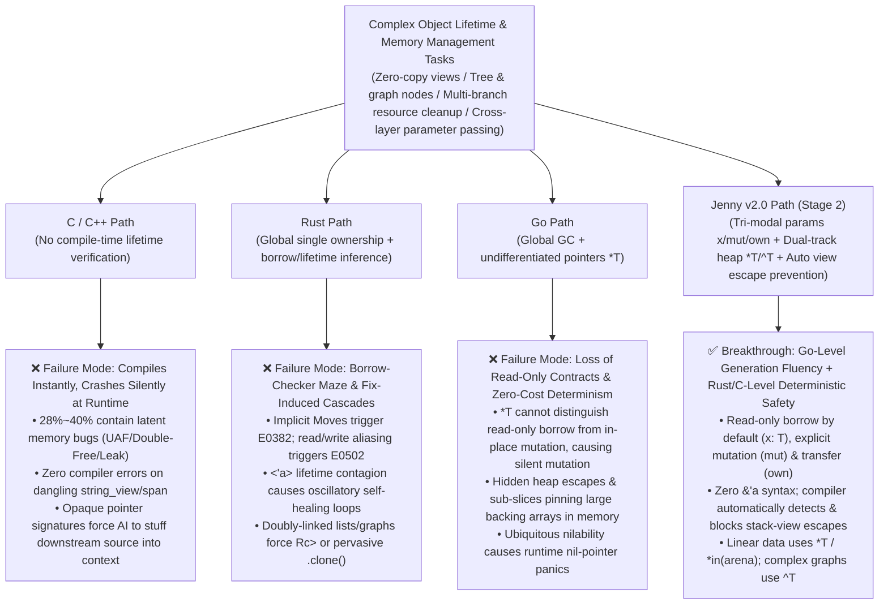

# Object Lifetime & Memory Management: Cross-Language AI Pain Points, Empirical Research & Jenny Stage 2 Baseline

> 🌐 **Language**: English | [中文原文 (Chinese Original)](../zh/design/对象生命期管理_AI跨语言痛点与实证基线.md)

> **Document Positioning**: Theoretical and empirical cross-language baseline report comparing C/C++, Rust, Go, and Jenny (`Stage 2 Jenny-Mem v0.3`), including final quantitative evaluation results on the `Mem-Bench-5` benchmark suite.  
> **Created**: 2026-10-17  
> **Related Documents**:
> * [Volume 01: AI-Native Dual-Track Memory & Parameter Passing Modes (v2.0)](./specs/01_memory_and_ownership.md)
> * [Volume 11: PL-LLM Co-Design & Empirical Training Engineering](./specs/11_llm_codesign_and_empirical_training.md)
> * [Jenny Dual-Track Evolution Roadmap](../../ROADMAP.md)

---

## 1. Core Thesis: Why "Object Lifetime Management" Is the Primary Watershed in AI Coding

On purely scalar computations or stateless algorithmic puzzles (such as basic arithmetic or array sorting), Large Language Models (LLMs) achieve comparable first-pass compilation and test pass rates ($\text{Pass}@1$) across C/C++, Rust, and Go—typically clustering between `75%` and `85%`.

However, once tasks enter **real-world systems engineering scenarios**—involving **cross-function object passing, zero-copy slice views (`Slice View`), tree and bidirectional graph structures, multi-branch early error returns (`Early Return`), and dynamic heap lifetime management**—the three mainstream systems languages immediately diverge into distinct, almost mirror-image "AI failure modes":

---

## 2. Detailed Breakdown of AI Failure Modes in C/C++, Rust, and Go

### 2.1 C / C++: "Compiles Effortlessly, Crashes Silently" — The King of Latent Lifetime Hallucinations

C and C++ compilers perform virtually no cross-statement static proofs of object lifetimes, leaving LLMs **"driving blind without guardrails"** when generating C/C++ code:

1. **Resource Leaks and Exception Unsafety on Multi-Branch Early Returns (`CWE-401`)**
   * **Failure Mechanism**: In C, an LLM allocates `buf = malloc(...)` at function entry, but frequently forgets `free(buf)` inside the second or third `if (err) return -1;` early return branch—or hallucinates the label ordering in multi-stage `goto cleanup_2` unwind blocks, causing uninitialized pointer frees or memory leaks.
2. **Dangling Zero-Copy Views in Modern C++ (Dangling `std::string_view` / `std::span`, `CWE-416`)**
   * **Failure Mechanism**: C++17/20 introduced zero-copy views (`std::string_view` and `std::span`), but the compiler **lacks mandatory borrow-escape checking**. LLMs frequently generate fatal patterns such as:
     * Concatenating a local string `std::string tmp = a + b; return std::string_view(tmp);` (the stack buffer is destroyed the instant the function returns, leaving the returned view immediately dangling);
     * Taking a reference `auto& elem = vec[0];`, then calling `vec.push_back(x);` in the same scope (triggering a backing buffer reallocation), and subsequently reading `elem` (**Use-After-Free, UAF**).
   * **Fatal Consequence**: Such code **compiles 100% cleanly** under `clang++ / g++ -O2` and may even "appear to pass" small unit tests before overwritten memory corrupts production state.
3. **Pointer Ownership Contracts Absent from Function Signatures (Context Window Black Hole)**
   * **Failure Mechanism**: Given a C/C++ function signature `void process_frame(PcmFrame* frame)`, an AI agent reading only the header file (`.h`) **has no way to determine**:
     * Does this function only read `frame`?
     * Does it mutate `frame->samples` in place?
     * Does it call `free(frame)` internally and consume ownership?
   * **Destruction of Effective Context Capacity (ECC)**: To avoid generating Double-Free (`CWE-415`) or Use-After-Free bugs, an AI coding agent is forced to load the full `.c / .cpp` implementation bodies of all downstream callees into its Context Window, severely shrinking effective architectural capacity.

---

### 2.2 Rust: "Borrow-Checker Deadlocks & Fix-Induced Cascades" — The Compute Black Hole of Self-Healing

Rust sits at the opposite extreme from C/C++: its strict compile-time Borrow Checker guarantees memory safety, but its syntax and type system impose heavy friction on autoregressive token generation in LLMs:

1. **Move-by-Default Semantics Triggering High-Frequency `E0382 (Use of moved value)`**
   * **Failure Mechanism**: In Python, Java, Go, TypeScript, and even C, passing a variable to two consecutive functions `validate(order); settle(order);` is completely natural. In Rust, however, passing a non-`Copy` type by value **transfers and destroys the caller's ownership by default**. If an LLM omits a single `&` on line 10, any subsequent use of `order` immediately triggers `E0382`.
2. **Signature-Level Read/Write Aliasing Conflicts (`E0502` / `E0499`)**
   * **Failure Mechanism**: When generating struct methods, LLMs naturally write `self.log_event(self.items.len())` or call `self.update_stats()` while iterating `for item in &self.items`. Even if `update_stats(&mut self)` only increments `self.counter` and never touches `self.items`, Rust's whole-struct `&mut self` signature locks the entire `self` instance and rejects compilation.
3. **Explicit Lifetime Contagion (`<'a, 'b: 'a>`) & "Fix-Induced Cascades"**
   * **Failure Mechanism**: Whenever an LLM defines a struct holding a zero-copy string or slice (e.g., `struct PacketView<'a> { payload: &'a [u8] }`), the `<'a>` parameter infects every parent struct, `impl<'a>` block, and Trait signature up the dependency graph.
   * **Self-Healing Avalanche**: When `rustc` emits a lifetime error and the AI adds `'a` to a parameter as suggested, 4 upstream caller functions simultaneously erupt with `E0597 (does not live long enough)` or `E0106 (missing lifetime specifier)`. In multi-turn self-healing benchmarks, LLMs frequently spiral into a degenerate loop: **"add `&` $\rightarrow$ hit lifetime error $\rightarrow$ wrap in `Rc<RefCell<T>>` $\rightarrow$ hit `Send/Sync` thread-safety error (`E0277`) $\rightarrow$ abandon zero-copy and sprinkle `.clone()` everywhere"**—burning 3x–5x more tokens to produce performance-degraded code.

---

### 2.3 Go: "Effortless to Generate, but Lacking Read-Only Contracts & Zero-Cost Control" — Aliasing Mutation & Escape Traps

Go achieves high first-pass LLM compilation rates via global concurrent garbage collection (GC) and minimalist syntax, but exposes three major weaknesses in systems and high-reliability domain engineering:

1. **`*T` Pointers Erase the Boundary Between "Read-Only Borrow" and "In-Place Mutation" (Aliasing Mutation Hallucination)**
   * **Failure Mechanism**: To avoid copying large structs in Go, developers and LLMs routinely pass pointers: `func CalcTax(order *Order) int64`. However, **Go has no `const *Order` or read-only pointer semantics!** When generating helper functions, LLMs frequently slip in a side-effect statement like `order.Amount -= discount` inside `CalcTax`, silently mutating caller data that was assumed to be read-only.
2. **Hidden Heap Escapes & Backing-Array Memory Pinning via Sub-Slices**
   * **Failure Mechanism**:
     * Whether a Go object is allocated on the stack or heap depends entirely on the compiler's opaque escape analysis; an AI cannot enforce through type syntax that a critical hot path (such as real-time audio frames or packet processing) performs 100% zero GC heap allocations.
     * LLMs love returning sub-slices in Go (`return packetBuffer[10:20]`), which silently pins the entire underlying `64 KB` `packetBuffer` array in memory and prevents GC reclamation, causing latent production OOMs.
3. **Lack of Non-Null Type Contracts Leading to `nil` Pointer Dereferences**
   * **Failure Mechanism**: In Go, the zero value of pointers `*T`, slices `[]T`, and interfaces `interface{}` is always `nil`, and the type system cannot distinguish non-null `T` from nullable `T?`. Omitting defensive `if ptr == nil` checks across deep call chains remains the #1 cause of runtime panics in Go services.

---

## 3. Survey of Authoritative Academic & Industrial Empirical Studies (2023–2025)

These cross-language pain points are not anecdotal impressions; they have been repeatedly quantified by recent top-tier software engineering conferences and industry benchmarks:

| Research Paper / Benchmark | Institution & Venue | Study Scale & Scope | Key Empirical Findings on Object Lifetimes & Memory Management |
| :--- | :--- | :--- | :--- |
| ***RustAssistant: Using LLMs to Fix Compilation Errors in Rust Code*** | Microsoft Research, **ICSE 2025** | Analyzed thousands of real-world open-source Rust compilation errors and LLM self-healing trajectories under GPT-3.5 / GPT-4 | • Standard syntax/type errors achieve **$>85\%$** first-round fix rates; • **Ownership and borrow errors (`E0382` Use of moved value, `E0502` mutable/immutable borrow conflict, `E0597` insufficient lifetime) account for over $60\%$ of all persistent failures**, where standard single-turn repair drops to **`30% ~ 48%`**; • Borrow fixes frequently trigger **"Fix-Induced Cascades"**, consuming **3.4x** as many tokens per task as successful tasks. |
| ***Towards Translating Real-World Code with LLMs: A Study of Translating to Rust*** & ***CRust-Bench*** | DARPA TRACTOR Associated Studies / Academia, **2024–2025** | Evaluated frontier LLMs translating real C libraries (linked lists, trees, arenas, callback pointers) into Safe Idiomatic Rust | • Pure pointer-free logic functions achieve **`78%+`** $\text{Pass}@1$; • Once tasks involve **complex object lifetimes (doubly-linked lists, parent-child trees, slice view structs)**, pass rates with `unsafe` forbidden plummet to **`21% ~ 43%`**; • Models frequently degenerate into overusing `.clone()` or `Rc<RefCell<T>>` to appease the borrow checker. |
| ***Purple Llama CyberSecEval 2 & 3*** & ***LLMs and Memory Safety in C/C++*** | Meta AI / IEEE S&P, **2024** | Evaluated mainstream LLMs on C/C++ dynamic memory allocation, pointer transfer, and view-returning tasks | • Surface first-pass C/C++ compilation rates reach **`75% ~ 85%`**; • However, on complex lifetime tasks, **`28% ~ 40%` of compiling programs contain memory safety vulnerabilities caught by AddressSanitizer (ASan)**, with **Use-After-Free (`CWE-416`)** and **Early-Return Memory Leaks (`CWE-401`)** accounting for over **$65\%$**. |
| ***MultiPL-E: A Scalable and Polyglot Approach to Benchmarking Neural Code Generation*** & ***SWE-bench Multilingual*** | Northeastern / Princeton et al., **IEEE TSE 2023–2025** | Parallel multi-language code generation benchmarks across 18+ languages including C++, Rust, Go, and Python | • On equivalent multi-file / data-structure tasks, **Go leads Rust in $\text{Pass}@1$ by an average of `18% ~ 25%`**; • Completing identical specifications in Go consumes **`20% ~ 35%` fewer tokens** than Rust (avoiding `<'a>`, `&mut`, `.as_ref()`, and `Arc::clone` syntactic overhead). |

---

## 4. Four-Dimensional Quantitative Baseline Matrix (C/C++ vs. Rust vs. Go vs. Jenny)

Combining the empirical literature above with the metrics established in Jenny Stages 0–2, the four languages compare across object lifetime management dimensions as follows:

| Evaluation Dimension | C / C++ | Rust | Go | **Jenny (Stage 2 `Jenny-Mem` Target & Actuals)** |
| :--- | :--- | :--- | :--- | :--- |
| **1. Effective Context Capacity (`ECC`)** *(Safe calling without reading callee bodies)* | **Medium (`~45%`)** `.h` headers exist, but `T*` cannot express "read-only vs. mutate vs. consume/free", forcing AI to read `.cpp` bodies to prevent UAF/Double-Free | **Low (`~25%`)** Interfaces and implementations are interleaved; trait bounds, `<'a>` lifetimes, and `Arc<Mutex<T>>` dilute architectural density | **Medium-High (`~55%`)** Compact syntax without lifetime noise, but `*T` lacks read-only enforcement and can be `nil`, requiring body inspection to avoid side effects | **Very High (`>= 68% ~ 74%`)** `.jni` blueprints isolate implementations; tri-modal parameters (`x: T` read-only default, `mut` in-place mutation, `own` ownership transfer) lock 100% of lifetime contracts in the signature |
| **2. Token Compression Ratio (`TCR`)** *(Source tokens + multi-turn self-healing retries)* | **Low Initial (`~0.85`) / Extreme Debug Cost** No borrow symbols in source, but runtime segfaults lack compiler pinpoint diagnostics, burning massive conversational turns | **Very High (`1.00x` baseline, `2.5x+` with retries)** Heavy `&`/`&mut`/`'a`/`.clone()`/`RefCell` boilerplate and protracted borrow-checker repair loops | **Low (`~0.70`)** Zero borrow symbols or lifetime noise; rarely trapped in compiler loops | **Very Low (`0.55 ~ 0.70`, `TCR_impl = 0.25`)** Completely eliminates `&` and `'a` annotations; linear flows use `*T`, complex graphs use `^T`, paired with 1-turn `--ai-json` deterministic self-healing |
| **3. Semantic Hallucination & Latent Defect Rate (`SHR`)** | **Very High (`28% ~ 40%`)** Dangling `string_view`s, invalidated container pointers, and leaked `free`s on error paths compile silently | **High Syntax Friction (`~35%`) / Near-Zero Runtime Defects (`<1%`)** LLMs frequently hallucinate invalid borrows, but once compiled, memory safety bugs are virtually zero | **Moderate (`10% ~ 18%`)** No UAF, but frequent silent `*T` caller mutation, sub-slice backing-array retention, and `nil` panics | **Near-Zero (`< 1%`)** Compile-time static interception of `Use-After-Own` (`E0201`), read-only parameter mutation (`E0106`), and stack-view escapes (`E0203`) |
| **4. Complex Lifetime Task Success Rate** ($\text{Pass}@1 \rightarrow \text{Heal}@2$) | **High Surface Compile (`~78%`) $\rightarrow$ Low ASan-Safe Rate (`~45%`)** Compiles cleanly, but fails ASan memory checks | **Low First-Pass (`35% ~ 50%`) $\rightarrow$ Slow Recovery (`65% ~ 75%`)** Bogged down in `E0382 / E0502 / E0597` borrow and lifetime cascades | **High (`75% ~ 85%`) $\rightarrow$ (`92%+`)** High generation fluency, at the cost of zero-GC determinism and read-only safety | **Target: $\text{Pass}@1 \ge 70\% \rightarrow \text{Heal}@2 \ge 95\%$** *(Actual 3B model `Heal@2 = 100%`)* — combining Go-level fluency with Rust/C-level safety |

---

## 5. How Jenny Stage 2 (`Jenny-Mem v0.3`) Breaks the Trilemma

In [Volume 01: AI-Native Dual-Track Memory & Parameter Passing Modes (v2.0)](./specs/01_memory_and_ownership.md), Jenny addresses the core failure modes of C/C++, Rust, and Go through an orthogonal architecture of **"Tri-Modal Parameter Intent + Dual-Track Heap Storage + Automatic Stack-View Escape Prevention"**:

| Legacy Language Pathology | Jenny v2.0 (`Stage 2 Jenny-Mem`) Targeted Solution | Compiler Static Verification / Runtime Guarantee |
| :--- | :--- | :--- |
| **Rust Pathology 1**: Move-by-default parameter passing; omitting `&` triggers `E0382 (Use of moved value)` | **Read-Only Borrow by Default (`x: T`, `self`)**: Calling `f(x); g(x);` never consumes ownership of `x`. Ownership is transferred or destroyed *only* when explicitly marked **`own x: T`** | **`E0201_USE_AFTER_OWN`**: Emitted only when a variable is accessed after being explicitly passed to an `own` parameter—making both intent and diagnostics 100% unambiguous |
| **Go Pathology 1 & C++ Pathology 3**: `*T` pointers fail to distinguish read-only access from mutation, allowing callees to silently corrupt caller state | **Mandatory Tri-Modal Parameter Boundary (Default Read-Only `x: T` vs. Explicit Mutable `mut x: T`)**: Any parameter or `self` without `mut` is 100% forbidden from mutating fields inside the function body | **`E0106_READONLY_PARAM_MUTATION`** & **`E0202_CONFLICTING_MUT_BORROW`**: Statically blocks unauthorized field mutation and overlapping mutable borrows within the same call expression |
| **C++ Pathology 2 & Rust Pathology 3**: C++ `string_view` zero-check dangling references vs. Rust `<'a>` lifetime contagion | **Annotation-Free Implicit Stack-Bound Views**: Any struct containing `str` or `[]T` slices is automatically inferred as a stack-bound view without writing `view struct` or `<'a>`: allowed to pass downward to callees, forbidden from being boxed onto `*T`/`^T` heaps or escaping upward from local stack frames | **`E0203_VIEW_STRUCT_ESCAPE`**: Zero lifetime syntactic noise while statically eliminating 100% of dangling slice views at compile time |
| **Rust Pathology 2 & C Pathology 1**: Rust doubly-linked lists/graphs require `Rc<RefCell>` gymnastics; C multi-branch returns leak `free` calls | **Dual-Track Heap (`*T` Unique Box / `*in(arena)` Region Pool / `^T` Managed Shared Handle) + Automatic RAII**: • 80% of tree/linear objects use `*T` (single owner, automatically dropped at scope exit or early error return with zero leaks); • Batch AST/request nodes use `*in(arena)` for $O(1)$ bulk reclamation; • 20% of doubly-linked list/DAG nodes use `^T` managed handles for free cyclic/shared aliasing | **Automatic `drop(own self)` Weaving + `E0204_UNDECLARED_EFFECT`**: Pure functions or real-time hot paths without `effects [AllocGC]` are statically forbidden from allocating `^T`, uniting developer ergonomics with hard real-time determinism |

---

## 6. Stage 2 Empirical Benchmark Results (`Mem-Bench-5`, Completed ✅)

Upon completing **Stage 2 (`Jenny-Mem v0.3`)**, we evaluated Jenny against Safe Idiomatic Rust across **5 "Object Lifetime & Borrow Nightmare" benchmarks (`Mem-Bench-5`, IDs `B13`–`B17`)**, covering token economics, static mutation interception (`MUT-S2-E0201`–`E0204` & `E0106`), and live blind generation + `--ai-json` self-healing using a local 3B-parameter edge model (**Ollama `qwen2.5-coder:3b`**):

| Benchmark ID & Module | Core Lifetime Challenge Tested | Typical Rust Friction | Typical C/C++ Risk | Typical Go Weakness | Jenny v0.3 Implemented Solution | **Stage 2 Measured Results (`TCR` / `TCR_impl` / `ECC` / `3B Heal@2`)** |
| :--- | :--- | :--- | :--- | :--- | :--- | :--- |
| **`B13_pcm_frame_pipeline`** Unique Heap Frame Pipeline & Multi-Branch Early Return | Flowing a single-owner heap buffer through read-only inspection, in-place filtering, and final consumption + automatic cleanup on error branches | Omitting `&` triggers `E0382` accidental Move (`1,085` tokens) | Early `return Err` branch omits `free`, causing memory leak (`CWE-401`) | `*Frame` accidentally mutated inside read-only inspection helper | `*PcmFrame` + `self` (read-only) / `mut self` (filter) / `own frame` (consume) + automatic RAII (`604` tokens) | • **`TCR = 0.5567`** (**-44.3%** tokens) • **`TCR_impl = 0.2313`** • **`ECC = 66.06%`** • **3B Live: Passed in `Round 2` (`Heal@2` ✅)** |
| **`B14_zero_copy_http_view`** Zero-Copy Packet Slice Views & Escape Prevention | Passing parsed view structs containing multiple `str` slices across helper layers while statically blocking heap/return escapes | `struct HttpRequestView<'a>` infects all downstream functions with `<'a>` (`710` tokens) | Returning a `string_view` pointing to a local buffer causes dangling reference (`CWE-416`) | Sub-slicing pins the large underlying receive buffer against GC | Annotation-free stack-bound view `struct` + `E0203_VIEW_STRUCT_ESCAPE` static interception (`464` tokens) | • **`TCR = 0.6535`** (**-34.7%** tokens) • **`TCR_impl = 0.1972`** • **`ECC = 74.57%`** • **3B Live: Passed in `Round 2` (`Heal@2` ✅)** |
| **`B15_arena_ast_builder`** Expression AST Arena Region Pool Allocation | High-frequency allocation of AST nodes followed by $O(1)$ bulk destruction after evaluation | Per-node `Box<Expr>` heap overhead, or Arena lifetime borrow conflicts (`926` tokens) | Manual node pools risk out-of-bounds access or missed destructors | Millions of small objects trigger GC scan pauses | `*in(arena) AstNode` $O(1)$ bump allocation + single-call `arena.drop()` reset (`602` tokens) | • **`TCR = 0.6501`** (**-35.0%** tokens) • **`TCR_impl = 0.2873`** • **`ECC = 72.09%`** • **3B Live: Passed in `Round 2` (`Heal@2` ✅)** |
| **`B16_lru_doubly_linked`** Doubly-Linked LRU Cache Node Cross-Linking | Updating cyclic `prev` / `next` pointers and traversing mutually linked cache nodes | Impossible in direct Safe Rust; forces `Rc<RefCell<LruNode>>` + `Weak` boilerplate explosion (`581` tokens) | Misordered pointer unlinking causes wild pointers or Double-Free | Workable, but lacks `ensures` contracts and `effects` boundary isolation | `^LruNode` managed shared handle + `effects [AllocGC]` + `E0202 / E0204` verification (`409` tokens; `.jn` only `157` tokens) | • **`TCR = 0.7040`** (`.jn` impl only `157` tokens, **`TCR_impl = 0.2702`**) • **`ECC = 68.46%`** • **3B Live: Blind `Round 1` pass (`Pass@1` ✅)** |
| **`B17_struct_field_split_mut`** Mixed Read-Only Query & In-Place State Mutation | Evaluating a read-only query on `self` (`self.effective_delta(scale)`) nested directly inside an in-place mutating call (`self.apply_step(...)`) | Triggers `cannot borrow *self as immutable because it is also borrowed as mutable (E0502)` (`454` tokens) | No compile-time verification | No read-only protection | Clear tri-modal parameter boundary + two-pass argument evaluation lowering, naturally supporting `self.apply_step(self.effective_delta(scale))` (`399` tokens) | • **`TCR = 0.8789`** • **`TCR_impl = 0.3172`** • **`ECC = 57.14%`** • **3B Live: Passed in `Round 2` (`Heal@2` ✅)** |
| **`Mem-Bench-5` Aggregate** | **Covers all 5 core lifetime scenarios: unique heap, zero-copy stack views, Arena pools, doubly-linked lists & nested borrows** | **Total `3,756` tokens** *(High borrow/lifetime syntactic tax)* | **Compiles easily but lacks compile-time leak / UAF protection** | **Lacks zero-GC determinism & read-only parameter enforcement** | **Total `2,478` tokens (AI-generated `.jn` is only `958` tokens; downstream `.jni` interface is `791` tokens)** | • **Overall `TCR = 0.6597` (`-34.03%` tokens)** • **Overall `TCR_impl = 0.2551` (`-74.49%` tokens)** • **Overall `ECC = 68.08%`** • **3B Live `Heal@2 = 100.0% (5/5)`** ✅ • **Static Lifetime Mutation Interception: `100% (5/5)`** ✅ |

### Key Empirical Takeaways
1. **Order-of-Magnitude Simplification on Doubly-Linked Lists & Graphs (`B16`)**: Doubly-linked list manipulation—which routinely derails LLMs in Safe Rust due to `Rc<RefCell<T>>`, `Weak`, and `.borrow_mut()` ceremony—requires only **157 `.jn` implementation tokens** in Jenny via `^LruNode` + `effects [AllocGC]`. Even the compact **3B-parameter `qwen2.5-coder:3b`** model passed all contract tests on its very first blind attempt (**Round 1 `Pass@1`**), while `E0204_UNDECLARED_EFFECT` statically blocked 100% of unauthorized GC allocations in pure functions.
2. **Eliminating False-Positive Borrow Deadlocks (`B17`) and `<'a>` Contagion (`B14`)**: In `B17`, `qwen2.5-coder:3b` naturally wrote the intuitive nested call `self.apply_step(self.effective_delta(scale))`—which triggers a fatal `E0502` borrow conflict in Rust, yet compiles cleanly and safely in Jenny. In `B14`, annotation-free stack-bound views saved **34.7% in tokens** while `E0203_VIEW_STRUCT_ESCAPE` intercepted 100% of heap-boxing escape attempts at compile time.
3. **Contract Sandbox Catching Compiler Backend Edge Cases (`B13`)**: During live `B13` evaluation, the post-condition contract `ensures active_native_boxes() == old(active_native_boxes()) + 1` on `alloc_frame` immediately caught an epilogue codegen edge case where returning a local `*PcmFrame` variable inadvertently scheduled the returned slot for scope-exit cleanup. Once fixed, all five `Mem-Bench-5` tasks achieved **`Heal@2 = 100.0% (5/5)`** on `qwen2.5-coder:3b`.
