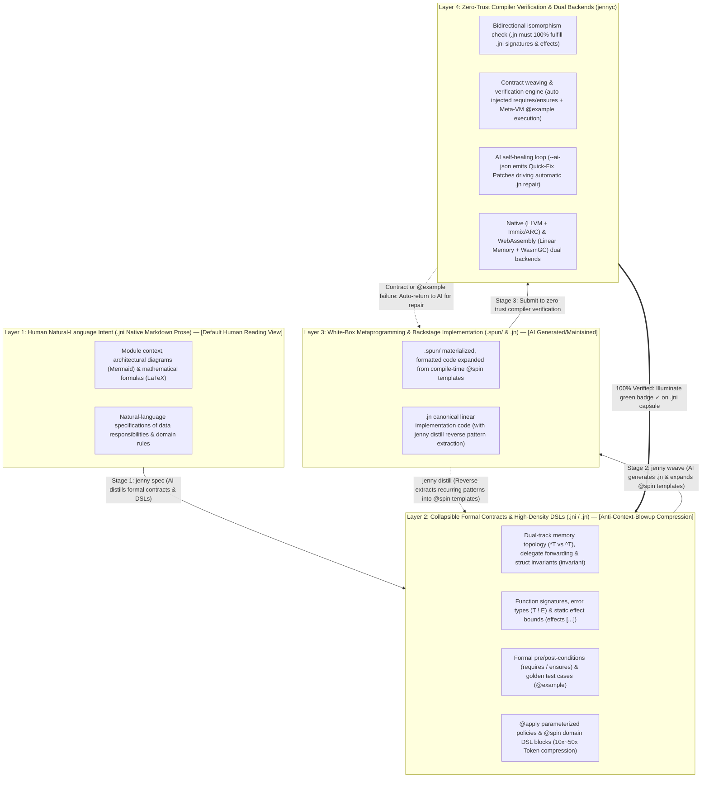

# Spinning Jenny (`Jenny`) Design Manifesto & AI-Native Architectural Overview

> 🌐 **Language**: English | [中文原文 (Chinese Original)](../zh/design/哲学与总纲.md)

> **Positioning**: The world's first AI-native systems programming language engineered from first principles to redefine the division of labor between humans and machines.  
> **Core Paradigm**: **Humans define intent and architecture in native Markdown (Literate Blueprint `.jni`) $\times$ AI automatically weaves formal contracts and implementations (`.jn`) $\times$ The Compiler enforces zero-trust contract verification (Verifier)**.

---

## I. First-Principles Reconstruction: From "Accommodating Manual Typing" to "AI Generates, Humans Read Blueprints"

Every mainstream programming language designed over the past 70 years—from C, C++, Java, and Python to Rust, Go, and Zig—rests on the same unspoken axiom: **"Humans are the direct writers of source code."**
Consequently, in traditional languages, *code is the master and documentation is the afterthought*. Programmers squeeze fragmented `///` comments into the crevices between lines of code; languages invent arcane syntactic sugar and implicit rules just to save keystrokes; and declaration-implementation separation is abandoned to avoid typing signatures twice.

In the era of the **AI Industrial Revolution**, however, the relations of software production undergo a Copernican inversion:

| Dimension | Traditional Language Assumption (Human-Written Era) | **Jenny's First Principles (AI-Native Era)** |
| :--- | :--- | :--- |
| **Who writes the code?** | Human programmers typing line by line | **100% of concrete implementations (and even formal interface signatures) are generated and maintained by AI** |
| **What is the human's role?** | Both architect and bricklayer (bogged down in low-level implementation minutiae) | **Pure Architect, Intent Definer, and Final Auditor (Architect & Auditor)** |
| **Subject-Object Hierarchy?** | Source code is the first-class citizen; `///` doc comments are second-class attachments | **Native Markdown design documents are first-class citizens; formal interfaces are collapsible semantic anchors within the document; concrete implementations live backstage** |
| **What no longer matters?** | Interface docs frequently go missing or stale; massive human hours are spent debugging internal loops | **Hundred-line procedural bodies exceed human working memory limits—once verified against formal contracts, humans rarely need to read them line by line** |

Grounded in this insight, Jenny establishes a new top-level architectural principle: **In daily engineering, humans primarily read and author `.jni` architectural blueprints written in clean, native Markdown (where formal interface blocks fold into status capsules in the IDE), while delegating interface formalization and `.jn` low-level implementation to a closed loop between AI agents and the verifying compiler.**

---

## II. Core Architectural Law 1: Physical Separation of Literate Blueprints (`.jni`) and Backstage Implementations (`.jn`)

Jenny reinvents and elevates **dual-file physical separation**, inverting the traditional status of documentation and implementation:

### 1. The Literate Architectural Blueprint: `<module>.jni` (The Human Arena)
* **Top-Level Syntax IS Native Markdown!**
  * Inside a `.jni` file, **no `///` or `/** */` comment markers are needed**. The top-level grammar of the file is 100% standard, free-form Markdown—supporting headings, lists, tables, Mermaid architectural diagrams, and LaTeX mathematical formulas. The compiler never interferes with prose authoring, allowing human architects to express design intent naturally.
* **Formal Interfaces and Contracts Embedded in ```` ```jenny ```` Blocks (Collapsed by Default in IDEs)**:
  * The compiler only parses formal contract blocks fenced by ```` ```jenny ```` inside `.jni` files (containing `struct`/`enum` dual-track memory definitions, `pub fn` signatures, `effects` clauses, `requires`/`ensures` contracts, and `@example` golden verification cases).
  * **Collapsible IDE Reading Experience**: When a human opens a `.jni` file, every ```` ```jenny ```` block defaults to a single, compact verification status capsule (e.g., `▶ [✓ Contracts Verified | Pure Function | 3/3 @example Passed]`). Reading a `.jni` file from top to bottom feels like reading an illustrated architectural whitepaper; the reader only clicks to expand a code block when inspecting a specific pointer track or boundary condition.
  * **Zero-Config GitHub Rendering**: Any `.jni` file pushed to GitHub or a documentation portal renders out-of-the-box as a cleanly typeset architectural specification without external doc-generation tooling.

### 2. The Backstage Implementation File: `<module>.jn` (The AI Weaving Workshop)
* **Primary Audience**: **AI Coding Agents (Primary Writer)** + **The Jenny Compiler (Primary Verifier)** (humans rarely need to open `.jn` files during routine development).
* **Contents**: Concrete procedural/functional bodies for all formal interfaces declared in `.jni`, private helper functions, low-level C raw pointer boundary crossings (`.as_raw_ptr()`), and concurrency state machines.
* **Bidirectional Isomorphism Law**:
  * The compiler strictly verifies that `<module>.jn` fulfills 100% of the signatures, memory tracks, effect bounds, and formal contracts declared across all ```` ```jenny ```` blocks in `<module>.jni`.
  * When an AI agent needs to comprehend a 100,000-line codebase, it only needs to load the project's **`.jni` blueprint collection**—acquiring both human architectural intent and 100% exact formal type signatures while reducing context token consumption by up to 90%.

---

## III. Core Architectural Law 2: "Three-Stage Progressive Weaving" & First-Class Contract Verification

If humans primarily read Markdown prose in `.jni`, keep ```` ```jenny ```` contract blocks folded by default, and rarely open `.jn` implementation files, **how does the quality assurance loop operate?**

Jenny pioneers the **"Three-Stage Progressive Weaving Workflow"**:

````markdown
<!-- ======================================================================= -->
<!-- 📄 audio_weaver.jni — What the human sees when opening the file         -->
<!-- ======================================================================= -->

# Audio Resampling & Loudness Analysis Module (`audio_weaver`)

This module manages zero-copy audio stream frames and extracts loudness features, bridging directly to the C `libsamplerate` library.
To guarantee **100% zero GC pauses** in hard real-time audio rendering pipelines, all audio sample buffers are allocated on the Native Heap (`*T`).

## 1. Native Audio Frame (`PcmFrame`)

Represents a contiguous buffer of interleaved 32-bit floating-point audio samples. Automatically invokes the C library to free underlying memory upon destruction.
- When frame length is greater than 0, the sample pointer must never be null.
- Sample rate must remain within the professional audio standard range $[8000, 192000]\text{ Hz}$.

```jenny
blueprint audio_weaver
import c "samplerate.h" as libsr

@repr(C)
pub struct PcmFrame {
    pub samples: *mut c_raw<f32>,
    pub length: usize,
    pub sample_rate: u32 = 48000,

    invariant self.length > 0 => self.samples != null
    invariant self.sample_rate >= 8000 && self.sample_rate <= 192000
}
```

## 2. Compute Normalized Root-Mean-Square Loudness (`compute_normalized_rms`)

Computes the Root-Mean-Square (RMS) energy of an input audio sample slice:
$$\text{RMS} = \sqrt{\frac{1}{N}\sum_{i=1}^{N} x_i^2}$$
and clamps the result strictly within the closed interval $[0.0, 1.0]$. If an empty slice is passed, immediately returns the `EmptyInput` error.
This function must be a **pure function** with zero I/O or GC allocations.

<!-- 💡 In the IDE, the ```jenny block below folds into a green status capsule by default: -->
<!-- ▶ [✓ Contracts Verified | Pure effects [] | ([]f32) -> f32 ! AudioError | 3/3 Examples Passed] -->
```jenny
pub enum AudioError {
    EmptyInput,
    ResampleFailed(i32),
}

pub fn compute_normalized_rms(samples: []f32) -> f32 ! AudioError
    effects []
    requires samples.len > 0 else AudioError.EmptyInput
    ensures  result >= 0.0 && result <= 1.0
    @example compute_normalized_rms([]) == AudioError.EmptyInput
    @example compute_normalized_rms([0.0, 0.0, 0.0]) == 0.0
    @example compute_normalized_rms([0.5, 0.5, 0.5, 0.5]) == 0.5
```
````

### The Three-Stage Human-AI Collaborative Loop:
1. **Stage 1 (Human Intent — Human Writes Markdown)**:
   * The human architect writes the Markdown headings, prose specifications, and mathematical formulas in `audio_weaver.jni` (without even needing to type the ```` ```jenny ```` blocks manually).
2. **Stage 2 (`jenny spec` — AI Weaves Collapsible Formal Contracts)**:
   * The AI reads the human's Markdown prose and automatically generates or updates the ```` ```jenny ```` formal contract blocks beneath each section (including exact `*T`/`^T` types, `effects []`, `requires`/`ensures` pre/post-conditions, and `@example` verification cases). The human can briefly expand the block to review the `@example` assertions, then fold it back up.
3. **Stage 3 (`jenny weave` — AI Generates Backstage `.jn` + Zero-Trust Compiler Verification)**:
   * The AI generates the corresponding `audio_weaver.jn` implementation file behind the scenes.
   * **The Jenny compiler automatically enforces a three-pronged verification gauntlet**:
     1. **Bidirectional Signature & `effects` Purity Check**: Ensures `.jn` violates no memory track or side-effect contracts declared in `.jni`;
     2. **Automatic Pre/Post-Condition Weaving**: The compiler directly compiles `requires samples.len > 0 else AudioError.EmptyInput` from `.jni` into the function prologue (so `.jn` never needs to duplicate defensive parameter checks!) and weaves `ensures` and `invariant` checks into function epilogues;
     3. **Compile-Time `@example` Sandbox Execution**: The compiler executes all `@example` assertions directly inside its built-in Meta-VM! If any assertion fails, the compiler emits a `--ai-json` deterministic diagnostic patch to drive AI self-healing of `.jn` until 100% of checks pass—illuminating the `✓ Contracts Verified` badge on the IDE capsule.

---

## IV. Core Architectural Law 3: Shifting Syntax Gravity from "Keystroke Saving" to "Self-Explanatory Clarity & Zero AI Hallucination"

When humans no longer type boilerplate by hand and instead audit contracts or spot-check implementations, the North Star of syntax design shifts decisively toward **Self-Explanatory Clarity**:

1. **Call-Site Named Arguments for Clarity**:
   * When calling functions with boolean flags, numeric constants, or multiple parameters of the same type, Jenny supports explicit parameter labels at the call site (e.g., `resample(frame, target_rate: 44100, high_quality: true)`), making domain intent transparent without jumping to the definition.
2. **Explicit Semantic & Control-Flow Landmarks**:
   * `*T` (Native single-owner heap pointer), `^T` (Managed shared heap handle), `x: T` / `mut x: T` / `own x: T` (tri-modal parameter passing without `&T` clutter), `.await` (async suspension point), `?` (error propagation point), and `.as_raw_ptr()` (explicit C FFI raw pointer boundary).
3. **Canonical Linear Form in `.jn` Implementations**:
   * `guard ... else` eliminates nested conditional pyramids; the `|>` pipeline operator eliminates inside-out parenthesis nesting; and intermediate `val` bindings encourage explicit step-by-step Chain-of-Thought anchors for LLMs.

---

## V. Core Architectural Law 4: Token Economics & Anti-Context-Blowup (Extreme Reuse & `@spin` DSL Pattern Libraries)

In the era of LLM-assisted software engineering, **Lines of Code (LOC) and Token Count directly govern an AI agent's effective reasoning ceiling and engineering cost**:
* Asking an AI to generate thousands of lines of repetitive CRUD boilerplate, state machines, protocol serializers, or composition forwarding methods rapidly triggers **Context Window Blowup**, inducing "Lost in the Middle" attention degradation, surging hallucination rates, and high inference latency.
* Jenny's fourth foundational principle is **Maximum Semantic Density**: compressing business code volume by **10x to 50x** through higher-order generics, `delegate` automatic forwarding, and `@spin` domain DSL template libraries.

### 1. Zero-Boilerplate Composition: `delegate` Forwarding & Trait Mixins
When favoring composition over fragile class inheritance, traditional languages (such as Go or Rust) force developers or AI agents to write dozens of trivial forwarding methods (`fn foo(self) { self.inner.foo() }`).
* Jenny builds the **`delegate` automatic forwarding primitive** directly into the language:
  ```rust
  pub struct CachedStorage {
      engine: *RocksDbEngine,
      cache: ^LruCache,
      // Forwards all 15 methods of the StorageEngine Trait to self.engine in a single line with zero overhead!
      delegate StorageEngine to self.engine
  }
  ```
* Combined with rich **Trait Default Method Mixins**, a type only needs to implement 1 or 2 core primitive methods to automatically inherit dozens of higher-order combinators for free.

### 2. The `@spin` Domain DSL Ecosystem (Spindle Pattern Library)
Within the Jenny ecosystem, the most valuable asset managed by `spindle` is its battle-tested library of **`@spin` compile-time code generation templates (Spindle Patterns)**, supporting two high-density declarative customization forms:

1. **Parameterized Policy Configuration (`@apply`)**:
   A dozen lines of declarative policy configuration deterministically spin thousands of lines of production-grade implementation—complete with caching, exponential backoff retries, telemetry instrumentation, and transaction management—into `.spun/`:
   ```rust
   @apply(patterns::crud_repository(
       table: "orders",
       primary_key: "order_id",
       cache: RedisCache(ttl: 300.sec, strategy: WriteThrough),
       retry: ExponentialBackoff(max_attempts: 3, base_delay: 50.ms)
   ))
   pub struct OrderRecord {
       pub order_id: u64,
       pub amount_cents: i64,
       pub status: OrderStatus = OrderStatus.Pending,
   }
   ```
2. **Block-Level Declarative Domain DSLs (`@spin` DSL)**:
   Allows template libraries to define ultra-compact domain-specific grammars (such as Finite State Machines, HTTP routing tables, ECS game systems, or dataflow topologies) that the Meta-VM expands at compile time into type-safe structs and transition logic:
   ```rust
   // Just 6 lines of DSL automatically spin 300 lines of type-safe state machine enums, guard checks, and event dispatchers!
   @spin fsm::state_machine(OrderWorkflow) {
       Created   --[Pay]------> Paid      guard (order.amount_cents > 0)
       Paid      --[Ship]-----> Shipped
       Shipped   --[Deliver]--> Completed
       Created   --[Cancel]---> Cancelled
   }
   ```

### 3. `jenny distill`: Reverse Pattern Distillation Across the Codebase
To prevent repetitive patterns from accumulating during iterative development, the Jenny toolchain provides the **`jenny distill`** workflow:
* When the compiler and AI agent detect structural clones or repeated control-flow skeletons across multiple `.jn` modules, running `jenny distill` automatically **abstracts those recurring implementations into a project-specific `@spin fn` template**, replacing the verbose implementations with concise `@apply(...)` or `@spin` DSL invocations—**allowing the codebase to grow thinner and more refined as business features expand!**

---

## VI. Core Architectural Law 5: Sub-Second Incremental Builds & Zero-Bloat Artifacts (Learning from Rust's `target/` Bloat)

In a high-frequency AI loop of *"Generate $\rightarrow$ Compile & Verify $\rightarrow$ Self-Heal"*, waiting puluhan seconds per build while the `target/` directory balloons to puluhan gigabytes (as often happens in Rust or C++) would cripple human-AI flow. Jenny eliminates the five root causes of build bloat at the compiler architecture level:

1. **The `.jni` Blueprint ABI Firewall**: Downstream modules depend exclusively on the AST hash of upstream `.jni` blueprints. As long as `<module>.jni` remains unchanged, no matter how many times the AI rewrites the internal implementation of `<module>.jn`, **downstream dependent modules require 100% zero recompilation**, and libraries never need to bundle bloated serialized function-body IR like Rust `.rlib` files.
2. **Dual-Mode Generics ("Debug Dictionary Passing vs. Release Monomorphization")**: During daily development and AI test loops, generics default to vtable dictionary passing (paired with permanent isomorphic pointer erasure for `^T`), compiling **only 1 machine-code copy** per generic function globally. Full static monomorphization and LTO inlining are reserved for `--release` production builds, eliminating 80% of intermediate code and symbol bloat.
3. **Built-In Bytecode Meta-VM Without Dynamic Library Bloat**: `@spin` metaprogramming executes directly over in-memory ASTs inside the compiler's lightweight bytecode sandbox, avoiding the need to compile hundreds of megabytes of host `.dll`/`.so` procedural macro plugins.
4. **Line-Tables-Only Debug Info & Quota-Bound LRU Content-Addressed Cache**: By default, builds emit compact line-number mapping tables taking only 5% of full DWARF size (with zero-copy Split DWARF available on demand). All intermediate artifacts reside in a content-addressed cache pool (`.jenny-cache/`) capped at a **2 GB** hard limit by default with automatic LRU eviction—banishing multi-gigabyte `target/` black holes for good.

---

## VII. Core Architectural Law 6: Language–Model Co-Evolution (PL-LLM Co-Design & RLVR Empirical Loop)

As a true AI-native programming language, Jenny rejects purely subjective armchair language design, instead binding **language feature design tightly with LLM training and empirical evaluation** in a data-driven feedback loop:

1. **Five Quantitative Benchmarks (`JennyBench`)**:
   * **TCR (Task Token Compression Ratio)**: Real token savings compared to equivalent Rust/TypeScript implementations (target $3\text{x}\sim 15\text{x}$);
   * **ECC (Effective Context Capacity)**: The architectural system scale controllable within a fixed context window when loading only `.jni` blueprints;
   * **$\text{Pass}@1$ & $\text{Heal}@k$ (First-Pass Compilation Rate & Self-Healing Rounds)**: Paired with error-code heatmaps to pinpoint and smooth out syntactic friction points that clash with pretrained model priors;
   * **SHR (Semantic Hallucination Rate)**: Measures the real interception rate of `requires`/`ensures`/`@example` contracts against subtle model logic hallucinations;
   * **HCS (Human Comprehension Speed)**: Measures the speed and accuracy with which human engineers grasp system boundaries by reading `.jni` blueprints alone.
2. **Compiler-in-the-Loop Reinforcement Learning with Verifiable Rewards (RLVR)**:
   * `jennyc`'s sub-second contract verifier and Meta-VM `@example` sandbox naturally form a deterministic reward function for RLVR / GRPO (**Full Contract Pass Reward + Token Length Penalty**), training models to spontaneously favor high-reuse, idiomatic Jenny code while using training error distributions to guide iterative refinements of the language grammar and `@spin` standard pattern library.

---

## VIII. The 4-Layer Literary Weaving Architecture


