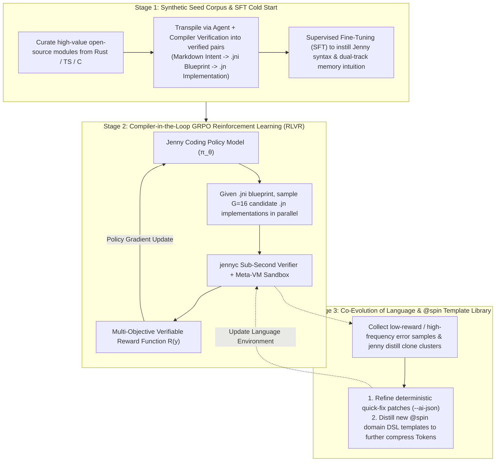

# Jenny Language Specification — Module 11: PL-LLM Co-Evolution and Empirical Quantitative Engineering

> **Language**: English | [中文版 (Chinese)](../../zh/design/specs/11_llm_codesign_and_empirical_training.md)  
> **Status**: Finalized (v2.0-spec)  
> **Core Philosophy**: Departing from traditional programming language design driven purely by human designers' subjective prior intuition, Jenny pioneers a scientific engineering paradigm of **Bidirectional Programming Language and Large Language Model Co-Evolution (PL-LLM Co-Design)**—using **Five Quantitative Metrics** as our compass, turning the compiler into a **Reinforcement Learning with Verifiable Rewards (RLVR) training environment**, and iteratively refining the language syntax and `@spin` template library from empirical model error distributions while training models to master Jenny.

---

## 1. Why Must an AI-Native Language Follow Empirical Co-Design?

Every newly designed programming language faces a formidable **Pre-training Prior Barrier** when interacting with Large Language Models (LLMs):
* Foundation models are pre-trained on trillions of Tokens of Python, TypeScript, Rust, C/C++, and Go corpora, forming deeply entrenched neural circuits across their attention heads and feed-forward layers.
* If a new language's syntax is designed in isolation based solely on human intuition, it easily clashes with the model's pre-training prior distribution (High KL-Divergence), causing frequent cross-language syntax contamination (such as hallucinating Rust's `&mut` or TypeScript's `===`), fragmented BPE tokenization, and high hallucination rates.

Jenny therefore establishes a **"data-driven, benchmark-coupled, bidirectionally iterative"** empirical engineering discipline: **every syntax feature, memory rule, and standard library API must pass quantitative benchmarking (`JennyBench`) and empirical model feedback before final stabilization.**

---

## 2. The Five Core Quantitative Evaluation Metrics

To scientifically evaluate Jenny's language design decisions, we established the cross-domain benchmark suite **`JennyBench`** (spanning zero-copy C library wrappers, concurrent network state machines, complex graph domain models, hard real-time audio stream processing, and microservice CRUD pipelines) and continuously monitor **five hard quantitative metrics**:

| Metric ID | Metric Name | Exact Mathematical Definition & Measurement | Optimization Target & Design Guidance |
| :--- | :--- | :--- | :--- |
| **1. TCR** | **Token Compression Ratio** | $$\text{TCR} = \frac{\text{Tokens}(\text{Jenny .jni Blueprint + .jn Impl})}{\text{Tokens}(\text{Equivalent Rust/TS Baseline})}$$ *(or inverse compression factor $\text{Tokens}_{\text{Baseline}} / \text{Tokens}_{\text{Jenny}}$, measured with mainstream BPE tokenizers such as `o200k` / `cl100k`)* | **Target: $\text{TCR}_{\text{impl}} \le 0.33$ ($3.0\text{x}$ reduction on general algorithms) down to $\le 0.09$ ($11\text{x}$–$15\text{x}$ reduction on DSL modules)**. If a task category exhibits poor compression, boilerplate remains too high and warrants new `@spin` templates or `delegate` sugar. |
| **2. ECC** | **Effective Context Capacity** | Within a fixed context budget (e.g., 32K/128K Tokens), load only project-wide `.jni` blueprint files into the prompt and measure both context Token savings and single-pass accuracy across multi-module architectural changes. | **Target: $\ge 60\%$ context savings ($2.5\text{x}$–$3.6\text{x}$ effective architectural capacity expansion)**, validating the real-world impact of `.jni` physical separation against context explosion. |
| **3. $\text{Pass}@1$ & $\text{Heal}@k$** | **First-Pass Compile Rate & Self-Healing Rate** | • **$\text{Pass}@1$**: Given a `.jni` blueprint, the percentage of `.jn` implementations generated in a single zero-feedback pass that pass all compiler checks and `@example` contracts. • **$\text{Heal}@k$**: Combined with `--ai-json` deterministic repair hints, the percentage achieving 100% self-healing convergence within $\le k$ rounds. | **Target: Few-shot $\text{Pass}@1 \ge 60\%$–$75\%$ pre-finetuning, $\text{Pass}@1 \ge 96\%$ post-finetuning, and $\text{Heal}@2 / \text{Heal}@3 \ge 99.5\%$**. Directly pinpoints counter-intuitive syntactic friction points from compiler error distributions. |
| **4. SHR** | **Syntax & Semantic Hallucination Rate** | The rate at which generated code hallucinates foreign syntax symbols (e.g., `&` references) or passes surface type checks while failing held-out boundary property and mutation tests. | **Target: $\text{SHR} \le 1.0\%$ (and $0.0\%$ reference-symbol hallucination)**. Measures how effectively `.jni`'s `requires`, `ensures`, `invariant`, and `@example` contracts intercept LLM logic hallucinations. |
| **5. HCS** | **Human Comprehension Score** | Accuracy and review speed when human engineers inspect **only folded/expanded `.jni` blueprints** to audit memory allocation tracks, error boundaries, and side-effect purity within a fixed time budget. | Validates how much native Markdown `.jni` blueprints and three-mode parameters (`x: T` / `mut x: T` / `own x: T`) reduce human cognitive load. |

---

## 3. Neural-Prior-Aligned Syntax A/B Testing Methodology (Perplexity & Friction Profiling)

Before freezing any concrete syntax variant (such as keyword naming, operator choice, or block structure), Jenny replaces subjective bike-shedding with **Foundation Model Perplexity and Error-Rate A/B Experiments**:

### 3.1 Minimum-Perplexity A/B Testing
1. **Experimental Setup**: For candidate syntax designs A and B, construct equivalent 500-Token minimal system prompts and evaluate foundation models (such as Gemini, Claude, Qwen-Coder, or DeepSeek) generating code across a `JennyBench` subset.
2. **Measuring Token Generation Entropy**:
   * Extract token-level **log-probabilities** at key syntactic decision points (function signatures, error propagation, memory prefixes, pattern matching).
   * **Decision Criterion**: If a candidate syntax triggers sharp probability collapse (high-entropy hesitation) or frequent regression into raw Rust/TypeScript syntax, that construct conflicts with pre-training priors and must be reshaped into a prior-compatible form!

### 3.2 Compiler Error Heatmaps and Friction Elimination
During empirical evaluation and training runs, the compiler tallies an **Error Code Heatmap** across all failed generations and feeds those insights back into the language design:
* **Case 1 (Eliminating Redundant Annotations)**: If empirical logs show that when a function signature already declares `own x: *Buffer`, models omit a redundant call-site annotation in $>10\%$ of generations, the compiler can canonicalize or emit a deterministic `--ai-json` auto-fix patch, turning friction into automated normalization!
* **Case 2 (Promoting Recurring Boilerplate to Standard Library / DSLs)**: Whenever models repeatedly write $>15$ lines of rigid structural boilerplate for a domain task, that pattern is distilled into the official `spindle` `@spin` standard template library.

---

## 4. Compiler-in-the-Loop Reinforcement Learning with Verifiable Rewards (RLVR)

Jenny's `.jni` contract system and sub-second compiler (`jennyc`) are not merely build tools—they form a purpose-built **RLVR (Reinforcement Learning with Verifiable Rewards) environment** for LLM post-training!

### 4.1 Multi-Objective Verifiable Reward Function Design
During GRPO (Group Relative Policy Optimization) reinforcement learning, the model generates a candidate `.jn` implementation $y$ from a `.jni` blueprint, and `jennyc` computes a deterministic scalar reward $R(y)$ in milliseconds:

$$R(y) = R_{\text{compile}}(y) + R_{\text{contract}}(y) + R_{\text{perf}}(y) - \lambda \cdot \text{LengthPenalty}(y)$$

1. **Staged Compilation Reward $R_{\text{compile}}(y) \in [0, 0.3]$**:
   * Passes lossless syntax parsing (valid AST construction): $+0.1$
   * Passes dual-track memory, borrow, and `effects` purity static checks: $+0.2$
2. **Contract & Golden Example Execution Reward $R_{\text{contract}}(y) \in [0, 0.5]$**:
   * Passes 100% of `@example` assertions inside the Meta-VM sandbox without violating any `requires`, `ensures`, or `invariant` contracts: $+0.5$ (scaled linearly by the fraction of passing examples).
3. **Dual-Track Memory & Zero-Copy Quality Reward $R_{\text{perf}}(y) \in [0, 0.2]$**:
   * Static analyzer rewards implementations that avoid redundant cloning and properly utilize `*in(arena)` and default read-only borrow views.
4. **Token Economics Length Penalty $-\lambda \cdot \text{LengthPenalty}(y)$**:
   * **Core Evolutionary Driver**: Among all candidate implementations $y_i$ that pass 100% of contract checks, **those using fewer Tokens and effectively leveraging generics, `delegate`, and `@spin` DSLs earn the highest net reward**!
   * This term drives the policy model during RL to **spontaneously evolve an ultra-concise, high-reuse, zero-boilerplate coding style**!

---

## 5. Phased Empirical Validation Roadmap

To let empirical data guide every milestone before committing to heavy compiler backend engineering, validation proceeds in three stages:

1. **Phase 0: Baseline Token & Contract Verification (`Stage 0: Jenny-Nano`)**
   * Construct paired Rust and Jenny v2.0 (`.jni` + `.jn`) implementations across representative systems, algorithmic, and domain modules.
   * Measure real BPE token counts, context capacity gains (ECC), and 100% contract-violation interception on adversarial fake implementations.
2. **Phase 1: Lightweight Frontend Verifier + Local Small-Model Self-Healing Stress Test (`Stage 1–Stage 4`)**
   * Build the static type/borrow/effect checker, `.spun/` white-box expander, C99 native backend, and `--ai-json` diagnostic engine.
   * Evaluate a lightweight local model (`qwen2.5-coder:3b`) across the 25-module benchmark suite (`B01`–`B25`), measuring $\text{Pass}@1$, $\text{Heal}@2$, $\text{Heal}@3$, and error code heatmaps to eliminate syntactic friction points.
3. **Phase 2: Synthetic Dataset Generation & Dedicated Small-Model LoRA / RLVR Training**
   * Use the compiler verifier and Meta-VM sandbox as an automated filter to synthesize tens of thousands of 100%-verified `.jni <-> .jn` training pairs.
   * Run the full SFT + RLVR loop on open-weights coding models (3B–32B), demonstrating the engineering inflection point where compact models writing Jenny outperform frontier models writing raw Rust or C++!
