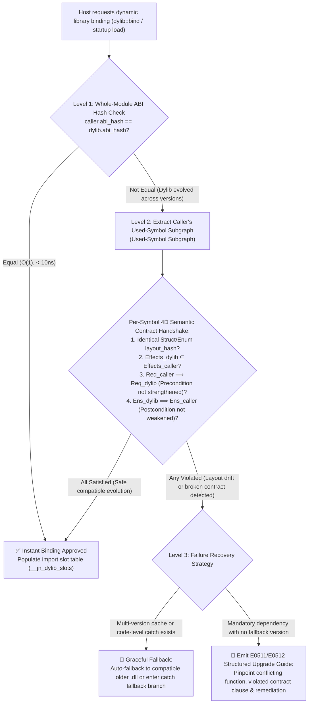

# Volume 13: Semantic Contract-Driven Native Dynamic Linking, Graceful Fallback & Zero-Leak Hot-Swap Architecture (`Jenny-Dylib` Design Draft)

> 🌐 **Language**: **English** | **[简体中文](../../zh/design/specs/13_dynamic_linking_and_semantic_hotswap.md)**

> **Status**: Design Draft (`v0.2-draft`, pending empirical validation in future stages)  
> **Related Volumes**:
> * [Volume 01: AI-Native Dual-Track Memory & Parameter Passing Modes](./01_memory_and_ownership.md) (Stack-Bound View Non-Escape Rule `E0201`)
> * [Volume 06: `@spin` Compile-Time White-Box Metaprogramming](./06_spin_metaprogramming.md) (Procedural template monomorphization and `.jenny-cache/spin/` global deduplication)
> * [Volume 09: Literate Architectural Blueprints (`.jni`) & First-Class Contract System](./09_literate_blueprint_and_contracts.md)
> * [Volume 12: Package Management, Module Resolution & Supply-Chain Effect Firewall (`Spindle`)](./12_package_management_and_module_system.md)

---

## 1. Background: The "Six Fatal Flaws of DLL Hell" in Traditional Dynamic Linking & Industry Retrospective

### 1.1 The Six Fundamental Flaws of Traditional Dynamic Linking (`.dll` / `.so` / `.dylib`)

Over the past three decades, C/C++ and OS-native dynamic linkers have repeatedly fallen into **"DLL Hell"**. The root cause is that traditional linkers operate purely on flat symbol names, remaining completely blind to **type memory layouts, function behavioral contracts, capability permissions, and resource lifetimes**:

1. **① Diamond Dependency & Single-Process Multi-Version Conflict (Symbol Interposition)**:
   * When a host process loads both `LibA` (depending on `Codec v1.0`) and `LibB` (depending on `Codec v2.0`), Windows forcibly deduplicates by filename (`codec.dll`), while Linux ELF silently hijacks symbols in the global flat symbol table (Symbol Interposition) by default.
2. **② Fragile Base Class & Silent Struct Layout Drift**:
   * When an upstream library adds or removes fields in a `struct` or alters an `enum` discriminant without changing function names, callers still allocate stack memory using the old `sizeof` and read/write fields at stale byte offsets, directly triggering **silent stack corruption**.
3. **③ Nominal SemVer Lie & Implicit Behavioral Drift**:
   * A dynamic library author claims a minor version upgrade is compatible (function signatures and struct layouts are unchanged), but quietly strengthens a precondition (e.g., previously allowing `0`, now crashing on `0`), weakens a postcondition guarantee, or injects undeclared `Net`/`FileSystem` side effects.
4. **④ Search Path Hijacking & Name Collision**:
   * Blindly searching by filename across `PATH`, `LD_LIBRARY_PATH`, or the working directory makes applications vulnerable to having same-named DLLs overwritten by other software or exploited via DLL side-loading attacks.
5. **⑤ Cross-Boundary Allocator Split & State Split (Split Runtime & ODR Violation)**:
   * Passing an object allocated in `A.dll` to `B.dll` for deallocation crashes when each links against a separate CRT heap; conversely, statically bundling base libraries into each DLL to avoid conflicts splits global variables and Thread-Local Storage (TLS) into multiple disconnected instances within the same process.
6. **⑥ Hot-Unload Dangling Pointers & Loader Lock Deadlocks (Use-After-Unload)**:
   * If a host retains a `str` slice pointing into a dynamic library's `.rodata` read-only segment or a function pointer into its `.text` code segment, executing `dlclose` / `FreeLibrary` to hot-unload the library causes an immediate `SIGSEGV` on the next access.

---

### 1.2 Comparison of Five Mainstream Industry Paradigms & the Evolution of .NET Hot-Unloading

| Technical Paradigm | Representative Systems | ① Multi-Version Coexistence | ② Layout Drift Prevention | ③ Behavioral Drift Prevention | ④ Path Hijacking Defense | ⑤ Split-Heap Prevention | ⑥ Safe Hot-Unload | Core Limitations & Engineering Costs |
| :--- | :--- | :---: | :---: | :---: | :---: | :---: | :---: | :--- |
| **1. OS Loader Patching** | WinSxS / macOS Two-Level Namespace / ELF SymVer | ⚠️ Partial | ❌ | ❌ | ⚠️ Partial | ❌ | ❌ | Cumbersome configuration; zero awareness of language-level struct layouts or contracts |
| **2. Aggressive Full Static Linking** | Go / Rust (`rlib` default mode) | ✅ Hashed symbols | ➖ Full rebuild | ❌ | ✅ Single binary | ✅ | ❌ Unsupported | Binary bloat; minor low-level edits require full relinking; sacrifices native hot-patching and plugin ecosystems |
| **3. Immutable Content-Addressed Stores** | Nix / Guix / Bazel | ✅ Exact paths | ➖ Rebuild on layout change | ❌ | ✅ Hashed paths | ⚠️ | ❌ | External build wrapper only; does not support runtime hot-swapping without recompilation |
| **4. Resilient ABI Indirection** | Swift Resilient ABI | ⚠️ Single version/process | ✅ Runtime witness tables | ❌ | ✅ | ✅ | ❌ | Non-`@frozen` structs degrade to runtime table lookups and heap allocation, sacrificing zero-cost value semantics |
| **5. Shared-Nothing Sandboxes** | Wasm Component Model | ✅ Instance isolation | ✅ Protocol adapters | ⚠️ Capability gates only | ✅ | ✅ | ✅ | **Forbids zero-copy slices across boundaries; every call requires deep-copy serialization** |
| **6. GC-Tracked Unload Contexts** | .NET `AssemblyLoadContext` / Java OSGi | ✅ Context isolation | ⚠️ Rebuild on layout change | ❌ | ✅ | ✅ | ⚠️ **Prone to leaks** | Object headers implicitly hold dynamic library `MethodTable*`; **if the host retains even a single object reference, the library can never unload (Unload Leak)** |

#### Deep Retrospective: Why .NET's Evolution from `AppDomain` to `AssemblyLoadContext (ALC)` Still Fails to Fully Solve Unloading
* **`.NET AppDomain` (1st Gen)**: Achieved unloading via in-process sub-domain isolation + mandatory cross-boundary deep-copy serialization (Remoting), but suffered from massive cross-boundary performance overhead and unsafe `ThreadAbort` forced thread termination, leading to its deprecation in .NET Core.
* **`.NET Collectible ALC` (2nd Gen)**: Allows host and plugins to pass objects directly with zero copy, but every plugin object header embeds a `MethodTable*` pointer referencing the plugin's `LoaderAllocator`. Calling `alc.Unload()` must wait for a full-heap GC scan—if the host accidentally retains even a single plugin object in a global cache, event callback, or logging queue, the entire dynamic library suffers a **permanent residency leak (Unload Leak)**.
* **Jenny's Breakthrough**: By combining Jenny's unique **`.jni` First-Class Contracts** with its **Tri-State Memory Model (Stack-Bound View Non-Escape Rule + pure value structs without vtable headers)**, we can turn **all of ① through ⑥ into ✅** simultaneously while **preserving C-grade zero-copy performance**!

---

## 2. Jenny Dynamic Libraries: "Dual-Layer Code Separation" & Stable Value ABI Architecture

### 2.1 Concrete Functions into `.dll` Machine Code, `@spin` Thin Templates into Read-Only Metadata Sections

When building a dynamic library (`spindle build --lib-type dylib`), functions in a module are automatically partitioned by nature:

1. **Concrete Functions & Methods (> 95% of code) $\rightarrow$ Compiled into Native Machine Code Export Symbols**:
   * Examples include `FmtBuffer.in_arena`, `FmtBuffer.put_str`, `FmtBuffer.put_spec`, and `FmtBuffer.to_sso_string` in `std::str::fmt`, as well as `Vec.*`, `HashMap.*`, and `VarintStream.*`;
   * Their parameter and return types are completely fixed, compiling directly into the `.text` code segment of `std.dll` / `libstd.so`.
   * **Commercial & Closed-Source Friendly**: When distributing a dynamic library, concrete functions are already compiled into machine code—**no `.jn` source files or implementation ASTs for concrete functions need to be distributed**; providing only the `.jni` blueprints is sufficient for downstream development and auditing.
2. **`@spin` Compile-Time Templates & Generic Functions (`@spin fn` Orchestrators) $\rightarrow$ Embedded in `.jn_spin` Metadata Section**:
   * For example, `@spin pub fn format_with(culture: Culture, ...args: Formattable) -> String` is itself merely a **thin glue orchestrator** containing only 3 branches;
   * Its template AST is embedded in the dynamic library's read-only `.jn_spin` section (or an accompanying lightweight `.jnast` archive);
   * When a downstream `app.exe` calls `str::format("id=", -42, ",hex=0x", hex_item)`, the compiler expands an 8-line thin glue function `format_with__spin_33cce456` on the caller side (`.jenny-cache/spin/`) keyed by signature hash, while `FmtBuffer.in_arena`, `put_str`, `put_spec`, and `to_sso_string` inside the glue body **all link directly to the exported machine code symbols in `std.dll`**!
   * **Pre-Spun Exports for Common Instantiations**: A dynamic library can directly export `__spin_<hash>` instances for common parameter combinations as weak/precompiled symbols; if a downstream caller hits the same signature hash, it invokes the symbol directly via `dllimport` without even generating the glue layer.

---

### 2.2 Unified Minimal Runtime Substrate (`jenny_rt.dll` / `libjenny_rt.so`) Eradicating Cross-DLL Heap Split (Eliminating ⑤)

In dynamic linking mode, the host executable and all Jenny dynamic libraries mandatorily share a single minimal dynamic runtime substrate, **`jenny_rt.dll` / `libjenny_rt.so`**:
* **Unified Allocators**: Hosts the globally unique thread-local Scratch Arena stack (`rt_scratch_mark` / `rt_scratch_alloc` / `rt_scratch_release`), the 64KB Immix block pool, and the `*T` native heap allocator (`rt_raw_alloc` / `rt_raw_free`). A `String` or `Vec` allocated in `A.dll` and passed to `B.dll` or `app.exe` for destruction is 100% guaranteed to land in the exact same physical allocator instance.
* **Unified Zero-Overhead Cross-DLL Channels**:
  * `str`: Fixed **16 Bytes** (`{ ptr, len }`) read-only borrowed view;
  * `String`: Fixed **24 Bytes** (`JnString` SSO value type; strings $\le 22$ bytes are passed entirely inline in registers/stack with 0 heap pointers);
  * `T ! E`: Fixed **16 Bytes** (`JnAnyError` register-inline value) + thread-local 16-slot error trace ring (`trace_depth()`), propagating errors across `.dll` boundaries with zero C++-style cross-boundary exception stack unwinding (Zero-Unwind).

---

### 2.3 Symbol Name ABI Hash Namespacing: Native Single-Process Multi-Version Coexistence (Eliminating ① & ④)

* Machine code symbol names exported by a dynamic library encode their package name, module name, and the **first 8 hex characters of the interface layout hash**:
  $$\text{ExportSymbol} = \texttt{jn\_<pkg>\_<mod>\_<layout\_hash8>\_\_<Type>\_<fn>}$$
* **Conflict-Free Single-Process Multi-Version Coexistence**: If `PluginA` depends on `codec` (layout hash `ebafecdb`) and `PluginB` depends on a newer `codec` with refactored structs (layout hash `7c3190a2`), their symbol names in the symbol table are completely orthogonal. Both can be loaded and executed simultaneously within the same process, permanently ending Linux ELF global symbol interposition and Windows same-name module collisions.

---

## 3. Three-Tier Runtime Semantic Contract Handshake & Graceful Fallback (Eliminating ② & ③)

Jenny completely abandons the traditional practice of blindly guessing whether a dynamic library is compatible based on version numbers in filenames. Every Jenny dynamic library automatically embeds a read-only self-describing manifest function `__jn_dylib_manifest()` at compile time, recording the **`layout_hash`** (physical memory layout fingerprint) and **`contract_spec`** (canonicalized `effects`, `requires`, and `ensures` contract predicates) for every exported type and function.



### 3.1 Tier 1: $O(1)$ Whole-Table Hash Fast-Path (Exact ABI Fast-Path)
* When a dynamic library only fixes internal algorithms in `.jn` without altering its `.jni` blueprint, `caller.expected_abi_hash == dylib.module_abi_hash`;
* The loader performs a single 64-bit integer comparison (`< 10 ns`) to complete verification and populate the function slot table.

### 3.2 Tier 2: On-Demand Symbol Subgraph + Runtime Hoare Contract Subtyping Check
* When a dynamic library version upgrade (e.g., adding new functions or adjusting contracts in `.jni`) changes the whole-module hash, the loader **does not reject it with a blanket error**. Instead, it performs four mathematical runtime verifications strictly scoped to the **subset of symbols actually imported and called by the host program (Used-Symbol Subgraph)**:
  1. **Physical Memory Layout Identity (`layout_hash` Match)**: The byte size, field offsets, and bitfield widths of every `struct` / `enum` / `union` actually used by the host must be 100% identical (even if the dynamic library modified other structs unused by the host, binding is fully approved);
  2. **No Effect Capability Expansion ($E_{\text{dylib}} \subseteq E_{\text{caller}}$)**: The `effects` declared by the new dynamic library function must be a subset of the caller's compile-time expected effects (preventing an upgraded dynamic library from surreptitiously smuggling in `Net` / `IO` backdoors);
  3. **No Precondition Strengthening ($\text{Req}_{\text{caller}} \implies \text{Req}_{\text{dylib}}$)**: The preconditions guaranteed by the caller must logically imply the preconditions demanded by the dynamic library;
  4. **No Postcondition Weakening ($\text{Ens}_{\text{dylib}} \implies \text{Ens}_{\text{caller}}$)**: The postconditions promised by the dynamic library must logically imply all postconditions relied upon by the caller.

### 3.3 Tier 3: Graceful Fallback & Structured Upgrade Diagnostics on Link Failure

When the runtime contract handshake detects an incompatibility, Jenny provides two clear engineering resolution paths:

#### Path A: Automatic Fallback to a Compatible Version or Code-Level `catch` Degradation
1. **Multi-Version Cache Pool Auto-Fallback**: If multiple historical builds of the dynamic library exist in `.jenny-cache/dylib/` or the application directory, when the loader detects that the newest build violates contracts, it automatically falls back to binding a compatible version that passes the semantic handshake and emits an observability warning.
2. **Explicit Code-Level `catch` Fallback**: For plugins or optional hardware-acceleration libraries, dynamic binding returns a first-class error union `DylibModule ! LinkError`:
   ```jenny
   val accel = dylib::load<CodecPlugin>("jenny_codec_avx512.dll") catch err {
       if err is LinkError.ContractIncompatible || err is LinkError.LayoutDrift {
           // Automatically degrade to the built-in software implementation when dylib contracts are incompatible, refusing to crash the process
           return CodecPlugin.builtin_software_fallback()
       }
       return CodecPlugin.builtin_software_fallback()
   }
   ```

#### Path B: Actionable Structured Upgrade Guidance (`E0511` / `E0512`)
When a mandatory core dynamic library fails linking and no fallback branch is provided, the runtime never prints a cryptic `undefined symbol` error or crashes with an OS dialog; instead, it outputs an upgrade report pinpointing the **exact function and violated contract clause**:

```text
[E0511_DYLIB_CONTRACT_INCOMPATIBLE] Runtime semantic link check failed for `std_codec_varint.dll`:
  ├─ Symbol   : `VarintStream.encode_u64(mut self, val: i64) -> i64 ! CodecError`
  ├─ Mismatch : Precondition strengthened in dynamic library (breaks caller guarantee)
  │    • Caller compiled with : `requires val >= 0`
  │    • Dylib v0.3.0 demands : `requires val >= 10`
  └─ Action   :
       1. Roll back `std_codec_varint.dll` to ABI-compatible build (`ebafecdb951cc11e`), OR
       2. Upgrade caller application to a version compatible with `std::codec::varint >= 0.3.0`.
```

---

## 4. Five-Step Atomic Hot-Swap & Zero-Leak Deterministic Unloading (Surpassing .NET `ALC`, Eliminating ⑥)

### 4.1 Why Jenny Is Naturally Immune to .NET `AssemblyLoadContext` "Unload Leaks"

In .NET (`ALC`) and Java (`ClassLoader`), cleanly unloading a dynamic library is notoriously difficult because object instances allocated by a plugin carry a `MethodTable*` pointer in their object header referencing the plugin's metadata segment. In Jenny, by contrast:

1. **Read-Only Slice Views (`str` / `[]T`) Are Statically Contained by the "Stack-Bound View Non-Escape Rule (`E0201`)"**:
   * String literals in a dynamic library's internal `.rodata` constant section have type `str`;
   * During static checking, the compiler strictly forbids storing any `str`, `[]T`, or slice-bearing view struct into heap objects (`*T` / `^T`) or global state;
   * **Conclusion**: Once a call into a dynamic library function returns, it is **mathematically impossible for the host heap to retain any `str` pointer referencing the dynamic library's `.rodata` segment**!
2. **Value Structs (`struct`) and `String` (24B SSO) Have 100% Zero Pointer Entanglement with Dylib Code Segments**:
   * Jenny `struct`s are pure data aggregates (no hidden vtable pointers), and 24B SSO `String`s are either stack-inline ($\le 22$ bytes) or allocated in the shared `jenny_rt` substrate;
   * **Conclusion**: Even if the host retains `String`s, `Vec`s, or domain `struct`s returned by a dynamic library indefinitely, their memory is completely independent of the dynamic library's virtual memory pages—unloading the dynamic library at any time never creates dangling pointers!
3. **Dynamic Dispatch Interfaces (`dyn Trait`) and Closures Route Through Handle Slot Table Proxies**:
   * Callbacks or `dyn Trait` fat pointers exposed across hot-unloadable dynamic library boundaries point to the host-maintained **import function slot table (`__jn_dylib_slots`)** rather than raw absolute addresses in `.text`.

---

### 4.2 Five-Step Zero-Downtime Atomic Semantic Hot-Swap

By binding imported functions through the indirect slot table `__jn_dylib_slots` paired with a lightweight in-flight call counter (`in_flight_calls`), Jenny achieves millisecond-level deterministic hot-swapping and unloading:

```jenny
pub struct DylibSlotTable {
    module_abi_hash: u64,
    in_flight_calls: AtomicI64,
    fn_slots: *mut c_raw<usize>,
}
```

1. **Step 1 (Parallel Mapping of New Library)**: Load the new dynamic library `plugin_v2.dll` in the background while live traffic continues flowing 100% through `plugin_v1.dll`;
2. **Step 2 (Runtime Semantic Contract Handshake)**: Execute Section 3's **Three-Tier Semantic Compatibility Check** against `plugin_v2.dll` (optionally running `plugin_v2`'s embedded `@example` self-test vectors in a sandbox!). If verification fails, immediately discard `v2` while live `v1` continues running untouched;
3. **Step 3 (Atomic Pointer Cutover)**: Once the contract handshake succeeds, update the function pointers in `__jn_dylib_slots` to point to `plugin_v2.dll` via atomic store-release operations. From that nanosecond onward, all newly initiated calls enter `v2`;
4. **Step 4 (In-Flight Call Draining)**: Threads still executing inside `v1` functions decrement `v1.in_flight_calls` upon returning;
5. **Step 5 (Deterministic Immediate Unload)**: As soon as `v1.in_flight_calls == 0`, without triggering a full-heap GC like .NET or Java, immediately invoke `dlclose` / `FreeLibrary` to reclaim `plugin_v1.dll`'s code and read-only data segments, achieving **100% deterministic zero-leak unloading**!

---

## 5. Dedicated Dynamic Linking Diagnostic Error Codes (`E0511` ~ `E0514`)

Building upon [Volume 12 (`E0501`~`E0510`)](./12_package_management_and_module_system.md), the following 4 standard diagnostic error codes for dynamic linking and hot-swapping are reserved for implementation and verification in subsequent stages:

| Error Code ID | Trigger Phase | Trigger Condition | Recovery / Remediation Mechanism |
| :--- | :---: | :--- | :--- |
| **`E0511_DYLIB_CONTRACT_INCOMPATIBLE`** | Runtime Load / Hot-Swap | An exported function in the dynamic library expands `effects` without authorization, strengthens `requires` preconditions, or weakens `ensures` postconditions | Auto-fallback to a compatible build, enter `catch` fallback branch, or upgrade caller / roll back dynamic library per diagnostics |
| **`E0512_DYLIB_LAYOUT_DRIFT`** | Runtime Load / Hot-Swap | The `layout_hash` (byte size, field offsets, bitfield widths) of an exported `struct`/`enum`/`union` in the dynamic library mismatches the caller | Block loading to prevent stack corruption; fall back to a compatible build or recompile caller |
| **`E0513_DYLIB_SYMBOL_MISSING`** | Runtime Load / Hot-Swap | An exported function symbol required by the caller does not exist in the target dynamic library | Enter `catch` fallback branch or upgrade the dynamic library |
| **`E0514_DYLIB_RAW_FN_ESCAPE`** | Compile-Time Static Check | A hot-unloadable plugin interface attempts to return a raw function pointer directly instead of a slot-table-managed interface handle | Export contract functions via `.jni` or use slot-table-managed interface handles |
