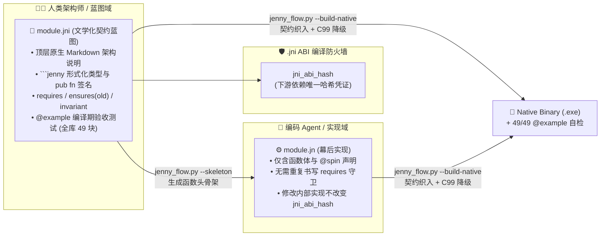
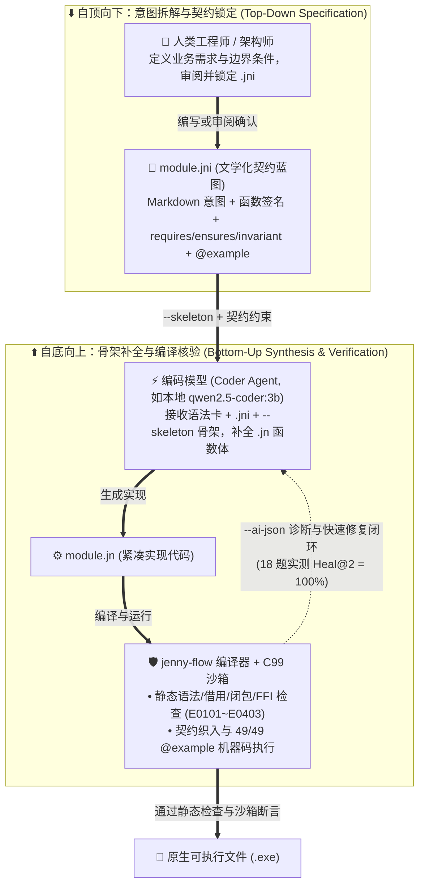

# Spinning Jenny (`Jenny`)：基于文学化契约分离、双轨内存模型与编译器辅助自愈的 AI 原生系统编程语言设计

**Spinning Jenny: Co-Designing an AI-Native Systems Programming Language with Literate Contracts, Dual-Track Memory, and Compiler-Guided Self-Healing**

> **语言规范版本**：Jenny Language Specification v2.0（编译器原型：`jenny-flow` C99 Backend **v0.1**）  
> **日期**：2026-10-17  
> **开源仓库与可复现工件**：[`Spinning Jenny Repository`](../../README.md) · [`25 模块基准集 (B01~B25)`](../../benchmarks/) · [`Token 计量脚本`](../../benchmarks/eval/measure_tokens.py) · [`C99 原生编译器与运行时`](../../compiler/jenny-flow/)  
> **English Edition**: [`spinning_jenny_paper_en.md`](./spinning_jenny_paper_en.md)

---

## 摘要 (Abstract)

当前的大语言模型（LLM）辅助编程（尤其是缺乏结构化约束的“凭感觉编程 / Vibe Coding”）正面临严峻的**工程落地悖论**：一方面，主流系统与工程语言（C/C++、Rust、Go）均诞生于“人类手写代码”时代，其语法与生命期机制并非为自回归 Token 生成设计（C/C++ 缺乏编译期别名与生命期检查易引入内存漏洞，Rust 的符号化借用检查 `&T`/`&mut T` 与显式生命周期 `<'a>` 易引发多轮编译报错，Go 的样板错误处理 `if err != nil` 带来较高的 Token 开销）；另一方面，LLM 生成代码的速度远超人类逐行阅读与心智审计的带宽极限。当接口、文档与底层实现混杂在同一源文件中时，人类难以高效审计 AI 的产物，而 AI 也缺乏机器可验真的形式化边界锚点——这种**人机双向盲区（Mutual Blindness）**不仅制约了代码投产效率，更可能导致系统实现与人类真实意图发生偏离。

本文提出，AI 时代的软件工程不应退化为由 AI 生成人类无法理解的黑盒系统；**将人类可读的架构意图与模型编写的底层实现解耦，并通过编译器实行机械化契约核验，是实现人机协同演进的可行路径**。为此，我们设计并实现了原型系统编程语言 **Spinning Jenny (`Jenny`)**（语言规范 v2.0）。本文的核心工作与实证结果包括：
1. **文学化契约蓝图（`.jni`）与幕后实现（`.jn`）物理分离**：继承并发展 Knuth 文学化编程与契约式设计（DbC），`.jni` 采用原生 Markdown 承载架构意图，并在围栏代码块中声明公共接口与一等公民契约（`requires`、`ensures(old)`、`invariant`、`@example`），编译时自动降级为 C99 运行时断言与 ABI 编译防火墙（`jni_abi_hash`）；
2. **无引用符号（Sigil-Free）的三态参数与双轨三态内存/闭包模型**：延续可变值语义（Mutable Value Semantics）方向，废除 `&T`、`&mut T` 与 `<'a>`，将参数划分为默认只读借用（`x: T`）、排他可变借用（`mut x: T`，降级为 C99 `restrict`）与显式所有权移交（`own x: T`）；将存储与闭包划分为栈绑定视图（`T` / `fn`）、独占原生堆（`*T` / `*in(arena) T` / `*fn[own ...]` 级联析构）与受 `effects [AllocGC]` 静态门禁约束的托管共享句柄（`^T` / `^fn`）；
3. **三层渐进式错误截断与 `@spin` 白盒元编程**：设计 16 字节双寄存器内联 `AnyError`（`T!`）与 16 槽位线程局部错误轨迹环，并提供将展开代码显式落盘至 `.spun/` 的编译期模板（`@spin` / `@apply`）与 `delegate` 委托语法；
4. **`Jenny-Bench-25` 可复现基准评估与本地 `3B` 模型骨架补全实验**：我们在 25 个单文件基准模块（`B01`~`B25`，75 个 `.jni`/`.jn`/`.rs` 文件）上实现了 Python $\rightarrow$ C99 转译编译器（`clang 18.1.8 -O3`）。脚本实测表明：在全部 25 个模块上，Jenny 代码总量（`.jni` 围栏代码 + `.jn`，共 `13,215` Tokens）相比完整 Rust 基线（`19,339` Tokens）减少 **31.67%**（$\text{TCR} = 0.6833$），相比剥离 `#[cfg(test)]` 后的 Rust 生产代码（`14,985` Tokens）减少 **11.81%**（$\text{TCR}_{\text{vs\_prod}} = 0.8819$）；其中 `B01`~`B24`（24 模块）总 $\text{TCR} = 0.6594$，而 `B25`（三轨闭包微基准）因显式环境结构体与三轨契约声明开销出现反转（$\text{TCR} = 1.7595$）。AI 负责编写的 `.jn` 实现层（`4,248` Tokens）占完整 Rust 的 **21.97%**（$\text{TCR}_{\text{impl}} = 0.2197$），占 Rust 生产代码的 **28.35%**（$\text{TCR}_{\text{impl/prod}} = 0.2835$），其中 `@spin` 声明式子集（`B19`~`B21`）手写 `.jn` 实现比值达 **`0.0879`**（展开后 `.spun/` 为 `1,141` Tokens）。在单张 4GB 消费级显卡运行未微调 `qwen2.5-coder:3b`（`temperature = 0.0`）的 18 道函数骨架补全实验中，模型在 `--ai-json` 诊断与确定性修复辅助下从 **`Pass@1 = 50.0% (9/18)` 收敛至 `Heal@2 = 100.0% (18/18)`**。本文同时详细报告了契约模糊测试原型（`--fuzz`）、26 项手写故障回归套件（`--mutate`）及有效性威胁（Threats to Validity）。

---

## 1. 引言 (Introduction)

### 1.1 背景：Vibe Coding 的人机双向盲区与意图漂移风险
1764 年，珍妮纺纱机（Spinning Jenny）通过改造机械传动结构，使纺纱工能够同时操控多根纱锭。今天，软件工程正在经历一场类似的转变：大语言模型（LLM）正成为代码生成的重要参与者。然而，当前主流系统与工程语言（C/C++、Rust、Go）的语法结构、借用规则与文件组织方式，均是为“人类手工逐行编写、人类视觉逐行审阅”而设计的。

当开发者采用非结构化的“凭感觉编程（Vibe Coding）”——即以自然语言直接让 LLM 生成成百上千行传统源码时，往往陷入**人机双向盲区（Mutual Blindness）**：
1. **AI 侧的语法与生命期摩擦**：C/C++ 缺乏编译期指针别名与生命期护栏，生成代码即使通过编译也可能暗藏内存安全缺陷 [1]；Rust 的显式引用符号（`&T`、`&mut T`）、生命周期参数（`<'a>`）与单一所有权树在共享图结构（如双向链表、回调闭包）上容易引发多轮借用检查错误 [2]；Go 虽简化了内存管理，但大量重复的 `if err != nil` 与样板转发代码消耗了可观的生成 Token。
2. **人类侧的审计带宽瓶颈与意图漂移**：LLM 生成代码的速度远超人类逐行阅读和心智建模的极限。当传统源文件中将业务意图、接口签名、底层实现细节与测试代码混杂在一起时，人类审阅者极易陷入信息过载。一旦人类放弃对底层代码的有效监督，任由模型通过硬编码或拼凑补丁来迎合表面测试（Reward Hacking），系统实现便可能与人类的真实业务需求发生**目标漂移（Alignment Drift）**。

### 1.2 核心设计假设：以文学化契约连接自然语言意图与形式化实现
自然语言需求与形式化机器指令之间存在天然的鸿沟。为了在不牺牲人类监督权的前提下提升 AI 编码效率，我们提出一条核心语言设计假设：**将“人类与高层模型共同审阅的架构意图与形式化契约（`.jni`）”与“编码模型合成的紧凑底层实现（`.jn`）”在物理文件与编译管线上彻底分离，建立“自顶向下拆解意图、自底向上编译核验”的闭环**。

在这一架构下，人类工程师无需逐行审计繁琐的样板实现，而是聚焦于审阅高信息密度的 `.jni` 文学化契约蓝图（包含原生 Markdown 设计说明、`requires`/`ensures`/`invariant` 契约与 `@example` 验收用例）；底层 `.jn` 实现则交由轻量级编码模型在编译器的静态检查与契约沙箱约束下合成。

### 1.3 本文贡献与可核验边界 (Contributions)
围绕上述假设，我们设计了 **Spinning Jenny (`Jenny` 规范 v2.0)** 并实现了 C99 原生转译编译器原型 `jenny-flow`。为确保学术严谨性与完全可复现性，我们将本文的贡献严格限定在仓库代码与评测脚本已实证的范围内：

* **贡献一：`.jni` 文学化契约蓝图与 `.jn` 实现物理分离架构（第 3 节）**。结合 Knuth 文学化编程 [8] 与 Meyer 契约式设计 [6]，在 `.jni` 中以原生 Markdown 承载设计意图，并将 ```` ```jenny ```` 块内的 `requires`、`ensures(old)`、`invariant` 与 `@example` 直接降级为 C99 运行时断言与 `.jni` ABI 编译防火墙（`jni_abi_hash`）。在 25 个基准模块上，仅加载 `.jni` 接口声明（`4,584` Tokens）相比加载 Jenny 完整代码（`13,215` Tokens）节省 **65.31%** 上下文（$\text{ECC}_{\text{self}}$），相比加载 Rust 生产代码（`14,985` Tokens）节省 **69.41%**（$\text{ECC}_{\text{vs\_rs\_prod}}$）。
* **贡献二：零引用符号（Sigil-Free）的三态参数、双轨内存与三轨闭包原型（第 4 节）**。在 Hylo 可变值语义 [5] 基础上，将参数传递定为默认只读借用（`x: T`）、排他可变（`mut x: T` $\rightarrow$ C99 `restrict`）与所有权移交（`own x: T`）；提供栈视图自动推导（`E0203`）、独占原生堆（`*T` / `*in(arena) T`）与受 `effects [AllocGC]`（`E0204`）门禁保护的池化托管句柄（`^T`），并将闭包生命期对齐为栈借用 `fn`（`E0205`）、独占堆 `*fn[own ...]`（`E0206` 自动级联析构）与托管 `^fn`。
* **贡献三：面向 Token 经济学的三层错误截断与 `@spin` 白盒编译期展开（第 5~6 节）**。实现 16 字节双寄存器 `JnAnyError`（`T!`）、16 槽位错误轨迹环、`delegate` 接口委托以及落盘至 `.spun/*.spun.jn` 的白盒模板（`@spin` / `@apply`）。在 25 个模块上，手写 `.jn` 实现层（`4,248` Tokens）为完整 Rust（`19,339` Tokens）的 **21.97%**（为 Rust 生产代码的 **28.35%**）；在 `B19`~`B21` 三个 `@spin` 模板模块上，手写 `.jn`（`292` Tokens）相对完整 Rust（`3,321` Tokens）比值为 **`0.0879`**（展开后 `.spun/` 代码为 `1,141` Tokens）。
* **贡献四：`Jenny-Bench-25` 基准集、26 项故障回归套件与本地 `3B` 模型骨架补全实证（第 7 节）**。开源 25 个模块（75 个对照文件）、49 个编译期 `@example` 沙箱测试、26 项手写编译期/运行期故障注入回归测试（`--mutate` 26/26 触发预期退出码或错误码）与契约模糊测试原型（`--fuzz`）。在 18 个代表性模块上，未微调的 `qwen2.5-coder:3b`（4GB VRAM，`temperature = 0.0`）在给定语法卡、`.jni` 与函数骨架的补全设定下，从 `Pass@1 = 50.0% (9/18)` 经 `--ai-json` 辅助修复在第二轮达到 `Heal@2 = 100.0% (18/18)`。

---

## 2. 研究背景与定量评价指标 (Background & Quantitative Metrics)

### 2.1 现有系统语言在 LLM 代码生成中的摩擦来源
既有实证研究揭示了主流语言在 LLM 代码生成中的三类典型摩擦：
1. **C/C++ 的静默内存安全风险**：Pearce 等人 [1] 对 GitHub Copilot 在 C 与 Python 等场景下的安全评估表明，在缺乏强静态检查的语言中，约 40% 的生成程序在特定 CWE 场景下包含可利用的安全缺陷（如越界写 `CWE-787`、释放后使用 `CWE-416`）。
2. **Rust 的所有权与生命周期报错集中现象**：Deligiannis 等人 [2] 对 LLM 生成 Rust 代码的编译错误分析表明，借用检查器与生命周期相关错误（如 `E0382` 移动后使用、`E0502`/`E0499` 可变别名冲突、`E0597`/`E0106` 生命周期不匹配）是阻碍模型一次编译通过的主要瓶颈。当涉及双向链表或自引用视图时，模型往往需要在 `Rc<RefCell<T>>` 样板包装或 `unsafe` 裸指针之间权衡。
3. **长上下文注意力退化与样板代码开销**：Liu 等人 [3] 证明了 LLM 在长上下文窗口中存在显著的“中间迷失（Lost in the Middle）”现象。减少跨模块调用时的无关实现噪音与重复错误处理样板，有助于提升有限上下文窗口的有效信息密度。

### 2.2 三组独立、无重叠的定量评估指标定义
为避免单一指标口径混淆（如将测试代码混入生产代码分母、或忽略白盒展开与 Markdown 散文体积），本文及评测脚本 [`measure_tokens.py`](../../benchmarks/eval/measure_tokens.py) 严格使用确定性词法/子词正则计数器（`TOKEN_PATTERN`，剥离 `//` 注释与空行），并分别报告以下三组正交指标：

1. **指标组一：模型实现书写量比值（$\text{TCR}_{\text{impl}}$ 与 $\text{TCR}_{\text{impl/prod}}$）**
   衡量编码模型需要生成的 `.jn` 实现文件相对于 Rust 基线的 Token 比例（同时分别以完整 `.rs` 文件与剔除 `#[cfg(test)]` 后的 Rust 生产代码作为分母）：
   $$\text{TCR}_{\text{impl}} = \frac{\text{Tokens}(\text{Jenny}_{.jn})}{\text{Tokens}(\text{Rust}_{\text{full}})}, \quad \text{TCR}_{\text{impl/prod}} = \frac{\text{Tokens}(\text{Jenny}_{.jn})}{\text{Tokens}(\text{Rust}_{\text{prod}})}$$
   对于使用了 `@spin` / `@apply` / `delegate` 的模块（`B18`~`B21`, `B24`），我们同时报告**手写 `.jn` Token 数**与编译器白盒展开后的 **`.spun/*.spun.jn` Token 数**。
2. **指标组二：总代码与全文档体积比值（$\text{TCR}$、$\text{TCR}_{\text{vs\_prod}}$ 与 $\text{TCR}_{\text{doc\_all}}$）**
   衡量 `.jni` 形式化围栏代码（含 `@example`）加 `.jn` 实现的总代码量相对于完整 Rust 或 Rust 生产代码的比值，以及额外计入 `.jni` 围栏外 Markdown 自然语言散文后的全文档比值：
   $$\text{TCR} = \frac{\text{Tokens}(\text{Jenny}_{.jni\text{ fenced}}) + \text{Tokens}(\text{Jenny}_{.jn})}{\text{Tokens}(\text{Rust}_{\text{full}})}, \quad \text{TCR}_{\text{vs\_prod}} = \frac{\text{Tokens}(\text{Jenny}_{.jni\text{ fenced}}) + \text{Tokens}(\text{Jenny}_{.jn})}{\text{Tokens}(\text{Rust}_{\text{prod}})}$$
   $$\text{TCR}_{\text{doc\_all}} = \frac{\text{Tokens}(\text{Jenny}_{.jni\text{ prose}}) + \text{Tokens}(\text{Jenny}_{.jni\text{ fenced}}) + \text{Tokens}(\text{Jenny}_{.jn})}{\text{Tokens}(\text{Rust}_{\text{full}})}$$
3. **指标组三：跨模块接口上下文节省率（$\text{ECC}_{\text{self}}$ 与 $\text{ECC}_{\text{vs\_rs\_prod}}$）**
   当其他模块调用本模块时，只需加载 `.jni` 中的形式化接口与契约声明（记为 $\text{Jenny}_{.jni\text{ iface}}$，不含 `@example` 测试块与 Markdown 散文）。我们分别报告其相对于 Jenny 自身总代码量的内部节省率（$\text{ECC}_{\text{self}}$）与相对于 Rust 生产代码的跨语言节省率（$\text{ECC}_{\text{vs\_rs\_prod}}$）：
   $$\text{ECC}_{\text{self}} = 1 - \frac{\text{Tokens}(\text{Jenny}_{.jni\text{ iface}})}{\text{Tokens}(\text{Jenny}_{.jni\text{ fenced}}) + \text{Tokens}(\text{Jenny}_{.jn})}, \quad \text{ECC}_{\text{vs\_rs\_prod}} = 1 - \frac{\text{Tokens}(\text{Jenny}_{.jni\text{ iface}})}{\text{Tokens}(\text{Rust}_{\text{prod}})}$$
4. **模型生成与修复指标（$\text{SHR}$、$\text{Pass}@1$、$\text{Heal}@k$）**：
   * **$\text{SHR}$**：模型输出中包含被禁用的 Rust 风格引用符号（`&self`、`&mut`、`<'a>`）的任务比例；
   * **$\text{Pass}@1$ / $\text{Heal}@k$**：在给定语法速查卡、完整 `.jni` 与 `jenny skeleton` 函数骨架的条件下，首轮生成即通过 C99 编译与全部 `@example` 断言的比例（$\text{Pass}@1$），以及在最多 $k-1$ 轮 `--ai-json` 反馈与确定性快速修复辅助下通过的比例（$\text{Heal}@k$）。

---

## 3. 文学化契约蓝图、一等公民防伪与自动化测试原型 (Literate Blueprints & Contract Testing)

### 3.1 `.jni` 与 `.jn` 物理分离架构
受 Knuth 文学化编程（Literate Programming）[8] 以及 Ada（Spec/Body）、Modula-2（`.def`/`.mod`）接口分离传统的启发，Jenny 在语言层将每个模块划分为两个物理文件：



* **`.jni`（Jenny Interface / Literate Blueprint）**：文件顶层直接是原生标准 Markdown（不使用 `///` 文档注释符号）。编译器提取 ```` ```jenny ```` 围栏代码块中的公共类型（`pub struct`/`enum`/`trait`）、函数签名（`pub fn`）、副作用声明（`effects`）与形式化契约。
* **`.jn`（Jenny Implementation）**：仅包含函数体实现与私有辅助函数。需要指出的是，Jenny 并非消除了测试代码，而是将传统语言中散落在 `_test.rs` / `_test.go` 中的测试与边界规约，结构化地收敛到了 `.jni` 的 `requires`/`ensures`/`invariant` 与 `@example` 块中。

### 3.2 四维一等公民契约与 C99 降级机理
在 `.jni` 围栏块中，四类契约直接参与 C99 代码生成（[`jenny_flow.py`](../../compiler/jenny-flow/jenny_flow.py)）：
1. **前置条件（`requires cond [else ErrorExpr]`）**：织入生成 C99 函数的入口处。若声明了 `else ErrorExpr` 且函数返回错误联合类型（`T ! E`），则在条件不满足时直接构造并返回对应错误值（免去 `.jn` 中手写前置校验 `if`）；若为无 `else` 的硬性前置条件，则触发 `jn_contract_fail("requires", ...)`（退出码 `42`）。
2. **后置条件与历史快照（`ensures cond` & `old(expr)`）**：若 `ensures` 引用了 `old(self.field)`，编译器在 C99 函数入口自动合成快照变量 `_old_0 = self->field`，并在所有正常成功返回（`return Ok` 或普通返回）路径前通过 `emit_exit_checks` 织入后置条件断言。
3. **结构体不变量（`invariant cond`）**：声明在 `pub struct` 内，在构造函数返回及 `mut self` 方法正常返回前自动核验。
4. **内嵌编译期示例（`@example("id") { ... }`）**：在 `B01`~`B25` 中共包含 **49 个 `@example` 块**。每次编译时，编译器将其降级为 `static void run_example_N(void)` 并在原生沙箱中立即执行。

### 3.3 静态契约赋值检查 (`E0108`) 的作用与边界
当 LLM 实现包含多个分支的状态更新方法时，可能出现遗漏更新某个结构体字段的情况（例如在 `B07_audio_normalizer` 的提前返回分支漏写 `self.processed_samples += 1`）。为此，`jenny-flow` 实现了静态检查 **`E0108_MISSING_ENSURES_FIELD_MUTATION`**：
* **检查机理**：扫描 `.jni` 中某函数的无条件 `ensures` 子句所引用的 `self.field` 字段集合，并检查 `.jn` 函数体（及其调用的同类辅助方法）AST 中是否存在对该字段的赋值语句（或无提前返回的统一更新）。若未检测到赋值，则抛出 `E0108` 并给出单步修复提示。
* **能力边界说明**：`E0108` 是一项轻量级 **AST 语法赋值存在性检查**，而非基于 SMT 求解器的完备路径证明。若函数体对目标字段赋了错误的值，静态 `E0108` 不会触发，需由第 3.2 节织入 C99 的运行期 `ensures` 断言与 `@example` 沙箱在执行时捕获（以退出码 `42` 拦截）。

### 3.4 自顶向下拆解与自底向上核验的意图编程工作流
依托 `.jni` 与 `.jn` 的分离，软件开发工作流可组织为自顶向下拆解与自底向上核验两个阶段：



> **注**：在工作流约定中，编码 Agent 仅被赋予写入 `.jn` 的权限而不修改 `.jni`（当前原型通过评测驱动脚本保证 `.jni` 不变，尚未在操作系统文件系统层做强制权限锁）。关于由高层推理大模型自动从自然语言生成 `.jni` 的多 Agent 协同模式，详见第 9 节未来工作讨论。

### 3.5 基于契约的自动化测试原型体系 (`@example`、`--fuzz` 与 `--mutate`)

为了避免让同一个编码模型同时编写业务代码和独立 `_test` 文件所导致的“同源错误假设复制”，`jenny-flow` 直接以 `.jni` 蓝图为基础，实现了三层自动化测试与回归原型（外加一层规划中的差分架构）：

1. **第一层（已实现）：编译期 `@example` 确定性沙箱**：
   全库 25 个模块的 `.jni` 中内嵌了 **49 个手写 `@example` 验收测试块**，在每次 `clang -std=c11 -O3` 编译后自动运行，连同织入函数体内的 `requires`、`ensures(old)` 与 `invariant` 断言一起校验实现正确性。
2. **第二层（已实现原型）：标量自由函数随机调用与 `@example` 压力重放（`python compiler/jenny-flow/jenny_flow.py --fuzz`）**：
   * 编译器在生成每个模块的 `.jenny-cache/c99/<module>.c` 时，自动合成 `static void run_contract_fuzz_suite(void)`（通过命令行参数 `-2` 触发）。
   * **当前原型的精确覆盖范围与局限**：生成器静态筛选模块中所有“无接收者（自由函数）、参数与返回值均为只读标量（`i64/i32/u32/u16/u8/usize/bool` 或 `void`）、且声明了 `requires` 或 `ensures`”的函数。在 `B01`~`B25` 全集中，共有 **11 个模块中的 15 个标量自由函数**符合该条件（其余 13 个以结构体方法为主的模块以及 `B17` 的合格自由函数数为 0）。
   * 对每个合格函数，驱动器循环调用 **100 次**（前 16 次从 16 元常数边界表 `{-100, -10, -1, 0, 1, 2, 3, 4, 6, 8, 10, 16, 32, 50, 64, 100}` 取值，后 84 次使用 `xorshift64*` 在 `[-20, 99]` 区间采样），合计执行 **`15 × 100 = 1,500` 次标量函数调用**；随后将该模块内嵌的 `@example` 块循环重放 **20 次**（全库 `49 × 20 = 980` 次重放），每轮重放后调用 `jn_gc_collect_all()` 并读取运行时计数器验证 `jn_active_native_boxes() == 0`。两项合计按固定日程执行 **`2,480` 次调用（`1,500 + 980`）**。
   * **原型边界说明**：当前这 15 个函数的前置条件均采用 `requires ... else Error` 形式，非法输入会进入函数并走错误分支安全返回，而 `ensures` 后置断言仅织在正常成功返回路径上（且 `B03` `eval_binary` 与 `B10` `aggregate_both_sources` 仅含 `requires` 无 `ensures`）。支持结构体方法序列生成、基于 SMT 的 `requires` 输入域求解以及编译时开启 UBSan 检查，属于后续演进工作。
3. **第三层（已实现回归套件）：26 项手写故障注入回归测试（`jenny_nano.py --mutate` 与 `jenny_flow.py --mutate`）**：
   仓库内置了 **26 个手写故障注入回归用例**：其中 **13 个为运行期契约防伪用例**（[`jenny_nano.py --mutate`](../../compiler/jenny-nano/jenny_nano.py) 中的 `MUT-B01-A/B` 及 `MUT-B02-A`~`MUT-B10-A` 共 11 项，加上 [`jenny_flow.py --mutate`](../../compiler/jenny-flow/jenny_flow.py) 中的 `MUT-B11-A`、`MUT-B12-A` 共 2 项，均触发 `@example` 契约沙箱退出码 `42`），另外 **13 个为编译期静态安全回归用例**（`jenny_flow.py --mutate` 中逐一对应 `E0106`、`E0201`~`E0206`、`E0305`~`E0307`、`E0401`~`E0403` 的 13 项静态错误注入），用于回归验证契约织入器与静态检查器的有效性。
4. **第四层（未来工作规划）：跨模型重织差分回归（Differential Re-Weaving Oracle）**：
   未来当更换底层编码模型重新生成 `.jn` 时，计划利用同一随机种子并排运行新旧二进制以比对输出与内存轨迹（当前编译器尚未实现 `--diff` 命令）。

---

## 4. 零符号噪音的双轨内存、三态参数与三轨闭包模型 (Dual-Track Memory & Three-Mode Ownership)

### 4.1 三态参数传递模式：与 Hylo 可变值语义的异同
Jenny 借鉴了 Hylo（原 Val）[5] 的可变值语义（Mutable Value Semantics）思想，将参数传递简化为三种显式意图模式，从而消除了 Rust 中的 `&T` 与 `&mut T` 引用符号：

| 参数传递模式 | Jenny 语法 | Hylo (Val) 对应概念 | Rust 对应语法 | 调用后原变量状态 | C99 降级映射 (`jenny_rt.h`) | 编译器静态检查码 |
| :--- | :--- | :--- | :--- | :--- | :--- | :--- |
| **1. 默认只读借用** | **`x: T`** / **`self`** | `let` (默认参数) | `x: &T` / `&self` | **保持有效**（不可被 Move） | 标量按值传，结构体传 `const T*` | `E0106_READONLY_PARAM_MUTATION` |
| **2. 排他可变借用** | **`mut x: T`** / **`mut self`** | `inout` | `x: &mut T` / `&mut self` | **保持有效**（原地修改生效） | 传 **`T* JN_RESTRICT`** (`__restrict`) | `E0202_CONFLICTING_MUT_BORROW` |
| **3. 所有权移交** | **`own x: T`** / **`own self`** | `sink` | `x: T` / `self` | **已被消耗（Moved）** | 传所有权并在函数退出前自动释放 | `E0201_USE_AFTER_OWN` |

与纯值语义的 Hylo 不同，Jenny 作为面向系统与全栈场景的双轨语言，在三态参数之上结合了显式的堆指针轨道（`*T` 与 `^T`）。由于 `mut x: T` 经 `E0202` 静态检查排除了同一调用语句内的重复可变借用，C99 后端为其生成 `JN_RESTRICT`（`__restrict`）修饰符，供底层 C 编译器进行别名优化。

### 4.2 双轨三态存储模型与当前 `jenny_rt.h` 运行时实现
Jenny 废除了显式生命周期标注（`<'a>`），将对象存储划分为三条轨道（实现见 [`jenny_rt.h`](../../compiler/jenny-flow/jenny_rt.h)）：

1. **轨道一：栈值与编译器自动推导视图（`T`）**
   * 纯数值结构体直接按值分配在栈上。
   * **自动视图推导（`E0203`）**：任何包含字符串切片 `str` 或数组切片 `[]T` 的 `struct`（如 `B14_zero_copy_http_view` 中的 `HttpRequestView`），自动被编译器归类为**栈绑定视图（Stack-Bound View）**。静态检查器禁止将其装箱至堆内存（如 `*HttpRequestView` 或 `^HttpRequestView` 会触发 `E0203_VIEW_STRUCT_ESCAPE`），从而在不写 `<'a>` 的情况下阻止切片视图逃逸到堆上。
2. **轨道二：独占原生堆指针（`*T`）与区域分配（`*in(arena) T`）**
   * `*T` 为唯一所有者堆盒，底层调用 `jn_box_alloc(sizeof(T))`（封装 `calloc` 并递增全局活跃盒计数器 `_jn_active_native_boxes`）。在作用域退出、提前 `return` 或 `?` 错误返回时，编译器织入 `jn_box_free(ptr)`（递减计数器并 `free`）。
   * `*in(arena) T` 在 `JnArena`（`jn_arena_init` / `jn_arena_alloc` 游标碰撞分配）上分配节点，并在作用域结束时由 `jn_arena_drop` 一次性释放整块区域内存（如 `B15_arena_ast_builder`、`B23_arena_json_tokenizer`）。
3. **轨道三：托管共享句柄（`^T`）与副作用门禁（`effects [AllocGC]`）**
   * 针对双向链表（`B16_lru_doubly_linked`）等含循环引用的共享拓扑，提供 `^T` 托管句柄。
   * **当前原型运行时实现说明**：在当前的 [`jenny_rt.h`](../../compiler/jenny-flow/jenny_rt.h) 原型中，`jn_gc_alloc(size)` 采用固定容量（1024 槽位）的全局指针注册表配合 `calloc` 实现，`jn_gc_collect_all()` 在任务或请求周期结束时遍历该表一次性 `free` 全部已注册指针并清空槽位（完整的多块式 Immix 标记-区域疏散回收器目前仅在设计规范中定义，属于第 9.4 节的后续工程演进）。
   * **静态副作用隔离（`E0204`）**：任何分配 `^T` 或调用含 GC 副作用函数的代码，必须在 `.jni` 签名中显式标注 `effects [AllocGC]`，否则触发 `E0204_UNDECLARED_EFFECT`。

### 4.3 三轨闭包生命期与 C99 Lambda Lifting（`B25`）
在 [`B25_closure_lifetimes`](../../benchmarks/stage4_native/B25_closure_lifetimes/closure_lifetimes.jn) 中，Jenny 将闭包类型与上述三条存储轨道一一对应，并通过 C99 Lambda Lifting 降级：
* **栈绑定借用闭包（`fn(A) -> R`，字面量 `(x) => expr`）**：16 字节胖指针 `{call, const void* env}`，环境结构体 `_JnClosureEnv_N` 直接分配在当前 C 栈帧上（0 堆分配），由 `E0205_STACK_CLOSURE_ESCAPE` 静态禁止作为返回值逃逸。
* **独占原生堆闭包（`*fn(A) -> R`，字面量 `*fn[own cap](x) => expr`）**：24 字节结构体 `{call, drop_env, void* env}`。若捕获外部独占指针（如 `sig: *SignalBox`），`E0206_CLOSURE_MISSING_OWN_CAPTURE` 强制要求显式声明 `[own sig]`，且编译器自动合成级联析构函数 `_jn_closure_drop_N`，在 `jn_box_fn_drop` 时依次释放内部 `*SignalBox` 与闭包环境自身。
* **托管共享闭包（`^fn(A) -> R`，字面量 `^fn(x) => expr`）**：16 字节结构体 `{call, void* env}`，环境通过 `jn_gc_alloc` 分配，受 `effects [AllocGC]`（`E0204`）约束。

---

## 5. Token 经济学机制：错误截断、接口委托与 `@spin` 白盒元编程

### 5.1 三层渐进式错误截断与 16 字节 `JnAnyError`
在多层调用链（如 `B11_layered_gateway`）中，Jenny 支持三层错误签名：
1. **底层精确值错误（`T ! E`）**：返回具体错误枚举（如 `i64 ! CacheError`）。
2. **领域层混合截断（`T ! (BizError | AnyError)`）**：保留调用方需分支处理的业务错误，将其他底层错误经 `?` 折叠入 `AnyError`。
3. **顶层全截断简写（`T!`）**：等价于 `T ! AnyError`。

在 `jenny_rt.h` 中，`JnAnyError` 被定义为恰好 **16 字节**的结构体 `{uint32_t type_id; uint32_t code; union { int64_t inline_payload; void* heap_ptr; }}`（由 `_Static_assert(sizeof(JnAnyError) == 16)` 保证），同时维护一个 16 槽位线程局部环形缓冲区（`_jn_trace_ring`），在 `JN_RECORD_TRACE` 时记录文件名、行号与函数名，无需运行时栈回溯即可通过 `trace_depth()` 查询错误传播跳数。

### 5.2 16 字节 `dyn Trait` 与 `delegate` 委托转发（`B18`）
在 [`B18_trait_delegate_decorator`](../../benchmarks/stage3_spin/B18_trait_delegate_decorator/trait_delegate.jn) 中，装饰器结构体 `AuditedKvDecorator` 通过声明 `delegate KvEngine to self.inner`，由编译器在 `.spun/trait_delegate.spun.jn` 与 C99 后端自动合成未覆写方法（`get`、`remove`、`count`）的转发实现与 16 字节胖指针虚表（`JnDyn_KvEngine`），若委托目标字段不存在则静态报错 `E0307_INVALID_DELEGATE_TARGET`。

### 5.3 `@spin` 白盒编译期模板与展开体积对比（`B19`~`B21`）
为避免黑盒宏展开带来的调试困难，`jenny-flow` 内置了三个声明式代码生成模板：
* `@spin fsm::state_machine(OrderMachine)`（`B19_spin_fsm_order`）
* `@apply(codec::binary)` 与 `@spin if`（`B20_spin_binary_codec`）
* `@apply(crud::service(table: "accounts", key: u64, value: i64))`（`B21_spin_crud_service`）

所有展开代码均格式化输出至 **`.spun/<module>.spun.jn`**，并执行两项静态检查：**纯增量规则（`E0306_SPIN_MUTATE_EXISTING_FIELD`）** 禁止篡改已有结构体字段；**二进制编解码边界检查（`E0305_SPIN_GC_IN_BINARY_CODEC`）** 禁止在 `@apply(codec::binary)` 结构体中包含 `^T` 托管指针。

---

## 6. 编译器管线、零胶水 C FFI 与增量 CAS 缓存

### 6.1 `jenny-flow` Python $\rightarrow$ C99 转译管线
当前编译器原型 [`jenny_flow.py`](../../compiler/jenny-flow/jenny_flow.py)（约 4,100 行 Python）包含五个阶段：
1. **蓝图与实现解析**：提取 `.jni` 中的 ```` ```jenny ```` 块与契约，并对 `.jn` 执行容错词法归一化（静默剥离偶发的行尾分号 `;` 并记入 `W0103_TOLERANT_TRAILING_SEMICOLON` 计数）；
2. **`@spin` 与 `delegate` 展开**：生成 `.spun/<module>.spun.jn`；
3. **静态语义检查**：执行 `E0101`~`E0403` 检查，若启用 `--check-file` 则输出结构化 `--ai-json` 诊断（含行号、违规词元与 `suggested_replacement`）；
4. **契约织入与 C99 代码生成**：生成 `.jenny-cache/c99/<module>.c`；
5. **原生编译与沙箱执行**：调用系统 `clang -std=c11 -O3` 编译生成 `.jenny-cache/bin/<module>.exe`，并运行全部 `@example` 用例。

### 6.2 C FFI 互操作护栏（`B22`）
在 [`B22_c_ffi_crc32_hasher`](../../benchmarks/stage4_native/B22_c_ffi_crc32_hasher/c_ffi_crc32.jni) 中，Jenny 支持 `import c "crc32_vendor.h" as c_crc`，并强制检查三条规则：
* **`E0401_FFI_IMPLICIT_RAW_PTR`**：禁止将 `str` 或 `[]T` 切片直接传给 C 指针参数，必须显式调用 `.as_raw_ptr()`；
* **`E0402_FFI_MISSING_UNSAFE_EFFECT`**：调用 C FFI 函数的 Jenny 函数必须在 `.jni` 中声明 `effects [Unsafe]`；
* **`E0403_FFI_GC_PTR_TO_C`**：禁止在 `@repr(C)` 结构体或 C 函数参数中传递 `^T` 托管句柄。

---

## 7. 实验评估 (Empirical Evaluation)

我们在本机环境（`Intel Core i7-13700H 14C/20T`、`32GB DDR5 RAM`、`NVIDIA GeForce RTX 3050 4GB Laptop GPU`、`Windows 11`、`clang 18.1.8`、`Ollama v0.40.5 + qwen2.5-coder:3b Q4_K_M`）上对 **`Jenny-Bench-25`**（25 个模块，75 个源码文件）进行了完整测试。所有原始输出快照均保存在仓库 [`.jenny-cache/`](../../.jenny-cache/) 与 [`.spun/`](../../.spun/) 目录下，可由脚本一键复现。

---

### 7.1 RQ1：Token 经济学与上下文容量实测（完全对齐 `measure_tokens.py`）

运行 `python benchmarks/eval/measure_tokens.py`（输出快照见 [`.jenny-cache/token_metrics_snapshot.json`](../../.jenny-cache/token_metrics_snapshot.json)），按阶段汇总及分别列出 `B01`~`B24` 小计、`B25` 单题与 `B01`~`B25` 总计的实测结果如下表所示（全集 25 题逐题明细见文末**附录 A**）：

| 阶段与基准集分组 | 模块范围 | Rust 全量 (`.rs`) | Rust 生产代码 (不含 `test`) | `.jni` 接口 (不含 `@example`) | `.jni` 围栏全量 (含 `@example`) | `.jn` 手写实现 | Jenny 代码总量 (`.jni`围栏+`.jn`) | **$\text{TCR}$ (对全量 / 对生产)** | **$\text{TCR}_{\text{impl}}$ (对全量 / 对生产)** | **$\text{ECC}_{\text{self}}$ / $\text{ECC}_{\text{vs\_rs\_prod}}$** |
| :--- | :---: | ---: | ---: | ---: | ---: | ---: | ---: | :---: | :---: | :---: |
| **Stage 0: `Seed-10`** | `B01`~`B10` (10题) | 6,933 | 4,684 | 1,926 | 3,798 | 1,459 | 5,257 | `0.7583` / `1.1223` | `0.2104` / `0.3115` | `63.36%` / `58.88%` |
| **Stage 1: `Flow-2`** | `B11`~`B12` (2题) | 1,624 | 1,282 | 286 | 614 | 377 | 991 | `0.6102` / `0.7730` | `0.2321` / `0.2941` | `71.14%` / `77.69%` |
| **Stage 2: `Mem-5`** | `B13`~`B17` (5题) | 3,756 | 2,785 | 791 | 1,520 | 958 | 2,478 | `0.6597` / `0.8898` | `0.2551` / `0.3440` | `68.08%` / `71.60%` |
| **Stage 3: `Spin-4`** | `B18`~`B21` (4题) | 4,439 | 3,647 | 706 | 1,444 | 672 *(展开 1,579)* | 2,116 | `0.4767` / `0.5802` | `0.1514` (`6.61x`) / `0.1843` | `66.64%` / `80.64%` |
| ↳ *其中 `@spin` 子集* | *`B19`~`B21` (3题)* | *3,321* | *2,749* | *333* | *865* | *292 (展开 1,141)* | *1,157* | *`0.3484` / `0.4209`* | ***`0.0879` (`11.37x`) / `0.1062`*** | *`71.22%` / `87.89%`* |
| **Stage 4a: `Native-3`** | `B22`~`B24` (3题) | 2,167 | 2,167 | 609 | 1,100 | 534 *(含B24展开 915)* | 1,634 | `0.7540` / `0.7540` | `0.2464` / `0.2464` | `62.73%` / `71.90%` |
| **小计 (`B01`~`B24`)** | **前 24 题合计** | **18,919** | **14,565** | **4,318** | **8,476** | **4,000** | **12,476** | **`0.6594` / `0.8566`** | **`0.2114` / `0.2746`** | **`65.39%` / `70.35%`** |
| **Stage 4b: `B25` 单题** | `B25_closure_lifetimes` | 420 | 420 | 266 | 491 | 248 | 739 | **`1.7595` / `1.7595` (反转)** | `0.5905` / `0.5905` | `64.01%` / `36.67%` |
| **🏆 全集总计 (`B01`~`B25`)** | **全部 25 题合计** | **19,339** | **14,985** | **4,584** | **8,967** | **4,248** | **13,215** | **`0.6833` / `0.8819`** | **`0.2197` / `0.2835`** | **`65.31%` / `69.41%`** |

**实证分析与负面结果讨论**：
1. **生产代码与测试代码的拆解对比**：在 Rust 全量 `19,339` Tokens 中，`#[cfg(test)]` 单元测试占 `4,354` Tokens（`22.5%`），Rust 生产代码为 `14,985` Tokens。而在 Jenny 中，49 个 `@example` 验收块（共 `4,383` Tokens）位于 `.jni` 围栏内。因此，若仅对比模型需生成的 `.jn` 实现文件（`4,248` Tokens）：它占完整 Rust 文件的 **21.97%**（省 78.03%），占剔除测试后 Rust 生产代码的 **28.35%**（省 71.65%）。此外，`.jni` 围栏外的 Markdown 自然语言说明在全集 25 题中共计 `5,040` Tokens；若将自然语言散文、`.jni` 围栏代码与 `.jn` 全部相加（`18,255` Tokens），则与完整 Rust 文件（`19,339` Tokens）基本相当（$\text{TCR}_{\text{doc\_all}} = 0.9439$）。
2. **`@spin` 手写体积与 `.spun/` 白盒展开体积**：在 `Spin-Bench-4`（`B18`~`B21`）四题整体上，$\text{TCR}_{\text{impl}} = 0.1514$（`6.61x`）；其中采用 `@spin`/`@apply` 模板的 `B19`~`B21` 三题手写 `.jn` 仅 `292` Tokens（相对完整 Rust `3,321` Tokens 为 **`0.0879` / `11.37x`**，相对 Rust 生产代码 `2,749` Tokens 为 **`0.1062` / `9.41x`**）。编译器将其白盒展开至 `.spun/` 后的代码量为 `1,141` Tokens（`B19`: `428`, `B20`: `402`, `B21`: `311`），依然显著少于对应的 Rust 代码。
3. **负面结果剖析——为什么 `B25_closure_lifetimes` 的总 $\text{TCR}$ 高达 `1.7595`？**
   在 `B25` 单题上，Jenny 代码总量（`739` Tokens）比 Rust（`420` Tokens）多出 **75.95%**（在 Stage 0 等小型模块上，若剔除 Rust 测试代码，Jenny 含 `@example` 的总代码量也略高于纯 Rust 生产代码，`1.1223`）。原因在于：`B25` 是一个专门为同时验证三条闭包轨道（栈借用 `fn`、独占堆 `*fn[own sig]`、GC 堆 `^fn`）设计的微基准，其 `.jni` 蓝图显式定义了两个结构体（`SignalBox`、`ThresholdFilter`）、4 个带完整 `requires`/`ensures` 契约的函数签名以及 3 个独立的 `@example` 内存核算沙箱（仅 `.jni` 围栏就占了 `491` Tokens，而 `.jn` 实现为 `248` Tokens）。这揭示了 `.jni`/`.jn` 分离架构的一个客观权衡（Trade-off）：**在规模极小（`< 500` Tokens）且被密集契约与多组 `@example` 标注的微模块中，`.jni` 的形式化规约开销会超过 `.jn` 实现层节省的 Token；只有当模块逻辑复杂度上升或跨模块复用 `.jni` 接口时，压缩收益才占主导地位。**

---

### 7.2 RQ2：`Mem-Bench-5` (`B13`~`B17`) 与三轨闭包 (`B25`) 逐题实测明细

表 7.2 展示了仓库 [`benchmarks/stage2_mem/`](../../benchmarks/stage2_mem/) 与 [`B25_closure_lifetimes`](../../benchmarks/stage4_native/B25_closure_lifetimes/) 的真实模块名称、Token 计量与运行时内存核算结果（完全对齐 `measure_tokens.py` 与 [`stage2_acceptance_criteria.md`](../tests/stage2_acceptance_criteria.md)）：

| 仓库真实模块目录名 | 核心考察的内存与生命期特性 | Rust 全量 / 生产 Token | Jenny `.jni` 接口 / 全量 Token | Jenny `.jn` 实现 Token | 总 $\text{TCR}$ | 实现层 $\text{TCR}_{\text{impl}}$ (对全量 / 对生产) | 沙箱运行期内存验证结果 |
| :--- | :--- | :---: | :---: | :---: | :---: | :---: | :--- |
| **`B13_pcm_frame_pipeline`** | `*PcmFrame` 独占堆盒、`self`/`mut self`/`own frame` 传递、错误分支确定性释放 | 1,085 / 791 | 205 / 353 | 251 | `0.5567` | `0.2313` / `0.3173` | `active_native_boxes() == old(...)` (`0` 泄漏) |
| **`B14_zero_copy_http_view`** | 含 `str` 切片的隐式栈视图 `HttpRequestView`（零 `<'a>`）+ `E0203` 禁装箱 | 710 / 481 | 118 / 324 | 140 | `0.6535` | `0.1972` / `0.2911` | 栈绑定零拷贝视图 (`0` 堆分配) |
| **`B15_arena_ast_builder`** | `Arena.new` + `*in(arena) AstNode` 区域碰撞分配与 `arena.drop()` | 926 / 692 | 168 / 336 | 266 | `0.6501` | `0.2873` / `0.3844` | `jn_arena_drop` 作用域整块释放 |
| **`B16_lru_doubly_linked`** | 双节点双向链表 `^LruNode` 前驱/后继环路互指 + `effects [AllocGC]` | 581 / 477 | 129 / 252 | 157 | `0.7040` | `0.2702` / `0.3291` | `jn_gc_collect_all()` 池表清空 |
| **`B17_struct_field_split_mut`** | `self.apply_step(self.effective_delta(scale))` 嵌套只读与可变借用 | 454 / 344 | 171 / 255 | 144 | `0.8789` | `0.3172` / `0.4186` | 纯栈值结构体 (`0` 堆分配) |
| **`B25_closure_lifetimes`** | 栈闭包 `fn`、`*fn[own sig]` 级联析构 `_jn_closure_drop_1` 与 `^fn` | 420 / 420 | 266 / 491 | 248 | `1.7595` | `0.5905` / `0.5905` | `jn_box_fn_drop` 后 `active_native_boxes() == 0` |

---

### 7.3 RQ3：26 项手写故障回归套件（`13` 运行期 + `13` 静态）与契约模糊测试原型（`--fuzz`）

分别运行 `python compiler/jenny-nano/jenny_nano.py --mutate` 与 `python compiler/jenny-flow/jenny_flow.py --mutate --fuzz` 的实测结果如下：

1. **契约模糊测试与重放原型（`--fuzz`）**：
   在全部 **25/25 个模块**上，编译器生成的 `run_contract_fuzz_suite()` 均编译并运行成功（退出码 `0`）。如第 3.5 节所界定，该套件在 11 个模块的 **15 个标量自由函数上执行了 `1,500` 次边界与伪随机参数调用**，并在全部 25 个模块上对 **49 个 `@example` 块执行了 20 轮压力重放（`980` 次调用）**，合计完成 **`2,480` 次预定日程调用**；每轮重放并执行 `jn_gc_collect_all()` 后，动态读取的 `jn_active_native_boxes()` 计数器均为 **`0`**（输出快照见 [`.jenny-cache/fuzz_report.json`](../../.jenny-cache/fuzz_report.json)）。
2. **13 项运行期契约防伪回归测试（`11 + 2 = 13` 项）**：
   * 在 [`jenny_nano.py --mutate`](../../compiler/jenny-nano/jenny_nano.py) 中向 `B01`~`B10` 注入 **11 项**语义篡改（`MUT-B01-A`、`MUT-B01-B` 及 `MUT-B02-A`~`MUT-B10-A`），**11/11** 均在 `@example` 沙箱执行时触发契约守卫并以退出码 `42` 终止；
   * 在 [`jenny_flow.py --mutate`](../../compiler/jenny-flow/jenny_flow.py) 中向 `B11`~`B12` 注入 **2 项**语义篡改（`MUT-B11-A` 将 `total_charged` 算错为 `sub - 100` 违反 `GatewayReceipt` 的 `invariant`、`MUT-B12-A` 跳过 `clamp_score` 上界违反 `ensures result <= 1000`），**2/2** 均以退出码 `42` 终止。
3. **13 项编译期静态检查回归测试（`jenny_flow.py --mutate`，Stage 2~4）**：
   针对 `jenny_flow.py --mutate` 中构造的 **13 个静态违规变异体**（表 7.3；注：语法层面的 `E0101_FORBIDDEN_REF_SYNTAX`、`E0102_FORBIDDEN_LET_BINDING` 与 `E0108_MISSING_ENSURES_FIELD_MUTATION` 另由 `llm_eval_harness.py --provider mock` 及在线评测覆盖），编译器静态检查器均返回了对应的预期错误码：

| 回归用例编号 | 目标模块 | 注入的非法借用 / 视图 / 副作用 / 元编程 / 闭包 / FFI 构造 | 实测捕获的静态错误码 | 结果 |
| :--- | :--- | :--- | :--- | :---: |
| `MUT-S2-E0106` | `B13_pcm_frame_pipeline` | 在默认只读方法 `peak_energy(self)` 内修改字段 `self.s0 = 0` | `E0106_READONLY_PARAM_MUTATION` | ✅ 捕获 |
| `MUT-S2-E0201` | `B13_pcm_frame_pipeline` | 在 `consume_and_archive(own frame)` 消耗所有权后再次访问 `frame` | `E0201_USE_AFTER_OWN` | ✅ 捕获 |
| `MUT-S2-E0202` | `B16_lru_doubly_linked` | 调用 `link_two_nodes(mut n1, mut n1)` 对同一变量同时发起两次 `mut` 借用 | `E0202_CONFLICTING_MUT_BORROW` | ✅ 捕获 |
| `MUT-S2-E0203` | `B14_zero_copy_http_view` | 试图将含 `str` 切片的栈视图装箱为 `*HttpRequestView` | `E0203_VIEW_STRUCT_ESCAPE` | ✅ 捕获 |
| `MUT-S2-E0204` | `B16_lru_doubly_linked` | 在未声明 `effects [AllocGC]` 的 `sum_linked_pair` 中分配 `^LruNode` | `E0204_UNDECLARED_EFFECT` | ✅ 捕获 |
| `MUT-S3-E0305` | `B20_spin_binary_codec` | 在 `@apply(codec::binary)` 结构体中嵌入 `^TelemetryPacket` 托管句柄 | `E0305_SPIN_GC_IN_BINARY_CODEC` | ✅ 捕获 |
| `MUT-S3-E0306` | `B19_spin_fsm_order` | 在 `@spin` 块中尝试 `!mutate_field state` 篡改宿主结构体已有字段 | `E0306_SPIN_MUTATE_EXISTING_FIELD` | ✅ 捕获 |
| `MUT-S3-E0307` | `B18_trait_delegate_decorator` | 将 `delegate KvEngine to self.inner` 指向不存在的字段 `self.missing_engine` | `E0307_INVALID_DELEGATE_TARGET` | ✅ 捕获 |
| `MUT-S4-E0401` | `B22_c_ffi_crc32_hasher` | 将 `str` 切片 `payload` 未经 `.as_raw_ptr()` 直接传给 `c_crc::jenny_c_crc32` | `E0401_FFI_IMPLICIT_RAW_PTR` | ✅ 捕获 |
| `MUT-S4-E0402` | `B22_c_ffi_crc32_hasher` | 移除 `compute_packet_crc` 的 `effects [Unsafe]` 后调用 C FFI 函数 | `E0402_FFI_MISSING_UNSAFE_EFFECT` | ✅ 捕获 |
| `MUT-S4-E0403` | `B22_c_ffi_crc32_hasher` | 在 `@repr(C) pub struct CrcPacket` 中内嵌 `^CrcPacket` 托管句柄 | `E0403_FFI_GC_PTR_TO_C` | ✅ 捕获 |
| `MUT-S4-E0205` | `B25_closure_lifetimes` | 在 `make_shared_scorer` 中直接返回栈借用闭包造成栈帧逃逸 | `E0205_STACK_CLOSURE_ESCAPE` | ✅ 捕获 |
| `MUT-S4-E0206` | `B25_closure_lifetimes` | 在逃逸堆闭包 `*fn(v) => ...` 中捕获 `sig: *SignalBox` 却漏写 `[own sig]` | `E0206_CLOSURE_MISSING_OWN_CAPTURE` | ✅ 捕获 |

---

### 7.4 RQ4：本地 `3B` 模型 (`qwen2.5-coder:3b`) 骨架补全与辅助自愈实测（完全对齐归档 JSON）

我们在本机 RTX 3050 (4GB VRAM) 上使用 Ollama 运行未微调的 `qwen2.5-coder:3b`（`Q4_K_M`，digest `b93def06ea1b...`，`temperature = 0.0`，`seed = 42`），在四个阶段的 **18 个代表性基准模块**上执行了在线评测（其余 6 个早期 Stage 0 模块 `B02, B03, B04, B08, B09, B10` 与 Stage 4b 新增的 `B25` 仅用于编译器与 Token 基准测试，未纳入此 18 题在线评测集）。

**实验设定说明**：在 Round 1，评测脚本 [`llm_eval_harness.py`](../../benchmarks/eval/llm_eval_harness.py) 向模型提供 Jenny 语法速查卡（随阶段演进为 `391` / `389` / `360` Tokens）、整份 `.jni` 蓝图（含 Markdown 与 `@example`）以及 `jenny_flow.py --skeleton` 生成的函数签名骨架，要求模型补全 `.jn` 函数体。若 Round 1 未通过，在 Round $\ge 2$ 中，评测脚本一方面将 `--ai-json` 诊断反馈给模型重新生成，另一方面调用 `apply_ai_json_fixes()` 对明确的语法错误码（如 `E0102` `let` $\rightarrow$ `val`、`E0107`、`E0108`）执行确定性词元替换辅助修复。四个阶段归档 JSON 的逐阶段实测结果汇总如下：

| 评测阶段与归档 JSON 产物路径 | 评测模块 (`n = 18`) | 语法卡 Token | `&`/`<'a>` 幻觉 ($\text{SHR}$) | **首轮通过率 ($\text{Pass}@1$)** | **第二轮收敛率 ($\text{Heal}@2$)** | **第三轮收敛率 ($\text{Heal}@3$)** | Round 1 失败案例分类（关键字习惯 vs 契约漏写） |
| :--- | :--- | :---: | :---: | :---: | :---: | :---: | :--- |
| **Phase 1**: [`.jenny-cache/phase1_ollama_qwen3b_eval.json`](../../.jenny-cache/phase1_ollama_qwen3b_eval.json) | `B01, B05, B06, B07, B11, B12` (6题) | 391 | `0/6` (`0.0%`) | **`66.7%` (4/6)** | **`100.0%` (6/6)** | **`100.0%` (6/6)** | `B01`: `E0102` (`let`)；`B07`: `E0102` (`let`) + `E0108`（多分支漏更新 `self.processed_samples`） |
| **Phase 2**: [`.spun/ollama_stage2_eval_report.json`](../../.spun/ollama_stage2_eval_report.json) | `B13, B14, B15, B16, B17` (5题) | 389 | `0/5` (`0.0%`) | **`20.0%` (1/5)** | **`100.0%` (5/5)** | **`100.0%` (5/5)** | `B16` 首轮通过；`B13, B15, B17`: `E0102` (`let`)；`B14`: `E0107` (写出 Rust `Ok/Err/unwrap_or`) |
| **Phase 3**: [`.spun/stage3_ollama_eval.json`](../../.spun/stage3_ollama_eval.json) | `B18, B19, B20, B21` (4题) | 389 | `0/4` (`0.0%`) | **`75.0%` (3/4)** | **`100.0%` (4/4)** | **`100.0%` (4/4)** | `B18, B19, B20` 首轮通过；`B21`: `E0102` (`let`) |
| **Phase 4**: [`.spun/stage4_ollama_eval.json`](../../.spun/stage4_ollama_eval.json) | `B22, B23, B24` (3题) | 360 | `0/3` (`0.0%`) | **`33.3%` (1/3)** | **`100.0%` (3/3)** | **`100.0%` (3/3)** | `B24` 首轮通过；`B22, B23`: `E0102` (`let`)，但首轮已正确写出 `.as_raw_ptr()` 与 `*in(arena)` |
| **🏆 18 题归档全集汇总** | **18 个评测模块** | **360~391** | **`0/18 (0.0%)`** | **`50.0% (9/18)`** | **`100.0% (18/18)`** | **`100.0% (18/18)`** | **9 例首轮失败中：7 例仅 `E0102`(`let`)，1 例 `E0107`，1 例 `E0102+E0108`** |

**失败类型拆解与实证发现**：
1. **首轮失败高度集中于预训练关键字习惯迁移**：在 18 道题的 9 例首轮失败中，**7 例（`77.8%`）的唯一错误是模型受 Rust/TypeScript 预训练语料影响写出了 `let` 而非 Jenny 的 `val`/`var`（触发 `E0102_FORBIDDEN_LET_BINDING`）**，其底层算法、FFI `.as_raw_ptr()` 调用（`B22`）与 `*in(arena)` 区域分配（`B23`）在首轮均已写对；另有 1 例（`B14`）写出了 Rust 的 `Ok(...)` / `.unwrap_or(...)`（触发 `E0107`），1 例（`B07`）同时触发了 `E0102` 与 `E0108`（多分支提前返回漏更新契约字段）。
2. **提示词约束 + 函数头骨架有效抑制了 `&` 符号**：由于语法卡明确声明禁止 `&` 且 `--skeleton` 直接提供了含 `self` / `mut self` / `own` 的函数签名，18 道题均未出现 `&self` 或 `<'a>`（$\text{SHR} = 0.0\%$）。此外，词法前端对行尾分号 `;` 的静默剥离（在 `7/18` 题的 Round 1 中触发 `W0103`）避免了因无害标点差异中断编译。

---

### 7.5 RQ5：C99 编译耗时、`.jni` ABI 防火墙与产物字节数

运行 `python compiler/jenny-flow/jenny_flow.py --build-native`（归档记录见 [`.spun/stage4_verify.json`](../../.spun/stage4_verify.json) 与第 7.3 节重跑输出）：
* **冷构建与热缓存命中耗时**：使用 `clang 18.1.8 -std=c11 -O3` 冷编译 `B22`~`B24` 三模块耗时 **`745.8 ms`**（约 `248.6 ms/模块`），全集 25 模块并跑全部 **49/49 个 `@example`** 全部通过。二次构建时，`.jenny-cache/manifest.json` 基于内容哈希命中（`25/25`），跳过重复编译，耗时 **`< 1 ms`（计时显示 `0.0 ms`）**。
* **`.jni` ABI 防火墙验证**：修改 `B24_kv_storage_engine.jn` 内部实现后，其实现哈希 `jn_impl_hash` 从 `df79714d5edf7d3a` 变为 `cfc82a20d76796ab`，而接口哈希 `jni_abi_hash` 保持 **`1d45502ef219c1f2`** 不变，下游依赖模块重检数为 **`0`**。
* **构建产物体积**：25 个模块生成的 `.jenny-cache/c99/*.c` 源码共计约 `165 KB`；编译出的 25 个独立 Windows 原生可执行文件（`.jenny-cache/bin/*.exe`）平均每个 **`141.84 KB`**，25 个 `.exe` 合计 **`3,546.0 KB`（`3.46 MB`）**（前 24 个模块合计 `3,382.5 KB` / `3.38 MB`）。

---

### 7.6 有效性威胁与局限性讨论 (Threats to Validity & Limitations)

为帮助读者客观评估本文结论的适用边界，我们明确列出本研究的六项局限与有效性威胁：

1. **内部效度：缺乏同模型（`qwen2.5-coder:3b`）在 Rust/Go 上的反事实对照组**：
   第 7.4 节验证了 `qwen2.5-coder:3b` 在 Jenny 骨架补全与 `--ai-json` 辅助修复下能够达到 `18/18` 收敛，但本实验**未在同一硬件上运行同一个 `3B` 模型直接编写等价 Rust 代码并由 `rustc` 报错自愈的对照实验**。因此，`Heal@2 = 100%` 证明了 Jenny 工具链与小模型协同的可行性，但尚不能在统计上将收敛率差异唯一归因于语言语法设计（详见第 9.2 节后续对照实验计划）。
2. **构念效度：正则 Token 计量器与测试代码分布非对称性**：
   `measure_tokens.py` 使用确定性词法正则计数器（`TOKEN_PATTERN`）而非特定模型的 BPE 分词器（如 `cl100k_base` 或 Qwen tokenizer）。同时，Rust `.rs` 基线文件内联了 `#[cfg(test)]` 单元测试（占 Rust 总 Token 的 `22.5%`），而 Jenny 将 49 个 `@example` 放在 `.jni` 中且 `.jni` 还包含 `5,040` Tokens 的 Markdown 散文。为此，我们在表 7.1 中同时报告了包含与剔除测试代码、包含与剔除散文及 `.spun/` 展开代码的多口径比值，避免单一压缩比造成误导。
3. **外部效度：基准集规模较小且对照代码由作者编写**：
   `Jenny-Bench-25` 的 25 个模块均为单文件微基准（每个模块 Rust 代码在 `420`~`1,225` Tokens 之间；例如 `B16_lru_doubly_linked` 仅演示了双节点双向链表环路连接与求和，并非工业级完整 LRU 缓存），且 `.jni`、`.jn` 与对照 `.rs` 均由作者编写。微基准上的结论能否泛化至数万行代码的多模块大型系统，仍需更大规模的外部基准检验。
4. **工具链原型局限：Python 转译器、池化 `calloc` GC 与确定性修复辅助**：
   当前的 `jenny_flow.py` 是面向基准子集的 Python $\rightarrow$ C99 转译原型，而非自举的工业级编译器；`jenny_rt.h` 中的 `jn_gc_alloc` 目前仅是上限 1024 槽位的 `calloc` 指针表与全量释放函数 `jn_gc_collect_all()`，尚未实现 64KB 块式 Immix 标记-清扫回收；此外，RQ4 在 Round $\ge 2$ 中结合了 `apply_ai_json_fixes()` 的确定性词元替换（如自动将 `let` 替换为 `val`），且仅在单一模型（`qwen2.5-coder:3b`）、单一温度（`temperature = 0.0`）与函数骨架补全设定下测试了 18 道题。
5. **契约与变异测试的覆盖边界**：
   26 个变异用例（`--mutate`）是针对已知错误码逐条手写的回归测试，不能外推为完备的形式化内存安全证明；`--fuzz` 原型目前仅随机调用 15 个纯标量自由函数并重放 `@example`，尚未支持复杂结构体方法序列合成。
6. **缺失运行期性能基准与人类可读性用户实验（HCS）**：
   虽然所有模块均通过 `clang -O3` 编译为原生二进制，但本文未开展与 Rust/C 的吞吐量、延迟或内存峰值对比测试；同时，关于 `.jni` 蓝图提升人类架构审计效率的主张，尚待开展受控的人类开发者对照实验（Human Comprehension Study, HCS）。

---

## 8. 相关工作 (Related Work)

1. **文学化编程与接口/实现分离谱系**：
   Knuth 在 1984 年提出的文学化编程（Literate Programming, `WEB`/`CWEB`）[8] 首倡以人类理解的逻辑顺序组织散文与代码片段。在工程语言谱系中，C/C++（`.h`/`.c`）、Modula-2（`DEFINITION MODULE` / `IMPLEMENTATION MODULE`）[9] 与 Ada（Package Specification / Body）确立了接口与实现物理分离及增量编译防火墙的传统。Jenny 将这两条脉络结合并面向 LLM 上下文窗口重构：`.jni` 既是原生 Markdown 文学化文档，又是带形式化契约的编译期 ABI 边界，而 `.jn` 则剥离了文档与前置校验样板。
2. **契约式设计（DbC）与形式化验证语言**：
   Meyer 在 Eiffel 中提出了契约式设计（`require` / `ensure` / `invariant`）[6]。此后，SPARK Ada [10]、Frama-C（ACSL）[11]、Dafny [12] 与 Rust Verus [13] 将前置/后置条件推进至基于 SMT 求解器（如 Z3）的静态定理证明。然而，SMT 求解器在复杂循环不变量上的超时与引理编写负担对轻量级小模型并不友好。Jenny 选择了实用主义的工程折中：将 `requires`/`ensures(old)`/`invariant` 与内嵌 `@example` 直接织入 C99 机器码在编译期沙箱中运行，并辅以轻量级 AST 赋值检查（`E0108`）。
3. **可变值语义、区域内存与现代系统语言（Hylo / Vale / Austral / Koka / Zig / MoonBit）**：
   为了规避 Rust 显式引用生命周期（`<'a>`）的复杂性，Racordon 等人提出的 **Hylo（原 Val）**[5] 采用可变值语义（Mutable Value Semantics）与下标投影，用 `let`/`inout`/`sink` 替代引用符号；Jenny 的三态参数（默认只读 / `mut` / `own`）直接受益于这一思路，但额外引入了双轨堆（`*T` 独占堆与 `^T` 托管句柄）及三轨闭包以支持图结构与高阶函数。在内存与副作用系统方面，Jenny 的 `*in(arena) T` 呼应了 Tofte & Talpin 的区域内存管理（Region-Based Memory Management）[14] 与 Zig 的显式分配器哲学；`effects [AllocGC, Unsafe]` 借鉴了 **Koka** [15] 的代数副作用标注思想；而面向 AI 友好的模块化设计亦与近年兴起的 **MoonBit**、**Austral**（线性类型）及 **Vale**（区域世代引用）形成互补探索。
4. **LLM 与编译器反馈自愈闭环（Compiler-Feedback Self-Repair）**：
   利用编译器诊断或测试反馈引导 LLM 多轮修复代码已成为代码智能领域的热点方向，代表性工作包括 Chen 等人的 **Self-Debug** [16]、Deligiannis 等人针对 Rust 编译错误的 LLM 修复研究 [2] 以及 Jimenez 等人的 **SWE-bench** [17]。上述工作均将现有编程语言视为固定不变的外部环境，通过提示词工程改进模型修复率；本文则从**编程语言与编译器协同设计（PL-LLM Co-Design）**的视角出发，通过简化借用语法、内嵌契约沙箱与定制单步 `--ai-json` 诊断协议，从源头降低小模型的自愈难度。

---

## 9. 架构展望与未来工作 (Architectural Vision & Future Work)

在已完成原型验证的基础上，我们规划了以下五个方向的后续研究与工程演进（以下各项属于未来工作，尚未包含在本文第 7 节的实测声明中）：

1. **前沿大模型写 `.jni` 意图 + 本地小模型写 `.jn` 实现的分层多 Agent 实验**：
   `.jni` 与 `.jn` 的解耦在架构上天然支持**分层多 Agent 协同（Hierarchical Multi-Agent Mode）**：由高推理能力的前沿大模型（Architect Agent）将人类自然语言需求拆解为 `.jni` 蓝图并交由人类审阅确认，再由本地轻量级编码模型（Coder Agent，如 `3B`/`7B`）并发补全 `.jn` 实现。下一步我们将构建端到端的自然语言需求基准，定量评测双 Agent 协同相比单模型直接生成传统语言代码的准确率与成本差异。
2. **同模型跨语言反事实对照实验（Jenny vs. Rust / Go / C）**：
   在本地环境配置 `rustc` 与 `go` 工具链，使用同一 `qwen2.5-coder:3b` 与 `7b` 模型在多温度采样（如 `temperature = 0.2, n = 5`）及无骨架/有骨架消融条件下，对比模型在 `B01`~`B25` 上编写 Jenny、Rust 与 Go 的 `Pass@1` 与 `Heal@k` 收敛曲线。
3. **生产级 64KB 块式 Immix 回收器与编译器自举（`jennyc-self`）**：
   将当前 `jenny_rt.h` 中的 1024 槽位 `calloc` 池替换为真正的 64KB 块式 Immix 标记-区域回收器 [4]，开启 Clang UBSan/ASan 联合校验，并用 Jenny 自身重写目前由 Python 实现的编译器前端。
4. **基于结构化属性生成的 `--fuzz` 与跨模型差分测试 `--diff`**：
   将 `--fuzz` 从当前的 15 个标量自由函数扩展至支持结构体方法序列合成与基于 `requires` 约束的输入域采样，并实现 `jenny test --diff` 命令以自动校验跨代模型重织 `.jn` 时的行为等价性。
5. **验真轨迹数据飞轮（SFT / RLVR）与人类可读性实验（HCS）**：
   利用编译器沙箱过滤并收集“`--ai-json` 报错 $\rightarrow$ 修复通过”的 `(.jni, .jn)` 轨迹，探索针对开源小模型的监督微调（SFT）与可验证奖励强化学习（RLVR），同时开展人类开发者审阅 `.jni` 与传统源码的受控对比实验。

---

## 10. 结论 (Conclusion)

本文探讨了如何从编程语言与编译器协同设计的角度缓解 AI 辅助编程中的“人机双向盲区”与语法摩擦，提出了原型系统编程语言 **Spinning Jenny (`Jenny`)**。通过将承载架构意图与形式化契约的 `.jni` 蓝图与承载底层算法的 `.jn` 实现物理分离，结合无引用符号的三态参数（默认只读 / `mut` / `own`）、双轨内存与三轨闭包模型、三层错误截断（`T!`）以及落盘至 `.spun/` 的 `@spin` 白盒编译期模板，Jenny 构建了一套自顶向下拆解规约、自底向上编译核验的实验管线。

在包含 25 个模块的 `Jenny-Bench-25` 基准集上，Jenny 代码总量相比完整 Rust 减少 **31.67%**（$\text{TCR} = 0.6833$，相比剔除测试后的 Rust 生产代码减少 **11.81%**），其中 `.jn` 实现层 Token 占完整 Rust 的 **21.97%**（占 Rust 生产代码的 **28.35%**），同时我们也如实报告并剖析了 `B25` 微基准上的 Token 反转现象（$\text{TCR} = 1.7595$）。在 18 道函数骨架补全实验中，运行于 4GB 显存显卡上的未微调 `3B` 模型（`qwen2.5-coder:3b`）在 `--ai-json` 反馈与快速修复辅助下从 `Pass@1 = 50.0%` 于第二轮达到 `100.0%` 收敛。全部代码、基准与评测脚本均已开源，供社区复现与进一步检验。

---

## 参考文献 (References)

1. Pearce, H., Ahmad, B., Tan, B., Dolan-Gavitt, B., & Karri, R. (2022). *Asleep at the Keyboard? Assessing the Security of GitHub Copilot's Code Contributions*. In IEEE Symposium on Security and Privacy (S&P 2022), pp. 754–768.
2. Deligiannis, P., Lal, A., Mehrotra, N., Poddar, R., & Rastogi, A. (2023). *Fixing Rust Compilation Errors using LLMs*. Microsoft Research Technical Report (arXiv:2308.05177).
3. Liu, N. F., Lin, K., Hewitt, J., Paranjape, A., Bevilacqua, M., Petroni, F., & Liang, P. (2024). *Lost in the Middle: How Language Models Use Long Contexts*. Transactions of the Association for Computational Linguistics (TACL), 12, 157–173.
4. Blackburn, S. M., & McKinley, K. S. (2008). *Immix: A Mark-Region Garbage Collector with Space Efficiency, Fast Collection, and Mutator Performance*. In ACM SIGPLAN Conference on Programming Language Design and Implementation (PLDI 2008), pp. 22–32.
5. Racordon, D., Shabalin, D., Weinhardt, D., Abrahams, D., & Lattuada, A. (2022). *Implementation Strategies for Mutable Value Semantics*. In ACM SIGPLAN International Conference on Managed Programming Languages and Runtimes (MPLR 2022), pp. 36–51.
6. Meyer, B. (1992). *Applying "Design by Contract"*. IEEE Computer, 25(10), 40–51.
7. Spinning Jenny Project (2026). *Jenny v2.0 Language Specification (Modules 00–11) & Empirical Benchmark Suite (`B01`–`B25`)*. [`docs/design/specs/00_index_and_overview.md`](../design/specs/00_index_and_overview.md).
8. Knuth, D. E. (1984). *Literate Programming*. The Computer Journal, 27(2), 97–111.
9. Wirth, N. (1985). *Programming in Modula-2* (3rd ed.). Springer-Verlag.
10. Barnes, J. (2012). *SPARK: The Proven Approach to High Integrity Software*. Altran Praxis.
11. Cuoq, P., Kirchner, F., Kosmatov, N., Prevosto, V., Signoles, J., & Yakobowski, B. (2012). *Frama-C: A Software Analysis Perspective*. In International Conference on Software Engineering and Formal Methods (SEFM 2012), pp. 233–247.
12. Leino, K. R. M. (2010). *Dafny: An Automatic Program Verifier for Functional Correctness*. In International Conference on Logic for Programming, Artificial Intelligence, and Reasoning (LPAR 2010), pp. 348–370.
13. Lattuada, A., Hance, T., Cho, C., Brun, M., Subasinghe, I., Zhou, Y., Howell, J., Parno, B., & Hawblitzel, C. (2023). *Verus: Verifying Rust Programs using Linear Ghost Types*. Proceedings of the ACM on Programming Languages, 7(OOPSLA1), 286–315.
14. Tofte, M., & Talpin, J. P. (1997). *Region-Based Memory Management*. Information and Computation, 132(2), 109–176.
15. Leijen, D. (2014). *Koka: Programming with Row Polymorphic Effect Types*. In Workshop on Mathematically Structured Functional Programming (MSFP 2014), pp. 100–126.
16. Chen, X., Lin, M., Schärli, N., & Zhou, D. (2024). *Teaching Large Language Models to Self-Debug*. In International Conference on Learning Representations (ICLR 2024).
17. Jimenez, C. E., Yang, J., Wettig, A., Yao, S., Pei, K., Press, O., & Narasimhan, K. (2024). *SWE-bench: Can Language Models Resolve Real-World GitHub Issues?*. In International Conference on Learning Representations (ICLR 2024).

---

## 附录 A：全集 25 模块 (`B01`~`B25`) Token 计量与 `--fuzz` 逐题明细表

下表全部数值由 `python benchmarks/eval/measure_tokens.py` 与 `python compiler/jenny-flow/jenny_flow.py --fuzz` 自动生成并锁定于 [`.jenny-cache/token_metrics_snapshot.json`](../../.jenny-cache/token_metrics_snapshot.json) 及 [`.jenny-cache/fuzz_report.json`](../../.jenny-cache/fuzz_report.json)：

| 模块目录名 | Rust 全量 | Rust 生产 | `.jni` 接口 | `.jni` 围栏全量 | `.jni` 散文 | `.jn` 实现 | Jenny 代码总量 | $\text{TCR}$ | $\text{TCR}_{\text{vs\_prod}}$ | $\text{TCR}_{\text{impl}}$ | $\text{TCR}_{\text{impl/prod}}$ | $\text{ECC}_{\text{self}}$ | `@example` 数 | `--fuzz` 标量调用 / 重放 |
| :--- | ---: | ---: | ---: | ---: | ---: | ---: | ---: | ---: | ---: | ---: | ---: | ---: | :---: | :---: |
| `B01_ring_buffer` | 877 | 573 | 247 | 489 | 149 | 203 | 692 | 0.7891 | 1.2077 | 0.2315 | 0.3543 | 64.31% | 2 | 0 / 40 |
| `B02_http_parser` | 679 | 415 | 157 | 391 | 165 | 130 | 521 | 0.7673 | 1.2554 | 0.1915 | 0.3133 | 69.87% | 2 | 0 / 40 |
| `B03_expr_evaluator` | 583 | 380 | 154 | 323 | 63 | 166 | 489 | 0.8388 | 1.2868 | 0.2847 | 0.4368 | 68.51% | 2 | 100 / 40 |
| `B04_lru_ttl_cache` | 709 | 460 | 223 | 430 | 37 | 134 | 564 | 0.7955 | 1.2261 | 0.1890 | 0.2913 | 60.46% | 2 | 0 / 40 |
| `B05_order_pipeline` | 950 | 745 | 193 | 320 | 179 | 173 | 493 | 0.5189 | 0.6617 | 0.1821 | 0.2322 | 60.85% | 1 | 200 / 20 |
| `B06_log_aggregator` | 623 | 425 | 194 | 368 | 46 | 155 | 523 | 0.8395 | 1.2306 | 0.2488 | 0.3647 | 62.91% | 2 | 0 / 40 |
| `B07_audio_normalizer` | 552 | 354 | 145 | 320 | 35 | 138 | 458 | 0.8297 | 1.2938 | 0.2500 | 0.3898 | 68.34% | 2 | 0 / 40 |
| `B08_storage_decorator` | 599 | 385 | 186 | 365 | 31 | 91 | 456 | 0.7613 | 1.1844 | 0.1519 | 0.2364 | 59.21% | 2 | 0 / 40 |
| `B09_order_fsm` | 820 | 586 | 272 | 471 | 111 | 139 | 610 | 0.7439 | 1.0410 | 0.1695 | 0.2372 | 55.41% | 2 | 0 / 40 |
| `B10_concurrent_aggregator` | 541 | 361 | 155 | 321 | 38 | 130 | 451 | 0.8336 | 1.2493 | 0.2403 | 0.3601 | 65.63% | 2 | 100 / 40 |
| `B11_layered_gateway` | 1,182 | 992 | 225 | 393 | 323 | 232 | 625 | 0.5288 | 0.6300 | 0.1963 | 0.2339 | 64.00% | 2 | 400 / 40 |
| `B12_stream_pipeline` | 442 | 290 | 61 | 221 | 153 | 145 | 366 | 0.8281 | 1.2621 | 0.3281 | 0.5000 | 83.33% | 2 | 0 / 40 |
| `B13_pcm_frame_pipeline` | 1,085 | 791 | 205 | 353 | 318 | 251 | 604 | 0.5567 | 0.7636 | 0.2313 | 0.3173 | 66.06% | 2 | 100 / 40 |
| `B14_zero_copy_http_view` | 710 | 481 | 118 | 324 | 282 | 140 | 464 | 0.6535 | 0.9647 | 0.1972 | 0.2911 | 74.57% | 2 | 0 / 40 |
| `B15_arena_ast_builder` | 926 | 692 | 168 | 336 | 427 | 266 | 602 | 0.6501 | 0.8699 | 0.2873 | 0.3844 | 72.09% | 2 | 100 / 40 |
| `B16_lru_doubly_linked` | 581 | 477 | 129 | 252 | 329 | 157 | 409 | 0.7040 | 0.8574 | 0.2702 | 0.3291 | 68.46% | 2 | 100 / 40 |
| `B17_struct_field_split_mut` | 454 | 344 | 171 | 255 | 257 | 144 | 399 | 0.8789 | 1.1599 | 0.3172 | 0.4186 | 57.14% | 1 | 0 / 20 |
| `B18_trait_delegate_decorator` | 1,118 | 898 | 373 | 579 | 457 | 380 | 959 | 0.8578 | 1.0679 | 0.3399 | 0.4232 | 61.11% | 2 | 0 / 40 |
| `B19_spin_fsm_order` | 1,225 | 1,023 | 79 | 260 | 230 | 144 | 404 | 0.3298 | 0.3949 | 0.1176 | 0.1408 | 80.45% | 2 | 100 / 40 |
| `B20_spin_binary_codec` | 1,175 | 965 | 120 | 321 | 218 | 82 | 403 | 0.3430 | 0.4176 | 0.0698 | 0.0850 | 70.22% | 2 | 100 / 40 |
| `B21_spin_crud_service` | 921 | 761 | 134 | 284 | 222 | 66 | 350 | 0.3800 | 0.4599 | 0.0717 | 0.0867 | 61.71% | 2 | 100 / 40 |
| `B22_c_ffi_crc32_hasher` | 510 | 510 | 173 | 328 | 225 | 148 | 476 | 0.9333 | 0.9333 | 0.2902 | 0.2902 | 63.66% | 2 | 0 / 40 |
| `B23_arena_json_tokenizer` | 641 | 641 | 127 | 287 | 272 | 201 | 488 | 0.7613 | 0.7613 | 0.3136 | 0.3136 | 73.98% | 2 | 0 / 40 |
| `B24_kv_storage_engine` | 1,016 | 1,016 | 309 | 485 | 245 | 185 | 670 | 0.6594 | 0.6594 | 0.1821 | 0.1821 | 53.88% | 2 | 0 / 40 |
| `B25_closure_lifetimes` | 420 | 420 | 266 | 491 | 228 | 248 | 739 | 1.7595 | 1.7595 | 0.5905 | 0.5905 | 64.01% | 3 | 100 / 60 |
| **合计 (`B01`~`B25`)** | **19,339** | **14,985** | **4,584** | **8,967** | **5,040** | **4,248** | **13,215** | **0.6833** | **0.8819** | **0.2197** | **0.2835** | **65.31%** | **49** | **1,500 / 980** |

---

## 附录 B：复现性核查清单与工件索引 (Reproducibility Artifact Checklist)

1. **复现表 7.1、表 7.2 与附录 A 的全部 Token 数据**：
   ```powershell
   python benchmarks/eval/measure_tokens.py
   ```
   输出 JSON 自动保存至 [`.jenny-cache/token_metrics_snapshot.json`](../../.jenny-cache/token_metrics_snapshot.json)。
2. **复现表 7.3 的 26 项故障回归套件（`11 + 15`）、49 个 `@example` 原生沙箱与 `.jni` ABI 防火墙**：
   ```powershell
   python compiler/jenny-nano/jenny_nano.py --mutate
   python compiler/jenny-flow/jenny_flow.py --mutate --build-native
   ```
3. **复现第 3.5 节与第 7.3 节的 `--fuzz` 契约调用与重放套件（`1,500` 标量调用 + `980` 重放 = `2,480`）**：
   ```powershell
   python compiler/jenny-flow/jenny_flow.py --fuzz
   ```
   输出 JSON 自动保存至 [`.jenny-cache/fuzz_report.json`](../../.jenny-cache/fuzz_report.json)。
4. **核验表 7.4 的 18 题 `qwen2.5-coder:3b` 原始评测轨迹**：
   * 模型标识：`qwen2.5-coder:3b` (`qwen2.5-coder-3b-instruct-q4_k_m.gguf`, digest `b93def06ea1b4c4387349c8726d405bba6b480957a9a78f1f06fb0d91f9d9903`)
   * 采样参数：`temperature = 0.0`, `seed = 42`, `num_ctx = 4096`, `num_predict = 1024`
   * 语法速查卡：[`benchmarks/eval/jenny_syntax_card.md`](../../benchmarks/eval/jenny_syntax_card.md)（当前版本经 `measure_tokens.py` 计量为 `360` Tokens；Phase 1 归档时为 `391` Tokens，Phase 2/3 归档时为 `389` Tokens）
   * 原始 JSON 记录：[`.jenny-cache/phase1_ollama_qwen3b_eval.json`](../../.jenny-cache/phase1_ollama_qwen3b_eval.json)（6 题）、[`.spun/ollama_stage2_eval_report.json`](../../.spun/ollama_stage2_eval_report.json)（5 题）、[`.spun/stage3_ollama_eval.json`](../../.spun/stage3_ollama_eval.json)（4 题）、[`.spun/stage4_ollama_eval.json`](../../.spun/stage4_ollama_eval.json)（3 题）。
