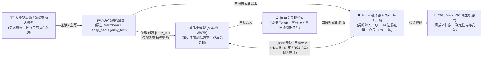
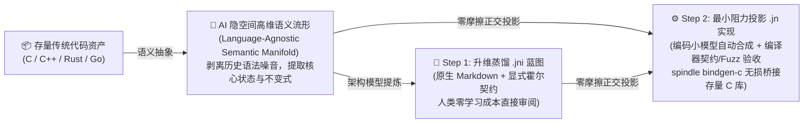
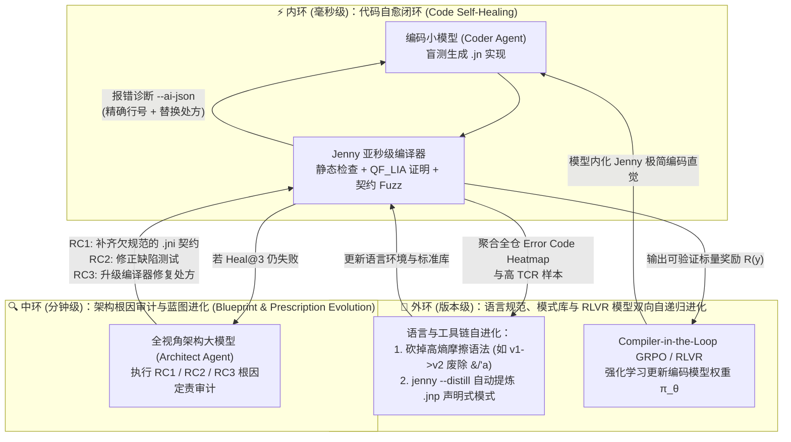
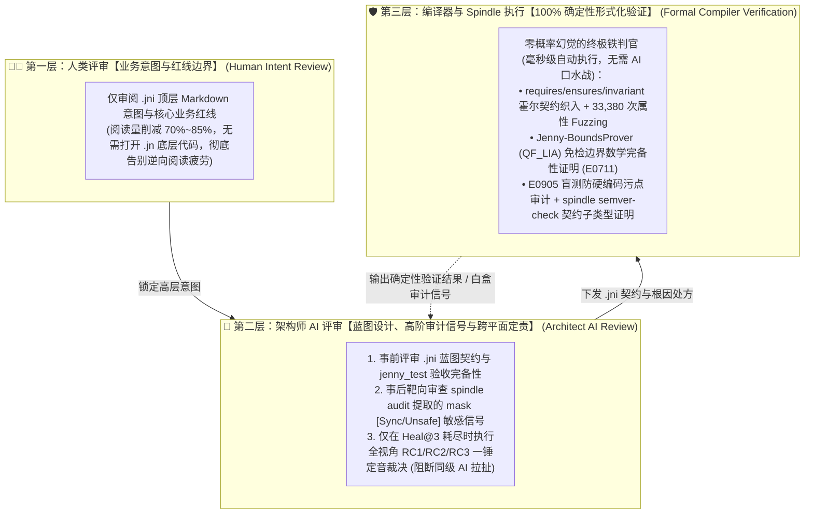
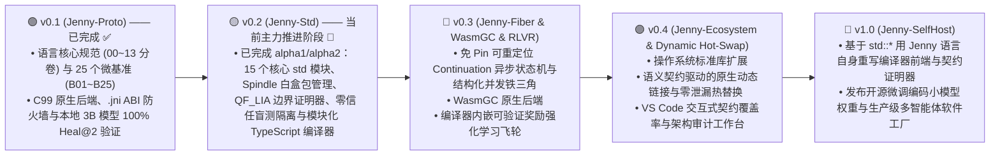

# 告别 Vibe Coding 的“黑暗森林”：迎接从AI原生第一性原理出发的 Spinning Jenny 系统级编程语言


> ***“In 1764, the Spinning Jenny wove the Industrial Revolution. Today, Jenny weaves Human Intent and AI Intelligence into verified computer code.”***  
> *（1764 年，珍妮纺纱机织就了第一次工业革命的序幕；今天，Spinning Jenny 将人类意图与 AI 智慧交织为可形式化验证的计算机代码。）*

---

## 一、引言：当 AI 每秒生成 500 行代码，我们正陷入怎样的工程悖论？

过去两年里，软件工程界正在经历一场被称为 **“Vibe Coding（凭感觉编程）”** 的狂欢与阵痛。

大语言模型（LLM）让代码生成的边际成本趋近于零，但任何一个尝试用 AI 构建严肃系统软件（存储引擎、网络协议栈、高并发运行时、金融核心账本）的工程师，很快就会撞上一堵无形的墙——我们称之为 **“AI 编程的黑暗森林悖论”**：

1. **传统语言是为“人类键盘敲击”设计的，而非为“自回归 Token 生成”设计的**：
   * **C / C++** 给了 AI 极高的自由度，却缺乏编译期内存与边界安全契约，AI 极易写出隐蔽的缓冲区溢出与 Use-After-Free；
   * **Rust** 拥有强大的安全性，但它的符号化借用检查器（`&T`, `&mut T`, `&'a mut`）、显式生命周期体操（`<'a, 'b: 'a>`）与严格的单所有者树限制，成了大模型的“头号幻觉泥潭”——哪怕是顶尖模型，在面对双向链表、自引用视图或复杂闭包捕获时，也会陷入多轮编译报错的死循环；
   * **Go** 虽简单直白，但满屏重复的 `if err != nil` 样板代码与弱表达力的类型系统，在大型项目中迅速吞噬宝贵的上下文窗口（Context Window）。
2. **人类的“审计失明”与 AI 的“脑补失控”**：
   * 人类自然语言天然是模糊、欠规范的。当人类丢出一句模糊的 Prompt，AI 依靠概率统计“脑补”边界条件，并以远超人类阅读生理极限的速度倾泻出成千上万行代码。
   * 当**架构意图、接口契约与底层实现细节**被混杂在同一个 `.rs` / `.cpp` / `.go` 源文件里时，人类既看不过来，也不敢全信；AI 既看不全跨模块上下文，又容易为了跑通测试而硬编码作弊（Reward Hacking）。**人类与 AI 双双在黑暗中抓瞎。**

如果编程语言从诞生之初，就不再假设“人类亲手敲击每一行实现代码”，而是基于 **“人机协同分工的第一性原理”** 重新设计，它会是什么样子？

这就是 **Spinning Jenny（简称 `Jenny`，蓝图文件 `.jni` / 实现文件 `.jn`）** 诞生的原因。



---

## 二、第一性原理：从“人类写代码 vs. AI 写代码”的底层差异，看 AI 原生语言的设计哲学与零摩擦迁移

### 2.1 追本溯源：AI 写代码与人类写代码的六大底层差异

过去 70 年的所有主流编程语言（从 C、C++、Java 到 Go、Rust），都建立在一个从未被质疑过的隐含公理之上：**代码是由一个拥有生物大脑、使用键盘随机编辑文本、打字很慢但具备直觉常识的人类程序员逐行敲出来的。**

然而，当编程的主力执行者变成基于 Transformer 的自回归大语言模型（LLM）时，底层物理规律发生了根本性逆转：

| 核心维度 | 👨‍💻 人类程序员（生物大脑 + 键盘随机编辑） | 🤖 AI 编码模型（自回归采样 + 注意力窗口） | 💥 传统语言在 AI 时代的错配痛点 |
| :--- | :--- | :--- | :--- |
| **1. 生成物理机制**<br>*(草稿跳转 vs. 单向因果)* | **非线性草稿流（随机光标跳转）**：人类打字慢（~40 tokens/min），但写到一半发现变量需要借用或结构体需要加 `<'a>` 时，随时可以把光标跳回文件开头修改签名。 | **严格从左到右的单向因果流（Left-to-Right Autoregression）**：生成速度极快（~5,000 tokens/min），但每个 Token 生成时无法“回头涂改前文”；若后文某次调用迫使前文签名改变，单次生成流必然发生前后矛盾的幻觉。 | Rust 的 `<'a>` 生命周期向上传染、隐式 Move 迫使回头加 `&`，严重违背了自回归模型的单向因果注意力机制。 |
| **2. 记忆与上下文瓶颈**<br>*(短时记忆 vs. 注意力稀释)* | **局部工作记忆极窄（$7 \pm 2$ 组块），但具备全局持久直觉**：记不住海量 API 细节（依赖 IDE 补全与语法糖），但脑中有清晰的业务全局图景。 | **参数记忆浩瀚，但有效注意力（Effective Attention）随上下文增长急剧衰减**：当 Context Window 被 70% 的跨模块底层实现细节与重复样板（如 `if err != nil`）塞满时，极易发生“Lost-in-the-Middle”注意力失焦。 | 传统语言将“接口契约”与“底层实现”混在同一个源文件（`.rs`/`.go`），导致跨模块调用时上下文 Token 被海量无关实现噪音污染。 |
| **3. 意图理解与边界处理**<br>*(常识隐含 vs. 概率脑补)* | **擅长理解自然语言言外之意，厌恶手写形式化契约**：人类凭常识知道“取款金额不能为负、下标不能越界”，觉得写 `requires` 是繁琐负担。 | **对未明说的隐式假设毫无常识（纯概率脑补），但极度擅长在严格约束内求解**：没有显式契约时 AI 会随机漏掉边界；一旦给出一等公民形式化契约，AI 就能将编程转化为高精度的数学填空。 | 传统语言把契约弱化为无约束力的 `///` 注释或分离的 `_test` 文件，导致人类意图在向 AI 传递时发生灾难性损耗。 |
| **4. 面对测试的行为模式**<br>*(因果泛化 vs. 目标作弊)* | **具备因果推理与工程自律**：看到测试用例 `assert(f(2) == 4)`，人类知道那只是抽样，不会写出 `if x == 2 { return 4 }`。 | **纯粹的目标迎合（Reward Hacking）**：若在编码时能看到具体测试字面量，模型为了最小化报错，极易针对测试输入硬编码“走捷径”。 | 传统开发流程把业务代码与测试代码放在同一上下文暴露给 Agent，缺乏编译器级的“零信任盲测隔离”与反作弊审计。 |
| **5. 消费编译反馈的方式**<br>*(教学散文 vs. 机器处方)* | **需要人类可读的长篇解释**：如 `rustc` 几十行的 ASCII 字符画箭头与散文式教学提示。 | **需要高信噪比、结构化、带确定性修复动作的 JSON 处方**：冗长的散文报错会污染自愈轮次的上下文；AI 需要直接定位 AST 节点与 `suggested_replacement`。 | 传统编译器诊断是为人类肉眼阅读设计的，而非为 Agent 闭环自愈（`Heal@k`）或强化学习可验证奖励（RLVR）设计的。 |
| **6. 系统演进的终极瓶颈**<br>*(打字速度 vs. 审计带宽)* | 过去人类的瓶颈在于**“手写代码的速度”**。 | 今天人机协同的终极瓶颈在于**“人类阅读与审计 AI 代码的生理带宽”**（人类深度 Code Review 极限仅 ~200 行/小时，远跟不上 AI 每秒百行的产出）。 | 传统语言迫使人类去逐行 Review AI 生成的底层实现代码，最终退化为“闭着眼睛点 Approve”的 Vibe Coding。 |

---

### 2.2 人机协同与语言演进的五大第一性原理

看清了人类与 AI 在认知机制上的六大本质差异，“什么才是真正的 AI 原生编程语言”便可以直接推导出五条工程第一性原理：

* **第一原理：双平面认知解耦定律（The Dual-Plane Law —— 人类守 `.jni` 契约，AI 织 `.jn` 实现）**
  * 既然人类的稀缺资源是**注意力与意图定义**，AI 的稀缺资源是**上下文纯净度与约束确定性**，就绝对不能再让人类和 AI 挤在同一个源码文件里工作。
  * 源码必须在物理上拆分为两个正交平面：**`.jni`（意图与契约平面）**顺应人类的认知优势，用原生 Markdown 阐述架构意图，内嵌高密度的 `jenny_decl`（类型、签名、霍尔契约）与 `jenny_test`（验收断言），让人类架构师的审阅工作量骤降 70% 以上；**`.jn`（幕后实现平面）**顺应编码小模型的高吞吐优势，在物理屏蔽 `jenny_test` 的零信任盲测隔离下由 AI 自动合成。
* **第二原理：单向因果友好定律（Autoregressive-Friendly Law —— 消灭反向传染与符号噪音）**
  * 语法设计必须顺应 Transformer 从左到右的单向注意力流，绝不允许“因为后文的一行代码，迫使前文修改类型签名或补生命周期符号”。
  * 因此，Jenny 将默认参数语义定为**只读借用（`x: T`）**，消除隐式 Move；将含切片结构体**自动推导为栈绑定视图**，消除 `<'a>` 传染；引入 **`mask [...]` 受控副作用阻断**，允许在函数内部安全消化锁（`Sync`）或免检访问（`Unsafe`），阻断副作用向顶层抽象接口反向染色。
* **第三原理：机械证明替代自然语言祈祷定律（Proof-over-Prompting Law —— 契约内生与形式化验证）**
  * 自然语言 Prompt 越长，AI 的注意力越发散；与其在 Prompt 里叮嘱十遍“注意边界检查”，不如让契约成为语言的一等公民并由编译器做数学证明。
  * Jenny 将 `requires ... else Error` 自动织入函数入口，内嵌 `QF_LIA` 线性算术证明器（`Jenny-BoundsProver`）对免检边界做完备性证明，并由 `Spindle` 基于霍尔逻辑蕴含关系自动证明版本升级兼容性。
* **第四原理：大小模型分层协同与编译器自愈飞轮定律（Hierarchical Agent & RLVR Law）**
  * 用昂贵的千亿参数前沿大模型去写每一行底层循环是算力的巨大浪费。最优分工是：**前沿架构大模型（Architect Agent）协同人类打磨 `.jni` $\times$ 本地廉价编码小模型（3B/7B Coder Agent）并发合成 `.jn` $\times$ 编译器通过 `--ai-json` 处方与 `RC1`–`RC3` 根因审计充当零信任裁判与强化学习奖励环境**。
* **第五原理：量化指标驱动的语言自递归进化定律（Metric-Driven Self-Recursive Evolution Law —— 告别主观拍脑袋，让语言按损失函数自我迭代）**
  * 传统编程语言靠语言委员会凭主观直觉“拍脑袋”设计，一旦发布便因人类肌肉记忆惯性而僵化锁死。Jenny的语法规则不再是神圣不可侵犯的教条，而是最小化“人机协同总摩擦损失函数（Total Co-Design Loss）”的可调参数。
  * 任何语法规则的存废与原语演进，均由 **五大正交量化指标（`TCR` Token 压缩比、`ECC` 上下文容量、`Pass@1 / Heal@k` 盲测自愈率、`SHR` 语义幻觉率、`HCS` 人类审计效率）** 与 **编译报错热力图（Error Code Heatmap）** 充当损失函数（Loss Function）：高频报错的语法节点触发语法降噪重设计，高频重复的 AST 子树触发 `jenny --distill` 自动升格为 `.jnp` 声明式模式，实现语言自身的**自递归进化（Self-Recursive Evolution）**。

---

### 2.3 为什么传统编程语言能“零摩擦”丝滑迁移到 Jenny？（高维语义流形投影 vs. 人类思维定势）

每当一门新编程语言问世，人们最常问的问题是：*“历史上推广 C++、Java 或 Rust 都花了十几年，生态迁移成本那么高，凭什么大家能迅速迁移到 Jenny？”*

答案恰恰藏在 **人类与 AI 对待“语言”的本质差异** 之中：

#### 2.3.1 历史死结：人类的“语法肌肉记忆与思维定势”

在人类手写代码的时代，推广一门新语言之所以难如登天，是因为人类程序员学习一门语言需要付出数千小时的沉没成本，在大脑皮层形成顽固的**思维定势（Cognitive Inertia）与肌肉记忆**，甚至将特定语言的语法习惯内化为职业身份认同。让一个习惯了 C++ 指针、Java 面向对象或 Go 极简风的工程师去学一门新语言，他本能地会产生强烈的心理排斥与路径依赖。

#### 2.3.2 AI 的表征真相：代码逻辑存在于跨语言的“高维语义流形（Semantic Manifold）”中

然而，大语言模型对编程语言**没有任何情感偏好、历史包袱或肌肉记忆**！

在 Transformer 的高维隐空间（Latent Space）中，算法逻辑、数据不变式、状态机流转与并发拓扑，是以**独立于具体语言的抽象语义流形（Language-Agnostic Semantic Manifold）**形式表征的。具体的编程语言（C++、Rust、Go、Jenny），本质上只是将这个高维语义流形向一维 Token 序列进行**切面投影（Surface Projection）的“坐标基底（Coordinate Basis）”**：

* **向传统语言基底投影时的“流形扭曲”**：当 AI 试图把一段清晰的图算法或零拷贝解析逻辑投影到 Rust 基底时，流形被迫为了迎合 `<'a>` 生命周期传染与 `Rc<RefCell<T>>` 借用规则而发生剧烈扭曲，导致投影路径变长、局部曲率爆炸（表现为多轮编译报错与语法幻觉）；
* **向 Jenny 基底投影时的“最小作用量路径”**：Jenny 的语法基底（无符号三态参数 `x` / `mut x` / `own x`、正交三态存储 `T` / `*T` / `^T`、一等霍尔契约）本身就是顺应 AI 隐空间语义流形的自然拓扑设计的。因此，AI 将内部语义流形映射到 Jenny 时，**投影阻力最小、流形保真度最高、Token 路径最短（精简 61% ~ 78%）**！
* **390 Tokens 即可完成的零样本基底切换**：我们在实证中证明，哪怕是从未在预训练语料中见过 Jenny 的 **3B 本地小模型（`qwen2.5-coder:3b`）**，只需在上下文中注入一张仅 **390 Tokens 的语法速查卡（Syntax Card）**，就能瞬间建立从内部语义流形到 Jenny 语法基底的投影映射，并在 2 轮编译反馈内达到 **100% 自愈通过（`Heal@2 = 100%`）**。



#### 2.3.3 存量资产的“升维迁移”与人类团队的“零痛感过渡”

基于这一机制，无论是存量代码库还是人类工程师团队，迁移到 Jenny 都不是痛苦的“推倒重来”，而是一场丝滑的跃迁：

* **对存量代码库（C / C++ / Rust / Go）——“语义流形升维 $\rightarrow$ `.jni` 契约蒸馏 $\rightarrow$ `.jn` 原生重织”**：
  * 传统的跨语言迁移工具（如 `c2rust`）做的是低维的“语法字面硬翻”，翻译出来的满屏 `unsafe *mut c_void` 既丑陋又无法维护；
  * 而在 Jenny 中，AI 先读取旧有的 C/Rust/Go 模块，在隐空间提取其核心业务流形与隐含假设，**向上升维蒸馏为结构化的 `<module>.jni` 文学化契约蓝图**（剥离旧语言的语法噪音，将隐式假设显式锁定为 `invariant` / `requires` / `ensures`），再由编码小模型**向下重织出纯净的 `<module>.jn` 实现**，并由编译器通过契约沙箱与上万次Fuzzing完成等价性验收（配合 `spindle bindgen-c` 还可直接 1:1 桥接现有C库头文件，0成本兼容存量代码库）。
* **对人类开发者——“把语法负担留给 AI，把直觉留给人类”**：
  * 人类之所以下意识排斥新语言，是因为害怕重新学习晦涩的底层语法细节
  * 但在 Jenny 的双平面分工下，**人类日常只需要阅读jni蓝图**。它的顶层是所有人都会写的原生 Markdown，内嵌的契约是直观的数学不等式（`requires amount > 0`），没有任何反直觉的符号体操；至于 `.jn` 的实现细节，则完全交给没有语言偏见的 AI 去编写。**人类无需对抗自己的思维定势，就能直接享受下一代 AI 原生语言带来的 10 倍工程生产力。**
  * 蓝图也懒得看怎么办？没关系，交给AI —— 它会帮你提炼总结代码逻辑，形成高度概括的编程意图，帮你架起自然语言和形式化逻辑的桥梁。

---

### 2.4 第一性原理的微观实证：从 `str::format` 对决 C++20 模板元编程与 Rust 宏，看 Jenny 的精妙设计

为了直观展示“AI 第一性原理”如何具体指导每一个语言特性的取舍，不妨看一个所有编程语言最基础、也最见功底的组件：**字符串格式化（String Formatting）**。

#### 2.4.1 传统格式化语法的原罪：为了讨好人类眼球的“视觉语法糖”，引爆编译器与 AI 的双重灾难
无论是 C 的 `snprintf("Key=%04x Count=%d", k, c)`、C++20 的 `std::format("Key={:04x} Count={:L}", k, c)`，还是 Rust 的 `format!("Key={:04x} Count={}", k, c)`，它们之所以都不约而同地选择**“把格式占位符嵌在字符串字面量里”**，唯一的原因是迁就人类的生物眼球——人类喜欢扫视一句连贯的模板字符串。

然而，当传统系统语言死守“讨好人类视觉习惯”的教条，同时又试图兼顾编译期类型安全时，却在底层制造了极其惨烈的工程代价：

* **C++ 的两代悲剧——从 `iostream` 状态污染到 C++20 `std::format` 的“克苏鲁级模板类型爆炸”**：
  * 早期的 `std::ostringstream`（`oss << "Key=" << std::hex << std::setw(4) << std::setfill('0') << k << std::dec ...`）不仅冗长难读，而且 `std::hex` 是有状态的流污染算子——AI 一旦漏写 `std::dec`，后续所有整数输出全部变成十六进制 Bug！
  * 到了 C++20，为了保住 `"Key={:04x}"` 的视觉语法糖并实现编译期检查，标准库引入了基于 `consteval` 与变参模板元编程（Template Metaprogramming, TMP）的 `std::format`。代价是什么？仅仅在代码里写一行 `#include <format>`，预处理器展开后的 C++ 模板源码就高达 **50,000 ~ 70,000 行（逾 1.5 MB 文本）**！
  * 每调用一次 `std::format("Key={:04x}", k)`，C++ 编译器必须在后台递归实例化：

    ```text
    std::basic_format_string<char, std::type_identity_t<int>&>
     └── std::__detail::__format::_Formatting_scanner<std::__detail::__format::_Sink_iter<char>, char>
          └── std::basic_format_context<std::__detail::__format::_Sink_iter<char>, char>
               └── std::basic_format_args<...>::handle (类型擦除虚表包装)
                    └── std::formatter<int, char>::parse / format ...
    ```

    这不仅让每个 `.cpp` 的编译耗时飙升、生成的 Mangled 符号名与 DWARF 调试信息剧烈膨胀；**更对 AI 自愈造成了毁灭性打击**——一旦 AI 传入了一个未特化 `std::formatter<T>` 的自定义类型（在 C++ 中特化一个 `formatter` 需要手写 20 多行极其晦涩的模板样板），GCC/Clang 会瞬间吐出 **150 ~ 300 行嵌套模板实例化回溯天书（Template Backtrace Explosion）**，直接撑爆并污染 AI 的上下文窗口！

* **Rust `format!` 的妥协——编译器特权黑魔法与自回归跨距对齐幻觉**：

  * Rust 为了避免 C++ 式的模板膨胀，被迫将 `format_args!` 做成**编译器硬编码特权宏（Compiler Built-in Magic）**——普通开发者根本无法用标准 Rust 语法写出同等能力的函数，破坏了语言的自举透明性。
  * 同时，对自回归从左到右生成代码的 AI 来说，`format!("... {} ... {:04x} ... {}", a, b, c)` 强迫模型进行**远距离位置对齐（Long-Range Positional Alignment）**，并在字符串内部塞进了一门脱离主语言 AST 的“隐式迷你正则子语言”（`{:>+#010.4x}`），极易诱发参数错位与 `{{` 花括号转义漏写幻觉。

#### 2.4.2 Jenny 的第一性原理抉择：把视觉语法糖留给历史，将 Token 开销与运行时开销压到物理极限

站在 Jenny **“`.jni` 人类契约平面与 `.jn` AI 实现平面物理分离”** 的第一性原理之上，我们问了自己一个本质问题：
> *既然字符串拼接代码只存在于幕后的 `.jn` 实现文件中（由 AI 编码小模型生成、由 CPU 执行，人类日常只审阅 `.jni` 契约），我们为什么要为了讨好人类眼球的视觉习惯，去制造 7 万行的模板展开或编译器特权宏黑魔法？*

于是，在 Jenny 的 [`std::str::fmt`](../../../library/std/str/fmt.jni) 中，幕后 `.jn` 的格式化调用被设计为**彻底顺应 AI 自回归因果流与硬件直写极限**的形态：

```jenny
// 位于幕后 .jn 实现中（由 AI 生成，无需讨好人类视觉连贯性）：
val s = str::format("Key=", (48879, FmtSpec.HexLower, 4), " Count=", (1234567, FmtSpec.GroupedInt))
```

看看这个“不讨好人类视觉习惯”的设计，如何在四个维度同时达到了物理极限：

* **单向因果就近绑定（Causal Locality）——零跨距对齐、零转义、零迷你子语言**：
  * 文本片段与被格式化的变量元组 `(48879, FmtSpec.HexLower, 4)` **就地紧邻绑定**，完全顺应 Transformer 从左到右的局部注意力；
  * 字符串字面量永远只是纯粹的字节切片（写 `"{}"` 就是输出 `"{}"`，永远不需要 `{{` 或 `%%` 转义）；
  * 格式控制符不再是神秘字符串 `":04x"`，而是主语言的一等公民强类型枚举 `FmtSpec.HexLower`，配合联合类型约束 `pub type Formattable = FmtInto | ToStr | (FmtSpecInto, FmtSpec, ...i64)`，AI 绝不可能写出非法格式符。
  
* **零编译器黑魔法——14 行白盒代码、3 个分支打天下**：
  * 因为彻底砍掉了“解析格式模板字符串”这个伪需求，Jenny 的格式化器不需要任何编译器内置宏特权，也不需要 C++ 的 7 万行模板头文件，仅用 **14 行纯 Jenny 代码、3 个 `@spin if` 分支** 即在标准库中完成 100% 白盒自举（实现 Token 相比对标 Rust 精简 **66.64%**）。

* **编译期极速展开与高信噪比诊断**：
  * `@spin for arg in args` 在编译期毫秒级按签名哈希单态化展开为顺序的 `fb.put_str(...)` 与 `fmt_spec_into(...)` 调用，零深层模板嵌套；若传入未实现格式化特征的类型，编译器仅输出 **1 条精准结构化诊断 `E0309`**，AI 一轮即可自愈。

* **CPU 运行期零开销极限**：
  * 编译后等价于手写极速 C 代码：直接向 512B 栈上 Arena 缓冲区追加字节，最终转为 24B 栈内联小字符串 `String`（$\le 22\text{B}$ 直接驻留寄存器/栈 SSO）——**0 格式串解析、0 虚表间接跳转、0 动态堆内存分配**！

| 评测维度 | **C (`snprintf`)** | **C++20 (`std::format` 模板元编程)** | **Rust (`format!` 编译器内置宏)** | **Jenny (`str::format` 过程式 `@spin`)** |
| :--- | :--- | :--- | :--- | :--- |
| **底层设计出发点** | 讨好人类眼球（内嵌 `%04x`） | 讨好人类眼球 + 硬套模板元编程（TMP） | 讨好人类眼球 + 编译器硬编码黑魔法 | **AI 第一性原理：不讨好人类视觉，追求极致因果局部性、Token 与运行期零开销** |
| **调用处语法形式** | `snprintf(b, n, "K=%04x", k)` | `std::format("K={:04x}", k)` | `format!("K={:04x}", k)` | `str::format("K=", (k, FmtSpec.HexLower, 4))` *(位于幕后 `.jn`)* |
| **AI 自回归生成友好度** | ❌ **差**（远距离位置对齐 + 零类型保护） | ❌ **极差**（远距离对齐 + 自定义类型需写 25 行 `std::formatter<T>` 模板特化天书） | ⚠️ **中**（远距离位置对齐 + `{{` 转义陷阱 + 字符串内嵌隐式迷你正则语言） | ✅ **极高**（文本与 `(val, FmtSpec, ...)` **单向因果就近绑定**，0 转义、0 格式串迷你语言） |
| **实现机制与自举透明性** | 运行期 C 库状态机扫描 | ❌ **黑盒级复杂度**（`#include <format>` 展开 **5~7 万行** 模板与 SFINAE/Concept 嵌套） | ❌ **编译器特权黑魔法**（依赖内置 `format_args!`，无法用普通 Rust 代码自举） | ✅ **100% 白盒标准库自举**（[`fmt.jni`](../../../library/std/str/fmt.jni) 仅用 **14 行代码、3 个 `@spin if` 分支**写完） |
| **编译速度与产物膨胀** | 快，但无编译期安全 | ❌ **灾难级慢编译与符号膨胀**（数十层模板类型展开，引爆 `.o` 与 DWARF 体积） | ⚠️ **较慢**（每个调用点构造 `fmt::Arguments` 与函数指针切片） | ✅ **亚秒级零膨胀**（连编译期解析格式串都省了！按类型签名哈希单态化展开至 `.spun/`） |
| **报错时对 AI 自愈的信噪比** | ❌ 运行期直接崩溃或内存越界 | ❌ **灾难级（吐出 150~300 行模板实例化回溯，瞬间撑爆并污染 AI 上下文）** | ⚠️ 散文式教学报错 | ✅ **1 条结构化 JSON 处方（`E0309`）**：精准指出第 $N$ 个参数未满足 `Formattable` 联合约束 |
| **CPU 运行期开销** | ❌ **慢**（每次运行期逐字符扫描解析 `%`） | ⚠️ 仍需构造 `basic_format_args` 类型擦除数组与动态内存缓冲 | ⚠️ 构造 `ArgumentV1` 虚表数组执行间接函数指针调用 | ✅ **物理极限**（编译期摊平为顺序内存追加：0 解析、0 虚表、512B 栈 Arena + 24B SSO **0 堆分配**） |

---

### 2.5 深入第五原理：如何用五大量化指标与 RLVR 飞轮驱动语言自身的“自递归进化”？

过去 70 年，几乎所有编程语言的演进都是“艺术化”甚至“宗教化”的——由语言创始人或委员会凭个人主观审美争吵数年定下语法，一旦发布，哪怕后来发现某个设计（如 C++ 的隐式拷贝、Rust 的复杂生命周期标注）造成巨大的工程摩擦，也会因为人类程序员群体的肌肉记忆惯性而被迫永久保留。

Spinning Jenny 彻底终结了“靠主观拍脑袋设计语言”的历史。我们在《模块十一：语言-模型联合演进与量化实证工程》（[`11_llm_codesign_and_empirical_training.md`](../design/specs/11_llm_codesign_and_empirical_training.md)）中，将 **“编程语言规范 + 编译器诊断 + 标准库/模式库 + 编码大模型”** 建模为一个**以量化指标为损失函数（Loss Function）的自递归进化系统（Self-Recursive Co-Evolution System）**。

#### 2.5.1 五维量化传感器：每一项指标异常都会自动触发语言级进化动作

在 Jenny 的研发闭环中，任何语法提案、编译器报错格式或标准库 API 的演进，都受控于 **五大核心量化指标**。当某一指标未达标或出现长尾异常时，系统会精准触发对应的语言架构自进化机制：

| 量化指标 | 物理定义与度量靶标 | 异常摩擦信号（痛点暴露） | **触发的语言 / 编译器自递归进化动作** | **Jenny 真实自进化实证案例** |
| :--- | :--- | :--- | :--- | :--- |
| **1. `TCR`**<br>*(Token 压缩比)* | `.jn` 实现相比等价 Rust/C++ 的 Token 比率 | 某类模块的 $\text{TCR}_{\text{impl}} > 0.45$（说明 AI 仍在反复手写同构样板代码） | 触发编译器 `jenny --distill` AST 克隆检测器，将高频重复 AST 子树**自动蒸馏升格为 `library/patterns/*.jnp` 声明式模式** | Stage 3 将状态机、二进制协议与 CRUD 蒸馏为 `.jnp` 后，局部 $\text{TCR}_{\text{impl}}$ 从 `0.38` 直接压降至 **`0.0879`（11.37 倍压缩）** |
| **2. `ECC`**<br>*(有效上下文容量)* | 固定窗口（如 32K）可无损容纳的跨模块架构拓扑规模 | 跨模块调用时上下文迅速饱和，模型出现注意力失焦 | 触发 `.jni` 蓝图瘦身与 `Spindle` 依赖图按需剪枝优化 | 将 `.jni` 拆分为 `jenny_decl` 与 `jenny_test` 双区，`spindle context --entry` 仅提取可达子图 `jenny_decl`，**剔除 80% 无关模块噪音** |
| **3. `Pass@1` & `Heal@k`**<br>*(盲测通过率与自愈率)* | 零信任盲测下首轮通过率与 $k$ 轮编译处方自愈率 | **编译报错热力图（Error Code Heatmap）** 显示某语法节点高频报错或超过 3 轮无法自愈 | 1. 触发 **语法困惑度 A/B 测试**，砍掉违背 LLM 预训练先验的反直觉符号；<br>2. 触发 **`RC1`–`RC3` 架构模型根因审计**，升级 `--ai-json` 修复处方模板 | **v1.0 $\rightarrow$ v2.0 语法大进化**：早期 v1.0 曾保留 `&*T` / `&^T` / `view struct`，热力图暴露出小模型频繁与 Rust `&mut` 发生符号混淆；v2.0 彻底砍掉 `&` 与 `<'a>`，改为无符号 `x` / `mut x` / `own x` 与自动视图推导，**借用幻觉率直接归零（`0.0%`），3B 小模型 `Heal@2` 跃升至 `100%`** |
| **4. `SHR`**<br>*(语义逻辑幻觉率)* | 编译通过但死于属性 Fuzzing 或边界变异的比率 | 变异测试或 `--fuzz` 发现模型写出“看似合法但漏掉负数/溢出边界”的代码 | 触发编译器静态验证器升级，将运行期隐式漏洞升格为编译期数学证明 | 针对免检下标访问漏写下界检查的隐患，进化出内嵌 `QF_LIA` 算术求解器的 **`Jenny-BoundsProver`（`E0711`）** 与盲测反硬编码审计（**`E0905`**） |
| **5. `HCS`**<br>*(人类意图审计效率)* | 人类架构师仅看 `.jni` 定位边界与副作用漏洞的耗时 | 人类阅读 `.jni` 感到视觉疲劳，或难以判断内部是否隐藏了锁/不安全操作 | 触发 `.jni` 文学化表现力升级与 `spindle audit` 白盒信号汇总 | 废除 `///` 文档注释，将 `.jni` 顶层定为原生 Markdown；将内部 `mask [Sync/Unsafe]` 自动提取至包级审计报告 `effect_mask_audit_signals` |

#### 2.5.2 三环嵌套的自递归进化飞轮（The Tri-Loop Self-Recursive Evolution Flywheel）

正是依托上述五大量化指标与亚秒级编译器，Jenny 构建了跨越 **“毫秒级代码自愈 $\rightarrow$ 分钟级契约/诊断修正 $\rightarrow$ 版本级语言规范与 RLVR 模型权重联合演进”** 的三层自递归飞轮：



在外环的 **Compiler-in-the-Loop RLVR（基于编译器可验证奖励的强化学习）** 中，Jenny 编译器直接对模型盲测生成的候选实现 $y$ 计算确定性多目标奖励 $R(y)$：

$$R(y) = R_{\text{compile}}(y) + R_{\text{contract}}(y) + R_{\text{perf}}(y) - P_{\text{overfit}}(y) - \lambda \cdot \text{LengthPenalty}(y)$$

* **反作弊清零项 $-P_{\text{overfit}}(y)$**：一旦触发 `E0905_TEST_LITERAL_OVERFITTING`（针对测试字面量硬编码走捷径），当次奖励直接清零；
* **Token 经济学长度惩罚项 $-\lambda \cdot \text{LengthPenalty}(y)$**：在所有 100% 通过编译与契约沙箱的候选代码 $y_i$ 中，**Token 越短、越善于复用 `@spin` 与 `.jnp` 模式库的实现，获得的净奖励最高**！
* **双向自递归的正反馈奇点**：一方面，强化学习迫使模型自发淘汰冗余代码、内化 Jenny 的内存与契约直觉；另一方面，模型在成千上万次强化学习采样中暴露出的高频报错热力图与重复 AST 模式，又自动指导 Jenny 语言淘汰高摩擦语法、蒸馏出更高维的 `.jnp` 原语。**语言因模型而变得更精炼，模型因语言而变得更可靠。**

> [!IMPORTANT]
> **拒绝“画大饼”：全套自递归演进轨迹与实证数据均已开源可复现！**  
> 上述五大量化指标、`v1.0 -> v2.0` 语法降噪对比实验、以及本地 3B 小模型在 `Jenny-Bench-25` 上的完整编译自愈轨迹，绝非纸面推演，而是已经完成了严格的学术级实证检验。完整实验设计、消融对比与逐模块原始数据可直接查阅我们的技术论文与实测报告：
> * 📄 **中文技术论文全文**：[《Spinning Jenny：面向人机协同编程的文学化契约蓝图、双轨三态内存与自愈式编译系统》](../../../paper/spinning_jenny_paper_zh.md)
> * 📄 **English Research Paper**：[*"Spinning Jenny: An AI-Native Systems Programming Language with Literate Contract Blueprints, Dual-Track Tri-Modal Memory, and Self-Healing Compilation"*](../../../paper/spinning_jenny_paper_en.md)
> * 📊 **阶段性量化实测与跨语言对标报告**：[`v0.1` 25 模块跨语言回顾报告](../reports/jenny_v1_retrospective_and_cross_lang_comparison.md) · [`v0.2-alpha1` 标准库与 Spindle 报告](../reports/v0.2_alpha1_std_and_spindle_report.md) · [`v0.2-alpha2` 33,380 次 Fuzzing 与 SemVer 报告](../reports/v0.2_alpha2_std_and_semver_report.md)

---

### 2.6 破解 Vibe Coding 的“评审死结”：当人类审不动、AI 审 AI 陷入无限拉扯，Jenny 如何用“三级正交评审”破局？

今天所有重度使用 AI 写代码的团队，最终都会撞上一个令人哭笑不得的 **“Vibe Coding 评审死结（The Code Review Deadlock）”**：

1. **死结一：让人类去评审 AI 生成的代码——“审代码的时间比自己写还长”**
   * AI 一秒钟就能倾泻出上千行看似格式工整、命名规范、甚至注释齐全的底层实现代码；
   * 但由于人类没有亲自参与编写过程，大脑中没有建立起对应的状态机心智模型。一旦要求人类工程师本着对生产环境负责的态度去逐行 Code Review，人类必须从零逆向推导 AI 的每一处指针操作与边界条件——**排查 AI 隐藏在工整代码下的“高迷惑性幻觉 Bug”，耗费的精力与时间甚至比人类自己从头手写还要多出 2 ~ 3 倍！**
   * 最终，人类工程师要么被淹没在代码洪流中退化为“闭眼点 LGTM 的橡皮图章”，要么因为审得太痛苦而干脆排斥 AI。
2. **死结二：让 AI 去评审 AI 生成的代码——“两个概率模型来回拉扯，陷入无限递归”**
   为了给人类减负，不少团队尝试引入“Reviewer AI”去自动评审“Coder AI”生成的代码。结果却演变成了一场更荒诞的闹剧：
   在传统语言中，由于缺乏一等公民的形式化契约真值（Ground Truth），Reviewer AI 只能靠概率统计去“猜”代码有没有缺陷。为了证明自己“审出了东西”，Reviewer AI 常常会过度挑剔代码风格，或捏造一个莫须有的边界假阳性；
   Coder AI 顺从地按意见修改后，不小心改坏了另一处逻辑；下一轮 Reviewer AI 又提出截然相反的修改建议，甚至两个 AI 在 PR 评论区里引经据典、互相辩论、来回拉扯十几个回合，**陷入“用概率幻觉去校验概率幻觉”的无限递归死循环**，把上亿Token 预算烧光也无法收敛！

#### Jenny 的破局之道：三级正交分层评审机制（Three-Tier Orthogonal Review Hierarchy）

Jenny 从第一性原理出发指出：**绝不能在同一个抽象层级上用概率模型去和概率模型扯皮，必须按“意图 $\rightarrow$ 架构蓝图 $\rightarrow$ 数学形式化证明”将评审职责切分为三个严格正交的层级**：



| 评审维度 | 传统 Vibe Coding（人类审全文 / AI 审 AI） | **Spinning Jenny 三级正交分层评审体系** |
| :--- | :--- | :--- |
| **人类工程师审什么？** | ❌ 被迫逐行审阅上千行底层实现代码，耗时比自己写还长，极易沦为橡皮图章 | ✅ **只审“意图”**：仅审阅 `.jni` 蓝图中的自然语言业务规则与核心红线契约，5 分钟完成高质量决策 |
| **架构师 AI 审什么？** | ❌ 与 Coder AI 在同一源码平面围绕代码风格与猜测性边界反复拉扯，陷入无限递归 | ✅ **审“蓝图设计与高维信号”**：打磨 `.jni` 契约完备性、抽检 `spindle audit` 暴露的极少数 `mask [...]` 块、并在 `Heal@3` 耗尽时以全视角执行 **`RC1`–`RC3` 降维裁决**（严禁同级无限互搏） |
| **底层实现代码谁来审？** | ❌ 靠人类肉眼找 Bug，或靠另一个概率 AI 猜 Bug | ✅ **100% 交给编译器形式化验证**：由 `Jenny-BoundsProver`（`QF_LIA` 数学证明）、霍尔契约沙箱、3 万次 Fuzzing 与 `E0905` 反作弊器给出**非黑即白的确定性裁决** |

通过这套 **“人类审意图 $\rightarrow$ 架构师 AI 审蓝图与关键信号 $\rightarrow$ 编译器做数学形式化验证”** 的三级正交体系，Jenny 既把人类从“审代码比写代码还累”的泥潭中彻底解放出来，又用编译器的确定性数学铁律斩断了“两个 AI 无限拉扯”的死循环。

---

## 三、Spinning Jenny 的六大核心架构创新

### 亮点 1：`.jni` 文学化契约蓝图与 `.jn` 幕后实现物理分离（含零信任盲测防作弊）

在传统语言中，文档注释（`///`）、接口声明、业务实现与单元测试全部挤在同一个文件里。而在 Jenny 中，每个模块由一对物理分离但由编译器强制配对的文件组成：

* **`<module>.jni`（Literate Contract Blueprint，文学化契约蓝图）**：**人类与架构师唯一需要日常阅读和编写的文件。** 它的顶层直接就是原生标准 Markdown（告别丑陋的 `///` 注释前缀），内嵌两个正交的形式化围栏区：
  * **第一章 ```` ```jenny_decl ````（声明与霍尔契约区）**：声明数据类型（含结构体不变量 `invariant`）、具名错误 `pub error`、以及函数签名与契约（`effects` 副作用清单、`requires` 前置条件、`ensures` 后置条件）；
  * **第二章 ```` ```jenny_test ````（验收与测试区）**：支持极简的单行断言语法 `<expr> => <expected>`（或 `=> err(ErrorVariant)`）以及多行有状态测试 `test "<描述>" { ... }`。
* **`<module>.jn`（Implementation Module，幕后实现文件）**：**由 AI 编码模型在幕后自动生成与维护的文件，人类日常无需打开。**

让我们看一个真实的固定容量环形缓冲区（[`B01_ring_buffer`](../../../benchmarks/seed_10/B01_ring_buffer/ring_buffer.jni)）在 Jenny 中的样子：

#### 📄 人类主读的蓝图：`ring_buffer.jni`
````markdown
# B01: 固定容量环形缓冲区 (`RingBuffer`)

本模块提供一个零堆分配、容量为 8 个 `i32` 元素的环形队列 `RingBuffer`。

```jenny_decl
module ring_buffer

pub error RingError {
    Full,
    Empty,
}

pub struct RingBuffer {
    pub data: [8]i32,
    pub head: usize = 0,
    pub tail: usize = 0,
    pub len: usize = 0,
    pub capacity: usize = 8,

    invariant {
        self.capacity == 8
        self.len <= self.capacity
        self.head < self.capacity
        self.tail < self.capacity
    }
}

impl RingBuffer {
    pub fn new() -> RingBuffer
        ensures result.len == 0 && result.capacity == 8

    pub fn push(mut self, val: i32) -> void ! RingError
        requires self.len < self.capacity else RingError.Full
        ensures self.len == old(self.len) + 1

    pub fn pop(mut self) -> i32 ! RingError
        requires self.len > 0 else RingError.Empty
        ensures self.len == old(self.len) - 1
}
```

```jenny_test
test "EX-B01-01: normal push, peek, pop and wrap-around" {
    var rb = RingBuffer.new()
    rb.push(10)!
    rb.push(20)!
    assert(rb.pop()! == 10)
    assert(rb.pop()! == 20)
}
```
````

#### ⚙️ AI 生成的幕后实现：`ring_buffer.jn`
```jenny
module ring_buffer

impl RingBuffer {
    pub fn push(mut self, val: i32) -> void ! RingError {
        self.data[self.tail] = val
        self.tail = (self.tail + 1) % self.capacity
        self.len += 1
    }

    pub fn pop(mut self) -> i32 ! RingError {
        val item = self.data[self.head]
        self.head = (self.head + 1) % self.capacity
        self.len -= 1
        return item
    }
}
```

注意看 `ring_buffer.jn` 里发生了什么：
1. **零防御式样板代码**：`push` 和 `pop` 内部根本不需要手写 `if self.len >= self.capacity { return Err(...) }`！因为 `.jni` 蓝图中的 `requires self.len < self.capacity else RingError.Full` 会由编译器**自动织入函数入口**；`RingBuffer.new()` 甚至无需在 `.jn` 中手写，编译器根据结构体字段默认值自动合成并校验 `invariant`！
2. **69.41% 跨模块上下文压缩与 ABI 编译防火墙**：当其他模块 `import ring_buffer` 时，只需向 LLM 上下文喂入 `ring_buffer.jni` 的 `jenny_decl` 区（相比喂入完整源码**节省 65.31% ~ 69.41% 的上下文 Token**）。同时，编译器的 `jni_abi_hash` 仅对 `jenny_decl` 计算哈希——**只要不改 `.jni` 接口，无论 AI 如何重构 `.jn` 内部算法，下游依赖模块 100% 零重新编译！**
3. **零信任盲测隔离（`E0905`）与架构师根因审计（`RC1`–`RC3`）**：
   * 许多 AI 编程工具在让模型写代码时把单元测试一起喂给模型，导致模型学会了“针对测试输入写 `if x == 42 { return 100 }`”的作弊套路（Reward Hacking）。
   * Jenny 编译器在调用编码模型（Code Agent）时，通过 `stripJennyTestForAgent` **100% 物理剥离 `jenny_test` 章节**（编码模型只能看到 Markdown 规范与 `jenny_decl` 契约），并通过静态污点分析器 `E0905_TEST_LITERAL_OVERFITTING` 拦截任何针对测试专有字面量的硬编码分支。
   * 如果编码模型在 3 轮编译修复（`Heal@3`）后仍未通过，编译器会自动唤醒拥有全视角的**架构设计模型（Architect Agent）执行根因定责审计**：精准判定究竟是 **蓝图契约欠规范（`RC1`）**、**测试用例自身写错（`RC2`）**，还是 **编码小模型陷入了算法死胡同（`RC3`）**。

---

### 亮点 2：向 `&'a mut` 说再见——无符号三态参数与双轨三态内存/闭包体系

为什么大模型写 Rust 时频繁出现借用检查报错？因为 Rust 将“默认语义”设为**所有权转移（Move）**，迫使开发者在 80% 只是想“读一下数据”的场景下到处标注 `&T`，在修改时标注 `&mut T`，在结构体含切片时传染 `<'a>`。

Jenny彻底废除了 `&T`、`&mut T`、`&self`、`&mut self` 以及 `<'a>` 生命周期标注，用直觉化的**三态参数意图**与**双轨三态内存模型**取而代之：

| 维度 | Jenny 语法 | 语义与底层 C99 降级机制 | 解决的 AI 痛点 |
| :--- | :--- | :--- | :--- |
| **参数模式 1（默认）** | **`x: T`** / **`self`** | **默认只读借用**（标量传值，结构体传 `const T*`） | **调用后原变量 100% 继续有效**，彻底根除 LLM 意外 Move 报错 |
| **参数模式 2** | **`mut x: T`** / **`mut self`** | **排他可变借用**（降级为 C99 `T* __restrict`） | 显式标注原地修改，编译器静态拦截同调用处 `mut` 别名冲突（`E0202`） |
| **参数模式 3** | **`own x: T`** / **`own self`** | **显式所有权移交**（消费后原绑定失效） | 仅在销毁或转移独占资源时书写，静态拦截消费后误用（`E0201`） |
| **存储轨道 1** | **`T`** / **`fn(A) -> R`** | **栈值与自动推导视图**（含 `str`/`[]T` 自动识别为栈视图） | **免写 `<'a>`**！编译器自动禁止含切片视图或栈闭包装箱逃逸（`E0203`/`E0205`） |
| **存储轨道 2** | **`*T`** / **`*in(arena) T`** / **`*fn[own ...]`** | **原生独占堆与区域池**（RAII 确定性级联析构 + $O(1)$ Arena） | 热路径零 GC 开销，作用域退出或异常传播时 100% 自动释放 |
| **存储轨道 3** | **`^T`** / **`^fn(A) -> R`** | **托管共享句柄**（64KB Block Immix GC / WasmGC `structref`） | 双向链表（如 LRU Cache）与图结构无需 `Rc<RefCell<T>>` 或 `unsafe`，由 `effects [AllocGC]` 静态门控 |

例如，在实现零拷贝 HTTP 协议解析器（[`B14_zero_copy_http_view`](../../../benchmarks/stage2_mem/B14_zero_copy_http_view/http_view.jni)）时，包含 `str` 切片的 `HttpRequestView` 无需任何 `<'a>` 泛型参数，编译器自动将其推导为栈绑定视图，并在有人试图将其装箱到堆上（`*HttpRequestView`）时立即以 `E0203_VIEW_STRUCT_ESCAPE` 静态拦截。

---

### 亮点 3：受控副作用阻断（`mask [...]`）与编译期 `QF_LIA` 形式化边界证明器（`Jenny-BoundsProver`）

在系统级编程中，有两个长期困扰语言设计者的两难困境：
1. **副作用染色（Side-Effect Coloring）困境**：如果语言引入了静态副作用追踪（如 `effects [Sync]` 追踪互斥锁加锁、`effects [Unsafe]` 追踪底层免检指针/下标访问），一旦某个具体实现用了锁来保护内部缓存，难道顶层的抽象接口 `trait StorageEngine` 也要被迫加上 `effects [Sync]` 吗？
2. **数组越界检查的性能 vs 安全困境**：默认数组访问 `buf[i]` 带有运行期边界检查；在高频热循环（如解码器每次读取 4 字节）中，我们希望在循环外做一次 `guard offset + 4 <= buf.len()`，然后在内部调用 0 开销的免检访问 `buf.get_unchecked(offset + 3)` 并把 `Unsafe` 副作用阻断在函数内部。**但编译器怎么知道你写的边界检查是 100% 完备的、没有漏掉负数下标？**

Jenny 给出了一个极具独创性的答案：**`mask [...]` 受控副作用阻断 + 内嵌 `QF_LIA`（无量词线性整数算术）形式化边界证明器 `Jenny-BoundsProver`**：

```jenny
pub fn read_u32_le_fast(buf: []u8, offset: i64) -> i64 ! CodecError
    effects [] // 对外完全纯净！内部 Unsafe 已被形式化证明并安全阻断
    requires offset >= 0 && offset + 4 <= buf.len else CodecError.TruncatedFrame
{
    mask [Unsafe] {
        // Jenny-BoundsProver 在编译期自动构造验证条件 (VCG)：
        // (offset >= 0 && offset + 4 <= buf.len) ==> (0 <= offset + k < buf.len, k ∈ {0,1,2,3})
        // 证明成立！允许零开销免检访问并阻断 Unsafe 向上传播：
        val b0 = buf.get_unchecked(offset)
        val b1 = buf.get_unchecked(offset + 1)
        val b2 = buf.get_unchecked(offset + 2)
        val b3 = buf.get_unchecked(offset + 3)
        return b0 | (b1 << 8) | (b2 << 16) | (b3 << 24)
    }
}
```

**如果程序员或 AI 漏写了下界检查 `offset >= 0`（只写了 `guard offset + 4 <= buf.len`）会怎样？**
`Jenny-BoundsProver` 会在毫秒级内证伪该蕴含式，抛出 `E0711_UNPROVEN_BOUNDS_CONTAINMENT` 编译错误，并**直接给出具体的数学越界反例**：
> ❌ `E0711_UNPROVEN_BOUNDS_CONTAINMENT`: Bounds check `offset + 4 <= buf.len` does not mathematically entail `0 <= offset + 3 < buf.len`!  
> **Counterexample**: `{ buf.len = 4, offset = -2 }` $\implies$ `offset + 3 = -2 + 3 = 1` while `offset = -2 < 0` (lower-bound violation!).  
> **Suggested fix**: `requires offset >= 0 && offset + 4 <= buf.len`

同样地，当使用 `mask [Sync]` 在内部消化互斥锁时，编译器会强制校验 **锁守卫零逃逸（`E0709_MASKED_LOCK_ESCAPE`）** 与 **临界区内外部调用告警（`W0710`）**，并将全包所有的 `mask [...]` 汇总至 `spindle audit` 的 `effect_mask_audit_signals` 报告中，让代码安全审计一目了然。

---

### 亮点 4：三层错误截断、64-bit 因果调用栈与“零编译器黑魔法”的白盒标准库 (`library/`)

1. **一等公民 `pub error`、16 字节同构值级多态与三阶小载荷优化（SPO）**：
   * Jenny 将纯业务枚举 `pub enum` 与错误类型 **`pub error XxxError`** 严格解耦；
   * 所有具名错误 `E` 与顶层全截断错误 `AnyError`（简写为 `T!`）在底层共享完全同构的 **16 字节双寄存器 ABI `{ code: u64, payload: i64 }`**——这意味着从底层精确错误 `T ! IoError` 向上转型为领域混合错误 `T ! (OrderError | AnyError)` 或顶层 `T!`，**在机器码层面是 0 指令的 No-op！**
   * 当错误沿 `?`、`.await?` 或跨协程 `spawn` 传播时，自动写入 Fiber-Local 的 16 槽位零分配环形缓冲 `ErrorTrace`（每帧仅 8 字节位域 `[fn_sym_id:32 | frame_kind:2 | await_state:10 | line_no:20]`），彻底攻克了异步状态机挂起恢复后物理调用栈丢失的难题。
2. **拒绝格式串黑魔法：仅用 3 个分支的过程式 `@spin` 变参格式化器 (`std::str::fmt`)**：
3. **声明式模式库 (`library/patterns/*.jnp`) 实现 11.37 倍手写代码压缩**：
   * 编译器自身已被彻底剥离一切业务黑魔法——状态机（`fsm::state_machine`）、大端序二进制协议编解码（`codec::binary`）、CRUD 服务（`crud::service`）全部作为独立的 `.jnp` 白盒模式包存放在 [`library/patterns/`](../../../library/patterns/README.md) 下。在 `B19`~`B21` 基准测试中，仅需几十个 Token 的 `@spin dsl` 或 `@apply` 声明即可自动合成完整实现，**手写实现 Token 压缩达 11.37 倍（精简 91.21%）**。

---

### 亮点 5：`Spindle` 白盒包管理、契约 SemVer 证明与统一 AST 归档 (`std.jnast`)

传统包管理器（如 Cargo、npm、pip）本质上是“黑盒整包信任模型”：引入一个第三方包，你就默认赋予了它读写磁盘、发起网络请求的全部权限，且补丁升级（`1.2.0 -> 1.2.1`）全凭作者自觉，随时可能发生隐蔽的行为破坏。

Jenny 的官方包管理器 **`Spindle`**（配置文件 `Tapestry.toml`、双哈希锁文件 `Tapestry.lock`）确立了五大白盒范式：
1. **包级零信任副作用沙箱（`allow_effects`）与 Layer-0 内建边界审计（`E0510`）**：在 `Tapestry.toml` 中声明允许的副作用上限（如纯算法库 `allow_effects = ["Mutate", "AllocNative"]`），任何子模块一旦夹带 `Net`、`FS` 或绕过 [`std::rt::intrinsics`](../../../library/std/rt/intrinsics.jni) 蓝图私自调用底层 C 运行时函数，`spindle audit` 立即以 `E0503` / `E0505` / `E0510` 静态阻断。
2. **基于霍尔逻辑契约子类型的语义版本校验（`spindle semver-check`）**：
   * 什么样的升级才是真正的向后兼容（Safe Patch Hot-Swap）？`Spindle` 不看版本号数字，而是形式化校验新旧 `.jni` 蓝图的霍尔契约满足子类型蕴含关系：
     $$E_{\text{new}} \subseteq E_{\text{old}} \quad \land \quad \text{Req}_{\text{old}} \implies \text{Req}_{\text{new}} \quad \land \quad \text{Ens}_{\text{new}} \implies \text{Ens}_{\text{old}}$$
   * 一旦新版偷偷扩大了副作用（`E0506`）、收紧了前置条件（`E0507`）、削弱了后置条件（`E0508`）或在差分回归中改变了行为（`E0509`），`spindle semver-check` **100% 自动拦截**。
3. **“纯 `.jni` 蓝图 + 统一规范化 AST 归档 (`lib/std.jnast`)”发布模型**：
   * `spindle pack` 打包发布的库仅包含只读 `.jni` 文学化契约蓝图与单一预编译 AST 归档文件 `lib/std.jnast`（**发布包携带 0 个散落的 `.jn` 源文件与 0 个 `.spun` 文件**）；
   * 当开发者需要下钻调试某个模块的实现时，`spindle decompile --entry <mod>` 可在毫秒级内从 `std.jnast` **100% 无损反编译**还原出标准格式的 `.jn` 源码！

---

### 亮点 6：亚秒级增量构建与 1/20 零膨胀产物架构——为什么“构建速度”是 AI 编程语言的生死线指标？

在传统的人类手写代码时代，程序员每敲击 5 ~ 10 分钟键盘才触发一次编译，因此 C++ 或 Rust 动辄 15 ~ 60 秒的增量编译耗时、以及 `target/` 目录膨胀至 10 GB ~ 30 GB 的磁盘占用，往往被当作“为了零成本抽象必须忍受的代价”。

然而，在 **AI 原生编程与强化学习自进化（Compiler-in-the-Loop RLVR）** 时代，**编译器的构建速度与产物膨胀率不再是次要的体验问题，而是决定 AI 编程吞吐量上限的核心物理瓶颈**：
1. **AI 自愈闭环（`Heal@k`）的延迟墙与 GPU 算力空转**：
   * 得益于 Jenny 高达 78% 的实现 Token 压缩率，编码模型生成或修复一个模块的 `.jn` 实现仅需 **200 ~ 400 毫秒**；
   * 如果每次 AI 修改一行函数体实现，编译器都要像 Rust/C++ 那样触发跨模块级联重编并等待 20 秒，那么 **98% 的端到端自愈时间与昂贵的 GPU 显存 KV-Cache 驻留开销都被白白浪费在等待编译器上**！
2. **多智能体并发试错（Best-of-$N$）与 RLVR 训练的磁盘/内存风暴**：
   * 当多智能体软件工厂或 GRPO 强化学习训练管线在单机上每秒并发启动上百个“生成 $\rightarrow$ 编译 $\rightarrow$ 契约沙箱验证”循环时，如果每个工作沙箱都像传统系统语言那样产生数 GB 的重复泛型单态化副本与肥胖的 DWARF 调试符号，整台服务器的 NVMe 磁盘与 I/O 带宽将在几分钟内彻底崩溃。

为此，Jenny 在《模块十：极速增量构建与零膨胀中间产物架构》（[`10_fast_compilation_and_anti_bloat.md`](../design/specs/10_fast_compilation_and_anti_bloat.md)）与《模块十二：Spindle 包管理》（[`12_package_management_and_module_system.md`](../design/specs/12_package_management_and_module_system.md)）中，针对传统系统语言的慢编译与膨胀病灶设计了 **“亚秒级（50~200ms）增量反馈与 1/20 磁盘体积占用”** 的六大根治支柱：

| 传统系统语言（Rust / C++ / Go）的慢编与膨胀病灶 | 物理成因剖析 | **Spinning Jenny 的靶向根治架构** | **实测/设计收益** |
| :--- | :--- | :--- | :--- |
| **1. 第三方依赖包每次构建都要从源码重复解析与宏展开** | 传统包管理器（如 Cargo）分发原始 `.rs` 源码，下游每次冷构建或 CI 都必须对数十万行第三方库重新做词法/语法分析、宏展开与类型检查 | **发布包 `.jn` 预编译为统一规范化 AST（`lib/<pkg>.jnast`）+ 可达子图按需加载**：`spindle pack` 在发布时已将所有 `.jn` 实现与 `@spin` 展开预编译并固化为单一 `std.jnast` 归档 | 下游引用包时 **100% 免除依赖包的词法/语法解析与 `@spin` 重展开开销**；配合 `computeReachableSubgraph` 仅按需加载被调用的 AST 节点，且发布包携带 **0 个散落 `.jn` 文件**（彻底消除 `node_modules` 式海量小文件 I/O 风暴） |
| **2. 修改一行私有代码引发全链路级联重编** | 接口与实现混写在同一文件，且 `.rlib` 打包全量 MIR；上游改一行实现，下游所有依赖包全部缓存失效重编 | **`.jni` 蓝图编译防火墙（ABI Firewall）**：下游模块仅依赖上游 `.jni` 的 `jenny_decl` 哈希（`jni_abi_hash`） | 只要 `.jni` 契约未改，AI 将 `.jn` 内部算法重写十遍，**下游依赖模块 100% 零重编**（[`B24`](../../../benchmarks/stage4_native/B24_abi_compilation_firewall/abi_compilation_firewall.jni) 实证验证） |
| **3. 泛型无节制单态化与跨包重复复制** | 即使在 Debug 模式下也对所有泛型做 100% 机器码复制，LLVM 重复优化数千个副本 | **泛型“开发态字典多态 vs 发布态单态化”双模引擎 + `^T` 永久同构指针擦除**：AI 自愈与 Debug 模式默认开启 `@dynamic` 字典传递，Release 模式才开启静态单态化 + LTO | 开发与 AI 自愈态每个泛型函数全工程**仅编译 1 次**，中间 `.o` 体积直降 **80%**，增量验证反馈压缩至 **50 ~ 200ms** |
| **4. 过程宏需编译数百 MB 宿主机动态库** | 每个 `@derive` 宏都要先拉取并编译庞大的 `syn`/`quote` 解析器为 `.dll`/`.so` 插件 | **内置 `@spin` 沙箱与白盒 `.jnp` 模式库**：直接共享编译器内存 AST，零外部解析器依赖、零 `.dll` 插件产物 | 仅生成几 KB 的 `.spun/*.jn` 源码，冷启动构建耗时降低 **90%+** |
| **5. DWARF 调试符号重复拷贝（占 70%+ 体积）与明文符号逆向泄露** | 巨型异步状态机符号在 `.o`、`.rlib` 与可执行文件中重复拷贝 3~4 次；且明文符号极易被 IDA/Ghidra 逆向 | **双轨调试表 + 四级编译开关（`none \| line-tables \| split \| full`）**：将 `<2%` 体积的 `.rodata` 运行期 $O(1)$ 自省表与外部 DWARF 分离 | 默认 `line-tables` 缩减 **90% 符号体积**；商业发布 `none` 模式 **100% 抹除二进制明文符号**（配 `<app>.jnsym` 离线还原） |
| **6. `target/` 目录无上限堆积历史构建垃圾** | 每次微调编译参数都生成新 Hash 后缀的碎片文件，只增不减，动辄吞噬数十 GB 磁盘 | **定额 LRU 内容寻址缓存（Bounded CAS Store）**：函数 AST 级细粒度缓存 + 跨项目共享第三方包产物 | 默认单项目 **512 MB** / 全局 **2 GB** 容量硬上限，后台自动按 LRU 回收过期碎片，告别手动 `clean` |

---

## 四、硬核实证数据：40 个模块、33,380 次契约 Fuzzing 与本地 3B 小模型 100% 自愈

Jenny 绝不是停留在纸面上的概念草案或 PPT 构想。我们已经使用 **Node.js v24 原生模块化 TypeScript（[`compiler/src/`](../../../compiler/README.md)，共 19 个正交模块，零第三方 npm 依赖）+ LLVM `clang -O3` C99 原生后端**，完整建成了涵盖 25 个核心系统微基准（`Jenny-Bench-25`：`B01`~`B25`）与 15 个真实标准库模块（`Jenny-Std`：`std::{rt, ffi, mem, collections, str, io, codec}`）的编译与验证闭环（完整学术论证与逐模块实测数据详见 **[中文技术论文](../../../paper/spinning_jenny_paper_zh.md)**、**[英文技术论文](../../../paper/spinning_jenny_paper_en.md)** 及复现实验脚本 [`measure_tokens.py`](../../../benchmarks/eval/measure_tokens.py) / [`llm_eval_harness.py`](../../../benchmarks/eval/llm_eval_harness.py)）：

### 4.1 Token 经济学与验证指标实测对比（Jenny vs Rust）

| 评测维度 | `Jenny-Bench-25` (`B01`–`B25`) 实测结果 | `Jenny-Std` (15 个标准库模块) 实测结果 | 核心工程收益 |
| :--- | :--- | :--- | :--- |
| **实现代码压缩比 ($\text{TCR}_{\text{impl}}$)** | **`0.2197`** vs Rust 全量（`4,248` vs `19,339` tokens，**精简 78.03%**）<br>**`0.0879` (`11.37x`)** 于 `@spin` 声明式模块 | **`0.3896`** vs Rust 对标实现（`7,707` vs `19,784` tokens，**精简 61.04%**；`c_abi` 低至 `0.1786`） | AI 编码模型需要生成的幕后 `.jn` Token 数量减少 **60% ~ 90%**，生成速度与准确率大幅跃升 |
| **跨模块上下文节省 ($\text{ECC}$)** | **`65.31%`**（相比自身总 Token）<br>**`69.41%`**（相比 Rust 生产代码） | 按需可达子图裁剪 (`spindle context --entry`) 剔除无关模块达 **`80.00%`** | 同等 Context Window 容量下，架构/编码模型可容纳 **3 ~ 5 倍**规模的系统调用图 |
| **原生沙箱与契约 Fuzzing** | **`25/25`** 模块 `clang -O3` 编译通过<br>**`49/49`** `@example` 通过 | **`15/15`** 模块（含 **327 条形式化契约**）编译通过<br>**`30/30`** `@example` 通过 | 全仓 **40/40** 模块、**79/79** 测试用例、**33,380 次 `--fuzz`**（含 30,000 步有状态容器序列）**0 内存泄漏** |
| **故障变异与安全门禁拦截** | **18/18 (100%)** 语言级故障变异拦截（Stage 1~4，含 `E0309`、`E0709`、`E0711`） | **6/6 (100%)** 供应链变异拦截 + **4/4 (100%)** SemVer 破坏性升级拦截 | 任何违背契约、所有权、副作用边界或 SemVer 兼容性的代码均无法逃过编译器门禁 |

### 4.2 本地 3B 参数小模型 (`qwen2.5-coder:3b`) 编译闭环自愈实证

为了验证 Jenny 是否真正降低了小尺寸编码模型的心智负担，我们在单张消费级笔记本显卡（RTX 3050 4GB VRAM）上运行仅 **30 亿参数（3B Q4_K_M）** 的本地开源小模型 `qwen2.5-coder:3b`，在不做任何微调（Zero-Shot + 390 tokens 语法速查卡）的条件下，让其根据 `.jni` 蓝图独立补全 `B01`~`B25` 的 `.jn` 实现：

* **首轮直出（`Pass@1`）**：**50.0%（9 / 18）** 一次编译并跑通全部契约沙箱；
* **两轮编译器反馈自愈（`Heal@2`）**：借助编译器输出的 `--ai-json` 结构化修复处方（精确指出违例行、错误码与建议替换片段），通过率在 2 轮内直接跃升至 **100.0%（18 / 18 全部编译通过并满足所有形式化契约）**！
* **符号幻觉率（`SHR`）**：全过程 `&T` / `&mut T` / `<'a>` 借用符号幻觉率为 **0.0%**。

---

## 五、未来发展规划：从 `v0.1` 原型走向 `v1.0` 自举与多智能体软件工厂

Spinning Jenny 遵循严格的 **“小步快跑、实证驱动（Empirical Co-Design）”** 演进路线图（详见 [`ROADMAP.md`](../../../ROADMAP.md)）：


---

## 六、结语：重新夺回人类对软件架构的掌控权

260 年前，詹姆斯·哈格里夫斯发明了“珍妮纺纱机（Spinning Jenny）”，将人类从繁重、重复的手工捻线体力劳动中解放出来，开启了机械化纺织与第一次工业革命。

今天，在 AI 浪潮席卷软件工程的十字路口，我们不认为工程师的未来是退化为“对着聊天框祈祷 AI 别写错的 Prompt 调优员”，也不认为人类应该继续把生命消耗在手写内存生命周期符号与防御式样板代码上。

**人类的智慧应当聚焦于最高维度的系统架构、领域建模与契约边界（`.jni`）；繁琐的底层代码编织（`.jn`）应当交给高吞吐的编码模型；而正确性的底线，必须由零信任的形式化编译器（`jenny` & `spindle`）用数学与契约牢牢捍卫。**

欢迎来到 **Spinning Jenny** 的世界——让我们一起，将人类意图与 AI 智慧，编织成真正可靠的未来软件。

---

### 🔗 延伸阅读与快速体验

* **项目全局路线图**：[`ROADMAP.md`](../../../ROADMAP.md)
* **设计哲学与六大核心法则**：[`docs/design/哲学与总纲.md`](../design/哲学与总纲.md)
* **语言规范全卷索引（Module 00 ~ 13）**：[`docs/design/specs/00_index_and_overview.md`](../design/specs/00_index_and_overview.md)
* **学术技术论文（中 / 英）**：[`spinning_jenny_paper_zh.md`](../../../paper/spinning_jenny_paper_zh.md) · [`spinning_jenny_paper_en.md`](../../../paper/spinning_jenny_paper_en.md)
* **三行命令本地体验 Jenny 模块化 TypeScript 编译器**：
  ```powershell
  # 1. 编译全仓 40 个模块，运行 79 个 @example 契约沙箱与 18 项语言级变异测试
  node compiler/src/jenny.ts --mutate

  # 2. 运行 33,380 次契约性质与有状态容器 Fuzzing
  node compiler/src/jenny.ts --fuzz

  # 3. 运行 Spindle 供应链审计、包级变异测试与契约 SemVer 校验
  node compiler/src/jenny.ts audit
  node compiler/src/jenny.ts semver-check
  ```
