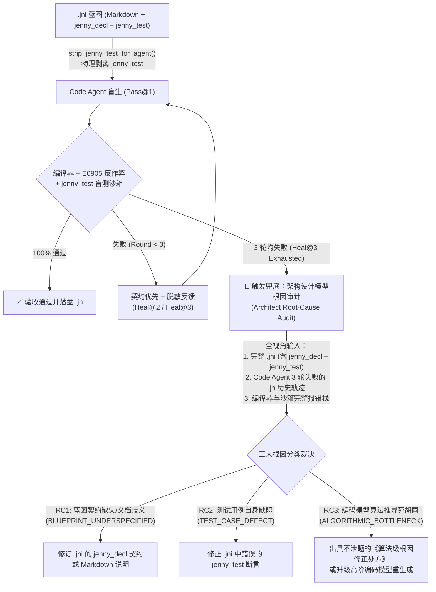

# Jenny 语言规范 —— 模块九：文学化架构蓝图（`.jni`）双区结构与一等公民契约系统 (Literate Blueprints & Design by Contract)

> **状态**：已定稿 (v2.0-spec)  
> **核心母题**：将“原生 Markdown 文档”加冕为一等公民！人类只读写排版优美的 `<module>.jni` 文学化架构蓝图，并按 **`jenny_decl`（声明与契约区）** 与 **`jenny_test`（验收与测试区）** 物理分区消除视觉干扰；AI 自动在幕后生成并维护 `<module>.jn` 实现代码（及模块内私有辅助函数 `fn`），编译器通过形式化契约（`requires` / `ensures` / `invariant`）与 `jenny_test` 验收套件执行零信任自动验证。

---

## 1. `.jni` 文学化蓝图双区架构：```` ```jenny_decl ```` 与 ```` ```jenny_test ````

### 1.1 为什么必须将声明契约与测试代码拆分为两个独立围栏章节？
如果将冗长的测试用例代码（`@example` / `test`）与核心类型/函数声明混杂在同一个 ```` ```jenny ```` 代码块中，会带来三大工程副作用：
1. **人类视觉干扰（损害 $\text{HCS}$ 可读性）**：人类架构师审阅 `.jni` 时，首要目标是快速扫视模块导出了哪些数据结构、函数签名与核心前后置契约；穿插其中的几十行状态构造与断言代码会严重打断接口阅读流。
2. **契约哈希（`jni_abi_hash`）虚假失效**：若测试代码与接口声明混在同一代码块中，每当开发者补充一条边界测试用例，都会改变代码块哈希并触发下游依赖模块不必要的重新类型检查。
3. **AI 上下文打包冗余（`spindle context`）**：当下游模块调用 `std::collections::Vec` 时，AI 只需要 `Vec` 的类型定义与函数契约（`jenny_decl`），并不需要把 `Vec` 自身的几十行单元测试也塞进 Prompt Context Window。

因此，Jenny v2.0 将 `.jni` 内的形式化代码块规范化为两个职责正交的围栏章节（同时向下兼容单块 ```` ```jenny ````）：

| 围栏标签 | 章节定位 | 允许包含的语法元素 | 编译器、`jni_abi_hash` 与 `spindle context` 行为 |
| :--- | :--- | :--- | :--- |
| **```` ```jenny_decl ````**<br>*(第一章：声明与契约区)* | **纯粹的对外接口与形式化契约唯一真相源** | • `module <path>`、`import`、`pub import`<br>• `pub error`、`pub enum`、`pub struct`（含 `invariant`）、`pub trait`<br>• `pub fn` / `pkg fn` 签名及 `effects`、`requires`、`ensures`<br>• **严禁出现任何函数体实现或测试语句** | • **`jni_abi_hash` 仅对 `jenny_decl` 计算 SHA-256 指纹**（增删测试绝不触发下游重编）<br>• **`spindle context` 默认仅打包上游模块的 `jenny_decl` 块**（极致压缩 AI 上下文 Token） |
| **```` ```jenny_test ````**<br>*(第二章：验收与测试区)* | **自包含白盒验收套件與可执行文档示例** | • **单行极简断言**：`<expr> => <expected>` 或 `<expr> => err(<ErrorVariant>)`<br>• **多行有状态测试块**：`test "<描述>" { ... }`（兼容 `@example("<描述>") { ... }`） | • 仅在 `spindle test` / `jenny check` 验证模式下编译并在沙箱中执行<br>• **100% 不导出符号、不进入生产二进制与 `lib/<pkg>.jnast` 发布包** |

### 1.2 `.jni` 与 `.jn` 的双向同构绑定与三级可见性铁律
每个模块由同名的 `<module>.jni`（蓝图）与 `<module>.jn`（实现）配对组成，严格执行三级可见性物理分流：

| 修饰符 | 可见性范围 | 在 `<mod>.jni` (`jenny_decl`) 中 | 在 `<mod>.jn` 实现文件中 | C99 / Native 符号链接属性 |
| :--- | :--- | :--- | :--- | :--- |
| **无修饰符 (`fn` / `struct` / `enum`)** | **模块内私有 (Module-Private)** | **严禁出现**（保持 `.jni` 蓝图 100% 纯净，绝不暴露内部实现细节） | **直接定义并实现**（由编译器自动推导 `effects` 副作用并传染校验调用链） | `static` 内部符号（外部模块物理不可见，绝不污染全局符号表） |
| **`pkg fn` / `pkg struct`** | **包内跨模块可见 (Package-Internal)** | 声明于包内共享蓝图 | 实现具体函数体 | 包内可见，对包外依赖方隐藏（`E0504`） |
| **`pub fn` / `pub struct` / `pub error`** | **公开导出 API (Public API)** | **必须在 `jenny_decl` 中声明完整签名、`effects` 与契约** | 实现具体函数体（若 `.jn` 中出现未在 `.jni` 声明的 `pub fn`，立即报错拦截） | 公开导出符号 |

* **契约免重复与自动织入（Contract Weaving）**：`.jni` 的 `jenny_decl` 中已声明的 `requires`、`ensures`、`invariant` 无需在 `.jn` 中重复书写，由编译器在中端阶段**自动织入（Weave-in）** `.jn` 公开函数的入口与出口！
* **彻底终结“为了测试而把私有辅助函数改成 `pub fn`”的反模式**：
  * 模块内部的拆解辅助函数（如 `fn grow_buffer`、`fn rebalance_node`）直接定义为无 `pub` 的模块私有 `fn` 放在 `.jn` 中；
  * 所有状态构造与多步验证逻辑一律写在 `.jni` 第二章 ```` ```jenny_test ```` 的 `test "..." { ... }` 块中，无需在 `.jni` 的 `jenny_decl` 中暴露任何伪造的 `pub fn test_xxx()` 辅助函数！

---

## 2. 一等公民形式化契约语法 (`jenny_decl` 章节)

为了使人类与 AI 无需打开 `.jn` 阅读具体实现即可 100% 掌控模块行为，Jenny 在 ```` ```jenny_decl ```` 的函数与类型声明中内建三大形式化契约原语：

### 2.1 前置条件契约：`requires <cond> [else <ErrorVariant>]`
* **语义**：声明调用该函数时实参或接收者状态必须满足的布尔断言。
* **自动错误映射（免手写参数校验）**：
  * 当函数返回类型为 `T ! E` 时，支持书写 `requires cond else ErrorVariant`（如 `requires cap > 0 else RingError.InvalidCapacity`）。
  * **编译器自动代码生成**：编译器直接在 `.jn` 函数体入口处自动插入 `if !(cond) { raise ErrorVariant }`！AI 在编写 `.jn` 时无需再写样板式的参数边界校验代码，可直接专注核心算法逻辑。

### 2.2 后置保证契约：`ensures <cond>`
* **语义**：声明函数正常返回（未触发 `raise`）时，返回值与对象状态必须满足的承诺。
* **专用内建标识符**：
  * **`result`**：指代函数的成功返回值（如 `ensures result >= lo && result <= hi`）。
  * **`old(expr)`**：指代函数进入前某表达式或字段的快照值（用于 `mut self` 或 `mut` 参数方法，如 `ensures self.len == old(self.len) + 1`）。

### 2.3 数据结构不变量：`invariant <cond>`
* **语义**：声明在 `struct` 内部，规定该类型实例在构造完成时、以及任何公开方法（`pub fn`）调用前后必须恒成立的状态约束（如 `invariant self.len <= self.cap`）。

---

## 3. 极简白盒验收语法 (`jenny_test` 章节)

在 `.jni` 的第二章 ```` ```jenny_test ```` 围栏块中，所有的代码天生处于测试验收上下文中，因此省去了繁琐的装饰器前缀，提供两种极简写法：

### 3.1 单行极简断言：`<expr> => <expected>`
对于纯函数计算、边界值校验或错误触发验证，直接书写 **`<左表达式> => <期望结果>`**（无需书写 `@example`、`test` 或 `assert` 包装）：
```jenny_test
// 1. 正常返回值断言：直接写 `<调用表达式> => <期望值>`
clamp(15, 0, 10)  => 10
clamp(-5, 0, 10)  => 0
clamp(5, 0, 10)   => 5

// 2. 错误分支断言：使用 `=> err(<ErrorVariant>)` 验证前置契约或异常分支拦截
RingBuffer.with_capacity(0) => err(RingError.InvalidCapacity)
```
*(注：编译器同时向下兼容 `@example <expr> => <expected>` 写法)*。

### 3.2 多行有状态测试块：`test "<描述>" { ... }`
对于需要初始化可变容器、连续调用多个方法并检查状态演进的场景，使用 `test "<描述>" { ... }` 块（向下兼容 `@example("<描述>") { ... }`）：
```jenny_test
test "ring buffer push, full rejection, and FIFO pop" {
    var rb = RingBuffer.with_capacity(2)!
    rb.push(10)!
    rb.push(20)!
    assert(rb.push(30) is Err(RingError.BufferFull))
    assert(rb.pop() == 10 && rb.pop() == 20 && rb.pop() == null)
}
```

---

## 4. 完整实战范例：`ring_buffer.jni`（双区蓝图）与 `ring_buffer.jn`（含私有 `fn`）

### 4.1 人类与 AI 共享的双区蓝图文件：`ring_buffer.jni`
````markdown
# 零拷贝定长环形缓冲区 (`ring_buffer`)

本模块提供用于硬实时音频/网络管线的原生堆环形缓冲区。
- **内存策略**：缓冲区分配于 Native Heap（`*RingBuffer<T>`），支持 `*in(arena)`，**100% 零 GC 参与**。
- **容量规则**：初始化容量 `cap` 必须大于 0；写入满缓冲区时返回 `RingError.BufferFull` 错误，绝不隐式扩容。

## 1. 接口声明与形式化契约 (`jenny_decl`)

```jenny_decl
module ring_buffer

pub error RingError {
    InvalidCapacity,
    BufferFull,
}

pub struct RingBuffer<T: TrivialCopy> {
    buf: *mut c_raw<T>,
    cap: usize,
    len: usize = 0,
    head: usize = 0,
    tail: usize = 0,

    invariant self.cap > 0
    invariant self.len <= self.cap
    invariant self.head < self.cap && self.tail < self.cap
}

impl<T: TrivialCopy> RingBuffer<T> {
    pub fn with_capacity(cap: usize) -> *RingBuffer<T> ! RingError
        effects [AllocNative]
        requires cap > 0 else RingError.InvalidCapacity
        ensures  result.cap == cap && result.len == 0

    pub fn push(mut self, item: T) -> void ! RingError
        effects [Mutate]
        requires self.len < self.cap else RingError.BufferFull
        ensures  self.len == old(self.len) + 1

    pub fn pop(mut self) -> T?
        effects [Mutate]
        ensures  if old(self.len) == 0 { result == null } else { self.len == old(self.len) - 1 }
}
```

## 2. 黄金验收与边界测试 (`jenny_test`)

```jenny_test
// 单行极简断言：一行验证非法容量契约拦截与初始状态
RingBuffer.with_capacity(0) => err(RingError.InvalidCapacity)
RingBuffer.with_capacity(4)!.len => 0

// 多行有状态验收块：验证入队、满载拦截与 FIFO 顺序出队
test "ring_buffer_fifo_and_full_guard" {
    var rb = RingBuffer.with_capacity(2)!
    rb.push(10)!
    rb.push(20)!
    assert(rb.push(30) is Err(RingError.BufferFull))
    assert(rb.pop() == 10 && rb.pop() == 20 && rb.pop() == null)
}
```
````

### 4.2 幕后实现文件：`ring_buffer.jn`（支持 `.jn` 专属模块私有 `fn`）
```jenny
module ring_buffer

// 模块内私有辅助函数（无 pub 修饰符）：
// 仅在 ring_buffer.jn 内部可见，编译为 C99 `static` 函数，绝不污染 ring_buffer.jni 蓝图！
fn next_ring_index(idx: usize, cap: usize) -> usize {
    return (idx + 1) % cap
}

// 注意：requires 参数校验、ensures 后置断言与 invariant 检查已由编译器从 .jni 自动织入！
impl<T: TrivialCopy> RingBuffer<T> {
    pub fn with_capacity(cap: usize) -> *RingBuffer<T> ! RingError {
        val raw = mem::alloc_array::<T>(cap)
        return *RingBuffer<T> {
            buf: raw,
            cap: cap,
        }
    }

    pub fn push(mut self, item: T) -> void ! RingError {
        mem::write_at(self.buf, self.tail, item)
        self.tail = next_ring_index(self.tail, self.cap)
        self.len += 1
    }

    pub fn pop(mut self) -> T? {
        guard self.len > 0 else {
            return null
        }
        val item = mem::read_at(self.buf, self.head)
        self.head = next_ring_index(self.head, self.cap)
        self.len -= 1
        return item
    }

    fn drop(own self) {
        mem::free_array(self.buf, self.cap)
    }
}
```

---

## 5. 零信任盲测隔离、防走捷径审计（`E0905`）与架构模型根因审计兜底协议 (Zero-Trust Blind-Test & Architect Root-Cause Audit Protocol)

将 `.jni` 拆分为 `jenny_decl` 与 `jenny_test` 两大物理章节，不仅消除了人类阅读时的视觉干扰，更构建了防止 AI 编码代理（Code Agent）**面向测试用例硬编码走捷径（Reward Hacking / Test Overfitting）** 的核心防线。

### 5.1 角色视角物理隔离（Information Asymmetry）

在 Jenny 工具链（`jenny-flow` / `spindle`）调用大模型生成或维护 `.jn` 实现时，严格执行 **“设计全视角、编码盲测视角”** 的信息不对称访问控制：

| 参与主体 | 可见的 `.jni` 内容 | 权限边界与工程目的 |
| :--- | :--- | :--- |
| **人类架构师 / 架构设计模型 (`Architect Agent`)** | 顶层 Markdown + ```` ```jenny_decl ```` + ```` ```jenny_test ````（全量可见） | 负责制定模块契约、编写边界验收用例，并在编码模型多次自愈失败后执行全视角根因审计 |
| **编码实现模型 (`Code Agent`, `Pass@1`)** | **仅可见** 顶层 Markdown + **```` ```jenny_decl ````**（**100% 物理剥离 `jenny_test`**） | 编译器自动调用 `strip_jenny_test_for_agent()` 剥离所有测试块。编码模型只能依据文档说明与 `requires` / `ensures` / `invariant` 推导通用算法，**彻底断绝照抄测试输入的可能**，同时节省 25%~45% 的 Prompt Token |
| **编译器沙箱 (`jenny-flow` / `spindle test`)** | 全量编译 `.jn` + 自动织入 `jenny_decl` 契约 + 沙箱运行隐藏的 `jenny_test` | 将对编码模型不可见的 `jenny_test` 作为 **盲测验收套件（Holdout Verification Suite）** 执行零信任裁决 |

### 5.2 三道防走捷径防线（Anti-Shortcut Defenses）

1. **防线一：`Pass@1` 盲生模式（Blind Generation）**
   * 默认所有向 Code Agent 发起的生成请求一律物理剥离 ```` ```jenny_test ```` 章节（及旧版 `@example` 块）。
2. **防线二：`Heal@2 ~ Heal@3` 契约优先与测试断言脱敏反馈（Desensitized Heal Feedback）**
   * 当盲测沙箱执行失败进入自愈循环（最多 3 轮：`Pass@1` $\rightarrow$ `Heal@2` $\rightarrow$ `Heal@3`）时：
     * **契约违例优先**：若触发 `requires`、`ensures` 或 `invariant` 违例，编译器仅向 Code Agent 报告违反的数学契约公式（如 `CRITICAL CONTRACT VIOLATION in push: ensures self.len == old(self.len) + 1`），绝不泄露测试用例源码；
     * **断言字面量脱敏**：若为 `jenny_test` 断言失败，编译器通过 `desensitize_failed_examples()` 隐去测试专用的魔法字面量输入与期望常数（替换为 `<REDACTED_TEST_LITERAL>`），仅告知失败的测试块意图描述（`test "<描述>"`）与状态偏差类别，防止模型在自愈轮次补写 `if x == <测试输入>` 分支。
3. **防线三：编译器 AST 反硬编码静态审计（`E0905_TEST_LITERAL_OVERFITTING`）**
   * 编译器同时解析 `jenny_test` 与 `.jn` 的 Token/AST：
   * 设 $L_{\text{test}}$ 为 `jenny_test` 中出现的非平凡字面量集合（排除 `-1, 0, 1, 2, true, false, null, ""` 等通用基础常数），$L_{\text{decl}}$ 为 `jenny_decl` 与顶层 Markdown 正文中合法声明的业务常量集合（如协议魔数、固定位宽、默认容量）。
   * 若 `.jn` 实现代码在条件判断（`if` / `match` / `==` / `!=`）或返回值中出现了任何属于 **$L_{\text{test}} \setminus L_{\text{decl}}$** 的测试专用字面量，编译器立即抛出 **`E0905_TEST_LITERAL_OVERFITTING`（检测到针对测试用例字面量的硬编码走捷径）** 并判定编译失败！

### 5.3 终极兜底策略：`Heal@3` 失败后的架构模型根因审计 (`Architect Root-Cause Audit`)

如果编码模型（Code Agent）经过 **3 轮尝试（`Pass@1` 盲生 + `Heal@2` 修复 + `Heal@3` 修复）** 后依然未能通过编译或 `jenny_test` 盲测，系统**严禁继续盲目重试或向编码模型直接泄题**，而是立即触发 **架构设计模型根因审计兜底协议（`spindle audit` / `Architect Root-Cause Audit`）**：



#### 架构设计模型（Architect Agent）输出的三大根因分类与闭环动作：
1. **`RC1_BLUEPRINT_UNDERSPECIFIED`（`.jni` 蓝图契约缺失或文档歧义）**：
   * **判定依据**：`jenny_test` 检验了某个特定边界行为（例如空切片返回何种错误码、溢出时饱和截断还是报错），但该规则既未写在顶层 Markdown 说明中，也未体现在 `jenny_decl` 的 `requires` / `ensures` 契约里，导致处于盲测态的 Code Agent 根本无法凭空猜出该隐式需求。
   * **闭环动作**：由架构模型直接在 `<mod>.jni` 的 `jenny_decl` 中补齐缺失的 `requires` / `ensures` 契约或澄清 Markdown 规范。
2. **`RC2_TEST_CASE_DEFECT`（`jenny_test` 测试用例自身缺陷）**：
   * **判定依据**：Code Agent 生成的 `.jn` 代码完全符合 `jenny_decl` 的形式化契约与业务逻辑，但 `jenny_test` 中的期望值算错或状态构造有误。
   * **闭环动作**：由架构模型修正 `<mod>.jni` 第二章 `jenny_test` 中的错误断言。
3. **`RC3_ALGORITHMIC_BOTTLENECK`（编码模型算法推导瓶颈/死胡同）**：
   * **判定依据**：`.jni` 的声明契约与测试均 100% 完备正确，但编码模型在连续 3 轮中陷入局部错误模式（如漏更新结构体次要字段、指针/环形索引模运算偏移错误、或顽固使用被禁用的旧语法）。
   * **闭环动作**：架构模型生成结构化的 **`ArchitectAuditReport`（含精准定位到函数与行号的根因分析 + 不泄露测试字面量的算法级修正处方 `algorithmic_prescription`）**，指导编码模型一次性精准修复，或将该模块标记为需要高阶模型（Pro Tier）接管。

