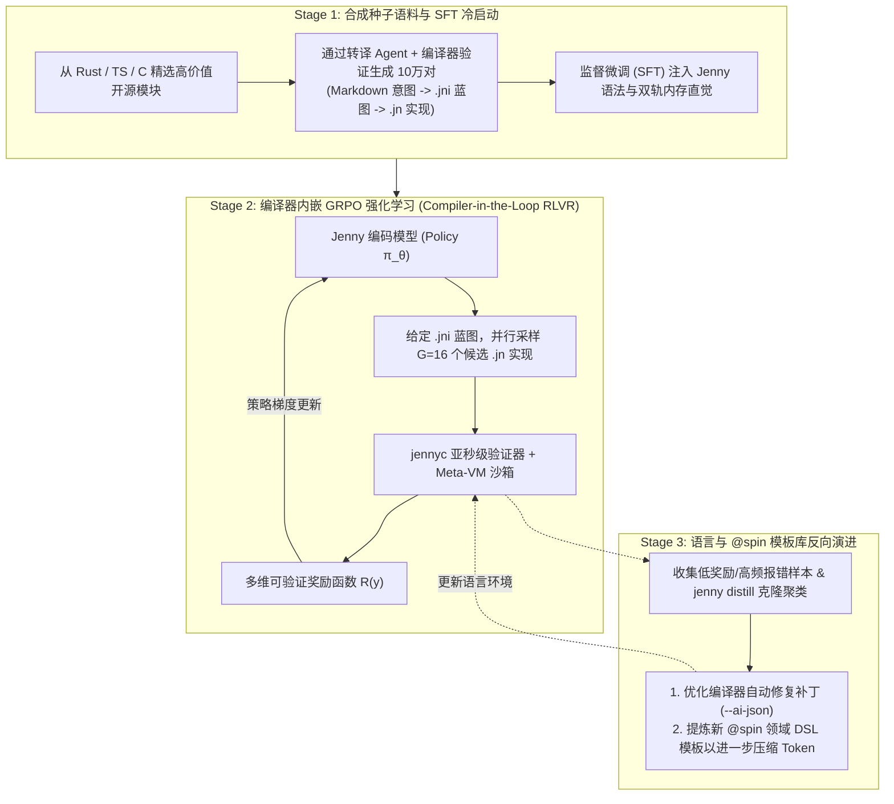

# Jenny 语言规范 —— 模块十一：语言-模型联合演进与量化实证工程 (PL-LLM Co-Design, JennyBench & RLVR Training)

> **状态**：已定稿 (v2.0-spec)  
> **核心理念**：彻底告别传统编程语言“纯靠人类设计者主观拍脑袋（Prior Intuition）”的设计方式；首创 **“编程语言与大语言模型双向协同演进（PL-LLM Co-Evolution）”** 科学工程范式——以 **五大核心量化指标** 为标尺，将编译器转化为 **RLVR（基于可验证奖励的强化学习）训练环境**，在训练模型精通 Jenny 的同时，根据模型的实证报错分布反向打磨语言语法与 `@spin` 模板库。

---

## 1. 为什么 AI 原生语言必须走“实证与训练协同（Co-Design）”之路？

任何一门新设计的编程语言在面对大语言模型（LLM）时，都面临着严峻的 **“预训练先验壁垒（Pre-training Prior Barrier）”**：
* 基座大模型在数万亿 Token 的 Python、TypeScript、Rust、C/C++、Go 语料上进行了预训练，其内部注意力头与 FFN 层已经形成了稳固的“代码神经回路”。
* 如果新语言的语法设计仅凭人类直觉闭门造车，极易与模型的先验分布发生剧烈冲突（High KL-Divergence），导致模型在生成代码时频繁出现跨语言语法污染（如误写出 Rust 的 `&mut` 或 TS 的 `===`）、Token 切分破碎以及高幻觉率。

因此，Jenny 确立了 **“数据驱动、训赛结合、双向迭代”** 的实证设计准则：**任何语法特性、内存规则与标准库 API 的最终定型，必须经过量化基准测试（JennyBench）与模型训练反馈的实证检验。**

---

## 2. 五大核心量化评估指标体系 (The 5 Quantitative Metrics)

为了科学度量 Jenny 语言设计的优劣，我们建立跨领域的标准评测集 **`JennyBench`**（涵盖：底层 C 库零拷贝封装、高并发网络状态机、复杂图结构业务模型、硬实时音频流处理、微服务 CRUD 管线五大类共 200 个复杂工程任务），并实时监控以下 **5 项硬性量化指标**：

| 指标代号 | 指标名称 | 精确数学定义与测量方法 | 优化目标与设计指导意义 |
| :--- | :--- | :--- | :--- |
| **1. TCR** | **任务 Token 压缩比** *(Token Compression Ratio)* | $$\text{TCR} = \frac{\text{Tokens}(\text{Rust/TS 等价基准实现})}{\text{Tokens}(\text{Jenny .jni 蓝图 + .jn 实现})}$$ *(采用主流 BPE Tokenizer 如 `o200k` / `cl100k` 实测)* | **目标：$\text{TCR} \ge 3.0\text{x}$（通用算法）至 $15.0\text{x}$（DSL 业务模块）**。 若某类任务 TCR 偏低，说明样板代码仍过多，需引入新的 `@spin` 模板或 `delegate` 语法糖。 |
| **2. ECC** | **有效上下文架构容量** *(Effective Context Capacity)* | 在固定上下文预算（如 32K Tokens）内，仅向模型注入全项目的 `.jni` 蓝图文件，测试模型执行跨 $N$ 个模块的全局需求变更时的**一次修改准确率**。 | **目标：单次 32K 窗口可无损容纳 $\ge 10\text{ 万行}$ 等价规模系统的全量架构拓扑**，验证 `.jni` 物理分离对防止上下文爆炸的真实增益。 |
| **3. $\text{Pass}@1$ & $\text{Heal}@k$** | **首次编译通过率与自愈效率** *(Compile Pass & Self-Healing Rate)* | • **$\text{Pass}@1$**：给定 `.jni` 蓝图，模型零反馈一次生成 `.jn` 并通过全部编译检查与 `@example` 契约的比例。 • **$\text{Heal}@2$**：结合 `--ai-json` 确定性修复补丁，在 $\le 2$ 轮内完成 100% 自愈闭环的比例。 | **目标：微调前 Few-Shot $\text{Pass}@1 \ge 75\%$，微调后 $\text{Pass}@1 \ge 96\%$，$\text{Heal}@2 \ge 99.5\%$**。 直接通过报错分布识别“反模型直觉”的语法摩擦点。 |
| **4. SHR** | **语义逻辑幻觉率** *(Semantic Hallucination Rate)* | 代码通过了基础类型检查，但在隐藏的边界属性测试集（Held-out Property & Fuzz Tests）上发生崩溃或逻辑错误的比率。 | **目标：$\text{SHR} \le 1.0\%$**。 度量 `.jni` 中的 `requires`、`ensures`、`invariant` 与 `@example` 契约对拦截模型逻辑幻觉的真实防御力。 |
| **5. HCS** | **人类意图审计效率** *(Human Comprehension Score)* | 人类工程师（或独立审计评测集）**仅阅读折叠态/展开态的 `.jni` 蓝图**，在限定时间内准确判断模块内存开销、异常边界与副作用纯度的得分与耗时。 | 验证 `.jni` 原生 Markdown 文学化蓝图与三态参数模式（默认只读 / `mut` / `own`）对人类心智负担的降低程度。 |

---

## 3. 顺应神经先验的语法 A/B 测试方法论 (Perplexity & Friction Profiling)

在完整编译器后端建成之前，以及在纠结任何具体语法变体（如关键字命名、符号选择、块结构）时，Jenny 采用 **“基座模型困惑度与错误率 A/B 实验”** 代替主观争论：

### 3.1 最小跨度正向迁移测试 (Minimum-Perplexity A/B Test)
1. **实验设置**：针对候选语法方案 A 与方案 B，分别编写等价的 500-Token 极简语法提示词（System Spec），让主流基座模型（如 Gemini / Claude / DeepSeek）在 `JennyBench` 子集上生成代码。
2. **测量生成熵（Token Generation Entropy）**：
   * 提取模型在生成关键语法节点（如函数签名、错误传播、内存前缀、模式匹配）时的 **Log-Probability（对数概率）**。
   * **判定准则**：如果模型在某个语法点上出现明显的概率坍缩（高熵犹豫）或高频退化为 Rust/TS 原生语法，说明该语法违背了预训练语料的先验分布，必须调整为更顺应先验的表述形式！

### 3.2 编译器报错热力图与“摩擦点消除（Friction Elimination）”
在实验与训练过程中，编译器自动统计所有生成失败案例的 **错误码频率热力图（Error Code Heatmap）**，并按以下规则反向演进语言设计：
* **案例 1（冗余重复标注消除）**：若统计发现模型在函数签名已声明 `own x: *Buffer` 的情况下，在调用处有 $>10\%$ 的概率漏写重复的 `own` 关键字，则编译器直接升级支持“调用处省略 `own` 时由 `--ai-json` 零歧义自动静默补全（Auto-Canonicalization）”，将编译报错转化为自动规范化！
* **案例 2（高频样板升格为标准库/DSL）**：若统计发现模型在处理某类任务时反复手写超过 15 行的固定模式代码，立即将该模式沉淀进官方 `spindle` 的 `@spin` 标准模板库。

---

## 4. 基于编译器可验证奖励的强化学习闭环 (Compiler-in-the-Loop RLVR)

Jenny 的 `.jni` 契约系统与极速编译器（`jennyc`）不仅是一个代码构建工具，更是天然为大模型后训练（Post-Training）量身定制的 **RLVR（Reinforcement Learning with Verifiable Rewards）强化学习环境**！

### 4.1 精确可验证奖励函数设计 (Multi-Objective Verifiable Reward Function)
在 GRPO（Group Relative Policy Optimization）强化学习阶段，模型根据 `.jni` 蓝图生成 `.jn` 实现代码 $y$，`jennyc` 编译器在毫秒级时间内直接计算确定性标量奖励 $R(y)$：

$$R(y) = R_{\text{compile}}(y) + R_{\text{contract}}(y) + R_{\text{perf}}(y) - \lambda \cdot \text{LengthPenalty}(y)$$

1. **阶段性编译通关奖励 $R_{\text{compile}}(y) \in [0, 0.3]$**：
   * 通过无损语法解析（AST 构建成功）：$+0.1$
   * 通过双轨内存、借用与 `effects` 纯度静态检查：$+0.2$
2. **契约与黄金用例实测奖励 $R_{\text{contract}}(y) \in [0, 0.5]$**：
   * 在内置 Meta-VM 沙箱中 100% 跑通 `.jni` 声明的所有 `@example` 用例且未违反 `requires` / `ensures` / `invariant`：$+0.5$（按通过用例比例线性给分）。
3. **双轨内存与零拷贝质量奖励 $R_{\text{perf}}(y) \in [0, 0.2]$**：
   * 静态分析器奖励零冗余 `.clone()`、正确使用 `*in(arena)` 与默认只读借用视图的实现。
4. **Token 经济学长度惩罚项 $-\lambda \cdot \text{LengthPenalty}(y)$**：
   * **核心驱动力**：在所有通过 100% 契约测试的候选代码 $y_i$ 中，**Token 数量越少、越善于复用泛型/`delegate`/`@spin` DSL 的实现，获得的净奖励最高**！
   * 这一项奖励将迫使模型在强化学习过程中**自我进化出“极致精简、高复用、零废话”的编码风格**！

---

## 5. 分阶段实证落地路线图 (Empirical Validation Roadmap)

为了在投入重型编译器后端开发前先用数据说话，实证工程按以下三步推进：

1. **Phase 0：零编译器基线对比实验（Week 1 ~ 2）**
   * 选取 10 个涵盖系统、并发与业务的典型模块，手工/半自动编写等价的 Rust、TypeScript 与 Jenny v2.0（`.jni` + `.jn`）对照代码。
   * 使用真实 Tokenizer 跑出第一份 **《Jenny v2.0 vs Rust/TS Token 消耗、上下文压缩比与语法熵实测报告》**，用真实数据校准基础语法。
2. **Phase 1：轻量级前端验证器 + Few-Shot LLM 压力测试（Month 1 ~ 2）**
   * 先用 Rust 快速写出仅包含 **Lexer + Parser + Type/Effect Checker + `--ai-json` 诊断器** 的轻量级前端（无需 LLVM 后端，耗时仅需 2~3 周）。
   * 接入主流大模型 API 跑 `JennyBench`，实测 Few-Shot 下的 $\text{Pass}@1$、$\text{Heal}@2$ 与高频错误码热力图，完成第一轮**数据驱动的语法磨平**。
3. **Phase 2：合成数据集构建与专属小模型 LoRA / RLVR 实验（Month 3 ~ 6）**
   * 利用轻量编译器前端与 Meta-VM 作为验证过滤器，自动合成数万条 100% 通过编译的高质量 `.jni <-> .jn` 训练集。
   * 在开源代码基座模型（如 Qwen-Coder / DeepSeek-Coder 7B~32B）上跑通 SFT + RLVR 闭环，实测小参数模型在 Jenny 语言上超越超大模型写 Rust/C++ 的工程拐点！
