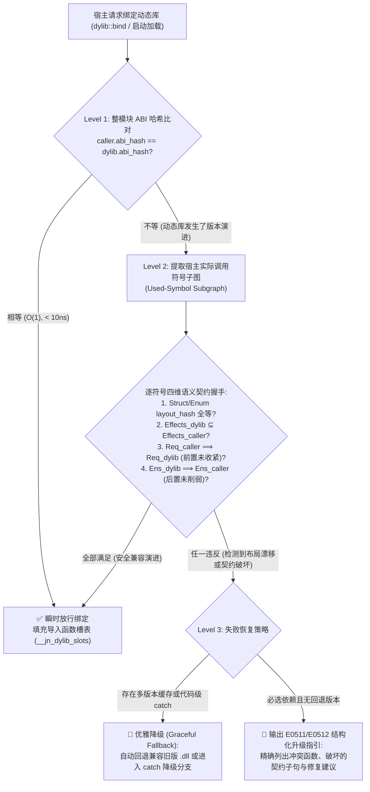

# 模块十三：语义契约驱动的原生动态链接、优雅降级与零泄漏热替换架构 (`Jenny-Dylib` 设计草案)

> **状态**：设计草案 (`v0.2-draft`，待后续实验验证)  
> **关联模块**：
> * [模块一：AI 原生双轨内存与参数意图模型](./01_memory_and_ownership.md)（视图不逃逸铁律 `E0201`）
> * [模块六：`@spin` 编译期白盒元编程](./06_spin_metaprogramming.md)（过程式模板单态化与 `.jenny-cache/spin/` 全局去重）
> * [模块九：文学化架构蓝图（`.jni`）与一等公民契约系统](./09_literate_blueprint_and_contracts.md)
> * [模块十二：包管理、模块解析与供应链副作用防火墙 (`Spindle`)](./12_package_management_and_module_system.md)

---

## 1. 问题背景：传统动态链接的“6 大 DLL Hell 死穴”与业界演进复盘

### 1.1 传统动态链接（`.dll` / `.so` / `.dylib`）的六大底层缺陷

在过去三十年中，C/C++ 及操作系统原生动态链接器频频陷入 **“DLL Hell（动态库地狱）”**，其根源在于传统链接器仅在“扁平符号名”层面工作，对**类型内存布局、函数行为契约、能力权限与资源生命周期**完全盲视：

1. **① 菱形依赖与单进程多版本冲突（Diamond Dependency & Symbol Interposition）**：
   * 主程序同时加载 `LibA`（依赖 `Codec v1.0`）与 `LibB`（依赖 `Codec v2.0`）时，Windows 按文件名 `codec.dll` 强制去重，Linux ELF 默认在全局扁平符号表中发生静默符号劫持（Symbol Interposition）。
2. **② 脆弱基类与内存布局静默错位（Fragile Base Class & Struct Layout Drift）**：
   * 上游在 `struct` 中增删字段或改变枚举判别式，但函数名未变。调用方仍按旧 `sizeof` 在栈上分配内存并按旧偏移量读写字段，直接引发**静默栈踩踏（Silent Stack Corruption）**。
3. **③ 名义版本号欺骗与隐式语义背叛（Nominal SemVer Lie & Behavioral Drift）**：
   * 动态库作者声称小版本升级兼容（函数签名与结构体布局均未变），但悄悄收紧了前置条件（如原本允许传 `0`，新版传 `0` 崩溃）、削弱了后置保证，或植入了未声明的 `Net`/`FileSystem` 副作用。
4. **④ 搜索路径劫持与同名污染（Path Hijacking & Name Collision）**：
   * 依赖 `PATH`、`LD_LIBRARY_PATH` 或工作目录按文件名盲目搜索，极易被其他软件覆盖同名 DLL 或遭受 DLL 侧载攻击（Side-Loading）。
5. **⑤ 跨边界分配器分裂与状态分裂（Split Runtime & ODR Violation）**：
   * `A.dll` 分配的对象传给 `B.dll` 释放时因各自链接不同 CRT 堆而崩溃；或为规避冲突各自静态打包基础库，导致全局变量与线程局部存储（TLS）在进程内分裂成多份。
6. **⑥ 热卸载悬垂指针与隐式初始化死锁（Use-After-Unload & Loader Lock Deadlock）**：
   * 宿主持有指向动态库 `.rodata` 只读段的 `str` 切片或指向 `.text` 代码段的函数指针，一旦执行 `dlclose` / `FreeLibrary` 热卸载，下一秒访问即触发 `SIGSEGV`。

---

### 1.2 业界五大主流流派及 .NET 热卸载演进的得失对比

| 技术流派 | 代表系统 | ① 多版本共存 | ② 防布局漂移 | ③ 防语义背叛 | ④ 防路径劫持 | ⑤ 防堆分裂 | ⑥ 安全热卸载 | 核心局限与工程代价 |
| :--- | :--- | :---: | :---: | :---: | :---: | :---: | :---: | :--- |
| **1. OS 加载器补丁派** | WinSxS / macOS 双层命名空间 / ELF SymVer | ⚠️ 部分 | ❌ | ❌ | ⚠️ 部分 | ❌ | ❌ | 配置繁琐，完全不懂语言级结构体布局与契约 |
| **2. 激进全静态编译派** | Go / Rust (`rlib` 默认模式) | ✅ 符号带哈希 | ➖ 靠全量重编 | ❌ | ✅ 单文件 | ✅ | ❌ 不支持 | 二进制体积膨胀，微改底层需全量重链，丧失原生热更新与插件能力 |
| **3. 不可变内容寻址派** | Nix / Guix / Bazel | ✅ 精确路径 | ➖ 改布局必重编 | ❌ | ✅ 哈希路径 | ⚠️ | ❌ | 仅为外部构建壳，不支持运行期免重编热替换 |
| **4. 韧性 ABI 查表派** | Swift Resilient ABI | ⚠️ 单进程单版 | ✅ 运行期查表 | ❌ | ✅ | ✅ | ❌ | 未标 `@frozen` 的结构体退化为运行期查表与堆分配，损失零开销值语义 |
| **5. 零共享内存沙箱派** | Wasm Component Model | ✅ 实例隔离 | ✅ 协议升降级 | ⚠️ 仅能力门禁 | ✅ | ✅ | ✅ | **跨边界严禁零拷贝切片，每次调用必须深拷贝序列化** |
| **6. GC 追踪卸载上下文** | .NET `AssemblyLoadContext` / Java OSGi | ✅ 上下文隔离 | ⚠️ 改布局需重编 | ❌ | ✅ | ✅ | ⚠️ **易泄漏** | 对象头隐式持有动态库 `MethodTable*`，**只要宿主残留 1 个对象引用就永远卸载不掉（Unload Leak）** |

#### 深度镜鉴：为什么 .NET 从 `AppDomain` 演进到 `AssemblyLoadContext (ALC)` 仍未彻底解决卸载难题？
* **`.NET AppDomain`（第一代）**：靠进程内子域隔离 + 跨边界强制深拷贝序列化（Remoting）实现卸载，但跨边界性能损耗巨大，且 `ThreadAbort` 强制杀线程极不安全，最终在 .NET Core 中被废弃。
* **`.NET Collectible ALC`（第二代）**：允许宿主与插件零拷贝直接互传对象，但每个插件实例的对象头都带有指向该插件 `LoaderAllocator` 的 `MethodTable*` 指针。调用 `alc.Unload()` 后必须等待全堆 GC 扫描——一旦宿主在任何全局缓存、事件回调或日志队列里不小心残留了 1 个插件对象，整个动态库就会发生**永久驻留泄漏（Unload Leak）**。
* **Jenny 的破局点**：结合 Jenny 独有的 **`.jni` 一等公民契约** 与 **三态内存模型（栈绑定视图不逃逸铁律 + 无虚表头的纯值结构体）**，我们可以在**保持 C 级零拷贝性能**的同时，一次性把上述 **① ~ ⑥ 全部变为 ✅**！

---

## 2. Jenny 动态库的“双层代码分离”与稳定值 ABI 架构

### 2.1 具象函数进 `.dll` 机器码，`@spin` 薄模板进只读元数据段

在构建动态链接库（`spindle build --lib-type dylib`）时，模块中的函数按性质自动分流：

1. **普通具象函数与方法（Concrete Functions，占比 > 95%）$\rightarrow$ 编译为原生机器码导出符号**：
   * 例如 `std::str::fmt` 中的 `FmtBuffer.in_arena`、`FmtBuffer.put_str`、`FmtBuffer.put_spec`、`FmtBuffer.to_sso_string`，以及 `Vec.*`、`HashMap.*`、`VarintStream.*`；
   * 它们的参数与返回类型完全固定，直接编译进 `std.dll` / `libstd.so` 的 `.text` 代码段。
   * **商业/闭源发布友好**：发布动态库时，具象函数已编译为机器码，**无需分发 `.jn` 源码或具象函数的实现 AST**，仅需对外提供 `.jni` 蓝图即可完成开发与审计。
2. **`@spin` 编译期模板与泛型函数（`@spin fn` Orchestrators）$\rightarrow$ 嵌入 `.jn_spin` 元数据段**：
   * 如 `@spin pub fn format_with(culture: Culture, ...args: Formattable) -> String`，它本身只是一层仅含 3 个分支的**薄胶水编排器（Orchestrator）**；
   * 其模板 AST 嵌入在动态库的只读段 `.jn_spin`（或配套的轻量 `.jnast`）中；
   * 当下游 `app.exe` 调用 `str::format("id=", -42, ",hex=0x", hex_item)` 时，编译器在调用方侧（`.jenny-cache/spin/`）按签名哈希展开出 8 行薄胶水函数 `format_with__spin_33cce456`，而胶水体内调用的 `FmtBuffer.in_arena`、`put_str`、`put_spec`、`to_sso_string` **全部直接链接到 `std.dll` 的导出机器码符号**！
   * **高频实例预导出（Pre-Spun Exports）**：动态库可将常见参数组合的 `__spin_<hash>` 实例直接作为弱符号/预编译符号导出；下游若命中相同签名哈希，直接 `dllimport` 调用，连胶水层都无需重复生成。

---

### 2.2 统一极简运行时底座（`jenny_rt.dll` / `libjenny_rt.so`）根除跨库堆分裂（消灭 ⑤）

在动态链接模式下，主程序与所有 Jenny 动态库强制动态共享同一个极简运行时底座 **`jenny_rt.dll` / `libjenny_rt.so`**：
* **统一分配器**：托管全局唯一的线程局部 Scratch Arena 栈（`rt_scratch_mark` / `rt_scratch_alloc` / `rt_scratch_release`）、64KB Immix 块池与 `*T` 原生堆分配器（`rt_raw_alloc` / `rt_raw_free`）。`A.dll` 创建的 `String` 或 `Vec` 传给 `B.dll` 或 `app.exe` 销毁，100% 落在同一物理分配器实例中。
* **统一零开销跨库通道**：
  * `str`：固定 **16 Bytes** (`{ ptr, len }`) 只读借用视图；
  * `String`：固定 **24 Bytes** (`JnString` SSO 值类型，$\le 22$ 字节全在寄存器/栈值内联传递，0 堆指针)；
  * `T ! E`：固定 **16 Bytes** (`JnAnyError` 寄存器内联值) + 线程局部 16 槽错误追踪环（`trace_depth()`），跨 `.dll` 传播错误无需 C++ 式的跨边界异常栈展开（Zero-Unwind）。

---

### 2.3 符号名 ABI 哈希命名空间：原生支持单进程多版本共存（消灭 ① & ④）

* 动态库导出的机器码符号名编码其所属包名、模块名与**接口布局哈希前 8 位**：
  $$\text{ExportSymbol} = \texttt{jn\_<pkg>\_<mod>\_<layout\_hash8>\_\_<Type>\_<fn>}$$
* **单进程多版本零冲突共存**：若 `PluginA` 依赖 `codec`（布局哈希 `ebafecdb`），`PluginB` 依赖重构了结构体的新版 `codec`（布局哈希 `7c3190a2`），两者在符号表中的名称完全正交，可在同一进程内同时加载运行，彻底终结 Linux ELF 全局符号劫持与 Windows 同名模块冲突。

---

## 3. 运行期三级语义契约握手与优雅降级（消灭 ② & ③）

Jenny 彻底抛弃了“靠文件名里的版本号盲猜动态库是否兼容”的传统做法。每个 Jenny 动态库在编译时都会自动嵌入一个只读自描述清单函数 `__jn_dylib_manifest()`，记录每个导出类型与函数的 **`layout_hash`**（物理内存布局指纹）与 **`contract_spec`**（`effects`、`requires`、`ensures` 规范化契约谓词）。



### 3.1 第一级：$O(1)$ 整表哈希快路径（Exact ABI Fast-Path）
* 当动态库仅修复了 `.jn` 内部算法而未改动 `.jni` 蓝图时，`caller.expected_abi_hash == dylib.module_abi_hash`；
* 加载器仅执行一次 64 位整数比较（耗时 `< 10 ns`）即完成验证并填充函数槽表。

### 3.2 第二级：按需符号子图 + 霍尔契约子类型运行期验证（Subgraph Subtyping Check）
* 当动态库升级了版本（如 `.jni` 增加了新函数、或调整了契约）导致整表哈希变化时，加载器**不再一刀切报错**，而是仅针对**当前宿主程序实际导入并调用的符号子集（Used-Symbol Subgraph）**执行四项运行期数学验证：
  1. **物理内存布局全等（`layout_hash` Match）**：宿主用到的每个 `struct` / `enum` / `union` 的字节大小、字段偏移量与位域宽度必须 100% 恒等（哪怕动态库修改了宿主未使用的其他结构体，也完全放行）；
  2. **副作用权限不扩张（$E_{\text{dylib}} \subseteq E_{\text{caller}}$）**：新版动态库函数声明的 `effects` 必须是调用方编译期预期副作用的子集（防止新版动态库偷偷夹带 `Net` / `IO` 后门）；
  3. **前置条件不收紧（$\text{Req}_{\text{caller}} \implies \text{Req}_{\text{dylib}}$）**：调用方保证满足的前置条件必须能推导出动态库要求的前置条件；
  4. **后置保证不削弱（$\text{Ens}_{\text{dylib}} \implies \text{Ens}_{\text{caller}}$）**：动态库承诺的后置条件必须能推导出调用方依赖的所有后置条件。

### 3.3 第三级：链接失败时的优雅降级（Fallback）与结构化升级诊断

当运行期契约握手检测到不兼容时，Jenny 提供两条清晰的工程出路：

#### 出路 A：自动回退兼容版本或代码级 `catch` 降级处理
1. **多版本缓存池自动回退**：若 `.jenny-cache/dylib/` 或应用目录中存在多个历史构建版本的动态库，加载器发现最新版契约不兼容时，自动回退绑定通过语义握手的兼容版本，并输出一条可观测性告警。
2. **代码级显式 `catch` 降级**：对于插件或可选加速库，动态绑定返回一等错误类型 `DylibModule ! LinkError`：
   ```jenny
   val accel = dylib::load<CodecPlugin>("jenny_codec_avx512.dll") catch err {
       if err is LinkError.ContractIncompatible || err is LinkError.LayoutDrift {
           // 动态库语义契约不兼容时，自动降级为内置标准实现，拒绝进程崩溃
           return CodecPlugin.builtin_software_fallback()
       }
       return CodecPlugin.builtin_software_fallback()
   }
   ```

#### 出路 B：精准告知用户的结构化升级指引（`E0511` / `E0512`）
当核心必选动态库链接失败且无降级分支时，运行时绝不输出模糊的 `undefined symbol` 或崩溃弹窗，而是输出精确到**具体函数与契约子句**的升级报告：

```text
[E0511_DYLIB_CONTRACT_INCOMPATIBLE] Runtime semantic link check failed for `std_codec_varint.dll`:
  ├─ Symbol   : `VarintStream.encode_u64(mut self, val: i64) -> i64 ! CodecError`
  ├─ Mismatch : Precondition strengthened in dynamic library (breaks caller guarantee)
  │    • Caller compiled with : `requires val >= 0`
  │    • Dylib v0.3.0 demands : `requires val >= 10`
  └─ Action   :
       1. Roll back `std_codec_varint.dll` to ABI-compatible build (`ebafecdb951cc11e`), OR
       2. Upgrade caller application to a version compatible with `std::codec::varint >= 0.3.0`.
```

---

## 4. 五步原子热替换与零泄漏确定性卸载（超越 .NET `ALC`，消灭 ⑥）

### 4.1 为什么 Jenny 天生免疫 .NET `AssemblyLoadContext` 的“卸载泄漏”？

在 .NET (`ALC`) 和 Java (`ClassLoader`) 中，动态库之所以极难干净卸载，是因为插件创建的对象实例头中含有指向插件元数据区的 `MethodTable*` 指针。而在 Jenny 中：

1. **只读切片视图 (`str` / `[]T`) 受“栈绑定视图不逃逸铁律 (`E0201`)”静态封锁**：
   * 动态库内部 `.rodata` 常量段的字符串字面量类型是 `str`；
   * 编译器在静态检查期已经严禁将任何 `str`、`[]T` 或含切片的视图结构体存入堆对象（`*T` / `^T`）或全局状态；
   * **结论**：一旦对动态库函数的调用返回，宿主堆中**在数学上绝不可能残留任何指向动态库 `.rodata` 段的 `str` 指针**！
2. **值结构体 (`struct`) 与 `String` (24B SSO) 与动态库代码段 100% 零指针纠缠**：
   * Jenny 的 `struct` 是纯数据聚合（无隐藏虚表指针），24B SSO `String` 要么栈内联（$\le 22$ 字节），要么分配在共享的 `jenny_rt` 底座中；
   * **结论**：即便宿主长期持有动态库返回的 `String`、`Vec` 或业务 `struct`，这些数据也完全独立于动态库的虚拟内存页，动态库随时卸载都不会产生悬垂指针！
3. **动态多态接口 (`dyn Trait`) 与闭包走句柄槽表代理**：
   * 跨可热卸载动态库边界暴露的回调或 `dyn Trait`，其函数指针统一指向宿主侧维护的**导入函数槽表（`__jn_dylib_slots`）**，而非裸露的 `.text` 绝对地址。

---

### 4.2 五步零停机原子热替换（Five-Step Atomic Semantic Hot-Swap）

通过将导入函数绑定在间接槽表 `__jn_dylib_slots` 上，并配合轻量的在途调用计数器（`in_flight_calls`），Jenny 实现毫秒级确定性热替换与卸载：

```jenny
pub struct DylibSlotTable {
    module_abi_hash: u64,
    in_flight_calls: AtomicI64,
    fn_slots: *mut c_raw<usize>,
}
```

1. **Step 1（并行映射新库）**：在后台加载新版本动态库 `plugin_v2.dll`，此时线上流量仍 100% 走 `plugin_v1.dll`；
2. **Step 2（运行期语义契约握手）**：对 `plugin_v2.dll` 执行第 3 节的**三级语义兼容性检查**（还可选择性在沙箱中自动跑一遍 `plugin_v2` 内嵌的 `@example` 自检向量！）。若检查不通过，立即丢弃 `v2`，线上 `v1` 毫发无损；
3. **Step 3（原子指针切流）**：契约握手通过后，以原子写（Atomic Store Release）更新 `__jn_dylib_slots` 中的函数指针指向 `plugin_v2.dll`。从这一纳秒起，所有新发起的调用全部进入 `v2`；
4. **Step 4（在途调用排空）**：正在执行 `v1` 函数的线程在函数返回时递减 `v1.in_flight_calls`；
5. **Step 5（确定性立即卸载）**：一旦 `v1.in_flight_calls == 0`，无需像 .NET/Java 那样触发全堆 GC，直接调用 `dlclose` / `FreeLibrary` 立即释放 `plugin_v1.dll` 的代码段与只读数据段，实现 **100% 确定性零泄漏卸载**！

---

## 5. 动态链接专属诊断错误码规范 (`E0511` ~ `E0514`)

在 [模块十二 (`E0501`~`E0510`)](./12_package_management_and_module_system.md) 基础上，预留以下 4 个动态链接与热替换标准诊断码供后续阶段实现验收：

| 错误码 ID | 触发阶段 | 触发条件 | 恢复/修复机制 |
| :--- | :---: | :--- | :--- |
| **`E0511_DYLIB_CONTRACT_INCOMPATIBLE`** | 运行期加载 / 热替换 | 动态库导出函数的 `effects` 越权扩张、`requires` 前置条件收紧或 `ensures` 后置保证削弱 | 自动回退兼容版本、进入 `catch` 降级分支，或按诊断升级调用方/回滚动态库 |
| **`E0512_DYLIB_LAYOUT_DRIFT`** | 运行期加载 / 热替换 | 动态库中导出结构体/枚举/联合体的 `layout_hash`（字段大小、偏移量、位域宽度）与调用方不匹配 | 拦截加载以防止栈踩踏，回退兼容版本或重新编译调用方 |
| **`E0513_DYLIB_SYMBOL_MISSING`** | 运行期加载 / 热替换 | 调用方依赖的导出函数符号在目标动态库中不存在 | 进入 `catch` 降级分支或升级动态库 |
| **`E0514_DYLIB_RAW_FN_ESCAPE`** | 编译期静态检查 | 可热卸载插件接口尝试直接返回裸函数指针而非受槽表托管的接口句柄 | 改为通过 `.jni` 导出契约函数或托管槽表接口 |
