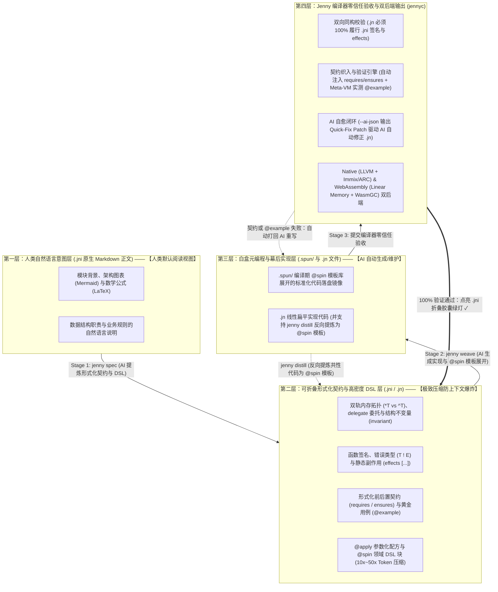

# 《Spinning Jenny (Jenny) 语言设计宪章与 AI 原生架构总纲》

> **定位**：全球首门彻底重构“人机分工第一性原理”的 AI 原生系统级编程语言。  
> **核心范式**：**人类以原生 Markdown 定义意图与架构（Literate Blueprint `.jni`） $\times$ AI 自动纺出形式化契约与代码实现（`.jn`） $\times$ 编译器执行零信任契约验收（Verifier）**。

---

## 一、 第一性原理重构：从“迁就人类手写”到“AI 生成、人类读文档”

过去 70 年的所有编程语言（从 C、C++、Java、Python 到 Rust、Go、Zig），其底层设计均建立在同一个不言自明的旧公理之上：**“人类是代码的直接书写者（Writer）”**。
因此，传统语言代码中“代码是主人，注释是附庸”——人类必须在一行行冰冷的代码缝隙中用 `///` 塞入零碎的注释；为了省敲击次数，语言发明了大量晦涩的语法糖与隐式规则；为了避免手写两遍签名，放弃了声明与实现的分离。

然而，在 **AI 工业革命**的时代，生产力关系发生了根本性的哥白尼式翻转：

| 维度 | 传统编程语言的假设（Human-Written Era） | **Jenny 语言的第一性原理（AI-Native Era）** |
| :--- | :--- | :--- |
| **谁写代码？** | 人类程序员一行行手敲 | **100% 具体实现代码（甚至形式化接口签名）由 AI 生成与维护** |
| **人类的角色？** | 既当建筑师，又当泥瓦匠（陷入底层实现细节泥潭） | **纯粹的架构师、意图定义者与最终审计者（Architect & Auditor）** |
| **主客体关系？** | 代码是一等公民，注释（`///`）是代码的附属品 | **原生 Markdown 设计文档是一等公民，形式化接口是文档中可折叠的语义锚点，具体实现隐藏在幕后** |
| **什么不重要？** | 接口文档经常缺失或过期，海量时间花在调试内部循环 | **具体函数体内部的百行实现细节超出人类瞬时信息处理极限，只要通过契约验证即无需人类逐行阅读** |

基于这一洞察，Jenny 确立了全新的顶层设计纲领：**人类日常只需阅读和编写如同 Markdown 技术文档般的 `.jni` 架构蓝图（形式化接口定义默认由 IDE 折叠为状态胶囊），而将繁琐的接口形式化与 `.jn` 底层代码实现交给 AI 与编译器闭环完成。**

---

## 二、 核心架构法则一：文学化蓝图（`.jni`）与幕后实现（`.jn`）的物理分离

Jenny 重新发明并升华了**双文件物理分离架构**，彻底反转了文档与代码的地位：

### 1. 文学化架构蓝图文件：`<module>.jni`（Literate Blueprint —— 人类主战场）
* **顶层格式直接就是原生 Markdown！**
  * 在 `.jni` 文件中，**不需要任何 `///` 或 `/** */` 注释符号**。文件的顶层语法就是 100% 纯正的自由文本 Markdown（支持标题、列表、表格、Mermaid 架构图、LaTeX 数学公式）。编译器不干涉 Markdown 正文的自由创作，让人类用最舒服的母语阐述设计意图。
* **形式化接口与契约内嵌于 ```` ```jenny ```` 块中（IDE 默认折叠）**：
  * 编译器只解析 `.jni` 文件中由 ```` ```jenny ```` 包裹的形式化契约代码块（包含 `struct`/`enum` 双轨内存定义、`pub fn` 签名、`effects` 副作用、`requires`/`ensures` 契约与 `@example` 黄金验收用例）。
  * **IDE 折叠阅读体验**：当人类打开 `.jni` 时，所有的 ```` ```jenny ```` 代码块默认折叠为一行精致的验证状态胶囊（如 `▶ [✓ 契约已验证 | 纯函数 | 3 个 @example 通过]`）。人类从头到尾阅读 `.jni` 就像在读一篇图文并茂的架构设计白皮书，仅在需要深究某个指针类型或边界条件时才点击展开该代码块！
  * **GitHub 零配置渲染**：任何 `.jni` 文件上传至 GitHub 或文档系统，无需任何文档生成工具，天然就是一篇排版完美的架构规范文档！

### 2. 幕后代码实现文件：`<module>.jn`（Implementation —— AI 纺织车间）
* **受众**：**AI Coding Agent（主写）** + **Jenny 编译器（主验）**（人类在日常开发中完全无需打开 `.jn` 文件）。
* **包含内容**：`.jni` 中所有形式化接口的具体过程式/函数式实现、私有辅助函数、底层 C 裸指针转换（`.as_raw_ptr()`）及并发状态机逻辑。
* **编译器双向同构铁律**：
  * 编译器强制校验 `<module>.jn` 必须 100% 精确履行 `<module>.jni` 中所有 ```` ```jenny ```` 块声明的签名、内存轨道、副作用与形式化契约。
  * 当 AI 需要理解整个十万行级项目时，只需读取全项目的 **`.jni` 蓝图文件集合**，既同时获得了人类的自然语言设计意图，又获得了 100% 精确的形式化类型签名，Token 消耗降低 90%！

---

## 三、 核心架构法则二：“三步渐进式纺纱”与一等公民契约验收

既然人类主要阅读 `.jni` 中的 Markdown 文档，甚至默认折叠了 ```` ```jenny ```` 形式化接口块，也不用打开 `.jn` 实现文件，**整个开发与质量保障闭环是如何运转的？**

Jenny 首创了 **“三步渐进式纺纱工作流（Three-Stage Progressive Weaving）”**：

````markdown
<!-- ======================================================================= -->
<!-- 📄 audio_weaver.jni —— 人类打开文件时看到的真实模样（原生 Markdown）      -->
<!-- ======================================================================= -->

# 音频重采样与响度分析模块 (`audio_weaver`)

本模块负责底层音频流的零拷贝帧管理与响度特征提取，直接桥接 C 语言 `libsamplerate` 库。
为了保证硬实时音频渲染管线 **100% 零 GC 停顿**，所有音频样本缓冲区均分配在原生堆（`*T`）上。

## 1. 原生音频帧 (`PcmFrame`)

代表一段连续的交错 32 位浮点音频样本。销毁时自动调用 C 库释放底层内存。
- 当帧长度大于 0 时，样本指针绝对不能为空。
- 采样率必须限制在专业音频标准区间 $[8000, 192000]\text{ Hz}$ 内。

```jenny
blueprint audio_weaver
import c "samplerate.h" as libsr

@repr(C)
pub struct PcmFrame {
    pub samples: *mut c_raw<f32>,
    pub length: usize,
    pub sample_rate: u32 = 48000,

    invariant self.length > 0 => self.samples != null
    invariant self.sample_rate >= 8000 && self.sample_rate <= 192000
}
```

## 2. 计算归一化均方根响度 (`compute_normalized_rms`)

计算输入音频样本切片的均方根（RMS）能量值：
$$\text{RMS} = \sqrt{\frac{1}{N}\sum_{i=1}^{N} x_i^2}$$
并将结果严格钳制在 $[0.0, 1.0]$ 闭区间内。若传入空切片，立即返回 `EmptyInput` 错误。
本函数必须是无任何 I/O 与 GC 分配的**纯函数**。

<!-- 💡 在 IDE 中，下方这个 ```jenny 块默认被折叠为一行绿色状态胶囊： -->
<!-- ▶ [✓ 契约已验证 | 纯函数 effects [] | ([]f32) -> f32 ! AudioError | 3/3 用例通过] -->
```jenny
pub enum AudioError {
    EmptyInput,
    ResampleFailed(i32),
}

pub fn compute_normalized_rms(samples: []f32) -> f32 ! AudioError
    effects []
    requires samples.len > 0 else AudioError.EmptyInput
    ensures  result >= 0.0 && result <= 1.0
    @example compute_normalized_rms([]) == AudioError.EmptyInput
    @example compute_normalized_rms([0.0, 0.0, 0.0]) == 0.0
    @example compute_normalized_rms([0.5, 0.5, 0.5, 0.5]) == 0.5
```
````

### 三步渐进式人机协同闭环：
1. **第一步（Human Intent —— 人类写 Markdown）**：
   * 人类架构师在 `audio_weaver.jni` 中只写上面的 Markdown 标题、文字说明与公式（甚至不用手写 ```` ```jenny ```` 块）。
2. **第二步（`jenny spec` —— AI 纺出可折叠的形式化契约）**：
   * AI 读取人类的 Markdown 段落，在每个章节下方自动生成/更新 ```` ```jenny ```` 形式化接口块（包含精确的 `*T`/`^T` 类型、`effects []`、`requires`/`ensures` 前后置条件以及 `@example` 验收用例）。人类可以展开瞄一眼 `@example` 是否符合预期，随后将其折叠收起。
3. **第三步（`jenny weave` —— AI 生成幕后 `.jn` 实现 + 编译器零信任验收）**：
   * AI 根据 `.jni` 自动生成背后的 `audio_weaver.jn` 实现代码。
   * **Jenny 编译器自动执行三重铁律验收**：
     1. **双向签名与 `effects` 纯度核验**：确保 `.jn` 未违反任何内存或副作用契约；
     2. **前置/后置条件自动织入**：编译器直接将 `.jni` 中的 `requires samples.len > 0 else AudioError.EmptyInput` 自动编译进函数入口（`.jn` 里连参数校验代码都不用重复写！），将 `ensures` 与 `invariant` 织入函数出口；
     3. **`@example` 编译期沙箱实测**：编译器在内置 Meta-VM 中直接运行所有 `@example`！若未通过，编译器输出 `--ai-json` 确定性修复补丁打回给 AI 重写 `.jn`，直到 100% 通过后在 IDE 折叠胶囊上点亮 `✓ 契约已验证`！

---

## 四、 核心架构法则三：语法重心从“省敲击次数”转向“自解释可读性与 AI 零幻觉”

当人类不再手敲代码、仅在展开契约或抽检实现时做阅读审查，语法设计的评判标准全面转向**自解释性（Self-Explanatory）**：

1. **调用处具名参数（Named Arguments for Clarity）**：
   * 当调用包含布尔标志、常量或同类型多参数的函数时，支持在调用处携带参数名标签（如 `resample(frame, target_rate: 44100, high_quality: true)`），无需跳转定义即可看懂业务含义。
2. **六大显式安全与控制流地标**：
   * `*T`（原生唯一所有权）、`^T`（托管共享句柄）、`&T`（局部借用视图）、`.await`（异步挂起点）、`?`（错误传播点）、`.as_raw_ptr()`（C FFI 裸指针跨越点）。
3. **`.jn` 实现层的“线性扁平范式（Canonical Linear Form）”**：
   * 用 `guard ... else` 消除条件缩进金字塔；用 `|>` 管道消除括号洋葱嵌套；鼓励每一步计算拆解为具名 `val` 中间变量，内嵌 AI 思维链（Chain-of-Thought）锚点。

---

## 五、 核心架构法则四：Token 经济学与反上下文爆炸（极致复用与 `@spin` DSL 模板库）

在大模型协同编程时代，**代码行数（LOC）与 Token 数量直接决定了 AI 的智商上限与工程成本**：
* 如果用传统方式让 AI 生成成千上万行重复的 CRUD、状态机、协议转换或组合转发样板代码，项目的上下文窗口会迅速爆炸（Context Blowup），引发大模型注意力稀释（Lost in the Middle）、幻觉率飙升以及高昂的算力延迟。
* Jenny 的第四条根本设计原则是：**用最少的代码量表达最丰富的业务语义（Maximum Semantic Density），通过“高阶泛型 + `delegate` 自动委托 + `@spin` 领域 DSL 模板库”将业务代码量压缩 10 到 50 倍！**

### 1. 组合零样板：`delegate` 自动委托与 Trait Mixins
在放弃脆弱的类继承、转向“组合优于继承”时，传统语言（如 Go/Rust）迫使开发者或 AI 编写大量无意义的转发方法（`fn foo(&self) { self.inner.foo() }`）。
* Jenny 在语言层内置 **`delegate` 自动委托原语**：
  ```rust
  pub struct CachedStorage {
      engine: *RocksDbEngine,
      cache: ^LruCache,
      // 一行代码自动将 StorageEngine Trait 的全部 15 个方法零开销委托给 self.engine！
      delegate StorageEngine to self.engine
  }
  ```
* 同时，通过丰富的 **Trait 默认方法织入（Mixins）**，类型只需实现 1~2 个核心原语方法，即可自动免费获得数十个高阶组合算子。

### 2. `@spin` 领域 DSL 模板生态（Spindle Pattern Library）
在 Jenny 生态中，`spindle` 包管理器最核心的资产是经过千锤百炼的 **`@spin` 领域代码生成模板库（Spindle Patterns）**。支持两种高密度声明式定制语法：

1. **参数化策略配置（Parameterized `@apply`）**：
   只需十几行声明式策略配置，即可在 `.spun/` 中确定性地纺出上千行包含缓存、指数退避重试、监控埋点与事务管理的工业级实现：
   ```rust
   @apply(patterns::crud_repository(
       table: "orders",
       primary_key: "order_id",
       cache: RedisCache(ttl: 300.sec, strategy: WriteThrough),
       retry: ExponentialBackoff(max_attempts: 3, base_delay: 50.ms)
   ))
   pub struct OrderRecord {
       pub order_id: u64,
       pub amount_cents: i64,
       pub status: OrderStatus = OrderStatus.Pending,
   }
   ```
2. **块级声明式领域 DSL（Block-Level `@spin` DSL）**：
   允许模板库定义高度浓缩的领域专属语法（如有限状态机 FSM、HTTP 路由表、ECS 游戏系统、数据流拓扑），由 Meta-VM 在编译期展开为完整的结构体与状态转换代码：
   ```rust
   // 仅用 6 行 DSL，自动纺出 300 行类型安全的状态机枚举、守卫校验与事件分发器！
   @spin fsm::state_machine(OrderWorkflow) {
       Created   --[Pay]------> Paid      guard (order.amount_cents > 0)
       Paid      --[Ship]-----> Shipped
       Shipped   --[Deliver]--> Completed
       Created   --[Cancel]---> Cancelled
   }
   ```

### 3. `jenny distill`：项目级共性代码反向提炼（Pattern Distillation）
为了防止项目在迭代中产生重复代码，Jenny 工具链提供 **`jenny distill`（提炼纱锭）** 工作流：
* 当编译器与 AI 检测到项目中多个 `.jn` 模块出现了相似的结构或重复的控制流骨架时，执行 `jenny distill` 可自动将这些重复实现**反向抽象提炼为一个项目专属的 `@spin fn` 模板**，并将原有的长篇实现替换为几行简短的 `@apply(...)` 或 `@spin` DSL 调用——**让代码库随着业务增长反而越来越薄、越来越精炼！**

---

## 六、 核心架构法则五：亚秒级增量构建与零膨胀中间产物（吸取 Rust 构建膨胀教训）

在 AI 驱动的“生成 $\rightarrow$ 编译验证 $\rightarrow$ 自愈修正”高频闭环中，如果像 Rust / C++ 那样每次编译动辄耗时数十秒、且 `target/` 目录膨胀至数十 GB，将彻底拖垮人机协同流体验。Jenny 从编译器架构底层根治了五大膨胀病灶：

1. **`.jni` 蓝图编译防火墙（ABI Firewall）**：下游模块仅依赖上游的 `.jni` 蓝图 AST 哈希。只要 `<module>.jni` 未变，无论 AI 将 `<module>.jn` 内部实现重写多少遍，**下游依赖模块 100% 零重编**，且无需像 Rust `.rlib` 那样打包肥胖的序列化函数体 IR。
2. **泛型“Debug 默认字典传递 vs Release 单态化”双模调度**：在日常开发与 AI 测试循环中，泛型默认采用基于虚表字典传递的多态编译（配合 `^T` 永久同构指针擦除），每个泛型函数全局仅编译 **1 份** 机器码；仅在 `--release` 生产构建时才开启全量静态单态化与 LTO 内联，消除 80% 的中间代码与符号膨胀！
3. **内置字节码 Meta-VM 免动态库膨胀**：`@spin` 元编程直接在编译器内存 AST 与内置轻量字节码沙箱中运行，无需像 Rust 过程宏那样编译几百 MB 的宿主机 `.dll`/`.so` 插件。
4. **轻量行号表（Line-Tables-Only）与定额 LRU 内容寻址缓存**：默认仅生成占完整 DWARF 5% 体积的行号映射表（按需开启零拷贝 Split DWARF），所有中间产物存入默认硬上限 **2 GB**、支持自动 LRU 垃圾淘汰的内容寻址缓存池（`.jenny-cache/`），彻底告别数十 GB 的 `target/` 磁盘黑洞。

---

## 七、 核心架构法则六：语言与大模型联合演进（PL-LLM Co-Design & RLVR 实证闭环）

作为一门真正的 AI 原生语言，Jenny 拒绝纯靠人类主观臆断闭门造车，而是将**语言特性设计与大模型训练/评测深度绑定**，建立数据驱动的双向演进闭环：

1. **五大硬性量化标尺（`JennyBench`）**：
   * **TCR（任务 Token 压缩比）**：对比 Rust/TS 等价实现的真实 Token 节省倍数（目标 $3\text{x}\sim 15\text{x}$）；
   * **ECC（有效上下文架构容量）**：固定窗口内仅加载 `.jni` 蓝图可准确驾驭的系统规模；
   * **$\text{Pass}@1$ & $\text{Heal}@k$（首次编译通过率与自愈轮数）**：结合报错码热力图，直接定位并磨平“反模型先验直觉”的语法摩擦点；
   * **SHR（语义幻觉率）**：度量 `requires/ensures/@example` 形式化契约对模型逻辑幻觉的真实拦截率；
   * **HCS（人类意图审计效率）**：度量人类仅阅读 `.jni` 蓝图掌控系统边界的速度与准确率。
2. **编译器内嵌强化学习（Compiler-in-the-Loop RLVR）**：
   * `jennyc` 的亚秒级契约检查与 Meta-VM `@example` 沙箱，天然构成可验证奖励强化学习（RLVR / GRPO）的完美奖励函数（**契约全通过奖励 + Token 长度惩罚**），既能训练模型自动演化出极致精简的高复用编码风格，又能通过训练报错分布反向指导语言语法与 `@spin` 标准模板库的迭代！

---

## 八、 Jenny 语言四层全景架构图 (The 4-Layer Literary Weaving Architecture)



