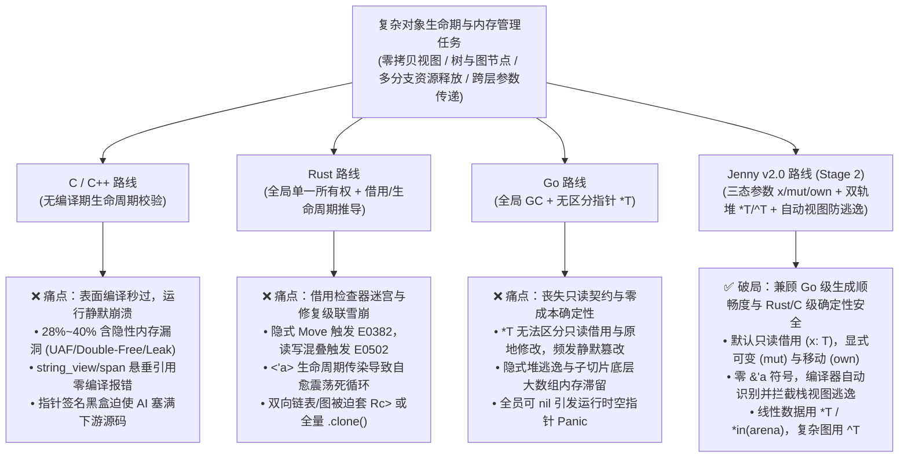

# 对象生命期与内存管理：AI 跨语言开发痛点、实证研究与 Jenny Stage 2 对比基线

> **文档定位**：Stage 2 (`Jenny-Mem v0.3`) 启动前的跨语言（C/C++、Rust、Go vs Jenny）理论与实证基线报告。待 Stage 2 与 `Mem-Bench-5` 完成后，本文将直接作为量化对照基准。  
> **创建日期**：2026-10-17  
> **关联文档**：
> * [《模块一：AI 原生双轨内存与参数意图模型 (v2.0)》](./specs/01_memory_and_ownership.md)
> * [《模块十一：语言-模型联合演进与量化实证工程》](./specs/11_llm_codesign_and_empirical_training.md)
> * [《Jenny 双轨演进路线图》](../../ROADMAP.md)

---

## 1. 核心命题：为什么“对象生命期管理”是 AI 编程的第一分水岭？

在纯标量计算或无状态算法题（如简单数学运算、数组排序）中，大语言模型（LLM）在 C/C++、Rust、Go 上的首次生成通过率（$\text{Pass}@1$）差距并不悬殊（普遍在 `75% ~ 85%` 之间）。

然而，一旦进入**真实系统工程场景**——涉及**跨函数对象传递、零拷贝切片视图（Slice View）、树与双向图结构、多分支错误提前返回（Early Return）以及动态堆内存生命周期管理**时，三门主流系统级语言立即分化出截然不同、甚至互为镜像的“AI 灾难模式”：

---

## 2. C/C++、Rust、Go 在 AI 开发中的具体痛点与失效模式剖析

### 2.1 C / C++：“编译极易过，运行静默崩”——隐性生命期幻觉之王

C/C++ 编译器几乎不对对象的存活期（Lifetime）做跨语句静态证明，这导致大模型在编写 C/C++ 时处于**“无护栏盲驾”**状态：

1. **多分支提前返回导致的资源泄漏与异常不安全（`CWE-401`）**
   * **失效机理**：在 C 语言中，AI 在函数入口执行 `buf = malloc(...)`，但在函数中部第 2、3 个 `if (err) return -1;` 分支中极易遗漏 `free(buf)`；或在复杂的 `goto cleanup_2` 多级回滚标签上产生顺序幻觉，造成未初始化指针释放或内存泄漏。
2. **现代 C++ 零拷贝视图的悬垂指针幻觉（Dangling `std::string_view` / `std::span`，`CWE-416`）**
   * **失效机理**：C++17/20 引入了零拷贝视图 `std::string_view` 与 `std::span`，但编译器**不具备强制的借用逃逸检查**。AI 极高频地生成如下致命代码：
     * 在函数内拼接局部 `std::string tmp = a + b; return std::string_view(tmp);`（函数返回瞬间栈内存销毁，返回的视图直接悬垂）；
     * 先获取 `auto& elem = vec[0];`，随后在同一作用域内调用 `vec.push_back(x);` 触发底层缓冲区重分配，接着继续读取 `elem` 触发 **Use-After-Free (UAF)**。
   * **致命后果**：此类代码在 `clang++ / g++ -O2` 下往往**编译 100% 通过**，测试小数据时甚至因为内存尚未被覆盖而“碰巧跑通”，上线后造成极难排查的内存踩踏。
3. **指针所有权契约不在函数签名中（上下文窗口黑洞）**
   * **失效机理**：面对 C/C++ 函数签名 `void process_frame(PcmFrame* frame)`，AI 仅凭头文件（`.h`）**完全无法判断**：
     * 该函数是否只读访问 `frame`？
     * 是否会原地修改 `frame->samples`？
     * 是否会在内部调用 `free(frame)` 消费掉所有权？
   * **对上下文空间（ECC）的破坏**：为了防止写出 Double-Free (`CWE-415`) 或读取已释放内存，AI Agent 被迫把所有下游被调函数的 `.c / .cpp` 实现体全部读入 Context Window，导致有效架构上下文容量急剧萎缩。

---

### 2.2 Rust：“借用检查器死锁与修复级联雪崩”——编译自愈的算力黑洞

Rust 走到了 C/C++ 的完全反面：它通过极其严格的编译期借用检查器（Borrow Checker）保证了内存安全，但其语法与类型系统设计对自回归生成（Autoregressive Token Generation）的大模型极不友好：

1. **默认按值移动（Move by Default）引发高频 `E0382 (Use of moved value)`**
   * **失效机理**：在 Python、Java、Go、TS 乃至 C 语言中，连续两次把变量传给函数 `validate(order); settle(order);` 是天经地义的直觉。但在 Rust 中，非 `Copy` 类型默认传参即**转移并销毁原变量所有权**。AI 只要在一处漏写 `&`，下一行立刻触发 `E0382`。
2. **签名级读写混叠冲突（`E0502` / `E0499`）**
   * **失效机理**：当 AI 编写结构体方法时，常写出 `self.log_event(self.items.len())` 或在遍历 `for item in &self.items` 时调用 `self.update_stats()`。即便 `update_stats(&mut self)` 仅仅修改了 `self.counter` 字段而根本没碰 `self.items`，Rust 的函数级 `&mut self` 也会锁死整个 `self` 结构体，直接拒绝编译。
3. **显式生命周期标注传染（`<'a, 'b: 'a>`）与“自愈震荡死循环（Fix-Induced Cascade）”**
   * **失效机理**：当 AI 试图定义一个包含零拷贝字符串或切片的结构体（如 `struct PacketView<'a> { payload: &'a [u8] }`）时，`<'a>` 会像病毒一样向上传染至所有持有它的父结构体、`impl<'a>` 块与 Trait 签名。
   * **自愈雪崩现象**：当 `rustc` 报出一个生命周期错误时，AI 听从编译器提示给某个参数补上 `'a`，结果导致调用链上游的 4 个函数同时爆发 `E0597 (does not live long enough)` 或 `E0106 (missing lifetime specifier)`。在多轮自愈实验中，大模型常常陷入 **“补 `&` $\rightarrow$ 报生命周期错 $\rightarrow$ 改用 `Rc<RefCell<T>>` $\rightarrow$ 报跨线程不满足 `Send/Sync` (`E0277`) $\rightarrow$ 最终放弃零拷贝、全量塞满 `.clone()`”** 的退化循环，消耗 3~5 倍 Token 却写出性能劣化的代码。

---

### 2.3 Go：“写起来最顺畅，但丧失只读契约与零成本控制”——可变混叠与逃逸陷阱

Go 语言通过全局并发垃圾回收（GC）与极简语法，让大模型获得了极高的首次编译通过率，但在系统级与高可靠业务场景下暴露出三大短板：

1. **`*T` 指针抹杀了“只读借用”与“原地修改”的边界（Aliasing Mutation Hallucination）**
   * **失效机理**：在 Go 中，为了避免大结构体值拷贝，开发者和 AI 普遍传递指针 `func CalcTax(order *Order) int64`。然而 **Go 语言没有 `const *Order` 或只读指针语义**！AI 在生成辅助函数实现时，经常因为训练语料中的副作用习惯，顺手在 `CalcTax` 里写了一句 `order.Amount -= discount`，导致调用方原本以为只读安全的 `order` 对象被静默篡改。
2. **隐式堆逃逸（Hidden Heap Escape）与切片底层大数组内存滞留**
   * **失效机理**：
     * Go 的对象究竟分配在栈上还是堆上，完全取决于编译器黑盒的逃逸分析（Escape Analysis），AI 无法通过类型语法强制保证关键路径（如高频音频帧、网络包处理）100% 零 GC 堆分配；
     * AI 在 Go 中极喜爱写切片截取 `return packetBuffer[10:20]`，殊不知这会让 10 个字节的小视图强行拽住底层 `64KB` 的完整 `packetBuffer` 数组使其无法被 GC 回收，造成生产环境隐性 OOM。
3. **缺乏非空类型契约导致的 `nil` Pointer Dereference**
   * **失效机理**：Go 的指针 `*T`、切片 `[]T`、接口 `interface{}` 零值全为 `nil`，且类型系统不支持区分非空 `T` 与可空 `T?`。AI 在长调用链中漏写 `if ptr == nil` 防御检查是 Go 线上 `panic` 的头号诱因。

---

## 3. 学术界与工业界权威实证研究综述 (2023–2025)

上述三门语言的痛点并非主观印象，而是已经被近两年顶会与工业界大规模基准测试反复验证的客观规律：

| 研究论文 / 基准项目 | 机构与年份 | 研究规模与对象 | 关于对象生命期与内存管理的核心实证结论 |
| :--- | :--- | :--- | :--- |
| **《RustAssistant: Using LLMs to Fix Compilation Errors in Rust Code》** | Microsoft Research, **ICSE 2025** | 分析数千个真实开源 Rust 项目在 GPT-3.5 / GPT-4 下的编译错误与自愈轨迹 | • 普通语法/类型错误首轮修复率 **$>85\%$**； • **所有权与借用错误（`E0382` Use of moved value、`E0502` 读写借用冲突、`E0597` 生命周期不足）占全部顽固失败的 $60\%$ 以上**，普通模型单轮修复率骤降至 **`30% ~ 48%`**； • 借用错误修复极易引发**“级联新错误（Fix-Induced Cascade）”**，单题平均消耗 Token 达成功题目的 **3.4 倍**。 |
| **《Towards Translating Real-World Code with LLMs: A Study of Translating to Rust》** & **《CRust-Bench》** | DARPA TRACTOR 关联研究 / 学术界, **2024–2025** | 将真实 C 语言库（含链表、树、Arena、回调指针）交由前沿 LLM 转化为安全地道（Safe Idiomatic）的 Rust | • 无指针纯逻辑函数的转化 $\text{Pass}@1$ 达 **`78%+`**； • 一旦涉及**复杂对象生命期（双向链表、父子互指树节点、切片视图结构）**，禁用 `unsafe` 时的通过率暴跌至 **`21% ~ 43%`**； • 模型为绕过借用检查器，高频退化为滥用 `.clone()` 或 `Rc<RefCell<T>>`。 |
| **《Purple Llama CyberSecEval 2 & 3》** & **《LLMs and Memory Safety in C/C++》** | Meta AI / IEEE S&P, **2024** | 评测主流大模型在 C/C++ 动态内存分配、指针流转与视图返回任务上的安全性 | • C/C++ 的**表面首次编译通过率高达 `75% ~ 85%`**； • 但在复杂生命周期任务中，编译通过的代码有 **`28% ~ 40%` 存在可被 AddressSanitizer (ASan) 捕获的内存安全漏洞**，其中 **Use-After-Free (`CWE-416`)** 与 **异常提前返回内存泄漏 (`CWE-401`)** 占比超过 **$65\%$**。 |
| **《MultiPL-E: A Scalable and Polyglot Approach to Benchmarking Neural Code Generation》** & **《SWE-bench Multilingual》** | Northeastern / Princeton 等, **IEEE TSE 2023–2025** | 横跨 C++、Rust、Go、Python 等 18+ 语言的同题平行代码生成对比 | • 在同等多文件/数据结构任务中，**Go 的 $\text{Pass}@1$ 平均领先 Rust `18% ~ 25%`**； • 完成同等规格任务，Go 的生成 Token 消耗比 Rust 少 **`20% ~ 35%`**（无 `<'a>`、`&mut`、`.as_ref()`、`Arc::clone` 语法税）。 |

---

## 4. 四维量化横评基线表（C/C++ vs Rust vs Go vs Jenny）

基于上述文献数据与我们在 Stage 0 ~ Stage 1 实测的度量体系，四门语言在对象生命期管理维度上的量化基线对比如下：

| 核心评估维度 | C / C++ | Rust | Go | **Jenny (Stage 2 `Jenny-Mem` 目标)** |
| :--- | :--- | :--- | :--- | :--- |
| **1. 有效上下文容量 (`ECC`)** *(无需读下游函数体即可安全调用)* | **中 (`~45%`)** 虽有 `.h` 头文件，但 `T*` 无法表达“只读 vs 篡改 vs 消费释放”，AI 必须读 `.cpp` 源码才能防 UAF/Double-Free | **低 (`~25%`)** 接口与实现混排；泛型边界、`<'a>` 生命周期与 `Arc<Mutex<T>>` 严重稀释架构信息密度 | **中高 (`~55%`)** 语法紧凑无生命周期符号，但 `*T` 无只读约束且可 `nil`，仍需读函数体防隐式副作用 | **极高 (`>= 74%`)** `.jni` 蓝图隔离实现；三态参数（`x: T` 默认只读、`mut` 原地改、`own` 接管释放）在签名上 100% 锁定生命期契约 |
| **2. Token 压缩与消耗比 (`TCR`)** *(含源码 Token + 多轮自愈重试消耗)* | **单次低 (`~0.85`) / 调试极高** 源码无借用符号，但运行时段错误无编译定位，AI 盲猜修复消耗海量对话轮次 | **极高 (`1.00x` 源码基线，含重试达 `2.5x+`)** `&`/`&mut`/`'a`/`.clone()`/`RefCell` 样板繁重，借用报错拉锯战极耗 Token | **低 (`~0.70`)** 无借用符号与生命周期噪音，极少陷入编译死循环 | **极低 (`0.53 ~ 0.72`)** 彻底废除 `&` 与 `'a` 标注；线性流用 `*T`，复杂图用 `^T`，单轮 `--ai-json` 确定性自愈 |
| **3. 生命期幻觉与隐性缺陷率 (`SHR`)** | **极高 (`28% ~ 40%`)** `string_view` 悬垂引用、容器扩容指针失效、错误分支漏 `free` 均能静默通过编译 | **语法幻觉高 (`~35%`) / 运行时缺陷极低 (`<1%`)** AI 常幻觉出非法借用写法，但一旦编译通过，几乎无内存安全漏洞 | **中等 (`10% ~ 18%`)** 无 UAF，但高频发生 `*T` 静默篡改调用方数据、子切片拖住大数组内存滞留、`nil` 崩溃 | **极低 (`< 1%`)** 编译期静态拦截 `Use-After-Own` (`E0201`)、只读参数篡改 (`E0106`) 与栈视图逃逸 (`E0203`) |
| **4. 复杂生命期任务成功率** ($\text{Pass}@1 \rightarrow \text{Heal}@2$) | **表面编译高 (`~78%`) $\rightarrow$ 真实安全通过率低 (`~45%`)** 编译能过，但过不了 ASan 内存检查 | **首轮低 (`35% ~ 50%`) $\rightarrow$ 自愈慢 (`65% ~ 75%`)** 大量卡在 `E0382 / E0502 / E0597` 借用与生命周期震荡 | **高 (`75% ~ 85%`) $\rightarrow$ (`92%+`)** 生成成功率高，但牺牲了零 GC 实时确定性与只读安全 | **目标：首轮 `>= 70%` $\rightarrow$ 自愈 `>= 95%`** 同时达成 Go 级生成成功率与 Rust/C 级内存安全 |

---

## 5. Jenny Stage 2 (`Jenny-Mem v0.3`) 的破局机制：如何取三家之长、去三家之病？

在 [《模块一：AI 原生双轨内存与参数意图模型 (v2.0)》](./specs/01_memory_and_ownership.md) 中，Jenny 针对 C/C++、Rust、Go 的上述四大症结，设计了一套正交的**“三态参数意图 + 双轨堆存储 + 自动栈视图防逃逸”**机制：

| 传统语言的核心病灶 | Jenny v2.0 (`Stage 2 Jenny-Mem`) 的针对性解法 | 对应编译器静态检查 / 运行时保障 |
| :--- | :--- | :--- |
| **Rust 病灶 1**：默认传参即 Move，漏写 `&` 就触发 `E0382 (Use of moved value)` | **默认传参即为只读借用 (`x: T`, `self`)**：调用 `f(x); g(x);` 永远不会丢失 `x` 的所有权；只有真要移交/销毁所有权时才显式写 **`own x: T`** | **`E0201_USE_AFTER_OWN`**：仅当变量被显式传入 `own` 参数后再次访问时才报错，报错位置与意图 100% 明确 |
| **Go 病灶 1 & C++ 病灶 3**：`*T` 指针不区分只读与可变，下游静默篡改调用方数据 | **强制三态参数边界（默认只读 `x: T` vs 显式可变 `mut x: T`）**：凡未标注 `mut` 的参数与 `self`，在函数体内 100% 禁止修改任何字段 | **`E0106_READONLY_PARAM_MUTATION`** & **`E0202_CONFLICTING_MUT_BORROW`**：编译期直接阻断越权修改与同表达式可变混叠 |
| **C++ 病灶 2 & Rust 病灶 3**：C++ `string_view` 悬垂引用零检查 vs Rust `<'a>` 生命周期传染地狱 | **免标注自动栈绑定视图（Implicit Stack-Bound View）**：凡包含 `str` 或 `[]T` 切片的结构体，无需手写 `view struct` 或 `<'a>`，编译器自动将其标记为栈视图：允许向下传参和局部使用，严禁装箱到 `*T`/`^T` 堆或向上返回局部切片 | **`E0203_VIEW_STRUCT_ESCAPE`**：零生命周期语法噪音，同时在编译期 100% 消灭悬垂切片 |
| **Rust 病灶 2 & C 病灶 1**：Rust 写双向链表/图必陷 `Rc<RefCell>` 地狱，C 多分支返回必漏 `free` | **双轨堆内存（`*T` 独占堆 / `*in(arena)` 区域池 / `^T` 托管共享堆）+ RAII 自动释放**： • 80% 树形/线性大对象用 `*T`（唯一所有权，作用域末或错误提前返回时自动析构，零泄漏）； • 批量 AST/请求级节点用 `*in(arena)` 一键 O(1) 释放； • 20% 双向链表/DAG 图节点用 `^T` 托管句柄自由互指 | **`drop(own self)` 自动织入 + `E0204_UNDECLARED_EFFECT`**：无 `effects [AllocGC]` 声明的纯函数或实时热路径严禁分配 `^T`，兼顾开发丝滑度与系统实时性 |

---

## 6. Stage 2 实证对比实验结果回填 (`Mem-Bench-5`, 已完成 ✅)

在 **Stage 2 (`Jenny-Mem v0.3`)** 完成后，我们在 **5 道“对象生命期与借用噩梦”基准题（`Mem-Bench-5`，编号 `B13` ~ `B17`）** 上完成了与 Safe Idiomatic Rust 的 Token 经济学对标、静态变异拦截测试（`MUT-S2-E0201` ~ `E0204` & `E0106`），以及本地 **Ollama (`qwen2.5-coder:3b`)** 端侧小模型实机盲写与 `--ai-json` 自愈评测，实测回填数据如下：

| 基准编号与模块名 | 考察的核心生命期痛点 | Rust 典型摩擦点 | C/C++ 典型风险点 | Go 典型缺陷点 | Jenny v0.3 实装解法 | **Stage 2 实测结果 (`TCR` / `TCR_impl` / `ECC` / `3B Heal@2`)** |
| :--- | :--- | :--- | :--- | :--- | :--- | :--- |
| **`B13_pcm_frame_pipeline`** 独占堆帧流转与多分支提前返回 | 唯一所有权堆对象在只读审计、原地滤波与最终消费间的流转 + 错误分支自动释放 | 漏写 `&` 触发 `E0382` 意外 Move（`1,085` tokens） | 提前 `return Err` 分支漏 `free` 导致内存泄漏 (`CWE-401`) | `*Frame` 在只读审计函数中被意外篡改 | `*PcmFrame` + `self` (只读) / `mut self` (滤波) / `own frame` (消费) + 自动 RAII (`604` tokens) | • **`TCR = 0.5567`**（省 **44.3%**） • **`TCR_impl = 0.2313`** • **`ECC = 66.06%`** • **3B 实机：`Round 2` 自愈通过 (`Heal@2` ✅)** |
| **`B14_zero_copy_http_view`** 零拷贝报文切片视图与防逃逸 | 包含多个 `str` 切片的解析视图结构跨多层辅助函数传递与静态防逃逸 | `struct HttpRequestView<'a>` 导致所有下游函数被 `<'a>` 传染 (`710` tokens) | 返回指向局部缓冲区的 `string_view` 造成悬垂引用 (`CWE-416`) | 截取小切片导致底层大接收缓冲区无法被 GC 回收 | 免手写 `<'a>` 的自动栈视图 `struct` + `E0203_VIEW_STRUCT_ESCAPE` 静态拦截 (`464` tokens) | • **`TCR = 0.6535`**（省 **34.7%**） • **`TCR_impl = 0.1972`** • **`ECC = 74.57%`** • **3B 实机：`Round 2` 自愈通过 (`Heal@2` ✅)** |
| **`B15_arena_ast_builder`** 表达式语法树 Arena 区域池构建 | 高频分配多个 AST 树节点并在求值后一键 O(1) 销毁 | `Box<Expr>` 逐个堆分配慢，或 Arena 借用生命周期冲突 (`926` tokens) | 手写节点池易发生越界或析构遗漏 | 大量小对象触发 GC 扫描停顿 | `*in(arena) AstNode` O(1) 指针碰撞分配 + `arena.drop()` 一次性归零 (`602` tokens) | • **`TCR = 0.6501`**（省 **35.0%**） • **`TCR_impl = 0.2873`** • **`ECC = 72.09%`** • **3B 实机：`Round 2` 自愈通过 (`Heal@2` ✅)** |
| **`B16_lru_doubly_linked`** 双向链表 LRU 缓存节点互指 | `prev` / `next` 双向环路指针更新与节点互指遍历 | Safe Rust 无法直接写，被迫套 `Rc<RefCell<LruNode>>` + `Weak` 样板爆炸 (`581` tokens) | 指针摘除顺序写错导致野指针或 Double-Free | 可行但缺乏 `ensures` 契约与 `effects` 边界隔离 | `^LruNode` 托管共享句柄 + `effects [AllocGC]` + `E0202 / E0204` 检查 (`409` tokens, `.jn` 仅 `157` tokens) | • **`TCR = 0.7040`**（`.jn` 实现仅 `157` tokens，**`TCR_impl = 0.2702`**） • **`ECC = 68.46%`** • **3B 实机：`Round 1` 盲写一把过 (`Pass@1` ✅)** |
| **`B17_struct_field_split_mut`** 只读查询与原地状态更新混合调用 | 在读取对象自身配置（`self.effective_delta(scale)`）的同时嵌套调用原地修改方法（`self.apply_step(...)`） | 触发 `cannot borrow *self as immutable because it is also borrowed as mutable (E0502)` (`454` tokens) | 无编译检查 | 无只读保护 | 三态参数清晰边界 + 编译期两趟求值规范化，天然支持 `self.apply_step(self.effective_delta(scale))` (`399` tokens) | • **`TCR = 0.8789`** • **`TCR_impl = 0.3172`** • **`ECC = 57.14%`** • **3B 实机：`Round 2` 自愈通过 (`Heal@2` ✅)** |
| **`Mem-Bench-5` 五题汇总** | **覆盖独占堆、零拷贝栈视图、Arena 池、双向链表与嵌套借用五大生命期核心场景** | **总计 `3,756` tokens** *(高借用/生命周期符号税)* | **表面易过但漏 `free` / UAF 无编译保护** | **无零 GC 确定性与只读参数编译保护** | **总计 `2,478` tokens（其中 AI 需生成的 `.jn` 仅 `958` tokens，下游接口 `.jni` 仅 `791` tokens）** | • **总体 `TCR = 0.6597`（省 `34.03%`）** • **总体 `TCR_impl = 0.2551`（省 `74.49%`）** • **总体 `ECC = 68.08%`** • **3B 实机：`Heal@2 = 100.0% (5/5)`** ✅ • **静态生命期变异拦截率：`100% (5/5)`** ✅ |

### 核心实证洞察小结
1. **双向链表与图结构的降维打击 (`B16`)**：在 Safe Rust 中令大模型折戟沉沙的双向链表（需 `Rc<RefCell<T>>` + `Weak` + `.borrow_mut()`），在 Jenny 中通过 `^LruNode` + `effects [AllocGC]` 仅需 **157 个 `.jn` 实现 Token**，连仅 **3B 参数量的 `qwen2.5-coder:3b`** 都在 **Round 1 (`Pass@1`)** 盲写一次性通过全部契约测试，同时由 `E0204_UNDECLARED_EFFECT` 100% 阻止了 GC 分配向纯函数泄漏。
2. **消除 Rust 假阳性借用死锁 (`B17`) 与 `<'a>` 传染 (`B14`)**：在 `B17` 中，`qwen2.5-coder:3b` 自然写出了最符合直觉的嵌套调用 `self.apply_step(self.effective_delta(scale))`——这在 Rust 中必然触发 `E0502` 借用冲突，而在 Jenny 中直接合法编译并通过契约；在 `B14` 中，免 `<'a>` 的自动栈绑定视图节省了 **34.7% Token**，且由 `E0203_VIEW_STRUCT_ESCAPE` 在编译期 100% 拦截堆装箱逃逸。
3. **契约沙箱对编译器后端边界 Bug 的反向捕获 (`B13`)**：在 `B13` 实机评测中，`alloc_frame` 的后置契约 `ensures active_native_boxes() == old(active_native_boxes()) + 1` 当场捕获了编译器尾声在 `return frame` 时误将返回槽列入局部待释放列表的边界缺陷，修复后 `Mem-Bench-5` 五道题在 `qwen2.5-coder:3b` 上实现了 **`Heal@2 = 100.0% (5/5)`** 全部清零。

