# 《Spinning Jenny (`Jenny`) 渐进式实证演进方案与最小验证集》

> **定位**：Jenny 语言从“概念验证原型（`v0.1 Jenny-Proto`，已完成 ✅）”经“标准库真实战场演练（`v0.2 Jenny-Std`）”逐步迭代至“自举工业级正式版（`v1.0 Jenny-SelfHost`）”的工程演进方法论与验证集规范。  
> **全局版本路线图索引**：参见 [`ROADMAP.md`](../../ROADMAP.md) · [`v0.1` 归档](../roadmap/roadmap_v0.1.md) · [`v0.2` 路线图](../roadmap/roadmap_v0.2.md)。  
> **核心铁律**：**拒绝一步到位的拍脑袋式重型开发！每引入一层新语言特性，必须先用最轻量的编译器后端在验证集与真实系统模块（如 `std` 标准库）上跑通大模型生成与契约验真实测数据，达标后方可进入下一版本。**

---

## 一、 演进方法论：两级“同心圆滚雪球”策略

在我们完成的 11 卷《Jenny 语言规范 v2.0》中，包含了双轨三态内存（`T` / `*T` / `^T`）、三轨闭包、三层错误截断（`T!`）、`@spin` 白盒元编程、结构化并发 `Fiber` 以及原生 C99 / LLVM / WasmGC 后端等设计。为了避免传统编译器开发“数月无反馈、语法摩擦修正成本高”的陷阱，Jenny 采用 **“两级同心圆渐进演进”** 策略：

1. **第一级（`v0.1 Jenny-Proto` 内部五步原型闭环 —— 已全部完成 ✅）**：
   * 从 `v0.1.0-alpha1 (Stage 0: Jenny-Nano)` 到 `v0.1.0 (Stage 4: Jenny-Native Prototype)`，通过 C99 原生后端（`clang -O3`）与 **25 个微基准模块（`Jenny-Bench-25`: `B01`~`B25`）** 跑通了全部核心语法、双轨内存检查器、`@spin` 白盒展开、四层契约测试原型与本地 `3B` 模型（`qwen2.5-coder:3b`）自愈闭环。
2. **第二级（`v0.2` $\rightarrow$ `v1.0` 面向真实工业场景的主版本迭代 —— 当前推进 `v0.2` 🎯）**：
   * 告别人工生造微基准，在 **`v0.2 (Jenny-Std)`** 中直接以 **“构建 Jenny 官方标准库 (`std::*`) 并全面对标 Rust `core` / `alloc` / `std`”** 作为真实系统战场，同步硬化多模块联编、真正的 64KB 块结构 Immix GC、10,000 步有状态容器 Fuzzing 与同模型跨语言反事实对照实验，最终在 `v1.0` 实现编译器自举（`jennyc-self`）。

```mermaid
flowchart LR
    subgraph V01["🟢 v0.1 (Jenny-Proto) 内部五步原型闭环 [已完成 ✅]"]
        direction LR
        S0["Stage 0 (v0.1.0-alpha1)\nJenny-Nano 契约核\n(B01~B10, 11 变异)"]
        S1["Stage 1 (v0.1.0-alpha2)\nJenny-Flow 错误与控制流\n(B11~B12, 16B AnyError)"]
        S2["Stage 2 (v0.1.0-beta1)\nJenny-Mem 双轨内存\n(B13~B17, *T/^T/Arena)"]
        S3["Stage 3 (v0.1.0-beta2)\nJenny-Spin 白盒纺纱\n(B18~B21, 11.37x 压缩)"]
        S4["Stage 4 (v0.1.0)\nJenny-Native C99/闭包/FFI\n(B22~B25, 49 @example)"]
        S0 ==> S1 ==> S2 ==> S3 ==> S4
    end

    V02["🟡 v0.2 (Jenny-Std)\n【构建 std 标准库对标 Rust std\n+ 64KB Immix GC + 容器状态机 Fuzz】"]
    V03["⚪ v0.3 (Jenny-Fiber & Wasm)\n【std::fiber 并发 + WasmGC\n+ RLVR 训练飞轮】"]
    V04["⚪ v0.4 (Jenny-Ecosystem)\n【std::{net,fs} + Spindle 包管理\n+ 契约审计 IDE】"]
    V10["⚪ v1.0 (Jenny-SelfHost)\n【jennyc 自举编译器\n+ 生产级多 Agent 工厂】"]

    V01 ==> V02 ==> V03 ==> V04 ==> V10
```



---

## 二、 `v0.1 (Jenny-Proto)` 内部五阶圈层拆解与准出实测结果（已完成归档 ✅）

### 📍 Stage 0 (`v0.1.0-alpha1`)：`Jenny-Nano` 最小契约核（已完成 ✅）

> **阶段目标**：搭建第一个能跑通 **“`.jni` Markdown 蓝图 $\rightarrow$ `.jn` 实现 $\rightarrow$ 自动织入契约并编译为 C99 跑通 `@example`”** 的最小闭环。

| 维度 | **Stage 0 (`v0.1.0-alpha1`) 包含的核心子集** | **实测验收结果 (`B01`~`B10`)** |
| :--- | :--- | :--- |
| **类型与内存** | 标量（`i32`, `i64`, `usize`, `f64`, `bool`, `str`）、`struct`、`enum`、切片 `[]T`；参数默认只读借用，原地修改标 `mut` | `Seed-10` 总体 **`TCR = 0.7583`**，手写实现 **`TCR_impl = 0.2104`** |
| **蓝图与契约** | `.jni`（原生 Markdown + ```` ```jenny ```` 块）与 `.jn` 物理分离；`requires`、`ensures(old)`、`invariant`、`@example` | **`19/19` 个 `@example` 原生沙箱 100% 通过** |
| **故障回归** | `compiler/jenny-nano/jenny_nano.py --mutate` | **`11/11` 个运行时契约违约变异体 100% 拦截（退出码 `42`）** |

---

### 📍 Stage 1 (`v0.1.0-alpha2`)：`Jenny-Flow` 三层错误截断与线性控制流（已完成 ✅）

> **阶段目标**：引入线性控制流与三层渐进式错误截断体系，并在本地 `3B` 模型上完成首次盲写与 `--ai-json` 自愈实测。

1. **核心特性落地**：
   * `if x is Pattern && cond` 与 `guard x is Pattern else { ... }`（含 `guard cond else Err` 简写）；
   * 16 字节双寄存器内联 `JnAnyError`（`_Static_assert(sizeof(JnAnyError) == 16)`）+ 16 槽位线程局部 **Error Trace RingBuffer**；
   * 底层精确错误 `T ! E`、领域混合截断 `T ! (BizError | AnyError)`、顶层简写 `T!`、`?` 传播与 `catch err`；
   * 管道操作符 `x |> f(a, _)`、可空合并 `??` 与静态契约字段赋值检查 **`E0108_MISSING_ENSURES_FIELD_MUTATION`**。
2. **实测验收结果 (`B11`~`B12` & `Phase 1`)**：
   * 4 层调用链基准 `B11_layered_gateway` 实测 **`TCR = 0.5288`**（底层新增错误上层签名修改率为 `0%`）；
   * 本地 `qwen2.5-coder:3b` 首轮测试 6 题达成 **`Pass@1 = 66.7% (4/6)`**、**`Heal@2 = 100.0% (6/6)`**，`&` 引用符号幻觉率 **`0.0%`**。

---

### 📍 Stage 2 (`v0.1.0-beta1`)：`Jenny-Mem` 双轨内存（`*T` / `^T`）与三态参数检查器（已完成 ✅）

> **阶段目标**：落地三态参数静态借用检查器与双轨堆内存原语，在 5 道“Rust 借用检查器噩梦题”（`Mem-Bench-5`: `B13`~`B17`）上完成实证验证。

1. **核心特性落地**：
   * 三态参数静态检查：默认只读 `x: T`（禁止修改 `E0106`，调用后实参永不失效）、排他可变 `mut x: T`（冲突拦截 `E0202`，映射为 C99 `JN_RESTRICT`）、显式移交 `own x: T`（Use-After-Own 拦截 `E0201`）；
   * 双轨存储原语：自动推导含 `str`/`[]T` 的栈绑定视图 `struct`（逃逸拦截 `E0203`）、原生独占堆 `*T` 与区域池 `*in(arena) T`、以及由 `effects [AllocGC]`（`E0204`）静态门控的托管共享句柄 `^T`。
2. **实测验收结果 (`B13`~`B17`)**：
   * `Mem-Bench-5` 总体 **`TCR = 0.6597`**，实现层 **`TCR_impl = 0.2551`**（节省 **74.49%** 实现 Token）；
   * `5/5` 静态内存安全变异 100% 拦截；本地 `qwen2.5-coder:3b` 在 `B16_lru_doubly_linked` 上零 `<'a>` 首轮直接通过，全组 **`Heal@2 = 100% (5/5)`**。

---

### 📍 Stage 3 (`v0.1.0-beta2`)：`Jenny-Spin` 零样板委托与 `@spin` 白盒元编程（已完成 ✅）

> **阶段目标**：实现 16 字节 `dyn Trait` 胖指针、`delegate` 自动委托与 `@spin` / `@apply` 白盒代码展开器（落盘 `.spun/*.spun.jn`）。

1. **核心特性落地**：
   * `delegate Trait to self.inner`（`E0307` 校验）与 16 字节零装箱 `dyn Trait`；
   * 3 大官方纱锭模板（`@spin fsm::state_machine`、`@apply(codec::binary)`、`@apply(crud::service)`），配备二进制协议禁混 `^T` 检查（`E0305`）与 Additive-Only 纯增量法则检查（`E0306`）。
2. **实测验收结果 (`B18`~`B21`)**：
   * `Spin-Bench-4` 总体 **`TCR = 0.4767`**，其中 `@spin` 声明式子集（`B19`~`B21`）手写 `.jn` 实现仅 `292` Tokens（展开后 `.spun/` 为 `1,141` Tokens），手写实现压缩比达 **`TCR_impl = 0.0879` (`11.37x`)**；
   * 本地 `qwen2.5-coder:3b` 达成 **`Pass@1 = 75.0% (3/4)`**、**`Heal@2 = 100.0% (4/4)`**。

---

### 📍 Stage 4 (`v0.1.0`)：`Jenny-Native Prototype` C99 原生后端、ABI 防火墙、零胶水 C FFI、三轨闭包与 `--fuzz`（已完成 ✅）

> **阶段目标**：完成全量 25 个模块的 C99 原生机器码编译、`.jni` ABI 编译防火墙、零胶水 C FFI、三轨闭包生命期（`B25`）与 `--fuzz` 契约模糊测试原型。

1. **核心特性落地**：
   * 零胶水 `import c "header.h" as alias`、`@repr(C)` 与 `.as_raw_ptr()`（静态拦截 `E0401`~`E0403`）；
   * 三轨闭包生命期（`B25_closure_lifetimes`）：栈绑定闭包 `fn`（0 堆分配，`E0205` 禁逃逸）、独占原生堆闭包 `*fn[own ...]`（强制显式捕获 `E0206` + 自动合成级联析构 `_jn_closure_drop_N`）、托管共享闭包 `^fn`；
   * `.jni` ABI 防火墙（`jni_abi_hash`）与 `--fuzz` 标量契约探针 + 20 轮零泄漏压力重放（`2,480` 次调用）。
2. **实测验收结果 (`B01`~`B25` 全集)**：
   * 全量 **25/25 模块** 经 `clang 18.1.8 -std=c11 -O3` 编译通过（热缓存命中 `< 1 ms`，25 个 `.exe` 共 `3.46 MB`），**`49/49` 个 `@example` 沙箱 100% 通过**，**`26/26` 项故障回归（13 运行时 + 13 静态）100% 拦截**；
   * 全局代码 **`TCR = 0.6833`**（vs Rust 全量 `19,339` Tokens；vs Rust 生产代码 `14,985` Tokens 为 `0.8819`），实现层 **`TCR_impl = 0.2197`**，跨模块接口节省率 **`ECC_self = 65.31%`**（vs Rust 生产代码为 **`69.41%`**）；
   * `B25_closure_lifetimes`（`TCR = 1.7595`）客观揭示了在 `< 500` Tokens 的极小微模块上，显式闭包环境与多契约块的固定开销会超过 `.jn` 压缩收益的边界条件。

---

## 三、 `v0.1` 完整 25 模块验证集清单（`Jenny-Bench-25`: `B01` ~ `B25`）

| 阶段子集 | 编号与目录名 | 核心考察的系统场景与语言特性 | Rust 全量 / 生产 Tokens | Jenny `.jni` + `.jn` Tokens | 总代码 $\text{TCR}$ | 实现层 $\text{TCR}_{\text{impl}}$ |
| :--- | :--- | :--- | :---: | :---: | :---: | :---: |
| **Stage 0 (`Seed-10`)** | `B01` ~ `B10` (10 题) | 环形队列、HTTP 解析、AST 求值、TTL 缓存、订单管线、日志聚合、音频归一化、装饰器、状态机、并发聚合 | 6,933 / 4,684 | 3,798 + 1,459 = 5,257 | `0.7583` | `0.2104` |
| **Stage 1 (`Flow-2`)** | `B11_layered_gateway`<br>`B12_stream_pipeline` | 4 层网关调用链三层错误截断（`T!`）与流式管道 `\|>` / `guard` | 1,624 / 1,282 | 614 + 377 = 991 | `0.6102` | `0.2321` |
| **Stage 2 (`Mem-5`)** | `B13` ~ `B17` (5 题) | `*PcmFrame` 独占堆、自动栈视图 `HttpRequestView` (`E0203`)、`Arena` AST、`^LruNode` 双向链表 (`AllocGC`)、借用分裂 | 3,756 / 2,785 | 1,520 + 958 = 2,478 | `0.6597` | `0.2551` |
| **Stage 3 (`Spin-4`)** | `B18` ~ `B21` (4 题) | `delegate` 特征委托、`@spin fsm`、`@apply(codec::binary)` (`E0305`)、`@apply(crud::service)` (`E0306`) | 4,439 / 3,647 | 1,444 + 672 = 2,116 | `0.4767` | `0.1514`<br>*(`@spin` 0.0879)* |
| **Stage 4 (`Native-4`)** | `B22` ~ `B25` (4 题) | 零胶水 C FFI CRC32 (`E0401`~`E0403`)、Arena JSON 分词、全栈 KV 引擎、三轨闭包生命期与级联析构 (`B25`) | 2,587 / 2,587 | 1,591 + 782 = 2,373 | `0.9173` | `0.3023` |
| **🏆 全集汇总** | **`B01` ~ `B25` (25 题)** | **覆盖全部核心语法、双轨内存、三轨闭包、`@spin` 与 C FFI** | **19,339 / 14,985** | **8,967 + 4,248 = 13,215** | **`0.6833`** | **`0.2197`** |

---

## 四、 下一阶段实战规划：`v0.2 (Jenny-Std)` —— 以构建标准库（对标 Rust `std`）作为真实业务演练场

完成 `v0.1` 的 25 个微基准原型后，**`v0.2 (Jenny-Std)`** 彻底告别人工生造测试题，直接以 **“从零构建 Jenny 官方标准库 (`std::*`) 并全面对标 Rust `core` / `alloc` / `std`”** 作为核心验证场景（完整规划见 [`docs/roadmap/roadmap_v0.2.md`](../roadmap/roadmap_v0.2.md)）：

1. **五大真实标准库模块集群 (`std/`)**：
   * **`std::mem` & `std::slice`**：`RawBuf` / `ByteBuf`（`*T` 2 倍动态扩容）、`Arena` 区域池、`GcPool`（**真正的 64KB 块/行结构 Immix 标记-区域回收器**，替代 `v0.1` 的 1,024 槽位 `calloc` 表）；
   * **`std::collections`**：`Vec<T>`、`VecDeque<T>`、`HashMap<K, V>`（Robin Hood 开放寻址）、`LruCache<K, V>`（基于 `^T` 双向链表 + 哈希表的完整容量淘汰缓存，零 `unsafe`）、`BTreeMap<K, V>`；
   * **`std::str` & `std::fmt`**：零拷贝 `StrView`（自动栈视图 `E0203`）、动态 `*StringBuf` 与格式化；
   * **`std::io` & `std::path`**：`Cursor`、`BufReader`、`BufWriter`（跨模块导入 `std::mem` + `delegate` 转发）、`PathView` / `PathBuf`；
   * **`std::sync` & `std::codec`**：有界通道 `MpscRing`、`Varint`、`JsonScanner`、`Crc32`。
2. **四大硬核实证门禁**：
   * **跨文件多模块联编与 `.jni` 防火墙 (`M0.2.1`)**：实测多模块依赖链下仅加载 `std/*.jni` 达成 **$\text{ECC} \ge 75\%$** 上下文节省；
   * **有状态容器 10,000 步随机方法序列 Fuzzing (`M0.2.3`)**：对 `Vec`、`HashMap`、`LruCache` 自动执行 10,000 步随机 `insert/get/remove` 并逐步校验 `invariant` 与 `ensures(old)`；
   * **同模型跨语言反事实对照实验 (`P0.2.2`)**：在同一台机器上用 `qwen2.5-coder:3b/7b` 分别实现 Jenny `std` vs Rust `std` (`rustc`) vs Go，并完成 `--skeleton` 与自动快修的消融实验；
   * **原生运行时性能对标 (`P0.2.4`)**：对比 Jenny `std` (`clang -O3`) 与 Rust `std` (`rustc -O3`) 的真实吞吐量与峰值内存。
