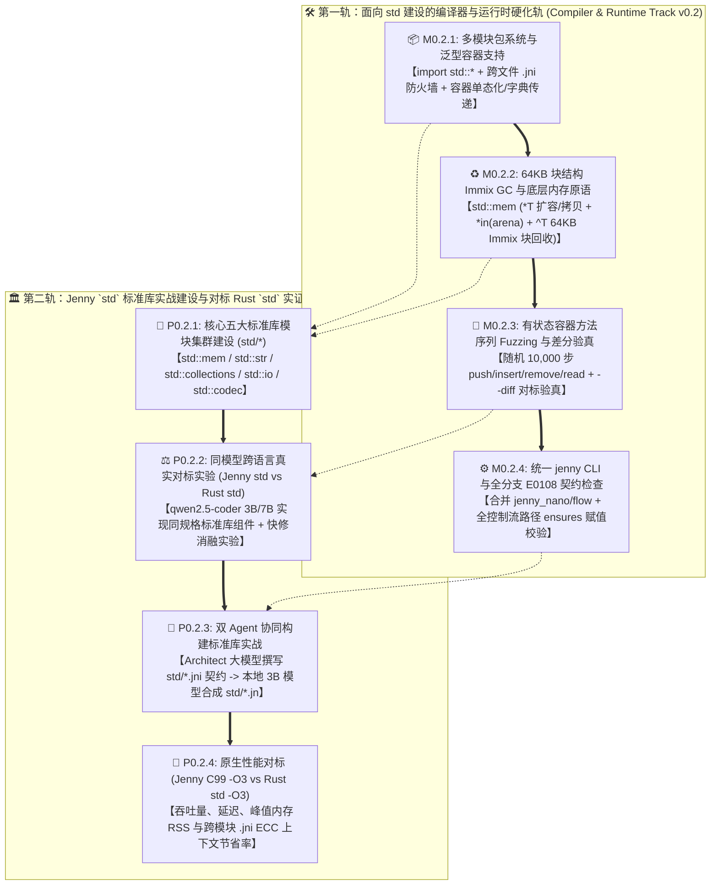

# 🗺️ Spinning Jenny `v0.2` 演进路线图 (`Jenny-Std`: 以标准库建设为真实业务战场的实证演进)

> **版本代号**：`v0.2.0` (`Jenny-Std`: Real-World Standard Library Construction Benchmarked Against Rust `std`)  
> **版本状态**：🟡 **规划就绪 / 待启动 (Planned — Next Target Release)**  
> **核心战略转向（告别生造测试题，以 `std` 标准库建设作为真实业务演练场）**：  
> 在 `v0.1` 原型阶段，我们使用 25 道人工构造的微基准（`B01`~`B25`）跑通了概念验证，但生造测试题在规模、复杂度与外部效度上天然存在局限。  
> 进入 **`v0.2`**，我们将 **“从零构建 Jenny 官方核心标准库（`std::*`），并直接对标 Rust `core` / `alloc` / `std`”** 作为核心真实业务场景。每一份 `.jni` 蓝图与 `.jn` 实现都不再是一次性的跑分玩具，而是沉淀为 Jenny 语言的永久核心资产，同时在最硬核的系统级真实场景中检验 **多模块联编、双轨内存（`*T` / `*in(arena)` / `^T` Immix GC）、有状态 Fuzzing 与同模型跨语言（Jenny `std` vs Rust `std`）生成自愈率**。  
> **上级总索引**：[`ROADMAP.md`](../../ROADMAP.md) · **上一版本归档**：[`roadmap_v0.1.md`](./roadmap_v0.1.md)

---

## 1. 为什么选择“建设 `std` 标准库（对标 Rust `std`）”作为 `v0.2` 的主战场？

1. **一石二鸟：既是最高含金量的真实系统业务，又是语言走向实用的必经基石**
   * 标准库（动态数组、哈希表、双向链表/LRU、UTF-8 字符串、缓冲 I/O、路径解析、格式化与二进制编解码）浓缩了系统编程中 **最真实的内存重分配（Realloc/Grow）、切片借用边界、哈希冲突处理、游标状态机与性能极限压榨**。
   * 相比人为编造的微基准，直接拿 **Jenny `std`** 对标 **Rust `std` (`alloc::vec`, `std::collections`, `std::io`, `core::str`)**，任何系统程序员和审稿人都能直观评判其真实含金量。
2. **天然契合 `.jni` 形式化契约与有状态结构体 Fuzzing (`--fuzz v2`)**
   * 标准库容器与 I/O 组件拥有极其严谨的数学不变量（例如 `Vec`: `len <= cap`；`HashMap`: 负载因子与键值一致性；`BufReader`: 缓冲区游标 `pos <= filled <= cap`；`String`: UTF-8 字节边界不变量）。
   * 用 `.jni` 的 `invariant` + `requires` + `ensures(old)` 表达 `std` 规范，再用有状态方法序列模糊测试（随机执行 10,000 次 `push / pop / insert / remove / reserve / seek`）与 Rust `std` 做差分对比，是最严苛的工业级实战检验。
3. **倒逼编译器补齐“泛型容器、多模块 `import std::*` 与真实 Immix GC”三大能力**
   * 要写出真正可用的 `std::collections` 和 `std::io`，编译器必须支持跨文件模块导入（`import std::mem` $\rightarrow$ `std::collections` $\rightarrow$ `std::io`）、参数化容器类型以及真正的 64KB 块结构 Immix 回收器。

---

## 2. `v0.2` 双轨全景架构图（以 `std::*` 建设为核心驱动）

---

## 3. `v0.2` 核心实战标的：Jenny 标准库五大模块集群 (`std/`) 对标 Rust `std`

我们将建立仓库根目录下的 **[`std/`](../../std/)** 官方标准库目录，分五大真实模块集群直接对标 Rust `core` / `alloc` / `std`，彻底取代生造测试题：

| 标准库模块集群 (`std/`) | 包含的核心组件 (`.jni` + `.jn`) | 直接对标的 Rust `std` 模块 | 核心考察的真实系统痛点与 Jenny 特性 |
| :--- | :--- | :--- | :--- |
| **1. `std::mem` & `std::slice`** 底层内存、动态缓冲区与区域池 | • `RawBuf` / `ByteBuf` (`*T` 动态扩容、`reserve`、`split_at`) • `Arena` (`*in(arena) T` 区域分配器与批量重置) • `GcPool` (`^T` 64KB Immix 块分配与统计接口) | `alloc::raw_vec::RawVec` `core::slice` `typed_arena` | • 原生堆 `*T` 2 倍扩容重分配与异常安全（零泄漏） • 切片边界 `invariant (len <= cap)` 与零拷贝子切片视图 |
| **2. `std::collections`** 核心数据结构与容器库 | • `Vec<T>` / `IntVec`（动态连续数组） • `VecDeque`（双端环形队列，升级自 `B01`） • `HashMap`（开放寻址 Robin Hood / SwissTable 哈希表） • `LruCache`（**基于 `^T` 双向链表 + 哈希表** 的全功能容量淘汰缓存，升级自 `B16`） • `BTreeMap` / `Skiplist`（有序映射，用 `^T` 或 Arena 节点实现） | `alloc::vec::Vec` `std::collections::VecDeque` `std::collections::HashMap` `std::collections::LinkedList` / `BTreeMap` | • **最残酷的跨语言对标场**：Rust 写 `LinkedList` / `LruCache` / `BTreeMap` 充斥 `unsafe` 裸指针与复杂生命周期；Jenny 用 `*T`（独占缓冲）与 `^T`（托管图节点）+ `invariant` 零 `unsafe` 安全实现 |
| **3. `std::str` & `std::fmt`** 字符串视图、构建器与格式化 | • `StrView`（UTF-8 校验、零拷贝 `split` / `trim` / `find` / `parse_int`） • `StringBuf`（独占堆 `*StringBuf` 动态拼接与格式化 `fmt`） • `InternPool`（基于 `*in(arena)` 的字符串驻留池） | `core::str` `alloc::string::String` `core::fmt` | • 自动推导含 `str` 的栈绑定视图 `struct`（`E0203` 逃逸拦截） • 零分配切片解析与确定性堆字符串构建 |
| **4. `std::io` & `std::path`** 缓冲流式 I/O、游标与路径规范化 | • `Cursor`（内存字节流读写游标，`seek` / `read_exact`） • `BufReader` & `BufWriter`（带内部缓冲区的流式读写器，`delegate` 组合转发） • `PathBuf` & `PathView`（跨平台路径分割、规范化与父子拼接） | `std::io::Cursor` `std::io::{BufReader, BufWriter}` `std::path::{Path, PathBuf}` | • 多模块依赖（`std::io` 导入 `std::mem` 与 `std::str`） • 三层错误截断 `T ! (IoError \| AnyError)` 与 `delegate` 零样板包装 |
| **5. `std::sync` & `std::codec`** 并发通道、状态机与标准编解码 | • `MpscRing`（有界多生产者单消费者通道） • `Varint` / `JsonScanner` / `Crc32`（标准二进制与文本编解码器，`@spin` 白盒生成 + C FFI 硬件加速） | `std::sync::mpsc` `serde` / `prost` 核心子集 | • `@spin` 白盒代码生成在标准库协议层的真实应用 • 零胶水 C FFI (`import c`) 封装底层系统调用与硬件指令 |

---

## 4. `v0.2` 详细里程碑与准出门禁 (Milestones & Gate Criteria)

### 🛠️ 第一轨：编译器与运行时硬化轨 (`Compiler Track v0.2`)

1. **`M0.2.1`：包管理系统（`spindle` & `Tapestry.toml`）、跨文件 `import std::*` 与容器类型支持（参见 [模块十二规范](../design/specs/12_package_management_and_module_system.md)）**
   * 实现 `Tapestry.toml` 清单解析、`Tapestry.lock` 双哈希锁定（`jni_abi_hash` + `jn_impl_hash`）与包级 `allow_effects` 供应链权限防火墙（**`E0503_PACKAGE_EFFECT_ESCALATION`**）；
   * 实现 `import std::mem`、`import std::collections::{Vec, HashMap}` 与 `pkg.jni` 门面重导出（`pub import`），静态拦截通配符导入（**`E0501`**）、模块循环依赖（**`E0502`**）与跨包可见性越权（**`E0505`**），自动生成 C99 接口头文件 `.jenny-cache/c99/<pkg>__<mod>.h`；
   * 支持标准库容器所需的基础泛型/单态化或类型参数化模板（如 `Vec<T>`、`HashMap<K, V>`、`Option<T>`）。
2. **`M0.2.2`：真正的 64KB 块/行结构 Immix 回收器 (`jenny_rt.h`) 与 Sanitizer 安全门禁**
   * 彻底替换 `jenny_rt.h` 中 1,024 槽位的 `calloc` 注册表，实现 **64KB Block + 128B Line 线性碰撞分配（Bump Allocation）与标记-区域回收（Mark-Region Sweep）**，支撑 `std::collections::LruCache` 和 `BTreeMap` 进行 **$\ge 100,000$ 次动态节点分配、淘汰与循环回收**。
   * 集成 `clang -fsanitize=address,undefined`（ASan/UBSan）编译门禁，确保整个 `std/` 零内存越界、零未定义行为。
3. **`M0.2.3`：面向 `std` 容器的有状态方法序列 Fuzzing (`--fuzz v2`) 与差分验真 (`--diff`)**
   * 针对 `std::collections::{Vec, VecDeque, HashMap, LruCache}` 与 `std::io::{Cursor, BufReader}`，编译器自动合成 **10,000 步随机方法调用序列（如随机交替 `insert` / `get` / `remove` / `len`）**，并在每一步前后动态校验 `.jni` 中的 `invariant` 与 `ensures(old)`。
   * 实现 `jenny diff`：将 Jenny `std` 容器与参考实现在相同随机操作流下的输出逐项比对。
4. **`M0.2.4`：统一 `jenny` CLI 与全路径控制流契约检查 (`E0108 v2`)**
   * 合并 `jenny_nano.py` 与 `jenny_flow.py` 为统一的 `jenny` CLI，并将 `E0108` 升级为全分支路径赋值覆盖检查。

---

### 🏛️ 第二轨：`std` 标准库实战建设与对标 Rust `std` 实证轨 (`Std & PL-LLM Track v0.2`)

1. **`P0.2.1`：完成 Jenny `std` 五大核心模块集群（15~20 个真实标准库组件）的落地与验真**
   * 交付完整的 `std/{mem,collections,str,io,codec}`（含 `.jni` 文学化规范蓝图、`.jn` 实现与对标的 Rust 标准库等价实现基准）。
   * **准出门禁**：全部 `std` 模块通过 C99 `-O3` 与 ASan/UBSan 编译，100% 通过内嵌 `@example` 与 10,000 步有状态容器 Fuzzing。
2. **`P0.2.2`：同模型跨语言实战对标实验（用 `qwen2.5-coder:3b/7b` 写 Jenny `std` vs 写 Rust `std` 组件）+ 消融实验**
   * **实验场景**：给定上述 15~20 个真实标准库组件的功能规范与接口契约（如实现 `RobinHoodHashMap`、`LruCache`、`BufReader`、`PathBuf`、`VecDeque`），让同一个本地模型（`qwen2.5-coder:3b` 与 `7b`）分别编写：
     * **Rust 实现**（用 `rustc --error-format=json` 驱动自愈，观察其在 `LruCache` / `BufReader` / 切片借用上的 `E0502`/`E0382`/`E0597` 报错率与 `unsafe` 崩溃率）；
     * **Go 实现**（用 `go test` 驱动自愈）；
     * **Jenny 实现（分“纯 LLM 重试”与“开启 `--ai-json` 确定性快修”两个消融组）**。
   * **准出门禁**：产出极具说服力的真实标准库跨语言同模型对比报告（直接回应论文审稿意见的核心关切）。
3. **`P0.2.3`：基于 `std` 的多模块构建与双 Agent 端到端演练**
   * 验证当上层业务或 `std::io` 导入底层 `std::mem` / `std::collections` 时，仅读取 `std/*.jni` 蓝图带来的真实跨模块上下文节省率（目标 $\text{ECC} \ge 75\%$）；
   * 演练由 **Architect 大模型撰写 `std/*.jni` 契约规范 $\rightarrow$ 本地 3B 模型合成 `std/*.jn` 实现 $\rightarrow$ `--fuzz` 10,000 步容器状态机自动验收** 的完整工业流水线。
4. **`P0.2.4`：Jenny `std` (`clang -O3`) vs Rust `std` (`rustc -O3`) 原生运行时性能对标**
   * 在 `Vec` 连续百万次 `push/pop`、`HashMap` 十万次随机查找、`LruCache` 十万次淘汰更新、`BufReader` 流式扫描四个真实标准库负载上，实测 Jenny C99 后端与 Rust `-O3` 的执行耗时与内存占用对比。

---

## 5. `v0.2` 建议启动顺序（分三阶段推进）

1. **第一阶段（地基与容器核：`std::mem` + `std::collections` + 64KB Immix GC）**：
   * 先打通跨模块 `import std::*` (`M0.2.1`) 与 64KB Immix GC (`M0.2.2`)，立即动手建设最硬核的 **`std::mem` (`ByteBuf`, `Arena`)** 与 **`std::collections` (`Vec`, `VecDeque`, `HashMap`, `LruCache`)**，并跑通有状态容器 `--fuzz v2` (`M0.2.3`)。
2. **第二阶段（扩展标准库：`std::str` + `std::io` + `std::codec`）**：
   * 在 `std::mem` 和 `std::collections` 之上构建零拷贝字符串视图 `StrView`、动态 `StringBuf`、流式缓冲读写器 `BufReader`/`BufWriter`、`PathBuf` 与标准编解码器，验证多模块级联 `.jni` ABI 防火墙与上下文压缩率。
3. **第三阶段（跨语言同模型大战：Jenny `std` vs Rust `std` 实证与性能评测）**：
   * 在全套 `std` 真实组件上运行 `qwen2.5-coder:3b/7b` 的 **Jenny vs Rust (`rustc`) vs Go 同模型反事实对照实验、消融实验与 `-O3` 运行时性能跑分**，产出 `v0.2` 旗舰实验报告与下一版论文。
