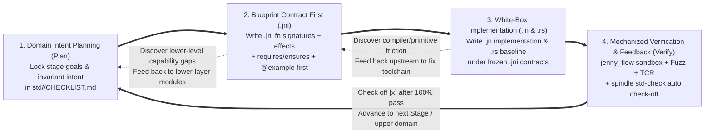

# 🏛️ Spinning Jenny (`std`) Standard Library Root Intent Blueprint & Staged Evolution Roadmap (`std/CHECKLIST.md`)

> **Document Role**: This file serves as the root-level master blueprint (**L1 Root Blueprint**) for the `std/` standard library. The detailed API signature checklists broken down by 4 stages (`Stage 1 ~ Stage 4`) for each module are maintained in their respective subdirectory `std/<domain>/CHECKLIST.md` files following the **Fractal Co-location** principle, keeping context window footprints minimal and enabling zero-conflict parallel execution across multiple subagents.  
> **Automated Audit Command**: `node compiler/src/jenny.ts std-check [--domain <domain>] [--stage <1|2|3|4>]`

---

## 1. Four-Step Intent Programming Feedback Closed Loop (`Intent -> .jni -> .jn -> Verify` Closed Loop)

Across every layer and stage of constructing the `std` standard library, human architects, lead agents, and subagents must strictly adhere to the following **four-step incremental spinning closed loop**:

1. **Step 1: Planning First (`Plan` — `std/<domain>/CHECKLIST.md`)**
   * Define the responsibility boundaries of the subdomain, its lower-layer subdomain dependencies, and the target API list partitioned across `Stage 1` ~ `Stage 4`.
2. **Step 2: Blueprint & Contract Freezing (`Blueprint First` — `<mod>.jni`)**
   * **Never skip `.jni` to write `.jn` directly!** Subagents must first translate planned APIs in `<mod>.jni` into exact formal signatures, `effects` tags, `requires ... else Err` preconditions, `ensures` postconditions, and bidirectional positive/negative `@example` verification tests.
   * Run `spindle std-check --domain <d>` to verify whether the **`Blueprint Gate (.jni)`** covers 100% of the current stage plan.
3. **Step 3: Contract-Constrained Implementation (`Weave` — `<mod>.jn` & `<mod>.rs`)**
   * Write the `.jn` implementation and equivalent `.rs` reference implementation without tampering with the `.jni` contracts; if lower-level primitives are insufficient, follow bottom-up hierarchical feedback to extend lower-level modules first.
4. **Step 4: Zero-Trust Verification & Closed-Loop Check-Off (`Verify & Check-Off`)**
   * Run `node compiler/src/jenny.ts library/std/<domain>/<mod>.jni` (native C99 compilation + `@example` + `--fuzz v2` zero memory leaks) and `node compiler/src/jenny.ts std-check --domain <d> --stage <N>`; once all checks pass green, mark `[x]` in the subdirectory `CHECKLIST.md`.

---

## 2. Four-Stage Iteration Roadmap Definition (`4-Stage Iteration Roadmap`)

Every module under each subdirectory organizes its API checklist across the following **4 progressive stages**:

| Stage | Stage Name | Core Positioning & Permitted Staged Simplifications | Exit Gate Criteria (`Exit Gate`) |
| :---: | :--- | :--- | :--- |
| **`Stage 1`** | **Minimal Contract Skeleton (`Skeleton`)** | Establish core memory layouts, `invariant` structural invariants, and the 7~14 most fundamental CRUD primitives; monomorphic `i64` payloads and manual `drop_xxx(mut self)` are permitted. | `G2-Contract` + `G6-Verify` 100% pass *(Completed in `v0.2-alpha2` ✅)* |
| **`Stage 2`** | **Core Production API Surface (`Core APIs`)** | **Complete 100% of high-frequency daily production methods without requiring major new compiler features** (front/back access, $O(1)$ swap-remove, bulk resize/reserve, search & sort, slice splitting, numeric parsing, LE/BE endianness read/write, etc.). | 100% of `[ ]` APIs in this stage implemented in `.jni` and `.jn` and passing bidirectional `@example` tests *(Current primary focus 🎯)* |
| **`Stage 3`** | **Generics, Traits & Automatic RAII (`Generics & Iter`)** | Eliminate early monomorphic and manual deallocation simplifications: upgrade to true generics `<T>` / `<K: Hash + Eq, V>`, switch to automatic `fn drop(own self)`, and provide zero-allocation `iter fn` generators plus standard `Clone`/`Eq`/`Formattable` traits. | `G3-RAII` + `G4-Generic` + `G5-Iter` gates all green |
| **`Stage 4`** | **Industrial Performance & System Hardening (`Production v1.0`)** | Zero-copy native slice `[]T` interop, Arena region container binding, SIMD vectorized acceleration paths, cross-platform OS boundary completeness, and million-step long-running Fuzzing. | `-O3` performance reaches $0.9\times \sim 1.05\times$ of Rust `std`, locking the `1.0` ABI |

---

## 3. Sub-Domain Layered Dependency Architecture & Staged Checklist Index (`Sub-Domain Checklist Index`)

The standard library is structured into 4 dependency layers via **Bottom-Up Layering**. When dispatching subagents, development can proceed layer-by-layer or in full parallel across sibling subdomains within the same layer:

| Layer | Sub-Domain Directory | Sub-Domain Staged Checklist Path (`L2 Checklists`) | Contained Modules (`L3 Modules`) | Stage 1 (Skeleton) | Stage 2 (Core APIs) | Stage 3 (Generics/RAII) | Stage 4 (v1.0 Hardening) | Total Progress |
| :---: | :--- | :--- | :--- | :---: | :---: | :---: | :---: | :---: |
| **Layer 0** *(Language Primitives)* | **`std::core`** | 📄 **[`./core/CHECKLIST.md`](./core/CHECKLIST.md)** | `option`, `result`, `error`, `tuple`, `range`, `cmp`, `any` | `0 / 56` 🎯 | `0 / 35` ⏳ | `0 / 16` ⏳ | `0 / 8` ⏳ | **0 / 115** (`0.0%`) |
| **Layer 0** *(Runtime Intrinsics)* | **`std::rt`** | 📄 **[`./rt/CHECKLIST.md`](./rt/CHECKLIST.md)** | `intrinsics` | `22 / 22` ✅ | `0 / 5` 🎯 | `0 / 3` ⏳ | `0 / 2` ⏳ | **22 / 32** (`68.8%`) |
| **Layer 0** *(Foundational FFI)* | **`std::ffi`** | 📄 **[`./ffi/CHECKLIST.md`](./ffi/CHECKLIST.md)** | `c_abi` | `13 / 13` ✅ | `0 / 5` 🎯 | `0 / 2` ⏳ | `0 / 1` ⏳ | **13 / 21** (`61.9%`) |
| **Layer 1** *(Memory Layer)* | **`std::mem`** | 📄 **[`./mem/CHECKLIST.md`](./mem/CHECKLIST.md)** | `raw_buf`, `arena` | `14 / 14` ✅ | `0 / 9` 🎯 | `0 / 3` ⏳ | `0 / 3` ⏳ | **14 / 29** (`48.3%`) |
| **Layer 2** *(Containers & Text)* | **`std::collections`** | 📄 **[`./collections/CHECKLIST.md`](./collections/CHECKLIST.md)** | `vec`, `vec_deque`, `hash_map`, `lru_cache` | `45 / 45` ✅ | `0 / 32` 🎯 | `0 / 13` ⏳ | `0 / 5` ⏳ | **45 / 95** (`47.4%`) |
| **Layer 2** *(Containers & Text)* | **`std::str`** | 📄 **[`./str/CHECKLIST.md`](./str/CHECKLIST.md)** | `str_view`, `string_buf`, `fmt` | `46 / 46` ✅ | `0 / 23` 🎯 | `0 / 7` ⏳ | `0 / 3` ⏳ | **46 / 79** (`58.2%`) |
| **Layer 3** *(Streams & Codecs)* | **`std::io`** | 📄 **[`./io/CHECKLIST.md`](./io/CHECKLIST.md)** | `cursor`, `buf_io`, `path_buf` | `22 / 22` ✅ | `0 / 18` 🎯 | `0 / 6` ⏳ | `0 / 5` ⏳ | **22 / 51** (`43.1%`) |
| **Layer 3** *(Streams & Codecs)* | **`std::codec`** | 📄 **[`./codec/CHECKLIST.md`](./codec/CHECKLIST.md)** | `varint` *(Note: `hex_base64`/`json_scan` extracted to external user packages)* | `7 / 7` ✅ | `0 / 8` 🎯 | `0 / 1` ⏳ | `0 / 0` ⏳ | **7 / 16** (`43.8%`) |
| **Layer 3** *(OS Threads & Sync)* | **`std::thread`** | 📄 **[`./thread/CHECKLIST.md`](./thread/CHECKLIST.md)** | `atomic`, `os_thread`, `sync`, `os_sync` | `0 / 28` 🎯 | `0 / 16` ⏳ | `0 / 8` ⏳ | `0 / 4` ⏳ | **0 / 56** (`0.0%`) |
| **Layer 4** *(Concurrency & Parallelism)* | **`std::fiber`** | 📄 **[`./fiber/CHECKLIST.md`](./fiber/CHECKLIST.md)** | `task`, `channel`, `sync`, `parallel` | `0 / 31` 🎯 | `0 / 20` ⏳ | `0 / 9` ⏳ | `0 / 4` ⏳ | **0 / 64** (`0.0%`) |
| **Total** | **10 Core Sub-Domains** | **30 Modules (15 Built + 15 Planned)** | — | **`169 / 284` (`59.51%`)** | **`0 / 171` (`0%`)** | **`0 / 68` (`0%`)** | **`0 / 35` (`0%`)** | **`169 / 558` (`30.29%`)** |

*(Note: Planned compile-time and platform-host subdomains—`std::spin` (Layer 0 `@spin` compile-time AST/Token reflection and code generation), `std::math` and `std::rand` (Layer 2 IEEE 754 deterministic math, CSPRNG, and reproducible `SeededRng`), and `std::time`, `std::fs`, `std::env`, `std::process`, `std::net` (Layer 3 platform time, filesystem, environment variables, subprocess sandboxing, and Socket I/O)—will establish their own `CHECKLIST.md` under their respective subdirectories following the same specification when construction begins.)*

---

## 4. Subagent Parallel Dispatch & Closed-Loop Verification SOP (`Subagent Parallel Dispatch SOP`)

When the lead agent dispatches subagents to advance standard library construction by stage:
1. **Targeted Dispatch by Subdirectory**: Each subagent is bound to an independent subdirectory (e.g., `core`, `collections`, `str`, `mem`, `io`) and loads only that subdirectory's `CHECKLIST.md` along with the corresponding `.jni`/`.jn`/`.rs` files;
2. **Strict Execution of the `Plan -> .jni -> .jn -> Verify` Closed Loop**:
   * First update `<mod>.jni` to add the target Stage's function signatures, Hoare contracts (`requires` / `ensures`), and `@example` assertions;
   * Then implement the concrete logic in `<mod>.jn` and `<mod>.rs`;
   * Execute `node compiler/src/jenny.ts library/std/<domain>/<mod>.jni` to verify compilation and sandbox tests;
   * Update `std/<domain>/CHECKLIST.md` to mark completed APIs from `[ ]` to `[x]`, and run `node compiler/src/jenny.ts std-check --domain <domain>` to verify `100%` alignment.
